# Dispofold

Dienstplanung für Leitstellen. Ein Solver (Timefold) berechnet den Monatsdienstplan der hauptberuflichen
Mitarbeiterinnen und Mitarbeiter. Die Dienstplanung prüft, ändert, fixiert, schließt ab und exportiert ihn.

- Regeln aus Kollektivvertrag und Qualifikation, jede Abweichung ein Regelverstoß: 11 h tägliche und 36 h wöchentliche Ruhe, höchstens
  12 h je Dienst, 60 h je Woche und 46,16 h im Durchschnitt des Durchrechnungszeitraums, nur qualifizierte
  Personen, Abwesenheiten und Sperren.
- Bedarf je Bereich und Tageszeit. Der Solver wählt unter den Schichtvarianten des Bereichs. Ist der Bedarf
  nicht erfüllbar, zeigt das Programm die Lücken genau an.
- Qualitätsregeln mit sichtbaren Gewichten: Stunden treffen, Fairness (Nächte, Wochenenden, Feiertage, fair verteilte
  Dienste, auch über die Vormonate), Wünsche mit gleicher Quote je Person, Blöcke von 2 bis 4 Diensten,
  Vorwärtsrotation, ganze Wochenenden, Ersatzruhe abbauen, Abwechslung, Familienregeln.
- Für jeden Dienst lässt sich nachlesen, welche Regeln gegriffen haben.
- Import eines Datensatzes im eigenen, dokumentierten JSON-Format. Export als Excel, CSV und JSON.

## Was ist Dispofold?

**Timefold Solver** ist eine freie Planungs-Engine (eine Java-Bibliothek, Community Edition, Lizenz Apache 2.0,
Version 2.8.0). Sie sucht unter sehr vielen möglichen Plänen einen guten, indem sie Pläne ausprobiert und nach
Regeln bewertet. Von Dienstplänen weiß sie von sich aus nichts.

**Dispofold** ist das Dienstplanungsprogramm, das um diese Engine herum gebaut ist:

- die Regeln aus dem Kollektivvertrag und die Planungsregeln, geschrieben als Regeln für Timefold, mit sichtbaren
  Gewichten;
- die Daten: Personen, Bereiche, Schichten, Bedarf, Abwesenheiten, Wünsche, Historie und Stundenkonto;
- Import und Export;
- die Oberfläche zum Planen, Prüfen, Ändern und Abschließen eines Monats;
- die Auswertungen und „Warum dieser Dienst?“.

Kurz gesagt: Timefold rechnet, Dispofold sagt, was zu rechnen ist, und zeigt das Ergebnis.

**Offline:** Timefold läuft in Dispofold, auf dem eigenen Rechner oder dem eigenen Server. Dispofold nutzt keinen
Cloud-Dienst und nicht die kommerzielle Plattform von Timefold, und keine Daten verlassen den Rechner. Ins
Internet gehen nur:

- die Suche nach einer neuen Version: am Server einmal beim Start und einmal am Tag eine anonyme Anfrage an GitHub,
  abschaltbar mit `DISPOFOLD_UPDATE_CHECK=false`; das Programm am eigenen Rechner fragt beim ersten Start, ob es
  suchen soll, und geht nach „Nein“ nie ins Netz;
- unter Windows das Setup, wenn die WebView2-Runtime von Microsoft fehlt: Dann lädt es sie herunter.
- die Hilfelinks der Oberfläche am Server: Sie öffnen diese Anleitung auf der Website des Projekts. Das Programm am
  eigenen Rechner hat die Anleitung eingebaut.

## Auslieferungen

| Auslieferung | Datei im Release | Für |
|---|---|---|
| Docker-Server | `dispofold-<version>-images.tar.gz` oder Registry, dazu `docker-compose.yml` und `env.example` | mehrere Planerinnen und Planer im Netz, Betrieb durch die IT, Anmeldung mit Benutzer und Rolle |
| Windows-Setup | `Dispofold-<version>-windows-setup.exe` | ein Arbeitsplatz, Installation je Benutzer ohne Adminrechte |
| Windows portabel | `Dispofold-<version>-windows-portable.zip` | ein Arbeitsplatz ohne Installation, Daten im Ordner neben dem Programm |
| Linux-Pakete | `Dispofold-<version>-linux-amd64.deb`, `Dispofold-<version>-linux-x86_64.rpm` | ein Arbeitsplatz |
| macOS | `Dispofold-<version>-macos.dmg` (nur, wenn ein macOS-Runner eingetragen ist) | ein Arbeitsplatz |

Die Desktop-Varianten bringen ihre eigene Java-Laufzeit mit, laufen ohne Server in einem eigenen Programmfenster
(unter Linux standardmäßig im Standardbrowser) und speichern die Daten verschlüsselt mit einem Passwort. Updates
kommen als signierte Update-Pakete; ob das Programm danach sucht, fragt es beim ersten Start, ohne Zustimmung
greift es nie aufs Netz zu. Die Programme sind nicht mit einem Code-Signing-Zertifikat signiert. Was bei den
Warnungen von Windows und macOS zu tun ist, steht in [docs/betrieb.md](docs/betrieb.md#unsignierte-programme).

Den ersten Antrag auf eine Signatur der Windows-Programme über die SignPath Foundation hat diese abgelehnt, weil
das Projekt noch jung ist; ein neuer Antrag folgt später. Wie die Programme gebaut werden und wie man Downloads
prüft, steht in der [Code signing policy](docs/code-signing-policy.md).

## Dokumentation

Als Website mit Suche: <https://mschabhuettl.github.io/dispofold/> (Stand des neuesten Releases). Dieselben Texte
liegen als Markdown in `docs/`.

| Für | Dokument |
|---|---|
| Dienstplanung | [docs/anleitung/](docs/anleitung/index.md): Anleitung in Seiten je Aufgabe, ein Monat Schritt für Schritt mit Bildern, jede Seite und Einstellung, häufige Fragen, Begriffe |
| IT | [docs/betrieb.md](docs/betrieb.md): Installation, Update, Sicherung, Deinstallation jeder Auslieferung |
| Betreuung und Releases | [docs/release.md](docs/release.md): CI, Repository-Einstellungen, Release |
| Technik Desktop | [docs/desktop.md](docs/desktop.md): Programmfenster, Launcher, Datenordner, Updates |
| Schnittstelle | [docs/api.md](docs/api.md) |
| Erweiterungen | [docs/plugins.md](docs/plugins.md): Erweiterungen (Plugins) entwickeln, ihre Erweiterungspunkte und Regeln |
| Planungsregeln | [docs/regeln.md](docs/regeln.md) |
| Datenformat | [docs/datenformat.md](docs/datenformat.md) |
| Codesignatur | [Code signing policy](docs/code-signing-policy.md) |

## Schnellstart mit Docker

Voraussetzung: Linux mit Docker Engine 24 oder neuer und dem Compose-Plugin, 2 CPU-Kerne, 4 GB RAM. Mit fertigen
Images aus dem Release (empfohlen) siehe [docs/betrieb.md](docs/betrieb.md). Aus dem Quellcode:

```bash
git clone https://github.com/mschabhuettl/dispofold.git
cd dispofold
cp .env.example .env && chmod 600 .env
echo "COMPOSE_FILE=docker-compose.yml:docker-compose.build.yml" >> .env   # Images selbst bauen
```

In `.env` echte Geheimnisse eintragen. Das Backend startet nicht mit leeren, zu kurzen oder nach Platzhalter
aussehenden Werten.

```bash
openssl rand -hex 24      # DB_PASSWORD
openssl rand -base64 48   # SESSION_ENCRYPTION_KEY
docker run --rm -it httpd:2.4-alpine htpasswd -nBC 10 planer   # bcrypt-Hash für APP_USERS
```

`APP_USERS` in einfachen Anführungszeichen, `TAG` beliebig (zum Beispiel `dev`):

```bash
TAG=dev
APP_USERS='planer:$2y$10$....:planner,leitung:$2y$10$....:viewer'
```

```bash
docker compose up -d --build
docker compose ps    # nach ein bis zwei Minuten alle Dienste "healthy"
```

Die Oberfläche ist dann unter `http://<server>:8080` erreichbar. Für den Zugriff im Netz gehört ein Reverse Proxy
mit HTTPS davor. Erster Test: anmelden, **Einstellungen**, **Daten**, **Erweitert**, **Demodaten laden**, dann im
**Dienstplan** auf **Planen** klicken. Die Demodaten beschreiben eine erfundene Leitstelle: 150 erfundene Personen in fünf
Bereichen, Jänner 2027.

`scripts/make-env.sh` füllt eine `.env` mit Zufallswerten. Es ist für Teststacks gedacht (CI), nicht für den
Betrieb.

## Bilder

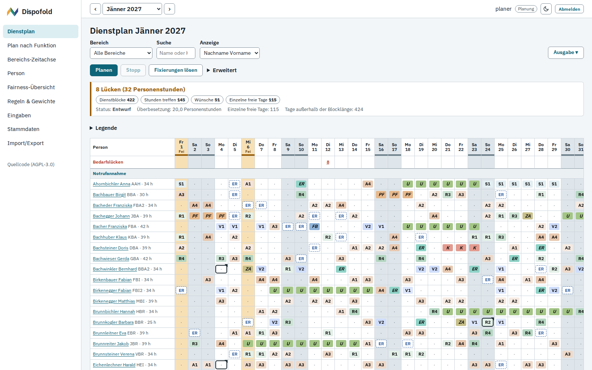

| Bereichs-Zeitachse | Person |
|---|---|
| 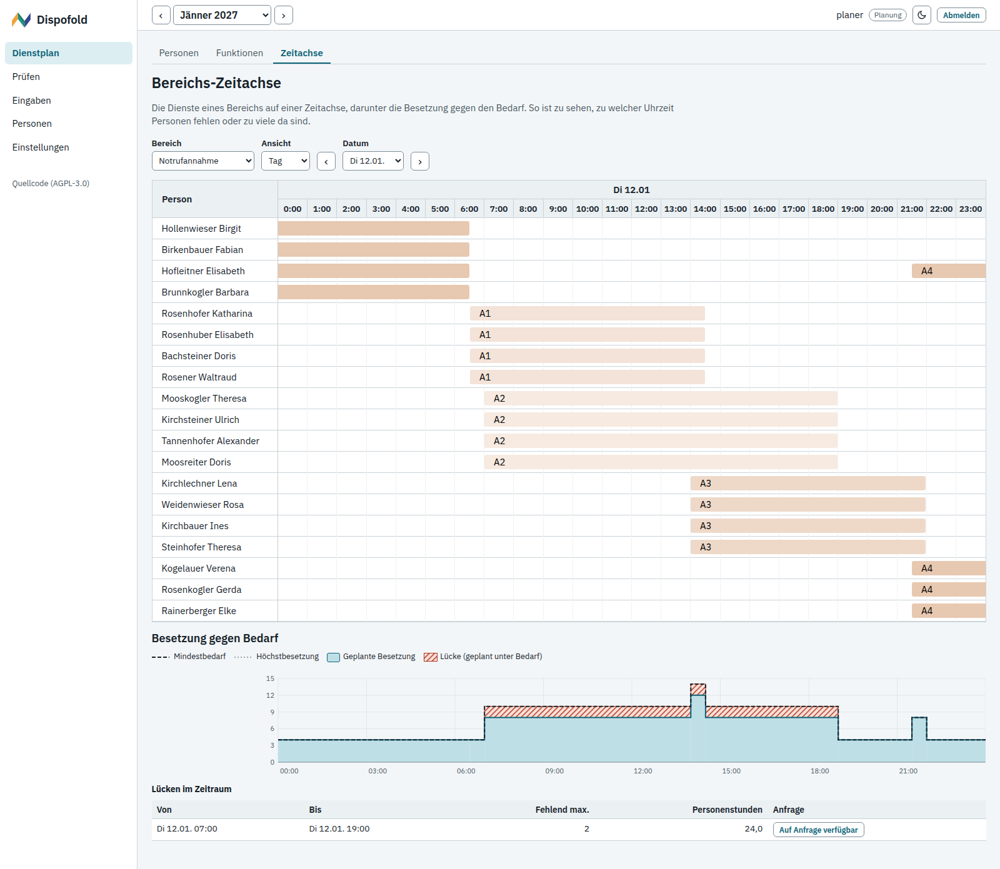 | 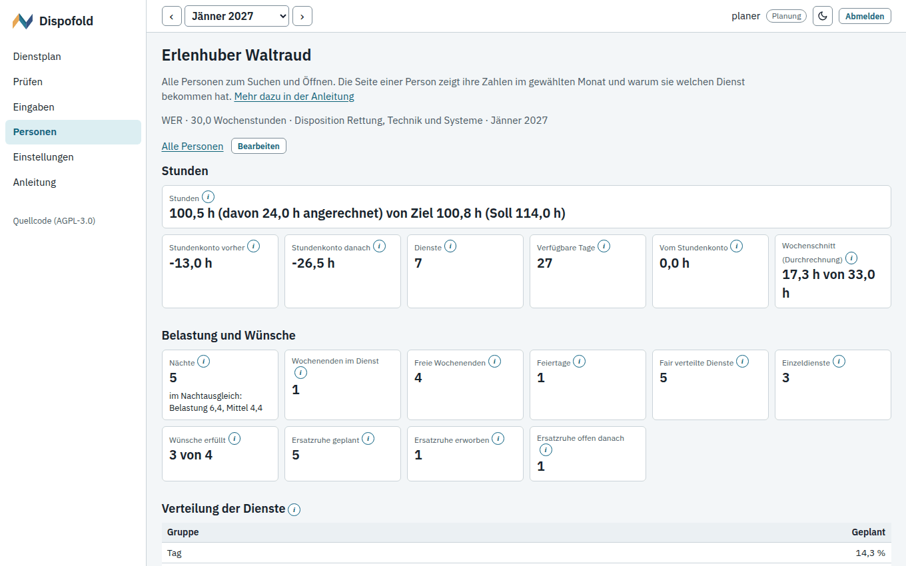 |

| Fairness | Regeln |
|---|---|
| 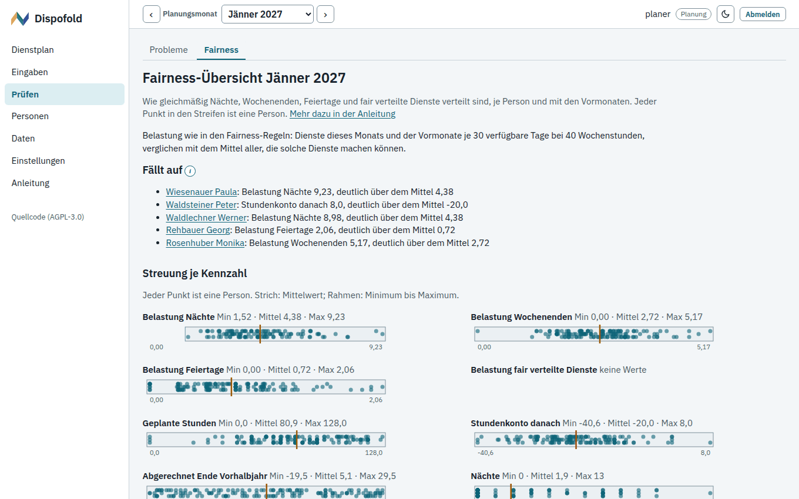 | 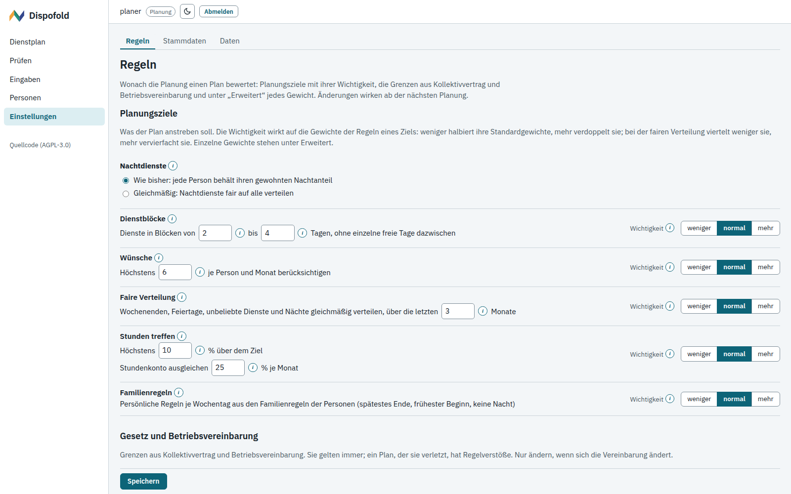 |

| Stammdaten bearbeiten | Plan nach Funktion |
|---|---|
| 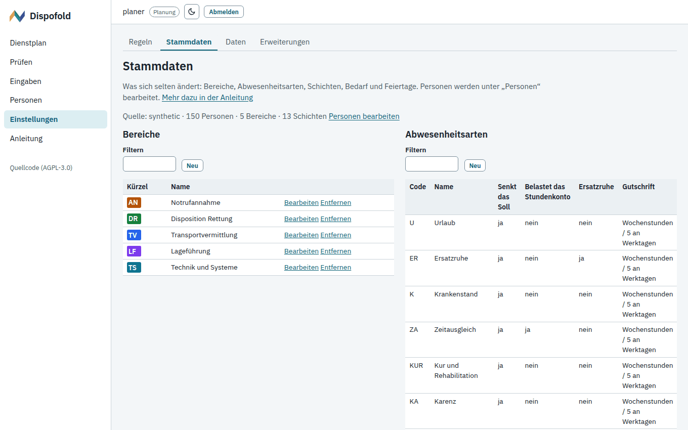 | 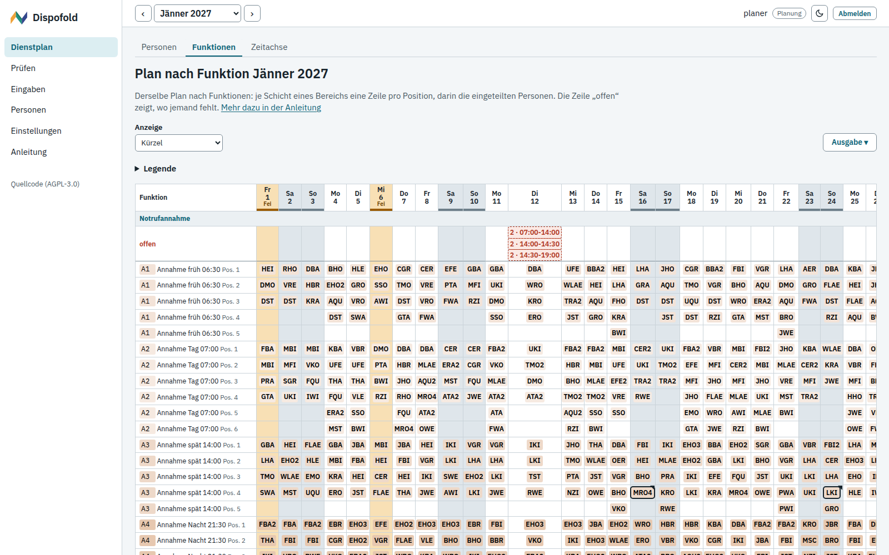 |

| Auf Anfrage verfügbar |
|---|
| 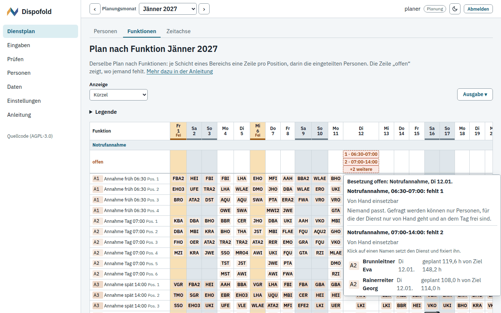 |

| Dienstplan, dunkel | Bereichs-Zeitachse, dunkel |
|---|---|
| 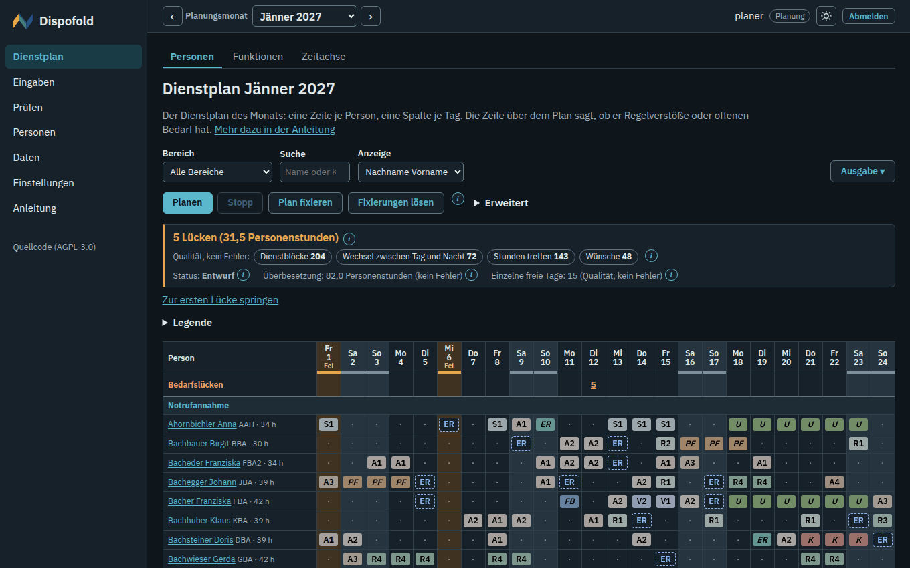 | 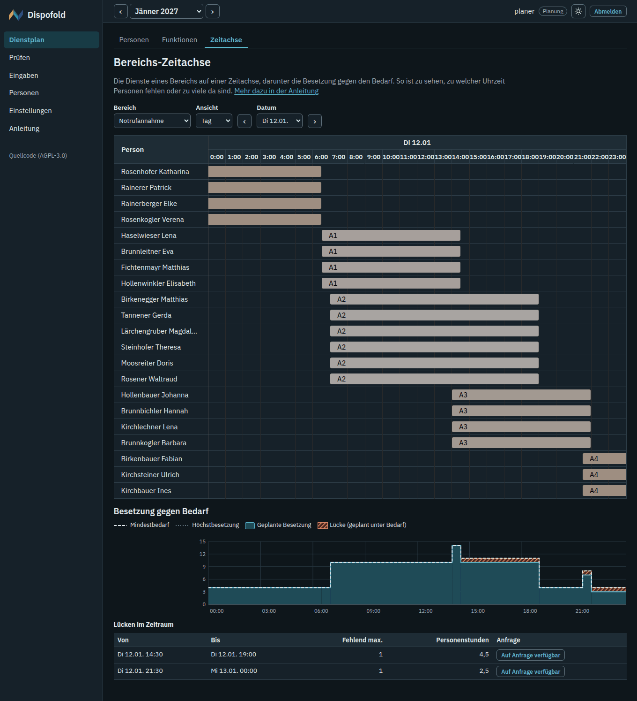 |

| Programmfenster | Programmfenster, dunkel |
|---|---|
| 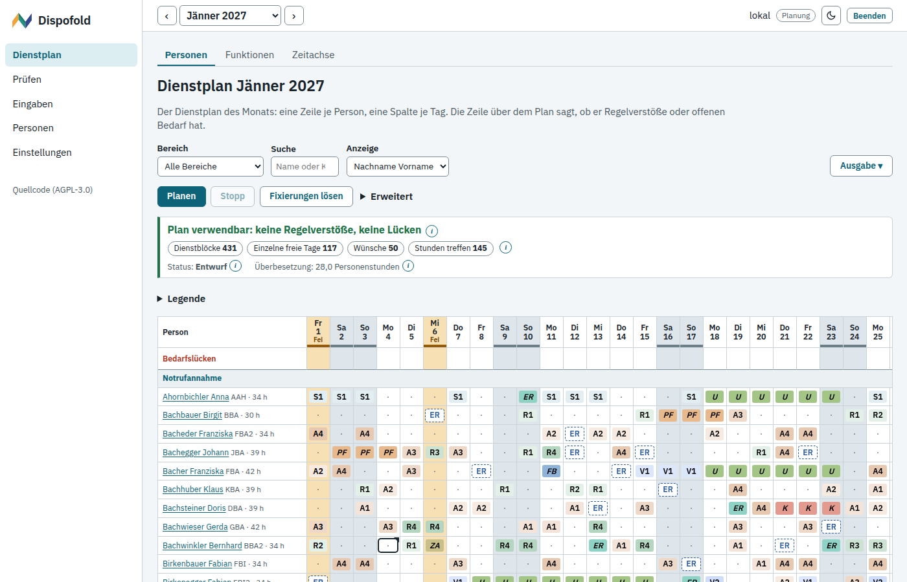 | 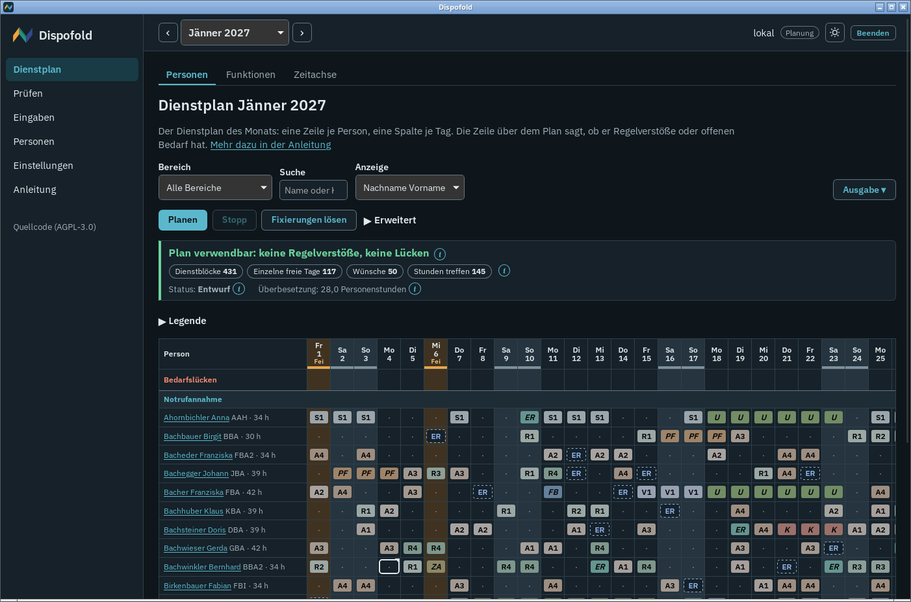 |

Alle Bilder zeigen synthetische Daten.

## Datenschutz

- Echte Daten liegen nur in der Datenbank: am Server in PostgreSQL, am Arbeitsplatz verschlüsselt im
  Datenordner. Sie sind nie Teil des Repositorys. Die CI bricht ab, wenn Datendateien (Datenbanktabellen,
  Sicherungen, Excel, CSV) eingecheckt werden.
- Logs und Fehlermeldungen nennen nur Ids und Codes, keine Namen und keine Pfade.
- Die Rolle `viewer` sieht keine Wünsche, keine Einschränkungen, keine Familienregeln und keinen Grund einer
  Abwesenheit. Exportieren kann nur die Rolle `planner`.
- Keine externen Dienste. Die einzige Verbindung ins Internet zur Laufzeit ist die Suche nach einer neuen
  Version: eine anonyme Anfrage an die Releases-API von GitHub, gesendet werden keine Daten, GitHub sieht nur die
  IP-Adresse. Der Server sucht beim Start und einmal am Tag, abschaltbar mit `DISPOFOLD_UPDATE_CHECK=false`. Die
  Desktop-Version fragt beim ersten Start, ob sie suchen soll, und greift nur mit Zustimmung oder einer selbst
  eingetragenen Update-Quelle aufs Netz zu.

## Entwicklung und Tests

Die CI (`.github/workflows/ci.yml`, ausgeführt von GitHub Actions) führt bei jedem Push alle Prüfungen dieser
Tabelle aus, außer den Screenshots:

| Teil | Befehle |
|---|---|
| Backend | `cd backend && ./mvnw -B test` (braucht Docker für die Test-Datenbank) |
| Backend auf H2 (wie Desktop) | siehe Job `backend-h2` in `.github/workflows/ci.yml` |
| Solver mit 150 Personen | `cd backend && ./mvnw -B test -Dtest=DemoSolveTest -Dsolver.longTest=true` |
| Frontend | `cd frontend && npm ci && npm test && npm run build`; `npm run dev` startet einen Mock-Server |
| Demodaten-Generator | `cd tools/demodata && pip install -r requirements-dev.txt && ruff check . && python -m pytest -q` |
| Programmfenster | `cd desktop-shell && cargo test --locked` (braucht die Entwicklungspakete von WebKitGTK 4.1) |
| Desktop Ende-zu-Ende | `backend/src/test/desktop/e2e.sh`: Selbsttest des Programmfensters aus dem gebauten deb, dazu Update, verändertes Update, Rollback und Passwortwechsel mit Wegwerf-Schlüssel (braucht ein gebautes `frontend/dist`; `DISPOFOLD_E2E_DEB=<deb>` nimmt ein fertiges Paket) |
| Desktop-Pakete | `scripts/desktop/package.sh <version> linux\|windows\|macos <ordner>` (Windows wird unter Linux gebaut) |
| Dokumentations-Website | `pip install -r tools/docs/requirements.txt && mkdocs build --strict` (Ausgabe in `site/`) |
| Repository-Prüfung | `scripts/check-repo.sh` (Text) und `scripts/check-images.sh` (Text in Bildern per OCR, braucht `tesseract-ocr` mit Deutsch und Englisch, `librsvg2-bin`, Pillow); Selbsttest `scripts/test-check-images.sh` |
| Screenshots | auf einem frischen Stack (`docker compose up -d --build --wait`, leere Datenbank, zweiter Benutzer mit Rolle `viewer`): `cd frontend && npx playwright install chromium && npm run build && SEED_DEMO=1 BASE_URL=http://localhost:8080 APP_USER=planer APP_PASSWORD=... VIEWER_USER=leser VIEWER_PASSWORD=... node scripts/screenshots.mjs ../docs/screenshots` (spielt das Beispiel der Anleitung mit Demodaten durch, nimmt alle Bilder der Anleitung und verkleinert sie mit `scripts/optimize-png.py`, braucht `pdftoppm` und Pillow; die Desktop-Bilder kommen vom Dev-Server, `fenster*.png` aus dem echten Programmfenster) |
| Stack mit Rauchtest | `docker compose up -d --build --wait`, dann `scripts/smoke-test.sh http://localhost:8080 planer <passwort>` (ersetzt die Stammdaten durch Demodaten) |

Synthetische Daten erzeugt der Generator in `tools/demodata` (nur für Entwicklung und Tests):
`cd tools/demodata && python -m demodata.generator --month 2027-01 --seed 1 --out demo.json`. Die Demodaten der
Oberfläche sind `tests/fixtures/synthetic/demo-dataset-2027-01.synthetic.json`; das Backend bringt sie mit.

## Lizenz

Copyright (c) 2026 Matthias Schabhüttl. Dispofold steht unter der GNU Affero General Public License, Version 3
(`AGPL-3.0-only`), Volltext in [LICENSE](LICENSE). Wer Dispofold verändert und anderen über ein Netzwerk
zur Verfügung stellt, muss ihnen den Quellcode der veränderten Fassung anbieten (Abschnitt 13). Dafür verweist
die Oberfläche auf der Anmeldeseite und in der Seitenleiste auf den Quellcode; eine veränderte Fassung muss
den Verweis auf ihren eigenen Quellcode richten (`frontend/public/index.html` und `login.html`).

Fremdkomponenten behalten ihre eigenen Lizenzen, alle vereinbar mit der AGPL-3.0: [THIRD_PARTY.md](THIRD_PARTY.md).
