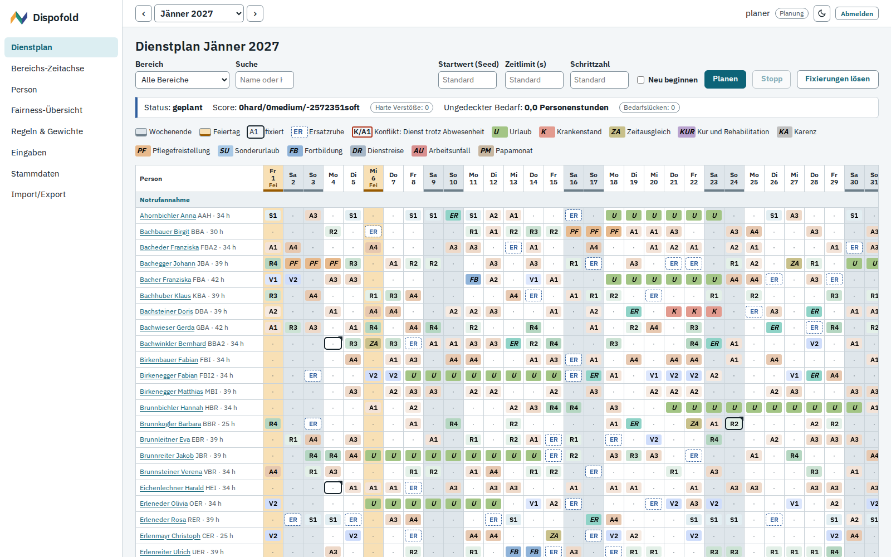
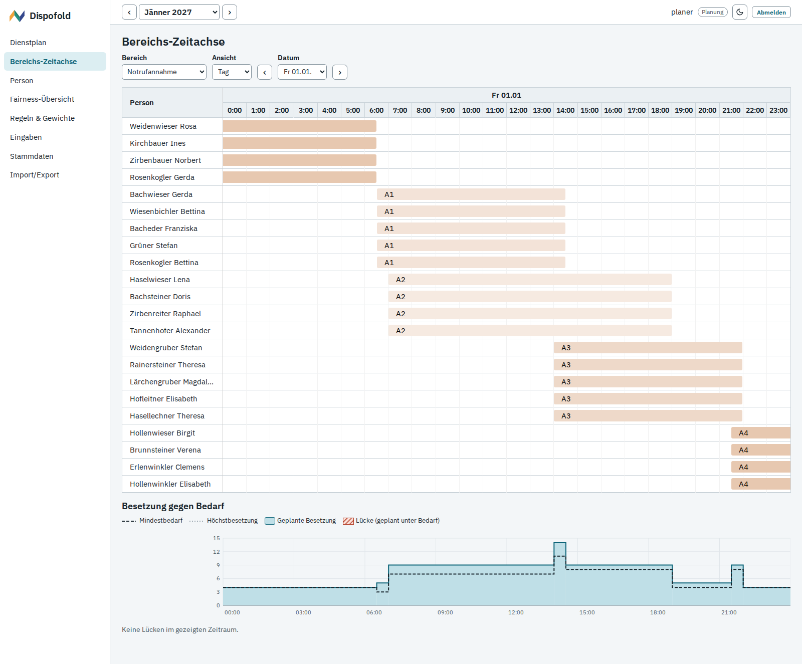
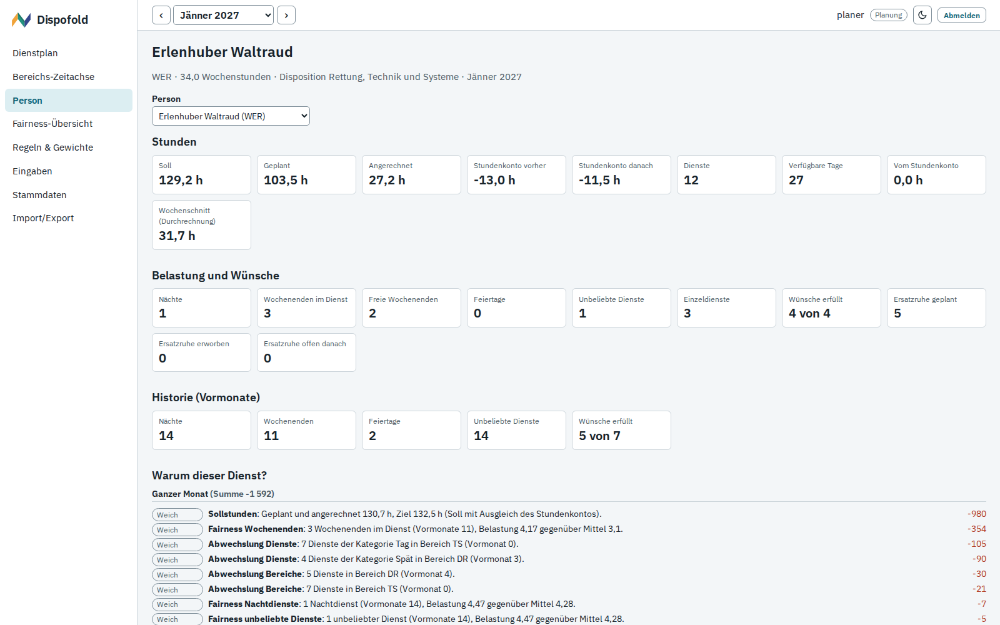
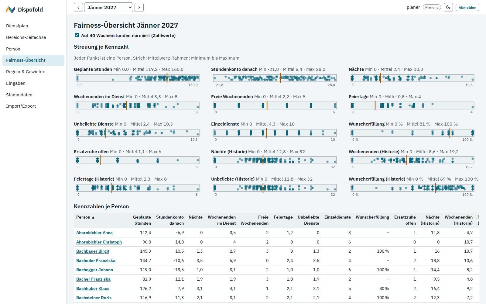
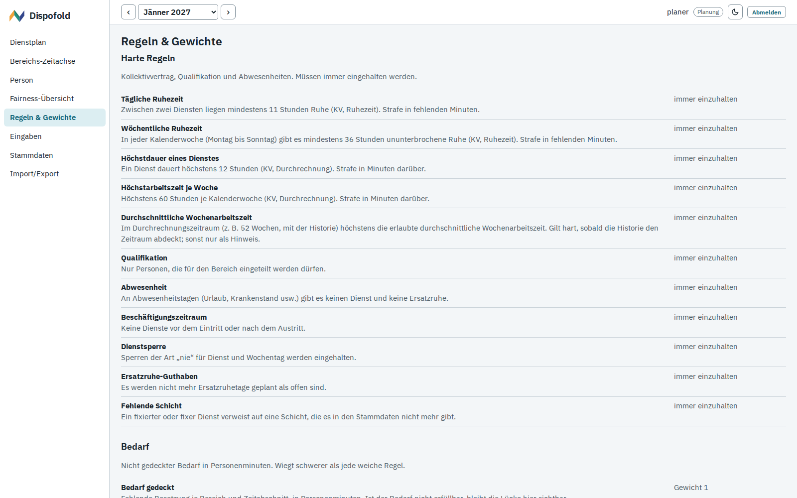
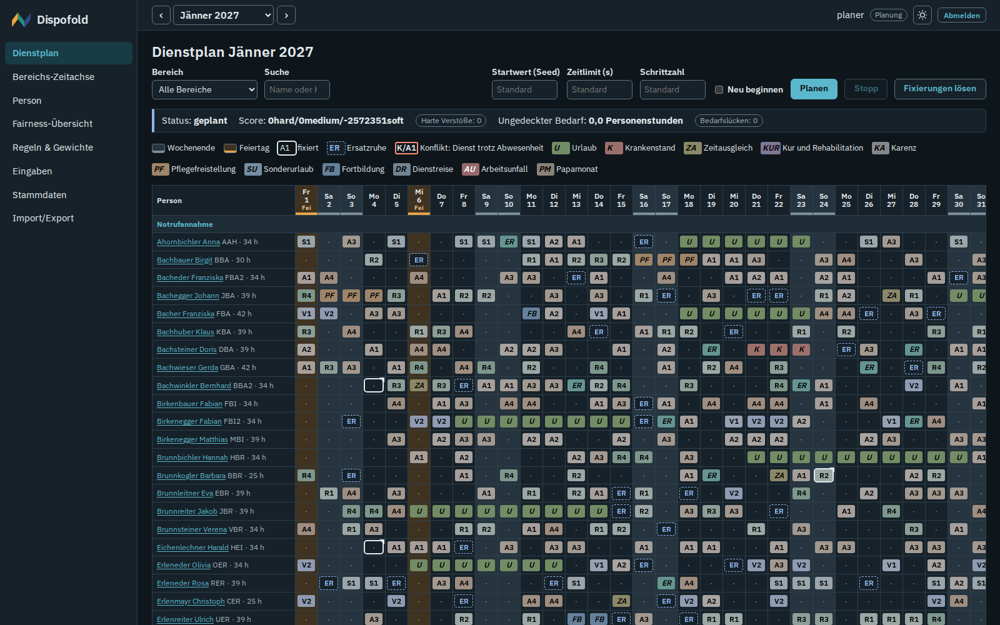
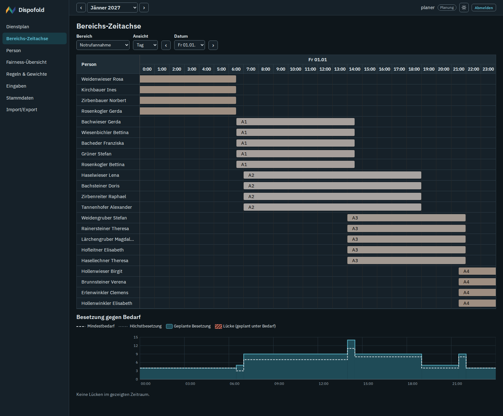
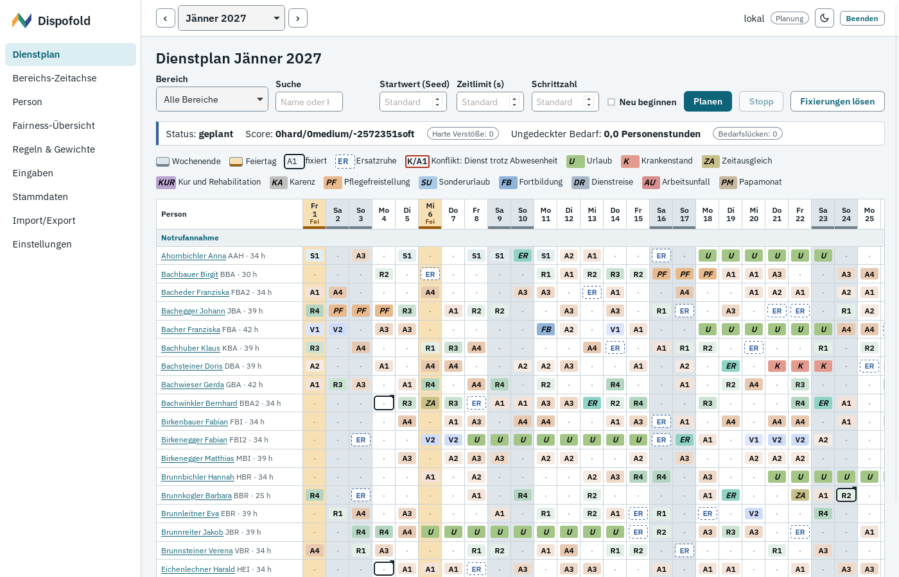
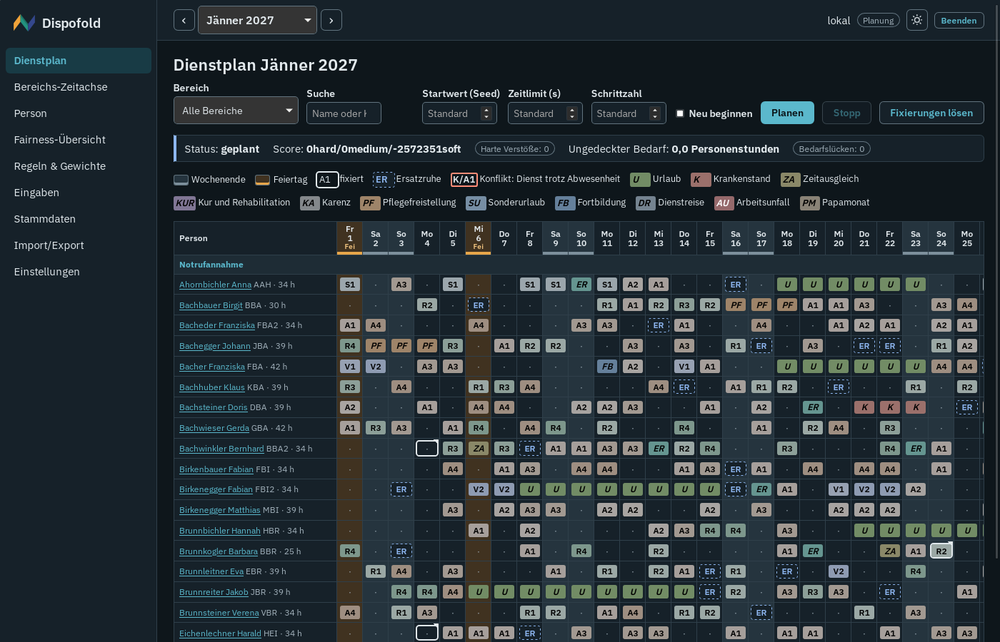

# Dispofold

Dienstplanung für Leitstellen. Ein Solver (Timefold) berechnet den Monatsdienstplan der hauptberuflichen
Mitarbeiterinnen und Mitarbeiter. Die Dienstplanung prüft, ändert, fixiert, schließt ab und exportiert ihn.

- Harte Regeln aus Kollektivvertrag und Qualifikation: 11 h tägliche und 36 h wöchentliche Ruhe, höchstens
  12 h je Dienst, 60 h je Woche und 46,16 h im Durchschnitt des Durchrechnungszeitraums, nur qualifizierte
  Personen, Abwesenheiten und Sperren.
- Bedarf je Bereich und Tageszeit. Der Solver wählt unter den Schichtvarianten des Bereichs. Ist der Bedarf
  nicht erfüllbar, zeigt das Programm die Lücken genau an.
- Weiche Regeln mit sichtbaren Gewichten: Sollstunden, Fairness (Nächte, Wochenenden, Feiertage, unbeliebte
  Dienste, auch über die Vormonate), Wünsche mit gleicher Quote je Person, Blöcke von 2 bis 4 Diensten,
  Vorwärtsrotation, ganze Wochenenden, Ersatzruhe abbauen, Abwechslung, Familienwünsche.
- Für jeden Dienst lässt sich nachlesen, welche Regeln gegriffen haben.
- Import eines Datensatzes im eigenen, dokumentierten JSON-Format. Export als Excel, CSV und JSON.

## Auslieferungen

| Auslieferung | Datei im Release | Für |
|---|---|---|
| Docker-Server | `dispofold-<version>-images.tar.gz` oder Registry, dazu `docker-compose.yml` und `env.example` | mehrere Planerinnen und Planer im Netz, Betrieb durch die IT, Anmeldung mit Benutzer und Rolle |
| Windows-Setup | `Dispofold-<version>-windows-setup.exe` | ein Arbeitsplatz, Installation je Benutzer ohne Adminrechte |
| Windows portabel | `Dispofold-<version>-windows-portable.zip` | ein Arbeitsplatz ohne Installation, Daten im Ordner neben dem Programm |
| Linux-Pakete | `Dispofold-<version>-linux-amd64.deb`, `Dispofold-<version>-linux-x86_64.rpm` | ein Arbeitsplatz |
| macOS | `Dispofold-<version>-macos.dmg` (nur, wenn ein macOS-Runner eingetragen ist) | ein Arbeitsplatz |

Die Desktop-Varianten bringen ihre eigene Java-Laufzeit mit, laufen ohne Server in einem eigenen Programmfenster
(unter Linux standardmäßig im Standardbrowser) und speichern die Daten verschlüsselt mit einem Passwort. Updates
kommen als signierte Update-Pakete, voreingestellt ohne Update-Quelle und damit ganz ohne Netzzugriff. Die
Programme sind nicht mit einem Code-Signing-Zertifikat signiert. Was bei den Warnungen von Windows und macOS zu
tun ist, steht in [docs/betrieb.md](docs/betrieb.md#unsignierte-programme).

## Dokumentation

| Für | Dokument |
|---|---|
| Dienstplanung | [docs/anleitung.md](docs/anleitung.md): planen, prüfen, fixieren, abschließen, exportieren |
| IT | [docs/betrieb.md](docs/betrieb.md): Installation, Update, Sicherung, Deinstallation jeder Auslieferung |
| Betreuung und Releases | [docs/release.md](docs/release.md): CI, Repository-Einstellungen, Release |
| Technik Desktop | [docs/desktop.md](docs/desktop.md): Programmfenster, Launcher, Datenordner, Updates |
| Schnittstelle | [docs/api.md](docs/api.md) |
| Planungsregeln | [docs/regeln.md](docs/regeln.md) |
| Datenformat | [docs/datenformat.md](docs/datenformat.md) |

## Schnellstart mit Docker

Voraussetzung: Linux mit Docker Engine 24 oder neuer und dem Compose-Plugin, 2 CPU-Kerne, 4 GB RAM. Mit fertigen
Images aus dem Release (empfohlen) siehe [docs/betrieb.md](docs/betrieb.md). Aus dem Quellcode:

```bash
git clone https://github.com/mschabhuettl/dispofold.git
cd dispofold
cp .env.example .env && chmod 600 .env
echo "COMPOSE_FILE=docker-compose.yml:docker-compose.build.yml" >> .env   # Images selbst bauen
```

In `.env` echte Geheimnisse eintragen. Das Backend startet nicht mit leeren, zu kurzen oder nach Platzhalter
aussehenden Werten.

```bash
openssl rand -hex 24      # DB_PASSWORD
openssl rand -base64 48   # SESSION_ENCRYPTION_KEY
docker run --rm -it httpd:2.4-alpine htpasswd -nBC 10 planer   # bcrypt-Hash für APP_USERS
```

`APP_USERS` in einfachen Anführungszeichen, `TAG` beliebig (zum Beispiel `dev`):

```bash
TAG=dev
APP_USERS='planer:$2y$10$....:planner,leitung:$2y$10$....:viewer'
```

```bash
docker compose up -d --build
docker compose ps    # nach ein bis zwei Minuten alle Dienste "healthy"
```

Die Oberfläche ist dann unter `http://<server>:8080` erreichbar. Für den Zugriff im Netz gehört ein Reverse Proxy
mit HTTPS davor. Erster Test: anmelden, **Import/Export**, **Demodaten laden**, dann im **Dienstplan** auf
**Planen** klicken. Die Demodaten beschreiben eine erfundene Leitstelle: 150 erfundene Personen in fünf
Bereichen, Jänner 2027.

`scripts/make-env.sh` füllt eine `.env` mit Zufallswerten. Es ist für Teststacks gedacht (CI), nicht für den
Betrieb.

## Bilder



| Bereichs-Zeitachse | Person |
|---|---|
|  |  |

| Fairness | Regeln & Gewichte |
|---|---|
|  |  |

| Dienstplan, dunkel | Bereichs-Zeitachse, dunkel |
|---|---|
|  |  |

| Programmfenster | Programmfenster, dunkel |
|---|---|
|  |  |

Alle Bilder zeigen synthetische Daten.

## Datenschutz

- Echte Daten liegen nur in der Datenbank: am Server in PostgreSQL, am Arbeitsplatz verschlüsselt im
  Datenordner. Sie sind nie Teil des Repositorys. Die CI bricht ab, wenn Datendateien (Datenbanktabellen,
  Sicherungen, Excel, CSV) eingecheckt werden.
- Logs und Fehlermeldungen nennen nur Ids und Codes, keine Namen und keine Pfade.
- Die Rolle `viewer` sieht keine Wünsche, keine Einschränkungen, keine Familienregeln und keinen Grund einer
  Abwesenheit. Exportieren kann nur die Rolle `planner`.
- Keine externen Dienste, keine Aufrufe ins Internet zur Laufzeit. Die Desktop-Version greift nur aufs Netz zu,
  wenn eine Update-Quelle eingetragen ist.

## Entwicklung und Tests

Die CI (`.github/workflows/ci.yml`, ausgeführt von GitHub Actions) führt bei jedem Push alle Prüfungen dieser
Tabelle aus, außer den Screenshots:

| Teil | Befehle |
|---|---|
| Backend | `cd backend && ./mvnw -B test` (braucht Docker für die Test-Datenbank) |
| Backend auf H2 (wie Desktop) | siehe Job `backend-h2` in `.github/workflows/ci.yml` |
| Solver mit 150 Personen | `cd backend && ./mvnw -B test -Dtest=DemoSolveTest -Dsolver.longTest=true` |
| Frontend | `cd frontend && npm ci && npm test && npm run build`; `npm run dev` startet einen Mock-Server |
| Demodaten-Generator | `cd tools/demodata && pip install -r requirements-dev.txt && ruff check . && python -m pytest -q` |
| Programmfenster | `cd desktop-shell && cargo test --locked` (braucht die Entwicklungspakete von WebKitGTK 4.1) |
| Desktop Ende-zu-Ende | `backend/src/test/desktop/e2e.sh`: Selbsttest des Programmfensters aus dem gebauten deb, dazu Update, verändertes Update, Rollback und Passwortwechsel mit Wegwerf-Schlüssel (braucht ein gebautes `frontend/dist`; `DISPOFOLD_E2E_DEB=<deb>` nimmt ein fertiges Paket) |
| Desktop-Pakete | `scripts/desktop/package.sh <version> linux\|windows\|macos <ordner>` (Windows wird unter Linux gebaut) |
| Repository-Prüfung | `scripts/check-repo.sh` (Text) und `scripts/check-images.sh` (Text in Bildern per OCR, braucht `tesseract-ocr` mit Deutsch und Englisch, `librsvg2-bin`, Pillow); Selbsttest `scripts/test-check-images.sh` |
| Screenshots | `cd frontend && npx playwright install chromium && BASE_URL=http://localhost:8080 APP_USER=planer APP_PASSWORD=... MONTH=2027-01 node scripts/screenshots.mjs` |
| Stack mit Rauchtest | `docker compose up -d --build --wait`, dann `scripts/smoke-test.sh http://localhost:8080 planer <passwort>` (ersetzt die Stammdaten durch Demodaten) |

Synthetische Daten erzeugt der Generator in `tools/demodata` (nur für Entwicklung und Tests):
`cd tools/demodata && python -m demodata.generator --month 2027-01 --seed 1 --out demo.json`. Die Demodaten der
Oberfläche sind `tests/fixtures/synthetic/demo-dataset-2027-01.synthetic.json`; das Backend bringt sie mit.

## Lizenz

Copyright (c) 2026 Matthias Schabhüttl. Dispofold steht unter der GNU Affero General Public License, Version 3
(`AGPL-3.0-only`), Volltext in [LICENSE](LICENSE). Wer Dispofold verändert und anderen über ein Netzwerk
zur Verfügung stellt, muss ihnen den Quellcode der veränderten Fassung anbieten (Abschnitt 13). Dafür verweist
die Oberfläche auf der Anmeldeseite und in der Seitenleiste auf den Quellcode; eine veränderte Fassung muss
den Verweis auf ihren eigenen Quellcode richten (`frontend/public/index.html` und `login.html`).

Fremdkomponenten behalten ihre eigenen Lizenzen, alle vereinbar mit der AGPL-3.0: [THIRD_PARTY.md](THIRD_PARTY.md).
