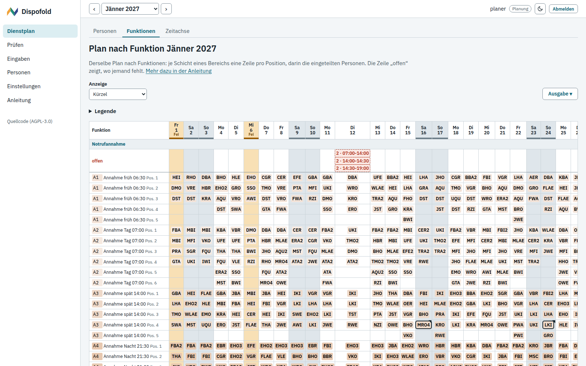
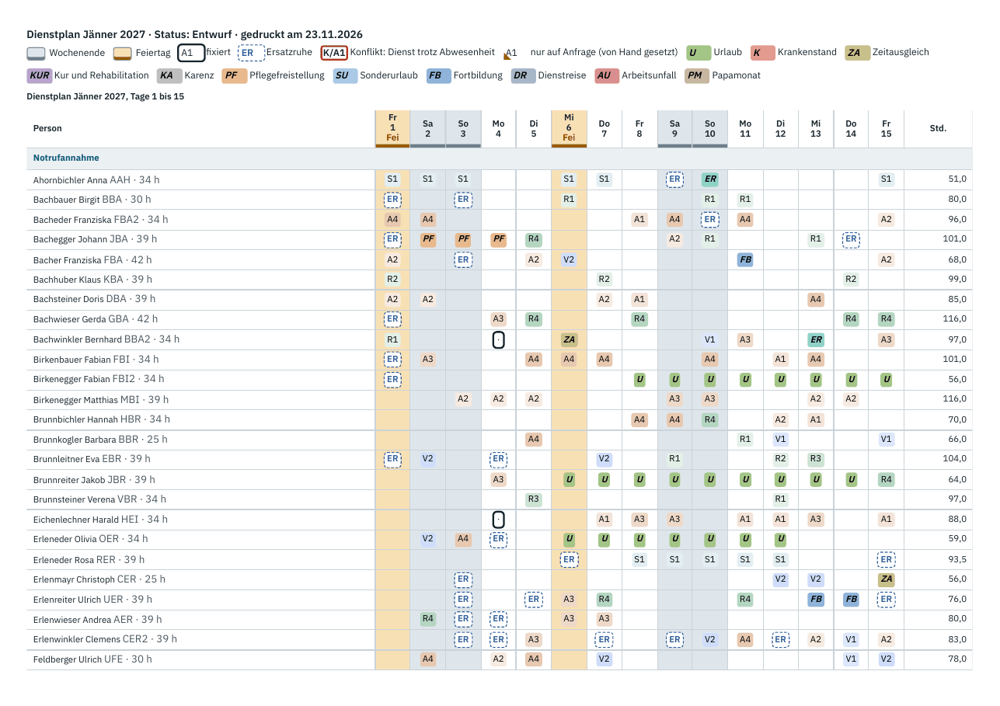
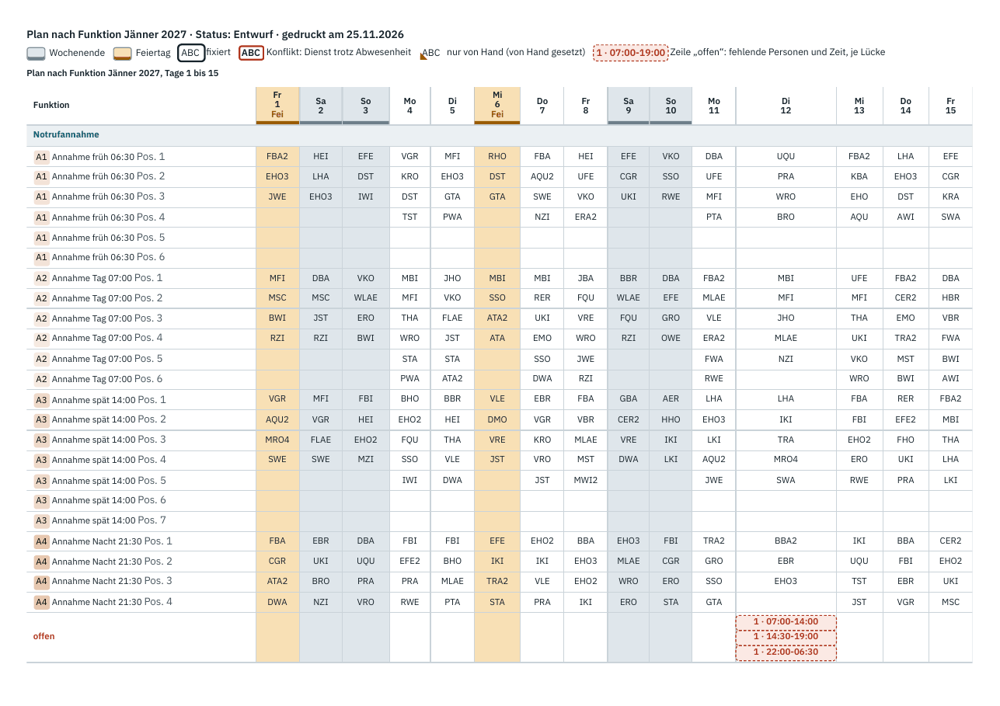

# Anleitung für die Dienstplanung

Diese Anleitung beschreibt die tägliche Arbeit mit Dispofold: Daten laden, einen Monat planen, das Ergebnis
prüfen, von Hand nachbessern, den Monat abschließen und den Plan exportieren. Nach welchen Regeln der Solver
plant, steht in [regeln.md](regeln.md).

Oben auf jeder Seite steht der **Planungsmonat**. Mit den Pfeilen daneben wechselt man den Monat. Alles auf den
Seiten bezieht sich auf den gewählten Monat.

## Anmelden

- **Server (Docker):** Die Adresse kommt von der IT. Benutzername und Passwort eingeben, **Anmelden**.
  **Abmelden** meldet ab. Neben dem Namen steht die Rolle: **Planung** oder **nur lesen**.
- **Programm am eigenen Rechner:** Es gibt keinen Benutzernamen. Beim Start fragt das Programm nach dem Passwort
  der Daten. Beim allerersten Start legt man dieses Passwort fest (mindestens 12 Zeichen, zweimal eingeben).
  **Ohne dieses Passwort sind die Daten verloren.** Es gibt keine Möglichkeit, es wiederherzustellen. Am
  eigenen Rechner hat man immer die Rolle Planung. Beendet wird das Programm mit **Beenden** oder durch Schließen
  des Fensters. Unter Linux öffnet sich die Oberfläche im Standardbrowser. Ein kleines Fenster „Dispofold
  läuft“ hält das Programm dann in Betrieb: **Öffnen** zeigt die Oberfläche wieder im Browser, **Beenden**
  beendet das Programm.

## Daten laden

Unter **Import/Export**:

- **Datensatz importieren:** Eine Datei im Format von [datenformat.md](datenformat.md) auswählen. Der Import
  prüft die ganze Datei. Ist etwas falsch, wird nichts übernommen, und die Liste der Fehler erscheint (nur mit
  Ids, ohne Namen). Ein Import ersetzt die Stammdaten und die Planungsmonate, die in der Datei stehen.
  Vorhandene Pläne bleiben. Ein abgeschlossener Monat kann nicht überschrieben werden.
- **Demodaten laden (Jänner 2027):** Zuerst im Datensatz-Import **Erweitert** öffnen, dann **Demodaten laden**.
  150 erfundene Personen in fünf Bereichen. Gut zum Ausprobieren. Die Demodaten ersetzen alle Stammdaten.

Die Rolle „nur lesen“ sieht **Import/Export** nicht in der Navigation.

**Wenn Stammdaten in Dispofold geändert wurden** (unter **Stammdaten**, siehe unten), würde ein Import diese
Änderungen überschreiben. Das Programm fragt dann nach:

- **Datensatz exportieren:** sichert den jetzigen Stand als Datei (siehe [Exportieren](#exportieren)).
- **Trotzdem importieren:** Der Import ersetzt die Stammdaten, die Änderungen in Dispofold gehen verloren.
- **Abbrechen:** Es wird nichts importiert.

## Stammdaten bearbeiten

Unter **Stammdaten** stehen Personen, Bereiche, Abwesenheitsarten, Schichten, Bedarf und Feiertage. Die Rolle
Planung pflegt sie hier, ein neuer Import ist dafür nicht nötig:

- **Neu** über jeder Tabelle legt einen Eintrag an, **Bearbeiten** und **Entfernen** stehen in jeder Zeile. Es
  ist immer nur ein Formular offen. **Speichern** übernimmt die Änderung sofort, **Abbrechen** verwirft sie.
- **Personen:** Die Tabelle zeigt die Bereiche mit ihrem Namen statt mit dem Kürzel. Das Formular hat Name, Kürzel, Wochenstunden, Bereiche (Namen mit Kürzel), Stundenkonto, offene Ersatzruhe, externe Id, Eintritt
  und Austritt sowie die **Familienregeln** (Wochentage, spätestes Ende, frühester Beginn, keine Nacht, Notiz).
  Mit **Einschränkungen** in der Zeile einer Person legt man fest, welche Schicht oder Kategorie (zum Beispiel
  alle Nachtschichten) sie nie oder nur auf Anfrage macht, an jedem Tag oder an einem Wochentag, auf Wunsch nur
  für eine bestimmte Zeit (gültig ab, gültig bis). Einschränkungen und Familienregeln stehen auch auf der Seite
  **Person**. Was „nur auf Anfrage“ beim Planen bedeutet, steht unter
  [Dienste nur auf Anfrage](#dienste-nur-auf-anfrage).
- **Gewohnte Verteilung:** Im Formular einer Person steht, wie sich ihre Dienste üblicherweise verteilen, in
  Prozent je Schichtart (Früh, Tag, Spät, Nacht) und je Bereich der Person, zum Beispiel Tag 90 % und Nacht 10 %.
  Die Werte stammen aus dem Datensatz, den ein Export aus der Historie liefert (Feld `shiftMix`, siehe
  [datenformat.md](datenformat.md)); im Formular lassen sie sich ändern. Eine ausgefüllte Gruppe muss zusammen
  100 % ergeben, eine leere Gruppe heißt keine Verteilung. **Verteilung entfernen** leert alle Felder, nach dem
  Speichern hat die Person keine gewohnte Verteilung mehr. Die Tabelle zeigt sie kurz an („Tag 90 %, Nacht 10 %“);
  die Felder je Bereich nennen den Bereich mit Namen und Kürzel.
  Beim Planen versucht die Regel „Gewohnte Verteilung“, die Dienste je Schichtart und Bereich an diese Anteile
  anzunähern. Was mit dem Nachtanteil geschieht, hängt von der Einstellung **Nachtdienste** auf der Seite
  **Regeln & Gewichte** ab: Bei „Wie bisher“ ergeben sich die Nächte einer Person mit Anteilen je Schichtart aus
  ihrem Nachtanteil, sie ist nicht in der Fairness Nachtdienste (dem „Nachtausgleich“) und nicht in „Abwechslung
  Dienste“. Bei „Gleichmäßig“ zählt der Nachtanteil nicht: Die Person ist im Nachtausgleich, die übrigen Anteile
  (Früh, Tag, Spät) gelten für ihre Dienste außer Nächten. In beiden Fällen ist nicht im Nachtausgleich, wer nie
  Nacht macht: eine Einschränkung „nie“ für jeden Tag auf alle Nachtschichten der eigenen Bereiche (als
  Schichtart Nacht oder Schicht für Schicht) oder eine Familienregel „keine Nacht“ an allen sieben Wochentagen.
  Für Personen mit Anteilen je Bereich gilt
  die Abwechslung Bereiche nicht. Auf der Seite **Person** stehen geplanter und gewohnter Anteil nebeneinander. Die
  Rolle „nur lesen“ sieht die Verteilung nicht. Mehr dazu in [regeln.md](regeln.md).
- **Ids:** Neue Personen und Schichten bekommen ihre Id vom Programm (`PN1`, `SN1`, ...). Bereiche und
  Abwesenheitsarten haben als Id ihr Kürzel, das im Plan steht. Es wird beim Anlegen eingegeben und lässt sich
  danach nicht mehr ändern. Ein entferntes Kürzel bleibt gesperrt und kann nicht neu vergeben werden.
- **Bedarf** gilt entweder an bestimmten Tagen (Montag bis Sonntag, Feiertag) oder an einem Datum.
- Das Programm prüft jede Änderung wie einen Import. Ist etwas falsch, wird nichts gespeichert, und die Liste
  der Fehler erscheint im Formular.

**Entfernen:**

- Wird ein Eintrag noch verwendet (in offenen Monaten oder in anderen Stammdaten, zum Beispiel eine Schicht in
  Einschränkungen oder im Plan), nennt das Programm die Zahl der Verweise und die Monate und fragt, ob er mit
  allen Verweisen entfernt werden soll.
- Kommt ein Eintrag in einem abgeschlossenen Monat vor, lässt er sich nicht entfernen. Bei Personen trägt man
  stattdessen den Austritt ein.
- Ein Bereich lässt sich erst entfernen, wenn seine Schichten entfernt sind. Während einer Planung sind
  Änderungen an betroffenen Monaten gesperrt.
- Offene Monate, die eine Änderung betrifft, zeigen danach „Plan veraltet: neu planen“.

**Wenn jemand anderer inzwischen Stammdaten gespeichert hat**, fragt das Programm wie bei den Eingaben nach:
**OK** übernimmt die eigene Änderung in die neue Fassung, **Abbrechen** verwirft sie und lädt die neue Fassung.
Wurde derselbe Eintrag auch von der anderen Person geändert, speichert das Programm nicht von selbst: Die eigenen
Angaben stehen wieder im Formular, sie sind zu prüfen und noch einmal zu speichern.

## Eingaben des Monats

Unter **Eingaben** stehen für den gewählten Monat:

- **Abwesenheiten:** Person, Datum und Art (zum Beispiel Urlaub oder Krankenstand). An diesen Tagen plant der
  Solver keinen Dienst.
- **Wünsche:** frei, Dienst, eine bestimmte Schicht oder eine bestimmte Schicht nicht. Je Person zählen
  höchstens so viele Wünsche, wie unter **Regeln & Gewichte** eingestellt ist (Standard 6), und zwar die ersten
  nach Datum. Die Spalte **Wünsche der Person** zeigt, wenn es zu viele sind.
- **Vorgaben:** Dienste, die fest vorgegeben sind. Der Solver ändert sie nicht.

Mit **Hinzufügen** und **Entfernen** ändert man die Listen, mit **Speichern** übernimmt man sie. Solange etwas
nicht gespeichert ist, steht **Ungespeicherte Änderungen** da.

**Wenn jemand anderer inzwischen gespeichert hat** (nur im Serverbetrieb mit mehreren Planerinnen und Planern
möglich), fragt das Programm beim Speichern nach:

- **OK:** Die eigenen Änderungen werden in die neue Fassung übernommen. Hat die andere Person denselben Eintrag
  (gleiche Person, gleicher Tag) anders geändert, gilt die eigene Änderung. Die Meldung nennt, wie viele Einträge
  das betrifft. Danach die Eingaben prüfen und noch einmal **Speichern**.
- **Abbrechen:** Die eigenen Änderungen werden verworfen, die neue Fassung wird geladen.

## Einen Monat planen

Unter **Dienstplan**:

1. **Planen** startet den Solver. Er rechnet im Hintergrund, die Laufzeit steht oben in der Statuszeile. Während
   der Planung ist der Plan gesperrt: Zellen, Export und Monatsabschluss gehen erst danach.
2. Die Planung endet von selbst nach der Schrittzahl, spätestens nach dem Zeitlimit. **Stopp** beendet sie
   früher. Der beste Stand bis dahin bleibt erhalten.

Einstellungen unter **Erweitert** neben **Planen**, **Stopp** und **Fixierungen lösen** (zugeklappt; alle optional, ein
leeres Feld nimmt den voreingestellten Wert; dort steht auch der Score):

- **Startwert (Seed):** voreingestellt 1. Gleiche Daten, gleicher Ausgangsplan, gleicher Startwert und gleiche
  Schrittzahl ergeben denselben Plan, sofern die Planung vor dem Zeitlimit endet. Weil eine neue Planung auf
  dem gespeicherten Plan aufbaut, gilt das für eine Wiederholung nur mit **Neu beginnen**. Ein anderer
  Startwert ergibt einen anderen, ähnlich guten Plan.
- **Schrittzahl:** Obergrenze der Rechenschritte, voreingestellt 250 000.
- **Zeitlimit (s):** Sicherheitsnetz für die Rechenzeit, voreingestellt 300 Sekunden.

Die voreingestellten Werte legt im Serverbetrieb die IT fest (siehe [betrieb.md](betrieb.md)).
- **Neu beginnen:** Der gespeicherte Plan wird nicht als Ausgangspunkt genommen. Nur fixierte Dienste bleiben.
  Ohne dieses Häkchen baut eine neue Planung auf dem gespeicherten Plan auf.

## Das Ergebnis lesen

Oben im **Dienstplan** steht die Statuszeile:

- **Überschrift** in Farbe: grün „Plan verwendbar: keine Regelverstöße, keine Lücken“, gelb die Zahl der Lücken
  mit den fehlenden Personenstunden, rot die Zahl der Regelverstöße. Der Score erscheint beim
  Darüberfahren und unter **Erweitert**.
- **Regeln mit Treffern** darunter: je Regel der Gruppe Regelverstoß mit Verstößen und je Qualitätsregel mit einem großen Anteil am
  Score Qualität (mindestens 10 %, höchstens die fünf größten) ein Knopf mit der Zahl der Treffer. Ein Klick
  listet Person und Tag mit einer kurzen Erklärung; ein Klick auf einen Eintrag öffnet die Seite **Person**.
- **Legende:** über dem Plan, zugeklappt; ein Klick öffnet sie, der Browser merkt sich die Wahl.

Die Begriffe im Einzelnen:

- **Regelverstöße:** Muss 0 sein. Die Regeln der Gruppe Regelverstoß sind Ruhezeiten, Höchstarbeitszeiten,
  Qualifikation und Abwesenheiten. Ein Plan mit Regelverstößen darf so nicht verwendet werden. Meist kommen sie von Hand
  gesetzten oder fixierten Diensten. Rot markierte Zellen zeigen einen Dienst trotz Abwesenheit. Welche Regel
  an welchem Tag verletzt ist, zeigt die Seite **Person**.
- **Freie Sonntage:** Jede Person hat im Kalendermonat mindestens zwei Sonntage ohne Dienst. Die Zahl steht
  unter **Regeln & Gewichte**, **Gesetz und Betriebsvereinbarung** (nach **Ändern**: **Freie Sonntage je Monat**);
  0 schaltet die Regel aus. Ein Sonntag ist nur
  frei, wenn kein Dienst ihn berührt, auch kein Nachtdienst von Samstag auf Sonntag; Urlaub und andere
  Abwesenheiten zählen als frei. Von Hand gesetzte Dienste dürfen die Regel verletzen und zählen dann als
  Regelverstoß.
- **Höchststunden im Monat:** Die Stunden einer Person im Monat (Dienste, angerechnete Abwesenheitstage und
  Ersatzruhe) dürfen das Ziel (Soll mit Ausgleich des Stundenkontos) höchstens um eine Toleranz übersteigen,
  voreingestellt 10 % des Ziels. Die Toleranz steht unter **Regeln & Gewichte** im Planungsziel **Stunden
  treffen** („höchstens 10 % über dem Ziel“); die gesetzlichen Grenzen wie die Höchstarbeitszeit je Woche gelten unabhängig davon. Das Programm plant
  nie darüber. Ein von Hand gesetzter Dienst darf darüber gehen, zählt dann aber als Regelverstoß und steht auf
  der Seite **Person** unter **Ganzer Monat**. Die Liste **Auf Anfrage verfügbar** lässt Personen aus, die
  der Dienst über diese Grenze brächte.
- **Verkleinertes Ziel:** Braucht der Bedarf weniger Arbeit, als die Ziele aller Personen zusammen ergeben,
  strebt das Programm ein verkleinertes Ziel an: Der Arbeitsanteil jedes Ziels (Ziel ohne angerechnete
  Abwesenheitstage) schrumpft um denselben Anteil. So muss niemand Stunden über den Bedarf hinaus sammeln, und
  der Plan kann zusammenhängende Dienstblöcke bevorzugen und einzelne freie Tage zwischen Diensten vermeiden.
  Die Obergrenze (Höchststunden im Monat, ein Regelverstoß) rechnet weiter mit dem echten Ziel. Die Seite **Person** zeigt
  in einer Kachel die geplanten Stunden gegen das verkleinerte Ziel und das Soll („28,0 h von Ziel 112,9 h
  (Soll 129,2 h)“); **Was bedeuten Soll und Ziel?** erklärt beide. Die Zeile **Warum dieser Dienst?** nennt beide
  Ziele. Für Lesende ist das Ziel ausgeblendet, weil es das Stundenkonto enthält.
- **Bedarfslücken:** Zeitabschnitte, in denen weniger Personen eingeteilt sind als der Bedarf verlangt. Die
  Zeile **Bedarfslücken** direkt unter den Tagen zeigt sie je Tag und bleibt beim Scrollen stehen; die
  Überschrift nennt ihre Zahl und die Summe in Personenstunden. In der Statuszeile steht **Überbesetzung**: Personenstunden über der Höchstbesetzung (wo keine gesetzt
  ist, über der Mindestbesetzung) und Dienste, die keinen Bedarf abdecken. Lücken sind kein Fehler des Solvers:
  Reicht das Personal nicht, bleibt die Lücke sichtbar, statt dass ein Regelverstoß entsteht. Ein Klick auf die Zahl eines Tages listet die Lücken dieses
  Tages mit Bereich, Uhrzeit und fehlender Besetzung, jeweils mit der Liste **Auf Anfrage verfügbar** (siehe
  [Dienste nur auf Anfrage](#dienste-nur-auf-anfrage)).
- **Einzelne freie Tage / Tage außerhalb der Blocklänge:** Zwei Kennzahlen der Statuszeile nach der Planung.
  **Einzelne freie Tage** zählt freie Tage, die zwischen zwei Diensten liegen (wenig Erholung). **Tage außerhalb
  der Blocklänge** zählt die Tage, um die Dienstblöcke kürzer oder länger sind als bevorzugt. Beide sollen klein
  sein; sie sind keine Fehler, sondern Maß für die Güte des Plans.
- **Score:** Die Bewertung in drei Gruppen: Regelverstoß, Bedarf, Qualität (unter **Erweitert**). Bedarf umfasst ungedeckten
  Bedarf und Besetzung über dem Bedarf, beides in der Statuszeile in Personenstunden. Eine fehlende Minute wiegt schwerer als
  jeder ganze Dienst über dem Bedarf: Ist jemand frei, wird eine Lücke immer zuerst gefüllt. Besetzung über dem
  Bedarf wiegt schwerer als jede Qualitätsregel: Wer unter seinem Soll liegt, bleibt darunter, statt dass Stellen
  doppelt besetzt werden. Einzelheiten in [regeln.md](regeln.md).

Weitere Seiten:

- **Plan nach Funktion:** derselbe Monat, aber je Funktion statt je Person, siehe
  [Plan nach Funktion](#plan-nach-funktion).
- **Bereichs-Zeitachse:** Dienste eines Bereichs als Tag oder Woche und die Besetzung gegen den Bedarf. Lücken
  sind rot markiert und darunter als Liste mit Uhrzeit und fehlender Besetzung aufgeführt. **Auf Anfrage
  verfügbar** in einer Zeile der Liste klappt darunter die Personen auf, die man für diese Lücke fragen kann.
- **Person:** Eine Person auswählen. Die Seite zeigt die geplanten Stunden gegen Ziel und Soll, Stundenkonto vorher
  und danach, Nächte, Wochenenden, Feiertage, unbeliebte Dienste, erfüllte Wünsche und Ersatzruhe. Unter **Warum
  dieser Dienst?** steht für jeden Tag (oder **Ganzer Monat**) in Worten, was zutrifft (zum Beispiel „verletzt
  keine Regel, 1 Wunsch erfüllt“), darunter welche Regeln gegriffen haben, mit ihrer Gruppe (**Regelverstoß**,
  **Bedarf**, **Qualität**) und ob es ein Verstoß, ein Nachteil oder ein Vorteil ist.
- **Fairness-Übersicht:** Alle Personen nebeneinander, je Kennzahl mit Minimum, Mittelwert und Maximum, auch über
  die Vormonate (Historie). Mit **Auf 40 Wochenstunden normiert** werden Teilzeitkräfte vergleichbar. Bei der
  Fairness zählt die Abweichung vom Mittelwert: Ein Treffer in der Erklärung erscheint nur bei Personen über dem
  Mittelwert. Personen außerhalb des Nachtausgleichs sind markiert, mit dem Grund (gewohnte Verteilung oder nie
  Nacht). Die Seite **Person** zeigt in der Kachel **Nächte**, ob die Person ihrer gewohnten Verteilung folgt, nie
  Nacht macht oder im Nachtausgleich ist, dann mit ihrer Belastung und dem Mittel aller Verglichenen.
- **Regeln & Gewichte:** drei Abschnitte.
  - **Planungsziele:** oben die Einstellung **Nachtdienste**: „Wie bisher“ (jede Person behält ihren gewohnten
    Nachtanteil, Standard) oder „Gleichmäßig“ (Nachtdienste fair auf alle verteilen). Ist „Wie bisher“ gewählt und
    das Gewicht von **Gewohnte Verteilung** 0, warnt die Seite: Personen mit gewohnter Verteilung haben dann keine
    Regel für Nachtdienste. Darunter die Ziele **Dienstblöcke** (Blöcke von ... bis ... Tagen), **Wünsche**
    (höchstens ... je Person), **Faire Verteilung** (Wochenenden, Feiertage, unbeliebte Dienste und Nächte, über
    die letzten ... Monate), **Stunden treffen** (höchstens ... % über dem Ziel, Stundenkonto ausgleichen ... % je
    Monat) und **Familienregeln**, jedes mit einer **Wichtigkeit**: **weniger**, **normal** oder **mehr** setzt die
    Gewichte der Regeln dieses Ziels auf das 0,5-, 1- oder 2-Fache ihres Standards (auf ganze Zahlen gerundet).
    Wurde ein Gewicht des Ziels unter **Erweitert** von Hand geändert, steht dort **angepasst**; die Wahl einer
    Wichtigkeit überschreibt diese Gewichte wieder.
  - **Gesetz und Betriebsvereinbarung:** Ruhezeiten, Höchstdauer eines Dienstes, Höchstarbeitszeit je Woche,
    Höchststunden im Monat, durchschnittliche Wochenarbeitszeit mit dem Durchrechnungszeitraum, freie Sonntage
    und Ersatzruhe für Feiertagsdienste, als Text. Erst **Ändern** macht die Felder bearbeitbar. Die tägliche
    Ruhezeit kann nicht unter 11 Stunden gesetzt werden.
  - **Erweitert** (zugeklappt): die Nachtzeit (Beginn, Ende, Mindeststunden) und alle Regeln mit Beschreibung,
    nach Qualität, Regelverstoß und Bedarf. Die Gewichte der Qualitätsregeln sind Zahlenfelder mit dem
    Standardwert und **Zurücksetzen**; bei den Regeln eines Planungsziels steht, zu welchem Ziel sie gehören. Das
    Gewicht von **Dienst nur auf Anfrage** ist fest („fest“ statt eines Zahlenfelds): Solche Dienste plant das
    Programm ohnehin nie selbst ein.

  Die Beschreibungen der Regeln nennen die eingestellten Werte und folgen der Eingabe. Die Leiste mit
  **Speichern** bleibt beim Blättern sichtbar und zeigt **Nicht gespeichert**, solange Änderungen offen sind; wer
  die Seite dann verlässt, wird gefragt. Regeln, die mit einer älteren Version gespeichert wurden, laden
  unverändert; ohne Einstellung der Nachtdienste gilt „Wie bisher“.

## Plan nach Funktion

Unter **Plan nach Funktion** steht derselbe Monat wie im **Dienstplan**, aber je Funktion: Eine Funktion ist
eine Schicht eines Bereichs. Die Spalten sind die Tage des Monats (Wochenenden und Feiertage hinterlegt wie im
Dienstplan), die Zeilen die Funktionen, nach Bereichen gruppiert. Gezeigt werden Schichten mit mindestens einem
Dienst im Monat und Schichten, deren Zeit ein Bedarf des Bereichs überschneidet.

- **Eine Zeile je Position:** Arbeiten an einem Tag zwei Personen in derselben Schicht, stehen sie in zwei
  Zeilen untereinander (nach Namen sortiert). Eine Schicht hat so viele Zeilen, wie an ihrem vollsten Tag
  Personen eingeteilt sind.
- **In der Zelle** steht das Kürzel der Person, der ganze Name erscheint beim Darüberfahren. Unter **Anzeige**
  lässt sich stattdessen „Nachname Vorname“ wählen; der Browser merkt sich die Wahl. Fixierte Dienste,
  Konflikte und Dienste nur auf Anfrage sind markiert wie im Dienstplan.
- **Zeile „offen“** (rot): Hat ein Bereich im Monat Bedarfslücken, steht direkt unter seinem Namen eine Zeile
  „offen“. Beim Scrollen bleiben Name und Zeile „offen“ des obersten Bereichs unter den Tagen stehen. Jede Lücke steht dort genau einmal, am Tag ihres Beginns (eine Lücke von 19:00 bis 07:00 also am
  ersten Tag), mit der Zahl der fehlenden Personen und der Uhrzeit, zum Beispiel „1 · 07:00-19:00“. Mehrere
  Lücken eines Tages stehen untereinander in derselben Zelle.
- **Ein Klick auf einen Namen** öffnet dieselbe Auswahl wie im Dienstplan (Dienst ändern, frei, fixieren).
  **Ein Klick auf eine Zelle der Zeile „offen“** öffnet die Liste **Auf Anfrage verfügbar** für die Lücken
  dieses Tages.
- Mit den Pfeiltasten bewegt man sich wie im Dienstplan durch die Zellen, Enter öffnet die Auswahl.
- **Drucken:** siehe [Drucken](#drucken).

## Drucken

**Dienstplan** und **Plan nach Funktion** haben oben rechts das Menü **Ausgabe** mit **Drucken**. Er öffnet den Druckdialog
des Browsers (im Desktop-Programm den Druckdialog des Systems) mit einer eigenen Druckansicht; die Druckfunktion
des Browsers (Strg+P) liefert dasselbe. Im Dialog lässt sich auch „Als PDF speichern“ wählen.

- **Papier:** A4 quer. Der Monat steht in zwei Tabellen, Tag 1 bis 15 und Tag 16 bis zum Monatsende; jede
  Hälfte beginnt auf einer neuen Seite. Reicht eine Hälfte über mehrere Seiten, steht der Tabellenkopf auf jeder
  Seite.
- **Kopf:** eine Zeile mit Ansicht und Monat, dem Stand des Plans („Entwurf“ oder „abgeschlossen“) und dem
  Druckdatum, darunter eine kurze Legende der Markierungen.
- **Ohne Bedienelemente:** Menü, Kopfleiste, Schaltflächen und Statuszeile werden nicht gedruckt; gedruckt wird
  immer hell auf weißem Papier, auch im dunklen Design.
- **Dienstplan:** dieselben Personen in derselben Reihenfolge und Gruppierung wie am Bildschirm (also auch mit
  gewähltem **Bereich** oder einer **Suche**). In den Zellen stehen die Kürzel der Schichten, Abwesenheiten mit
  ihrem Kürzel, Ersatzruhe als „ER“; Wochenenden und Feiertage sind hinterlegt, fixierte Dienste eingerahmt,
  Konflikte rot. Neben dem Namen stehen die Wochenstunden, rechts die geplanten Stunden des Monats (**Std.**),
  unten die Zeile **Bedarfslücken** mit der Zahl der Lücken je Tag.
- **Plan nach Funktion:** die Funktionen nach Bereichen wie am Bildschirm, die Zeile „offen“ mit den Lücken
  wird mitgedruckt.
- **Anzeige:** Beide Ansichten haben die Auswahl **Anzeige** („Kürzel“ oder „Nachname Vorname“); der Druck
  zeigt die Namen so, wie sie gewählt sind. Im **Dienstplan** ist „Nachname Vorname“ voreingestellt, im **Plan
  nach Funktion** „Kürzel“. Der Browser merkt sich die Wahl je Ansicht.
- **Rolle „nur lesen“:** gedruckt wird nur, was diese Rolle auch am Bildschirm sieht (Abwesenheiten als „ABW“).

## Dienste nur auf Anfrage

Eine Einschränkung „nur auf Anfrage“ (unter **Stammdaten**, **Einschränkungen**) heißt: Das Programm plant
diese Schicht für diese Person nie von selbst ein. Fehlt dadurch Personal, bleibt die Lücke im Plan stehen.
Die Planung fragt die Person und setzt den Dienst dann von Hand.

- **Auf Anfrage verfügbar:** Diese Liste steht bei jeder Lücke: im **Dienstplan** nach einem Klick auf die
  Zahl in der Zeile **Bedarfslücken**, in **Plan nach Funktion** nach einem Klick auf eine Zelle der Zeile „offen“ und in der
  Lückenliste der **Bereichs-Zeitachse**. Sie nennt die Personen, für die eine Schicht des Bereichs in dieser
  Lücke an diesem Tag nur auf Anfrage geht, die an dem Tag frei sind (kein Dienst, keine Abwesenheit, nicht
  fixiert) und für die der Dienst keinen Regelverstoß ergibt (auch nicht die Höchststunden im Monat). Je Person stehen Schicht, Datum und Stunden
  (geplant von Soll); wer am wenigsten Stunden hat, steht oben. Passt niemand, sagt die Liste das.
- **Ein Klick auf einen Namen** setzt den Dienst für diese Person und fixiert ihn. Die nächste Planung behält
  ihn bei.
- Im Plan ist ein solcher Dienst unten links mit einer kleinen Ecke markiert (**nur auf Anfrage**). Er zählt
  nicht als Regelverstoß.

## Von Hand ändern und fixieren

Eine Zelle im **Dienstplan** anklicken (oder mit den Pfeiltasten hingehen und Enter drücken). Es öffnet sich
eine Auswahl:

- Einen Dienst, **frei** oder **Ersatzruhe** wählen. Eine von Hand gesetzte Zelle ist danach **fixiert**: Die
  nächste Planung behält sie bei.
- **Fixieren** oder **Fixierung lösen** schaltet die Fixierung einer Zelle um, ohne den Dienst zu ändern.
- **Fixierungen lösen** (oben) löst alle Fixierungen des Monats. Vorgaben aus den **Eingaben** bleiben
  dabei erhalten. Sie lassen sich nur unter **Eingaben** entfernen.
- Abwesenheiten werden nicht im Plan geändert, sondern unter **Eingaben**.

Ein von Hand gesetzter Dienst kann eine Regel der Gruppe Regelverstoß verletzen. Dann steigen die **Regelverstöße**. Vor dem
Abschluss prüfen.

## Hinweis „Plan veraltet: neu planen“

Neben dem Status kann der Hinweis **Plan veraltet: neu planen** stehen. Er bedeutet: Der Plan passt nicht mehr
ganz zu den Daten, bitte neu planen. Der Grund steht im Tooltip:

- Eingaben (Abwesenheiten, Wünsche, Vorgaben), Stammdaten, Regeln oder Gewichte wurden nach dieser Planung
  geändert, oder die Historie der Vormonate.
- Der Plan des Vormonats wurde nach dieser Planung geändert. Die Ruhezeiten am Monatsanfang hängen von den
  letzten Diensten des Vormonats ab, deshalb nimmt der Solver sie aus dem gespeicherten Plan des Vormonats.

## Monatsabschluss

Unter **Import/Export**, **Monat abschließen**, oder im **Dienstplan** im Menü **Ausgabe**. Vorher sollte der Plan
fertig sein: keine Regelverstöße, Lücken geklärt. Der Dialog prüft das in einer Liste: Regelverstöße, offene
Lücken, Plan veraltet. Ist ein Punkt offen, lässt sich der Monat erst nach dem Häkchen **Trotzdem abschließen**
abschließen.

- **Was gespeichert wird:** Je Person die Kennzahlen des Monats (Nächte, Wochenenden, Feiertage, unbeliebte
  Dienste, Wünsche), die geplanten Stunden, das Stundenkonto nach dem Monat und die Ersatzruhe nach dem Monat
  (genommen und neu erworben, ein Dienst an einem Feiertag bringt einen Ersatzruhetag). Diese Werte sind die
  Grundlage für Fairness und Stundenkonto der Folgemonate. Von außen importierte Ist-Werte haben Vorrang und
  werden nie überschrieben.
- **Reihenfolge:** Monate werden der Reihe nach abgeschlossen. Gibt es einen Plan für den Vormonat, muss dieser
  zuerst abgeschlossen sein.
- **Abgeschlossen heißt nur lesen:** Plan, Eingaben und Import sind für diesen Monat gesperrt. Der Status zeigt
  **abgeschlossen**.
- **Wieder öffnen:** **Monat wieder öffnen** auf derselben Seite. Monate werden von hinten her geöffnet: Ist der
  Folgemonat abgeschlossen, muss er zuerst wieder geöffnet werden. Beim Öffnen verlassen die Abschlusswerte die
  Historie. Beim erneuten Abschließen werden sie neu geschrieben.

## Exportieren

Unter **Import/Export**, **Datensatz exportieren**, speichert man alle Stammdaten und Planungsmonate als Datei
im Format von [datenformat.md](datenformat.md). Die Datei lässt sich später wieder importieren. Sie enthält
personenbezogene Daten (auch Stundenkonten, Einschränkungen und Familienregeln) und ist entsprechend sicher
aufzubewahren.

Ebenfalls unter **Import/Export**, **Plan exportieren**, als XLSX (Excel), CSV oder JSON, oder im Menü **Ausgabe** der
beiden Planansichten. Im Programmfenster der Desktop-Version
landet die Datei im Ordner Downloads, eine Meldung nennt den Namen.

- Nur die Rolle Planung kann exportieren. Während einer Planung ist der Export gesperrt.
- Hat der Plan Regelverstöße, endet der Dateiname auf `-mit-verstoessen`. In XLSX heißt das Blatt
  „Dienstplan mit Verstößen“ und trägt den Hinweis „Achtung: … Regelverstöße, Plan nicht verwendbar“ (Text der Exportdatei); in
  CSV steht dieser Hinweis in der ersten Zeile.
- **Plan importieren** auf derselben Seite ersetzt den Plan des Monats durch einen früher exportierten Plan im
  JSON-Format.

## Rolle „nur lesen“

Im Serverbetrieb gibt es neben der Planung die Rolle **nur lesen** (`viewer`). Sie sieht Dienstplan, Plan nach
Funktion, Zeitachse, Personen und Fairness, kann aber nichts ändern, nicht planen, nicht abschließen und nicht
exportieren; **Import/Export** steht in ihrer Navigation nicht. Aus Datenschutzgründen sieht sie außerdem nicht:

- Wünsche und die Quote erfüllter Wünsche,
- Einschränkungen und Familienregeln von Personen (auch nicht die Markierung „nur auf Anfrage“ und nicht die
  Liste **Auf Anfrage verfügbar**),
- den Grund einer Abwesenheit (sie erscheint nur als „abwesend“),
- das Stundenkonto.
