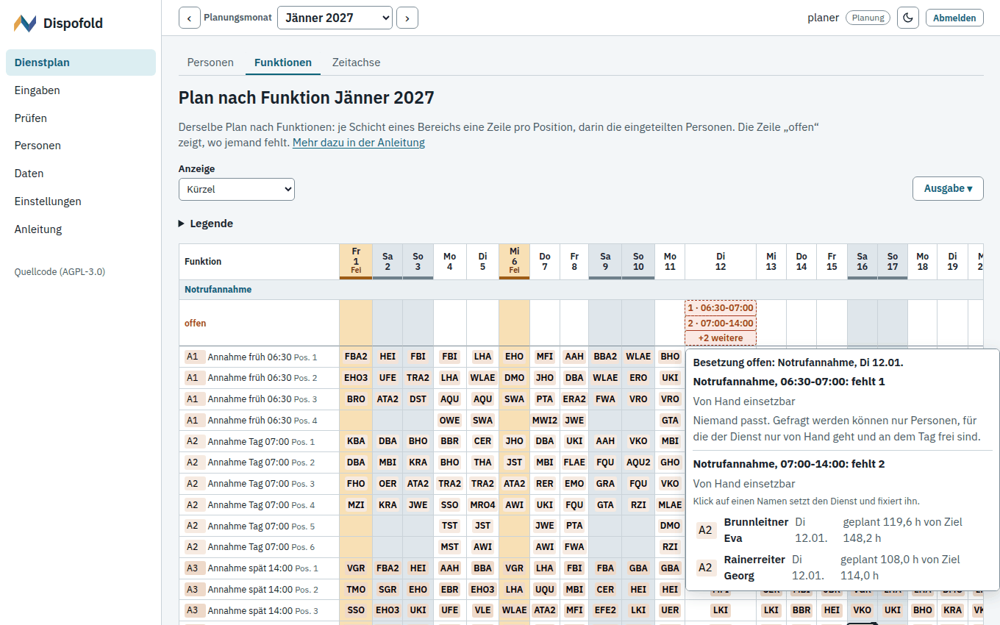
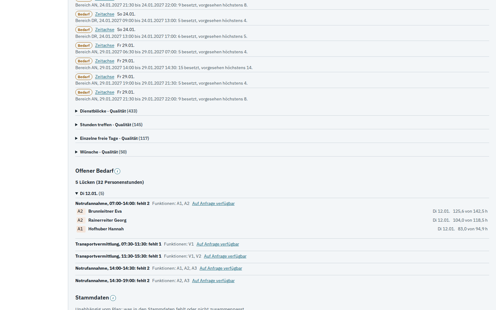
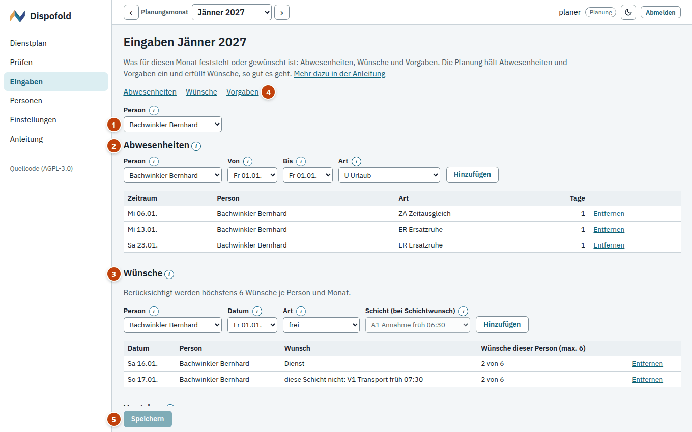
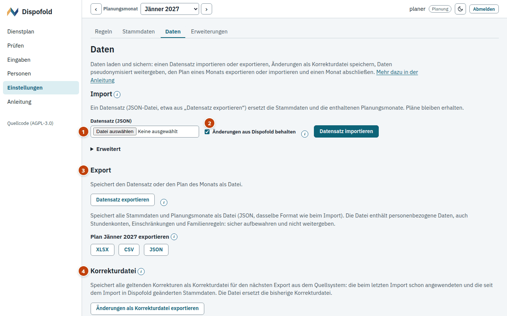

# Anleitung für die Dienstplanung

Diese Anleitung beschreibt die Arbeit mit Dispofold: wie das Programm plant, wie ein Monat abläuft und was auf
jeder Seite steht. Die Regeln, nach denen der Solver plant, stehen im Einzelnen in [regeln.md](regeln.md), das
Format der Datensätze in [datenformat.md](datenformat.md).

## So funktioniert es

**Was hineingeht:**

- **Stammdaten:** Personen (mit Wochenstunden, Bereichen, Stundenkonto, Einschränkungen, Familienregeln und
  gewohnter Verteilung), Bereiche, Schichten, Bedarf je Bereich und Tageszeit, Abwesenheitsarten und Feiertage.
  Sie ändern sich selten und kommen meist als Datensatz aus dem Quellsystem.
- **Eingaben des Monats:** Abwesenheiten, Wünsche und Vorgaben.
- **Regeln:** Grenzen aus Kollektivvertrag und Betriebsvereinbarung (Ruhezeiten, Höchstarbeitszeiten, freie
  Sonntage) und die Planungsziele mit ihren Gewichten.
- **Historie:** die Zahlen der abgeschlossenen Vormonate (Nächte, Wochenenden, Feiertage, unbeliebte Dienste,
  erfüllte Wünsche, Stundenkonto, Ersatzruhe).

**Was herauskommt:** ein Dienstplan für den Monat, eine Zelle je Person und Tag: frei, ein Dienst aus den
Schichten ihrer Bereiche oder ein Ersatzruhetag.

**Wie der Solver abwägt.** Er bewertet jeden Plan in drei Gruppen, die streng nacheinander zählen:

1. **Regelverstoß:** Ruhezeiten, Höchstarbeitszeiten, Höchststunden im Monat, freie Sonntage, Qualifikation,
   Abwesenheiten, Sperren. Muss 0 sein. Ein Plan mit Regelverstößen darf so nicht verwendet werden.
2. **Bedarf:** fehlende Besetzung (Lücken) und Besetzung über dem Bedarf, in Personenminuten. Eine fehlende
   Minute wiegt schwerer als jeder ganze Dienst über dem Bedarf.
3. **Qualität:** Stunden treffen, faire Verteilung, Wünsche, Dienstblöcke, Familienregeln, gewohnte Verteilung
   und weitere Regeln, jede mit einem einstellbaren Gewicht.

Ein Plan mit weniger Regelverstößen ist immer besser, egal wie es um Bedarf und Qualität steht; bei gleich vielen
Regelverstößen entscheidet der Bedarf, erst dann die Qualität. Reicht das Personal nicht, bleibt deshalb eine
Lücke sichtbar, statt dass ein Regelverstoß entsteht. Und wer unter seinem Soll liegt, bleibt darunter, statt dass
Stellen doppelt besetzt werden.

**Soll und Ziel.** Das **Soll** sind die vertraglichen Stunden des Monats (Wochenstunden durch 5 je Arbeitstag).
Das **Ziel** ist das Soll, korrigiert um einen Teil des Stundenkontos (ein Plus senkt es, ein Minus erhöht es).
Braucht der Bedarf weniger Arbeit, als alle Ziele zusammen ergeben, plant das Programm gegen ein verkleinertes
Ziel: Jedes Ziel schrumpft um denselben Anteil, so muss niemand Stunden über den Bedarf hinaus sammeln.

**Was fest ist und was nur gewünscht.**

- **Vorgaben** (unter **Eingaben**) sind Dienste oder freie Tage, die fest gelten. Der Solver ändert sie nicht.
- **Fixiert** ist eine Zelle im Plan, die die nächste Planung beibehält. Jede von Hand gesetzte Zelle ist
  fixiert. Fixierungen lassen sich lösen, Vorgaben nicht (sie werden nur unter **Eingaben** entfernt).
- **Abwesenheiten** sind ebenfalls fest: An diesen Tagen gibt es keinen Dienst.
- **Wünsche** erfüllt der Solver, so gut es geht, und verteilt die Erfüllung gleichmäßig auf alle.
- **Familienregeln** (persönliche Regeln je Wochentag) und die **gewohnte Verteilung** sind Qualitätsregeln: Sie
  werden eingehalten, wenn es geht.
- **Nur auf Anfrage:** Eine Schicht mit dieser Einschränkung plant das Programm für die Person nie selbst ein.
  Siehe [Dienste nur auf Anfrage](#dienste-nur-auf-anfrage).

**Monate und Historie.** Jeder Monat hat seine Eingaben und seinen Plan. Ein Plan ist zuerst **Entwurf**: Er kann
geändert und neu geplant werden. Ist der Monat fertig, wird er **abgeschlossen**: Seine Zahlen kommen in die
Historie, er ist danach nur lesbar. Die Historie zählt für die Fairness und die Wünsche der Folgemonate, das
Stundenkonto und die Ersatzruhe nach dem Monat für den nächsten. Die letzten Dienste des Vormonats zählen für die
Ruhezeiten am Monatsanfang. Monate werden der Reihe nach abgeschlossen.

### Anmelden

- **Server (Docker):** Die Adresse kommt von der IT. Benutzername und Passwort eingeben, **Anmelden**.
  **Abmelden** meldet ab. Neben dem Namen steht die Rolle: **Planung** oder **nur lesen**.
- **Programm am eigenen Rechner:** Es gibt keinen Benutzernamen. Beim Start fragt das Programm nach dem Passwort
  der Daten. Beim allerersten Start legt man dieses Passwort fest (mindestens 12 Zeichen, zweimal eingeben).
  **Ohne dieses Passwort sind die Daten verloren.** Es gibt keine Möglichkeit, es wiederherzustellen. Am
  eigenen Rechner hat man immer die Rolle Planung. Beendet wird das Programm mit **Beenden** oder durch Schließen
  des Fensters. Unter Linux öffnet sich die Oberfläche im Standardbrowser. Ein kleines Fenster „Dispofold
  läuft“ hält das Programm dann in Betrieb: **Öffnen** zeigt die Oberfläche wieder im Browser, **Beenden**
  beendet das Programm.

### Menü, Planungsmonat und Hilfe

Links steht das Menü: **Dienstplan**, **Prüfen**, **Eingaben**, **Personen** und **Einstellungen**. Hat ein
Menüpunkt mehrere Seiten, stehen sie als Reiter oben auf der Seite (zum Beispiel **Personen**, **Funktionen** und
**Zeitachse** im Dienstplan).

Auf den Seiten eines Monats steht oben der **Planungsmonat**. Mit den Pfeilen daneben wechselt man den Monat.
Alles auf diesen Seiten bezieht sich auf den gewählten Monat. Seiten, die nicht von einem Monat abhängen (Regeln,
Stammdaten, Updates), zeigen die Auswahl nicht.

Unter jedem Seitentitel sagt ein kurzer Text, wozu die Seite da ist. Ein **i** neben einer Regel, einer
Einstellung, einer Zahl oder einem Formularfeld öffnet eine Erklärung: was die Zahl zählt oder was ein höherer
oder niedrigerer Wert bewirkt. Das **i** geht mit Klick, Tippen oder Tastatur (Tab, dann Enter oder Leertaste);
Escape oder ein Klick daneben schließt die Erklärung.

## Typischer Ablauf

Ein Monat, von den Daten bis zum Abschluss:

1. **Daten laden** (einmal und nach jedem neuen Export aus dem Quellsystem): unter **Einstellungen**, **Daten**
   den Datensatz importieren. Was sich selten ändert (Schichten, Bedarf, Feiertage), pflegt man unter
   **Einstellungen**, **Stammdaten**, die Personen unter **Personen**. Siehe [Daten](#daten).
2. **Eingaben erfassen:** unter **Eingaben** die Abwesenheiten (Urlaub, Krankenstand), die Wünsche und die
   Vorgaben des Monats eintragen und **Speichern**. Siehe [Eingaben](#eingaben).
3. **Planen:** im **Dienstplan** auf **Planen** klicken. Der Solver rechnet einige Minuten im Hintergrund. Siehe
   [Planen](#planen).
4. **Prüfen:** Die Zeile über dem Plan sagt, ob er verwendbar ist. Unter **Prüfen** stehen alle Regelverstöße,
   der offene Bedarf mit den Personen, die man fragen kann, und Auffälligkeiten in den Stammdaten. Siehe
   [Prüfen](#prüfen).
5. **Von Hand nachbessern:** Zellen im Dienstplan ändern, Lücken mit Diensten auf Anfrage füllen, bei Bedarf
   noch einmal **Planen** (die von Hand gesetzten Zellen bleiben dabei fixiert). Siehe
   [Von Hand ändern und fixieren](#von-hand-ändern-und-fixieren).
6. **Drucken und exportieren:** im **Dienstplan** das Menü **Ausgabe**: **Drucken** oder Export als XLSX, CSV
   oder JSON. Siehe [Drucken](#drucken) und [Exportieren](#exportieren).
7. **Monat abschließen:** im Menü **Ausgabe** oder unter **Einstellungen**, **Daten**. Die Zahlen des Monats
   kommen in die Historie, der nächste Monat baut darauf auf. Siehe [Monatsabschluss](#monatsabschluss).

### Neuer Datensatz, Änderungen aus Dispofold behalten

Wer Personen, Einschränkungen oder Bedarf in Dispofold ändert und später einen neuen Datensatz aus dem
Quellsystem importiert, würde diese Änderungen überschreiben. Dafür gibt es zwei Wege, die man auch zusammen
verwenden kann:

1. **Beim Import behalten:** unter **Einstellungen**, **Daten** den neuen Datensatz wählen, das Häkchen
   **Änderungen aus Dispofold behalten** setzen (es ist gesetzt, sobald seit dem letzten Import etwas geändert
   wurde) und **Datensatz importieren**. Eine Vorschau nennt, wie viele Änderungen übernommen werden, wo auch der
   neue Datensatz etwas geändert hat (dort gilt der Wert aus Dispofold) und was nicht übernommen werden kann.
   **Jetzt importieren** führt den Import aus.
2. **Im Quellsystem nachtragen:** **Änderungen als Korrekturdatei exportieren** speichert die Änderungen seit dem
   letzten Import als Datei `korrekturen.json`. Das Exportprogramm wendet sie bei jedem weiteren Export an, so
   kommen sie mit jedem neuen Datensatz wieder mit. Was die Datei nicht ausdrücken kann (zum Beispiel in
   Dispofold neu angelegte Personen), steht darunter als Liste: Das ist im Quellsystem nachzutragen.

Behalten werden Änderungen an Personen (Wochenstunden, Bereiche, Stundenkonto, Ersatzruhe, Eintritt und
Austritt, gewohnte Verteilung, Familienregeln), an ihren Einschränkungen, entfernte Personen und der Bedarf je
Bereich. Nicht behalten werden neu angelegte Personen, geänderte Namen und Kürzel sowie Änderungen an Bereichen,
Schichten, Abwesenheitsarten und Feiertagen.

## Dienstplan

Der Dienstplan hat drei Reiter: **Personen** (eine Zeile je Person, eine Spalte je Tag), **Funktionen** (derselbe
Plan je Schicht, siehe [Plan nach Funktion](#plan-nach-funktion)) und **Zeitachse** (siehe
[Bereichs-Zeitachse](#bereichs-zeitachse)).

Über dem Plan stehen **Bereich** (nur die Personen eines Bereichs), **Suche** (Name oder Kürzel) und **Anzeige**
(„Nachname Vorname“ oder „Kürzel“ in der ersten Spalte; der Browser merkt sich die Wahl). Rechts steht das Menü
**Ausgabe** mit **Drucken**, dem Export als XLSX, CSV und JSON und **Monat abschließen**. Die **Legende** über dem
Plan ist zugeklappt; ein Klick öffnet sie, der Browser merkt sich die Wahl.

In den Zellen stehen die Kürzel der Schichten, Abwesenheiten mit ihrem Kürzel und Ersatzruhe als „ER“.
Wochenenden und Feiertage sind hinterlegt, fixierte Zellen eingerahmt, ein Dienst trotz Abwesenheit ist rot. Die
Zeile **Bedarfslücken** direkt unter den Tagen zeigt die Zahl der Lücken je Tag und bleibt beim Scrollen stehen.

### Planen

1. **Planen** startet den Solver. Er rechnet im Hintergrund, die Laufzeit steht in der Zeile über dem Plan.
   Während der Planung ist der Plan gesperrt: Zellen, Export und Monatsabschluss gehen erst danach.
2. Die Planung endet von selbst nach der Schrittzahl, spätestens nach dem Zeitlimit. **Stopp** beendet sie
   früher. Der beste Stand bis dahin bleibt erhalten.

Eine neue Planung baut auf dem gespeicherten Plan auf. **Fixierungen lösen** löst alle Fixierungen des Monats;
Vorgaben aus den **Eingaben** bleiben dabei erhalten.

Unter **Erweitert** (zugeklappt; alle Felder optional, ein leeres Feld nimmt den voreingestellten Wert):

- **Startwert (Seed):** Gleiche Daten, gleicher Ausgangsplan, gleicher Startwert und gleiche Schrittzahl ergeben
  denselben Plan, sofern die Planung vor dem Zeitlimit endet. Ein anderer Startwert ergibt einen anderen, ähnlich
  guten Plan.
- **Zeitlimit (s):** Sicherheitsnetz für die Rechenzeit.
- **Schrittzahl:** Obergrenze der Rechenschritte.
- **Neu beginnen:** Der gespeicherte Plan wird nicht als Ausgangspunkt genommen, nur fixierte Dienste und
  Vorgaben bleiben. Hilft, wenn der Plan in einer schlechten Lösung festsitzt. Eine Wiederholung mit demselben
  Ergebnis gelingt nur mit diesem Häkchen.
- **Score:** die Bewertung des Plans in den drei Gruppen.

Die voreingestellten Werte (im Serverbetrieb Startwert 1, 250 000 Schritte, 300 Sekunden) legt die IT fest
(siehe [betrieb.md](betrieb.md)).

### Das Ergebnis lesen

Die Zeile über dem Plan:

- **Überschrift** in Farbe: grün „Plan verwendbar: keine Regelverstöße, keine Lücken“, gelb die Zahl der Lücken
  mit den fehlenden Personenstunden (fehlende Personen mal Stunden), rot die Zahl der Regelverstöße.
- **Regeln mit Treffern** darunter: je Regel mit Regelverstößen und je Qualitätsregel mit großem Anteil an der
  Bewertung (höchstens die fünf größten) ein Knopf mit der Zahl der Treffer. Ein Klick listet Person und Tag mit
  einer kurzen Erklärung; ein Klick auf einen Eintrag öffnet die Seite der Person. Die ganze Liste steht unter
  [Prüfen](#prüfen).
- **Status:** **Entwurf** oder **abgeschlossen**.
- **Überbesetzung:** Personenstunden über der Höchstbesetzung (wo keine gesetzt ist, über der Mindestbesetzung)
  und Dienste, die keinen Bedarf abdecken.
- **Einzelne freie Tage:** freie Tage zwischen zwei Diensten (wenig Erholung). **Tage außerhalb der
  Blocklänge:** um wie viele Tage die Dienstblöcke kürzer oder länger sind als unter **Regeln** eingestellt.
  Beide sollen klein sein; sie sind keine Fehler, sondern ein Maß für die Güte des Plans.
- **Plan veraltet: neu planen**, siehe [unten](#hinweis-plan-veraltet-neu-planen).

Ein Klick auf die Zahl eines Tages in der Zeile **Bedarfslücken** listet die Lücken dieses Tages mit Bereich,
Uhrzeit und fehlender Besetzung, jeweils mit der Liste **Auf Anfrage verfügbar**.

Wichtige Regeln im Einzelnen (alle mit **i** auf der Seite **Regeln**):

- **Freie Sonntage:** Jede Person hat im Kalendermonat mindestens so viele Sonntage ohne Dienst wie eingestellt
  (Standard 2; 0 schaltet die Regel aus). Ein Sonntag ist nur frei, wenn kein Dienst ihn berührt, auch kein
  Nachtdienst von Samstag auf Sonntag; Abwesenheiten zählen als frei.
- **Höchststunden im Monat:** Die Stunden einer Person im Monat (Dienste, angerechnete Abwesenheitstage und
  Ersatzruhe) dürfen das Ziel höchstens um eine Toleranz übersteigen, voreingestellt 10 %. Das Programm plant nie
  darüber. Ein von Hand gesetzter Dienst darf darüber gehen, zählt dann aber als Regelverstoß. Die gesetzlichen
  Grenzen wie die Höchstarbeitszeit je Woche gelten unabhängig davon. Für die Obergrenze zählt immer das echte,
  nicht das verkleinerte Ziel.
- **Bedarfslücken** sind kein Fehler des Solvers: Reicht das Personal nicht, bleibt die Lücke sichtbar. Ist
  jemand frei und darf den Dienst machen, wird eine Lücke immer zuerst gefüllt.

### Plan nach Funktion

Der Reiter **Funktionen** zeigt denselben Monat je Funktion: Eine Funktion ist eine Schicht eines Bereichs. Die
Spalten sind die Tage des Monats, die Zeilen die Funktionen, nach Bereichen gruppiert. Gezeigt werden Schichten
mit mindestens einem Dienst im Monat und Schichten, deren Zeit ein Bedarf des Bereichs überschneidet.

- **Eine Zeile je Position:** Arbeiten an einem Tag zwei Personen in derselben Schicht, stehen sie in zwei
  Zeilen untereinander (nach Namen sortiert). Eine Schicht hat so viele Zeilen, wie an ihrem vollsten Tag
  Personen eingeteilt sind.
- **In der Zelle** steht das Kürzel der Person, der ganze Name erscheint beim Darüberfahren. Unter **Anzeige**
  lässt sich stattdessen „Nachname Vorname“ wählen. Fixierte Dienste, Konflikte und Dienste nur auf Anfrage sind
  markiert wie im Dienstplan.
- **Zeile „offen“** (rot): Hat ein Bereich im Monat Bedarfslücken, steht direkt unter seinem Namen eine Zeile
  „offen“. Beim Scrollen bleiben Name und Zeile „offen“ des obersten Bereichs unter den Tagen stehen. Jede Lücke
  steht dort genau einmal, am Tag ihres Beginns (eine Lücke von 19:00 bis 07:00 also am ersten Tag), mit der Zahl
  der fehlenden Personen und der Uhrzeit, zum Beispiel „1 · 07:00-19:00“.
- **Ein Klick auf einen Namen** öffnet dieselbe Auswahl wie im Dienstplan (Dienst ändern, frei, fixieren).
  **Ein Klick auf eine Zelle der Zeile „offen“** öffnet die Liste **Auf Anfrage verfügbar** für die Lücken
  dieses Tages.
- Mit den Pfeiltasten bewegt man sich wie im Dienstplan durch die Zellen, Enter öffnet die Auswahl.
- Das Menü **Ausgabe** hat hier **Drucken** und den Export.

### Bereichs-Zeitachse

Der Reiter **Zeitachse** zeigt die Dienste eines Bereichs als Tag oder Woche auf einer Zeitachse, darunter die
Besetzung gegen den Bedarf (Mindestbedarf, Höchstbesetzung, geplante Besetzung). Lücken sind rot markiert und
darunter als Liste mit Uhrzeit, fehlender Besetzung und Personenstunden aufgeführt. **Auf Anfrage verfügbar** in
einer Zeile der Liste klappt darunter die Personen auf, die man für diese Lücke fragen kann.

### Von Hand ändern und fixieren

Eine Zelle im Dienstplan anklicken (oder mit den Pfeiltasten hingehen und Enter drücken). Es öffnet sich eine
Auswahl:

- Einen Dienst, **frei** oder **Ersatzruhe** wählen. Eine von Hand gesetzte Zelle ist danach **fixiert**: Die
  nächste Planung behält sie bei.
- **Fixieren** oder **Fixierung lösen** schaltet die Fixierung einer Zelle um, ohne den Dienst zu ändern.
- Eine Vorgabe aus den **Eingaben** bleibt auch beim Lösen der Fixierungen bestehen und wird nur dort entfernt.
- Abwesenheiten werden nicht im Plan geändert, sondern unter **Eingaben**.

Ein von Hand gesetzter Dienst kann eine Regel verletzen. Dann steigen die **Regelverstöße**; die Überschrift wird
rot. Vor dem Abschluss prüfen.

### Dienste nur auf Anfrage

Eine Einschränkung „Nur auf Anfrage“ (auf der Seite der Person, siehe [Person bearbeiten](#person-bearbeiten))
heißt: Das Programm plant diese Schicht für diese Person nie von selbst ein. Fehlt dadurch Personal, bleibt die
Lücke im Plan stehen. Die Planung fragt die Person und setzt den Dienst dann von Hand.

- **Auf Anfrage verfügbar:** Diese Liste steht bei jeder Lücke: im **Dienstplan** nach einem Klick auf die Zahl
  in der Zeile **Bedarfslücken**, unter **Funktionen** nach einem Klick auf eine Zelle der Zeile „offen“, in der
  Lückenliste der **Zeitachse** und unter **Prüfen**, **Offener Bedarf**. Sie nennt die Personen, für die eine
  Schicht des Bereichs in dieser Lücke an diesem Tag nur auf Anfrage geht, die an dem Tag frei sind (kein Dienst,
  keine Abwesenheit, nicht fixiert) und für die der Dienst keinen Regelverstoß ergibt (auch nicht die
  Höchststunden im Monat). Je Person stehen Schicht, Datum und Stunden (geplant von Soll); wer am wenigsten
  Stunden hat, steht oben. Passt niemand, sagt die Liste das.
- **Ein Klick auf einen Namen** setzt den Dienst für diese Person und fixiert ihn. Die nächste Planung behält
  ihn bei.
- Im Plan ist ein solcher Dienst unten links mit einer kleinen Ecke markiert (**nur auf Anfrage**). Er zählt
  nicht als Regelverstoß.

### Hinweis „Plan veraltet: neu planen“

Neben dem Status kann der Hinweis **Plan veraltet: neu planen** stehen. Er bedeutet: Der Plan passt nicht mehr
ganz zu den Daten, bitte neu planen. Der Grund steht im Tooltip:

- Eingaben (Abwesenheiten, Wünsche, Vorgaben), Stammdaten, Regeln oder Gewichte wurden nach dieser Planung
  geändert, oder die Historie der Vormonate.
- Der Plan des Vormonats wurde nach dieser Planung geändert. Die Ruhezeiten am Monatsanfang hängen von den
  letzten Diensten des Vormonats ab, deshalb nimmt der Solver sie aus dem gespeicherten Plan des Vormonats.

### Drucken

**Ausgabe**, **Drucken** in den Reitern **Personen** und **Funktionen** öffnet den Druckdialog des Browsers (im
Desktop-Programm den Druckdialog des Systems) mit einer eigenen Druckansicht; die Druckfunktion des Browsers
(Strg+P) liefert dasselbe. Im Dialog lässt sich auch „Als PDF speichern“ wählen.

- **Papier:** A4 quer. Der Monat steht in zwei Tabellen, Tag 1 bis 15 und Tag 16 bis zum Monatsende; jede
  Hälfte beginnt auf einer neuen Seite. Reicht eine Hälfte über mehrere Seiten, steht der Tabellenkopf auf jeder
  Seite.
- **Kopf:** eine Zeile mit Ansicht und Monat, dem Status des Plans („Entwurf“ oder „abgeschlossen“) und dem
  Druckdatum, darunter eine kurze Legende der Markierungen.
- **Ohne Bedienelemente:** Menü, Kopfleiste, Schaltflächen und Statuszeile werden nicht gedruckt; gedruckt wird
  immer hell auf weißem Papier, auch im dunklen Design.
- **Dienstplan:** dieselben Personen in derselben Reihenfolge und Gruppierung wie am Bildschirm (also auch mit
  gewähltem **Bereich** oder einer **Suche**). In den Zellen stehen die Kürzel der Schichten, Abwesenheiten mit
  ihrem Kürzel, Ersatzruhe als „ER“; Wochenenden und Feiertage sind hinterlegt, fixierte Dienste eingerahmt,
  Konflikte rot. Neben dem Namen stehen die Wochenstunden, rechts die geplanten Stunden des Monats (**Std.**),
  unten die Zeile **Bedarfslücken** mit der Zahl der Lücken je Tag.
- **Plan nach Funktion:** die Funktionen nach Bereichen wie am Bildschirm, die Zeile „offen“ mit den Lücken
  wird mitgedruckt.
- **Anzeige:** Der Druck zeigt die Namen so, wie unter **Anzeige** gewählt. Im Reiter **Personen** ist
  „Nachname Vorname“ voreingestellt, im Reiter **Funktionen** „Kürzel“.
- **Rolle „nur lesen“:** gedruckt wird nur, was diese Rolle auch am Bildschirm sieht (Abwesenheiten als „ABW“).

### Monatsabschluss

**Ausgabe**, **Monat abschließen** im Dienstplan oder **Monat abschließen** unter **Einstellungen**, **Daten**.
Vorher sollte der Plan fertig sein: keine Regelverstöße, Lücken geklärt. Der Dialog prüft das in einer Liste:
Regelverstöße, offene Lücken, Plan veraltet. Ist ein Punkt offen, lässt sich der Monat erst nach dem Häkchen
**Trotzdem abschließen** abschließen.

- **Was gespeichert wird:** Je Person die Zahlen des Monats (Nächte, Wochenenden, Feiertage, unbeliebte
  Dienste, Wünsche), die geplanten Stunden, das Stundenkonto nach dem Monat und die Ersatzruhe nach dem Monat
  (genommen und neu erworben; ein Dienst an einem Feiertag bringt einen Ersatzruhetag). Diese Werte sind die
  Grundlage für Fairness und Stundenkonto der Folgemonate. Von außen importierte Ist-Werte haben Vorrang und
  werden nie überschrieben.
- **Reihenfolge:** Monate werden der Reihe nach abgeschlossen. Gibt es einen Plan für den Vormonat, muss dieser
  zuerst abgeschlossen sein.
- **Abgeschlossen heißt nur lesen:** Plan, Eingaben und Import sind für diesen Monat gesperrt. Der Status zeigt
  **abgeschlossen**.
- **Wieder öffnen:** **Monat wieder öffnen** unter **Einstellungen**, **Daten**. Monate werden von hinten her
  geöffnet: Ist der Folgemonat abgeschlossen, muss er zuerst wieder geöffnet werden. Beim Öffnen verlassen die
  Abschlusswerte die Historie. Beim erneuten Abschließen werden sie neu geschrieben.

## Prüfen

**Prüfen** hat zwei Reiter: **Probleme** und **Fairness**. Die Rolle „nur lesen“ hat statt **Prüfen** den
Menüpunkt **Fairness**.

### Probleme

Die Seite listet alles, was am Plan des gewählten Monats nicht stimmt, in drei Abschnitten:

- **Regelverstöße und Qualität:** jeder Regelverstoß, jede Überbesetzung und die Qualitätsregeln mit großem
  Anteil an der Bewertung (dieselben wie die Knöpfe über dem Dienstplan), ein Eintrag je Treffer. **Gruppieren
  nach** ordnet die Liste nach **Regel**, **Person** oder **Tag**; die drei Auswahlen daneben zeigen nur eine
  Regel, eine Person oder einen Tag. Jede Gruppe klappt mit einem Klick auf ihre Überschrift auf und zu; bei
  langen Listen ist nur die erste offen. Ein Eintrag nennt die Gruppe (**Regelverstoß**, **Bedarf**,
  **Qualität**), die Person (ein Klick öffnet ihre Seite) oder bei Bedarfseinträgen die **Zeitachse**, den Tag
  und eine kurze Erklärung.
- **Offener Bedarf:** die Lücken nach Tagen, je Lücke Bereich, Uhrzeit, wie viele Personen fehlen und welche
  Funktionen des Bereichs in diese Zeit fallen. **Auf Anfrage verfügbar** klappt die Personen auf, die man fragen
  kann, siehe [Dienste nur auf Anfrage](#dienste-nur-auf-anfrage). Während einer Planung und in einem
  abgeschlossenen Monat fehlt dieser Knopf.
- **Stammdaten:** unabhängig vom Plan, was in den Stammdaten fehlt oder nicht zusammenpasst, zum Beispiel eine
  Person ohne Bereich, ein Bereich ohne Bedarf oder eine gewohnte Verteilung, die nicht 100 % ergibt. Jeder
  Eintrag sagt, was zu tun ist, und verweist auf die Person, die **Stammdaten** oder die **Regeln**.

Ohne Plan zeigt die Seite nur die Prüfung der Stammdaten.

### Fairness

Die Fairness-Übersicht zeigt, wie gleichmäßig Nächte, Wochenenden, Feiertage und unbeliebte Dienste verteilt
sind, je Person und mit den Vormonaten.

- **Streuung je Kennzahl:** Jeder Punkt ist eine Person, der Strich der Mittelwert, der Rahmen reicht vom Minimum
  bis zum Maximum.
- **Kennzahlen je Person:** eine Tabelle, nach jeder Spalte sortierbar.
- In beiden steht für die Planung vorne die **Belastung** bei Nächten, Wochenenden, Feiertagen und unbeliebten
  Diensten, so wie die Fairness-Regeln vergleichen: Dienste dieses Monats und der Vormonate je 30 verfügbare Tage bei 40 Wochenstunden. Damit sind
  Teilzeitkräfte und Personen mit langer Abwesenheit vergleichbar. Bei der Fairness zählt die Abweichung vom
  Mittel aller, die solche Dienste machen können.
- Personen außerhalb des **Nachtausgleichs** sind bei der Belastung Nächte markiert, mit dem Grund: Ihre
  gewohnte Verteilung bestimmt die Nächte, oder sie machen nie Nacht. Wer im Nachtausgleich ist, hängt von der
  Einstellung **Nachtdienste** unter [Regeln](#regeln) ab.

## Eingaben

Unter **Eingaben** steht, was für den gewählten Monat feststeht oder gewünscht ist:

- **Abwesenheiten:** Person, **Von**, **Bis** und Art (zum Beispiel Urlaub oder Krankenstand). Eine
  Abwesenheit über mehrere Tage ist ein Eintrag mit Zeitraum und Zahl der Tage. An diesen Tagen plant der Solver
  keinen Dienst. Ob die Tage wie gearbeitet zählen oder vom Stundenkonto gehen, sagt die Abwesenheitsart.
- **Wünsche:** frei, Dienst, diese Schicht oder diese Schicht nicht. Je Person zählen höchstens so viele Wünsche,
  wie unter **Regeln** eingestellt ist (Standard 6), und zwar die ersten nach Datum. Die Spalte **Wünsche der
  Person** zeigt, wenn es zu viele sind.
- **Vorgaben:** Dienste oder freie Tage, die fest gelten. Der Solver ändert sie nicht, auch nicht beim Lösen der
  Fixierungen.

Die Auswahl **Person** oben zeigt nur die Einträge einer Person; neue Einträge sind dann für diese Person
vorbelegt. Gespeichert wird immer der ganze Monat. Mit **Hinzufügen** und **Entfernen** ändert man die Listen,
mit **Speichern** übernimmt man sie. Solange etwas nicht gespeichert ist, steht **Ungespeicherte Änderungen** da;
wer die Seite dann verlässt, wird gefragt. In einem abgeschlossenen Monat sind die Eingaben nur lesbar.

**Wenn jemand anderer inzwischen gespeichert hat** (nur im Serverbetrieb mit mehreren Planerinnen und Planern
möglich), fragt das Programm beim Speichern nach:

- **OK:** Die eigenen Änderungen werden in die neue Fassung übernommen. Hat die andere Person denselben Eintrag
  (gleiche Person, gleicher Tag) anders geändert, gilt die eigene Änderung. Die Meldung nennt, wie viele Einträge
  das betrifft. Danach die Eingaben prüfen und noch einmal **Speichern**.
- **Abbrechen:** Die eigenen Änderungen werden verworfen, die neue Fassung wird geladen.

## Personen

**Personen** listet alle Personen mit Kürzel, Bereichen und Wochenstunden. **Suchen** findet nach Name, Kürzel
oder Bereich (mehrere Wörter müssen alle passen). Ein Klick auf den Namen öffnet die Seite der Person. **Person
anlegen** öffnet ein leeres Formular für eine neue Person.

### Seite einer Person

Oben stehen Kürzel, Wochenstunden, Bereiche und der Beschäftigungszeitraum. **Bearbeiten** springt zum Formular.
Die Zahlen gelten für den gewählten Monat:

- **Stunden:** geplante Stunden gegen Ziel und Soll („28,0 h von Ziel 112,9 h (Soll 129,2 h)“; **i** erklärt
  beide), angerechnete Stunden, Stundenkonto vorher und danach, Dienste, verfügbare Tage, vom Stundenkonto
  abgezogene Stunden und der Wochenschnitt im Durchrechnungszeitraum („Historie unvollständig“, wenn die
  Vormonate nicht so weit zurückreichen).
- **Belastung und Wünsche:** Nächte, Wochenenden im Dienst und frei, Feiertage, unbeliebte Dienste,
  Einzeldienste, erfüllte Wünsche, Ersatzruhe geplant, erworben und offen danach. Die Kachel **Nächte** sagt, ob
  die Person ihrer gewohnten Verteilung folgt, nie Nacht macht oder im Nachtausgleich ist, dann mit ihrer
  Belastung und dem Mittel aller Verglichenen.
- **Verteilung der Dienste:** der geplante Anteil je Schichtart und Bereich neben der gewohnten Verteilung.
- **Historie (Vormonate):** Nächte, Wochenenden, Feiertage, unbeliebte Dienste und Wünsche der Vormonate, die
  für die Fairness mitzählen.
- **Warum dieser Dienst?** Für jeden Tag (oder **Ganzer Monat**) steht in Worten, was zutrifft (zum Beispiel
  „verletzt keine Regel, 1 Nachteil“), darunter welche Regeln gegriffen haben, mit ihrer Gruppe
  (**Regelverstoß**, **Bedarf**, **Qualität**) und ob es ein Verstoß, ein Nachteil oder ein Vorteil ist. Bei der
  Fairness erscheint ein Treffer nur bei Personen über dem Mittel.

### Person bearbeiten

Unter **Person bearbeiten** steht alles zu einer Person in einem Formular, gespeichert mit einem Klick auf
**Speichern**:

- **Vorname**, **Nachname**, **Kürzel**, **Wochenstunden**, **Stundenkonto**, **Ersatzruhe offen**, **Externe
  Id** (die Kennung im Quellsystem), **Eintritt** und **Austritt**. Vor dem Eintritt und nach dem Austritt gibt es
  keine Dienste.
- **Bereiche:** in welchen Bereichen die Person eingeplant werden darf. Ohne Bereich wird sie nie eingeplant.
- **Gewohnte Verteilung:** wie sich die Dienste üblicherweise verteilen, in Prozent je Schichtart (Früh, Tag,
  Spät, Nacht) und je Bereich, zum Beispiel Tag 90 % und Nacht 10 %. Die Werte kommen meist aus dem Datensatz
  (Feld `shiftMix`). Eine ausgefüllte Gruppe muss zusammen 100 % ergeben, eine leere Gruppe heißt keine
  Verteilung; **Verteilung entfernen** leert alle Felder. Beim Planen nähert die Regel „Gewohnte Verteilung“ die
  Dienste an diese Anteile an. Was mit dem Nachtanteil geschieht, hängt von der Einstellung **Nachtdienste** ab
  (siehe [Regeln](#regeln)); der Hinweis unter der Überschrift sagt es für die gewählte Einstellung. Für Personen
  mit Anteilen je Bereich gilt die Abwechslung Bereiche nicht.
- **Einschränkungen:** welche Schicht oder Schichtart (zum Beispiel alle Nachtschichten) die Person **Nie** oder
  **Nur auf Anfrage** macht, an jedem Tag oder an einem Wochentag, auf Wunsch nur für eine bestimmte Zeit
  (**Gültig ab**, **Gültig bis**). **Einschränkung hinzufügen** nimmt die Zeile in die Liste auf, **Entfernen**
  nimmt sie heraus. Für jeden Bereich der Person gibt es die Auswahl **Ganzer Bereich**: **keine**, **nur auf
  Anfrage** oder **nie** setzt alle Schichten des Bereichs auf einmal, für jeden Tag. „gemischt“ heißt, dass die
  Schichten des Bereichs verschieden eingeschränkt sind.
- **Familienregeln:** persönliche Regeln für gewählte Wochentage, zum Beispiel für Kinderbetreuung: **Ende
  spätestens**, **Beginn frühestens** oder keine Nacht, mit einer Notiz. **Familienregel hinzufügen** fügt eine
  Zeile an. Die Planung hält sie ein, wenn es geht; ein Dienst dagegen ist ein Nachteil in der Qualität.

Das Programm prüft jede Änderung wie einen Import. Ist etwas falsch, wird nichts gespeichert, und die Liste der
Fehler erscheint im Formular. Neue Personen bekommen ihre Id vom Programm. Offene Monate, die eine Änderung
betrifft, zeigen danach „Plan veraltet: neu planen“.

**Person entfernen:** Kommt die Person noch in offenen Monaten vor, nennt das Programm die Zahl der Verweise und
die Monate und fragt, ob sie mit allen Verweisen entfernt werden soll. Kommt sie in einem abgeschlossenen Monat
vor, lässt sie sich nicht entfernen; dann trägt man den Austritt ein.

**Wenn jemand anderer inzwischen Stammdaten gespeichert hat**, fragt das Programm wie bei den Eingaben nach:
**OK** übernimmt die eigene Änderung in die neue Fassung, **Abbrechen** verwirft sie und lädt die neue Fassung.
Wurde dieselbe Person auch von der anderen Person geändert, speichert das Programm nicht von selbst: Die eigenen
Angaben stehen wieder im Formular, sie sind zu prüfen und noch einmal zu speichern.

## Einstellungen

**Einstellungen** hat die Reiter **Regeln**, **Stammdaten**, **Daten** und im Programm am eigenen Rechner
**Updates**.

### Regeln

Die Regeln gelten für alle Monate und wirken ab der nächsten Planung. Drei Abschnitte:

- **Planungsziele:** oben die Einstellung **Nachtdienste**: „Wie bisher“ (jede Person behält ihren gewohnten
  Nachtanteil, Standard) oder „Gleichmäßig“ (Nachtdienste fair auf alle verteilen). Bei „Wie bisher“ ergeben sich
  die Nächte einer Person mit Anteilen je Schichtart aus ihrem Nachtanteil; sie ist nicht im Nachtausgleich
  (Fairness Nachtdienste) und nicht in der Abwechslung Dienste. Bei „Gleichmäßig“ zählt der Nachtanteil nicht:
  Die Person ist im Nachtausgleich, die übrigen Anteile gelten für ihre Dienste außer Nächten. In beiden Fällen
  ist nicht im Nachtausgleich, wer nie Nacht macht (eine Einschränkung „Nie“ für jeden Tag auf alle
  Nachtschichten der eigenen Bereiche oder eine Familienregel „keine Nacht“ an allen sieben Wochentagen). Ist „Wie
  bisher“ gewählt und das Gewicht von **Gewohnte Verteilung** 0, warnt die Seite.

  Darunter die Ziele **Dienstblöcke** (Blöcke von ... bis ... Tagen), **Wünsche** (höchstens ... je Person und
  Monat), **Faire Verteilung** (Wochenenden, Feiertage, unbeliebte Dienste und Nächte, über die letzten ...
  Monate), **Stunden treffen** (höchstens ... % über dem Ziel, Stundenkonto ausgleichen ... % je Monat) und
  **Familienregeln**, jedes mit einer **Wichtigkeit**: **weniger**, **normal** oder **mehr** setzt die Gewichte
  der Regeln dieses Ziels auf das 0,5-, 1- oder 2-Fache ihres Standards, bei der fairen Verteilung auf das
  0,25-, 1- oder 4-Fache. Wurde ein Gewicht des Ziels unter
  **Erweitert** von Hand geändert, steht dort **angepasst**; die Wahl einer Wichtigkeit überschreibt diese
  Gewichte wieder.
- **Gesetz und Betriebsvereinbarung:** Ruhezeiten, Höchstdauer eines Dienstes, Höchstarbeitszeit je Woche,
  Höchststunden im Monat, durchschnittliche Wochenarbeitszeit mit dem Durchrechnungszeitraum, freie Sonntage und
  Ersatzruhe für Feiertagsdienste, als Text. Erst **Ändern** macht die Felder bearbeitbar. Die tägliche Ruhezeit
  kann nicht unter 11 Stunden gesetzt werden.
- **Erweitert** (zugeklappt): die Nachtzeit (Beginn, Ende, Mindeststunden) und alle Regeln mit Beschreibung,
  nach Qualität, Regelverstoß und Bedarf. Die Gewichte der Qualitätsregeln sind Zahlenfelder mit dem
  Standardwert und **Zurücksetzen**; bei den Regeln eines Planungsziels steht, zu welchem Ziel sie gehören. Das
  Gewicht von **Dienst nur auf Anfrage** ist fest: Solche Dienste plant das Programm ohnehin nie selbst ein.

Die Beschreibungen der Regeln nennen die eingestellten Werte. Die Leiste mit **Speichern** bleibt beim Blättern
sichtbar und zeigt **Nicht gespeichert**, solange Änderungen offen sind; wer die Seite dann verlässt, wird
gefragt. Regeln, die mit einer älteren Version gespeichert wurden, laden unverändert; ohne Einstellung der
Nachtdienste gilt „Wie bisher“.

### Stammdaten

Unter **Stammdaten** stehen Bereiche, Abwesenheitsarten, Schichten, Bedarf und Feiertage, jede Tabelle mit einem
Feld **Filtern**. Personen werden unter [Personen](#personen) bearbeitet (Verweis **Personen bearbeiten** oben).

- **Neu** über jeder Tabelle legt einen Eintrag an, **Bearbeiten** und **Entfernen** stehen in jeder Zeile. Es
  ist immer nur ein Formular offen. **Speichern** übernimmt die Änderung sofort, **Abbrechen** verwirft sie.
- **Ids:** Neue Schichten bekommen ihre Id vom Programm. Bereiche und Abwesenheitsarten haben als Id ihr Kürzel,
  das im Plan steht. Es wird beim Anlegen eingegeben und lässt sich danach nicht mehr ändern. Ein entferntes
  Kürzel bleibt gesperrt und kann nicht neu vergeben werden.
- **Schichten** haben eine Kategorie (Früh, Tag, Spät, Nacht oder „aus den Zeiten“) für Vorwärtsrotation,
  Abwechslung, gewohnte Verteilung und Einschränkungen; **Unbeliebt** markiert Schichten für die Fairness.
- **Bedarf** gilt entweder an bestimmten Tagen (Montag bis Sonntag, Feiertag) oder an einem Datum, mit
  Mindestbesetzung und auf Wunsch Höchstbesetzung.
- **Abwesenheitsarten** legen fest, ob ein Tag das Soll senkt (zählt wie gearbeitet), das Stundenkonto belastet
  oder Ersatzruhe ist.
- Das Programm prüft jede Änderung wie einen Import. Ist etwas falsch, wird nichts gespeichert, und die Liste der
  Fehler erscheint im Formular.

**Entfernen:** Wird ein Eintrag noch verwendet (in offenen Monaten oder in anderen Stammdaten, zum Beispiel eine
Schicht in Einschränkungen oder im Plan), nennt das Programm die Zahl der Verweise und die Monate und fragt, ob er
mit allen Verweisen entfernt werden soll. Kommt ein Eintrag in einem abgeschlossenen Monat vor, lässt er sich
nicht entfernen. Ein Bereich lässt sich erst entfernen, wenn seine Schichten entfernt sind. Während einer Planung
sind Änderungen an betroffenen Monaten gesperrt. Offene Monate, die eine Änderung betrifft, zeigen danach „Plan
veraltet: neu planen“. Wie bei den Personen fragt das Programm nach, wenn jemand anderer inzwischen gespeichert
hat.

### Daten

Unter **Daten** lädt und sichert man Daten. Die Seite gehört zum gewählten Monat (Plan exportieren, Plan
importieren, Monat abschließen).

**Import:**

- **Datensatz importieren:** eine Datei im Format von [datenformat.md](datenformat.md) wählen. Der Import prüft
  die ganze Datei. Ist etwas falsch, wird nichts übernommen, und die Liste der Fehler erscheint (nur mit Ids, ohne
  Namen). Ein Import ersetzt die Stammdaten und die Planungsmonate, die in der Datei stehen. Vorhandene Pläne
  bleiben. Ein abgeschlossener Monat kann nicht überschrieben werden. Danach nennt die Seite, was importiert
  wurde, und bietet bei Bedarf an, zum Monat der Datei zu wechseln.
- **Änderungen aus Dispofold behalten:** siehe
  [Neuer Datensatz, Änderungen aus Dispofold behalten](#neuer-datensatz-änderungen-aus-dispofold-behalten).
- **Wenn Stammdaten in Dispofold geändert wurden** und das Häkchen nicht gesetzt ist, würde der Import diese
  Änderungen überschreiben. Das Programm fragt dann nach: **Datensatz exportieren** sichert den jetzigen Stand,
  **Änderungen behalten** zeigt die Vorschau wie mit dem Häkchen, **Trotzdem importieren** ersetzt die Stammdaten
  (die Änderungen gehen verloren), **Abbrechen** importiert nichts.
- **Demodaten laden (Jänner 2027)** unter **Erweitert**: 150 erfundene Personen in fünf Bereichen, gut zum
  Ausprobieren. Die Demodaten ersetzen alle Stammdaten.

#### Exportieren

- **Datensatz exportieren** speichert alle Stammdaten und Planungsmonate als Datei im Format von
  [datenformat.md](datenformat.md). Die Datei lässt sich später wieder importieren. Sie enthält personenbezogene
  Daten (auch Stundenkonten, Einschränkungen und Familienregeln) und ist entsprechend sicher aufzubewahren.
- **Plan Jänner 2027 exportieren** (mit dem gewählten Monat) als XLSX (Excel), CSV oder JSON, hier oder im Menü
  **Ausgabe** des Dienstplans. Im
  Programmfenster der Desktop-Version landet die Datei im Ordner Downloads, eine Meldung nennt den Namen.
- Während einer Planung ist der Export gesperrt.
- Hat der Plan Regelverstöße, endet der Dateiname auf `-mit-verstoessen`. In XLSX heißt das Blatt „Dienstplan mit
  Verstößen“ und trägt den Hinweis „Achtung: … Regelverstöße, Plan nicht verwendbar“; in CSV steht dieser Hinweis
  in der ersten Zeile.

**Korrekturdatei:** **Änderungen als Korrekturdatei exportieren** speichert die seit dem letzten Import in
Dispofold geänderten Stammdaten als `korrekturen.json` für das Exportprogramm, siehe
[Neuer Datensatz, Änderungen aus Dispofold behalten](#neuer-datensatz-änderungen-aus-dispofold-behalten). Gibt es
keine Änderung, wird keine Datei gespeichert.

**Anonymisieren:** **Pseudonymisieren** erstellt den Datensatz und den Plan des gewählten Monats mit Pseudonymen
(P001, P002, ...) statt Namen, zum Weitergeben, etwa für eine Fehlersuche. Namen, Kürzel und Ids der Personen
werden ersetzt, die Namen von Bereichen, Schichten und Abwesenheitsarten durch ihr Kürzel, Notizen der
Familienregeln geleert. Danach speichern **Datensatz speichern** und **Plan speichern** die beiden Dateien zum
Weitergeben. **Schlüssel speichern** speichert die Zuordnung der Pseudonyme zu den Personen: Sie bleibt in der
Planung und wird nie weitergegeben. Steht nach dem Pseudonymisieren noch ein Name in den Dateien, exportiert das
Programm nichts und nennt die Stelle.

**Plan importieren** ersetzt den Plan des gewählten Monats durch einen früher exportierten Plan desselben Monats
im JSON-Format.

**Monat abschließen** und **Monat wieder öffnen**: siehe [Monatsabschluss](#monatsabschluss).

### Updates

Nur im Programm am eigenen Rechner: die installierte Version, die **Update-Quelle** (eine Adresse oder ein Ordner,
voreingestellt keine), **Beim Start nach Updates suchen**, **Jetzt suchen** und **Update installieren**. **Update
aus Datei einspielen** ist für Rechner ohne Internetzugang: ein signiertes Update-Paket auswählen. Dispofold
startet danach neu. Einzelheiten in [desktop.md](desktop.md).

## Rolle „nur lesen“

Im Serverbetrieb gibt es neben der Planung die Rolle **nur lesen** (`viewer`). Ihr Menü hat **Dienstplan** (mit
den Reitern Personen, Funktionen und Zeitachse), **Personen** und **Fairness**. Sie kann nichts ändern, nicht
planen, nicht abschließen und nicht exportieren; im Menü **Ausgabe** steht nur **Drucken**. Aus
Datenschutzgründen sieht sie außerdem nicht:

- Wünsche und die Quote erfüllter Wünsche,
- Einschränkungen und Familienregeln von Personen (auch nicht die Markierung „nur auf Anfrage“ und nicht die
  Liste **Auf Anfrage verfügbar**),
- die gewohnte Verteilung, das Formular **Person bearbeiten** und die externe Id,
- den Grund einer Abwesenheit (sie erscheint nur als „abwesend“, im Plan als „ABW“),
- das Stundenkonto, das Ziel und die Ersatzruhe-Guthaben,
- die Belastung in der Fairness-Übersicht.
