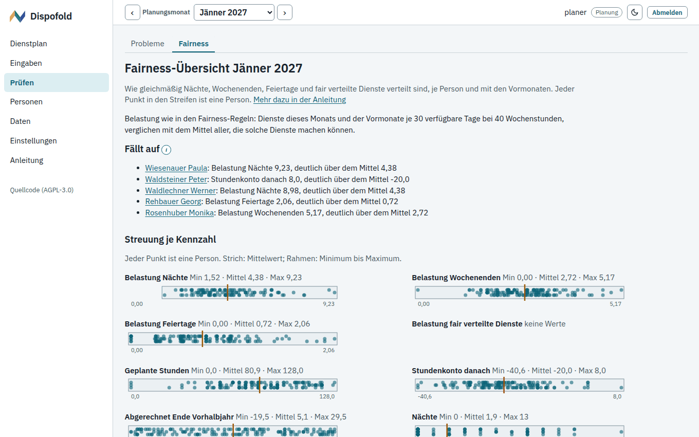
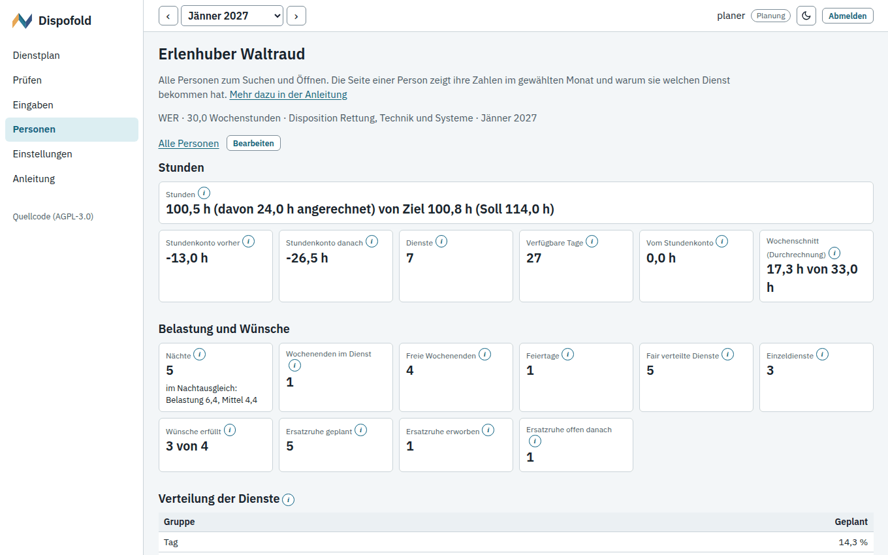
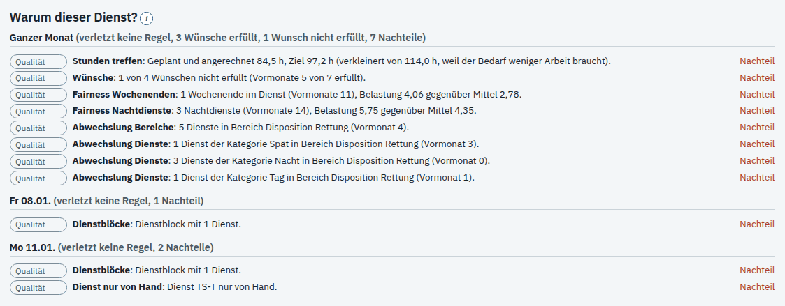

# Auswertungen

Zwei Stellen zeigen, wie gut ein Plan für die einzelnen Personen ist: die **Fairness-Übersicht** für alle (unter
**Prüfen**, **Fairness**) und die **Seite einer Person** mit ihren Zahlen und der Antwort auf „Warum dieser
Dienst?“. Beide gelten für den gewählten Monat und rechnen die Vormonate aus der Historie mit.

## Fairness

Die Fairness-Übersicht zeigt, wie gleichmäßig Nächte, Wochenenden, Feiertage und fair verteilte Dienste verteilt
sind, je Person und mit den Vormonaten.

- **Fällt auf:** oben höchstens fünf Personen, deren Wert weit vom Mittel aller liegt (mehr als zwei
  Standardabweichungen), die auffälligsten zuerst, etwa „Belastung Nächte 4,10, deutlich über dem Mittel 1,52“. Ein
  Klick auf den Namen öffnet die Seite der Person. Liegt niemand weit vom Mittel, steht dort „Niemand liegt weit vom
  Mittel entfernt.“
- **Streuung je Kennzahl:** Jeder Punkt ist eine Person, der Strich der Mittelwert, der Rahmen reicht vom Minimum
  bis zum Maximum. Über jedem Streifen stehen Minimum, Mittel und Maximum. Ein Punkt weit rechts ist eine Person,
  die deutlich mehr hat als die anderen.
- **Kennzahlen je Person:** eine Tabelle, nach jeder Spalte sortierbar (Klick auf die Überschrift). Die Spalten:
  geplante Stunden, Stundenkonto danach, Nächte, Wochenenden im Dienst, freie Wochenenden, Feiertage, fair verteilte
  Dienste, Einzeldienste, Wunscherfüllung, Ersatzruhe offen, dazu die Zahlen der Historie. Ein **i** an jeder
  Spalte erklärt sie.
- In beiden steht für die Planung vorne die **Belastung** bei Nächten, Wochenenden, Feiertagen und fair verteilten
  Diensten, so wie die Fairness-Regeln vergleichen: Dienste dieses Monats und der Vormonate je 30 verfügbare Tage
  bei 40 Wochenstunden. Damit sind Teilzeitkräfte und Personen mit langer Abwesenheit vergleichbar. Bei der
  Fairness zählt die Abweichung vom Mittel aller, die solche Dienste machen können.
- Personen außerhalb des **Nachtausgleichs** sind bei der Belastung Nächte markiert, mit dem Grund: Ihre
  gewohnte Verteilung bestimmt die Nächte, oder sie machen nie Nacht. Wer im Nachtausgleich ist, hängt von der
  Einstellung **Nachtdienste** unter [Regeln einstellen](einstellungen.md#planungsziele) ab.
- Wie viele Vormonate mitzählen, steht unter **Regeln** bei **Faire Verteilung** (Standard 3).

**Wie man sie liest:** Die Fairness gleicht über mehrere Monate aus. Wer diesen Monat mehr Nächte hat, kann in den
Vormonaten weniger gehabt haben; entscheidend ist die Belastung, nicht die Zahl des Monats. Fällt eine Person
dauerhaft auf, lohnt ein Blick auf ihre Einschränkungen und ihre gewohnte Verteilung. Was die Wichtigkeit „Faire
Verteilung“ bewirkt und warum sie wenig bewegt, steht in [regeln.md](../regeln.md#fairness).

Die Rolle „nur lesen“ sieht die Übersicht als eigenen Menüpunkt **Fairness**, aber ohne die Belastung,
Wunscherfüllung, Stundenkonto und Ersatzruhe.

## Die Zahlen einer Person

Die Seite einer Person (Menü **Personen**, Klick auf den Namen) zeigt ihre Zahlen im gewählten Monat. Jede Kachel
hat ein **i** mit einer Erklärung. Vor dem Planen sagt sie „Noch kein Plan für …“ und zeigt nur, was ohne Plan
feststeht: Ziel und Soll (mit dem Grund, wenn beide sich unterscheiden), das Stundenkonto vorher, die verfügbaren
Tage und die Historie (siehe [Was die Zahlen bedeuten](zahlen.md#die-seite-einer-person)).

**Stunden:**

- **Stunden:** geplante und angerechnete Stunden gegen Ziel und Soll in einer Kachel, zum Beispiel „96,0 h (davon
  24,0 h angerechnet) von Ziel 101,1 h (Soll 114,0 h)“. Diese Summe vergleicht die Planung mit dem Ziel. Die
  Rolle „nur lesen“ sieht nur die geplanten Stunden und das Soll.
- **Stundenkonto vorher** und **Stundenkonto danach:** der Stand zu Beginn des Monats (nach dem abgeschlossenen
  Vormonat, sonst aus den Personendaten) und nach diesem Plan.
- **Dienste:** die Zahl der geplanten Dienste. **Verfügbare Tage:** Tage, an denen die Person beschäftigt und
  nicht abwesend ist.
- **Vom Stundenkonto:** Stunden aus Abwesenheiten, die das Konto belasten (Zeitausgleich).
- **Wochenschnitt (Durchrechnung):** der Schnitt der Dienststunden je Woche über den Durchrechnungszeitraum, mit
  diesem Monat, und die eigene Grenze der Person, etwa „41,2 h von 44,0 h“: ihre Wochenstunden plus Spielraum
  (Standard 10 %), höchstens 46,16 h. „Historie unvollständig“ heißt: Die Vormonate reichen nicht so weit zurück, der Wert ist dann nur
  ein Hinweis.

**Belastung und Wünsche:** Nächte, Wochenenden im Dienst und frei, Feiertage, fair verteilte Dienste, Einzeldienste
(ein Diensttag mit freien Tagen davor und danach), erfüllte Wünsche, Ersatzruhe geplant, erworben und offen danach.
Die Kachel **Nächte** sagt, ob die Person ihrer gewohnten Verteilung folgt, nie Nacht macht oder im
Nachtausgleich ist, dann mit ihrer Belastung und dem Mittel aller Verglichenen.

**Verteilung der Dienste:** der geplante Anteil je Schichtart und Bereich neben der gewohnten Verteilung. Zählt
der Nachtanteil nicht (Nachtdienste „Gleichmäßig“ oder die Person macht nie Nacht), zeigt die Spalte **Gilt
(ohne Nächte)** die Anteile, die dann für die Dienste außer Nächten gelten.

**Historie (Vormonate):** Nächte, Wochenenden, Feiertage, fair verteilte Dienste und Wünsche der Vormonate, die für
die Fairness mitzählen.

## Warum dieser Dienst?

Für den ganzen Monat und für jeden Tag mit einem Treffer steht in Worten, was zutrifft (zum Beispiel „verletzt
keine Regel, 1 Nachteil“), darunter welche Regeln gegriffen haben, mit ihrer Gruppe (**Regelverstoß**, **Bedarf**,
**Qualität**) und ob es ein Verstoß, ein Nachteil oder ein Vorteil ist.

- **Ganzer Monat:** Regeln, die den ganzen Monat betreffen, etwa Stunden treffen („Geplant und angerechnet 96,0
  h, Ziel 101,1 h“), Wünsche und die Fairness.
- **Je Tag:** Regeln eines Tages, etwa ein einzelner freier Tag zwischen zwei Diensten oder ein Dienstblock mit nur
  einem Dienst.
- Bei der Fairness erscheint ein Treffer nur bei Personen über dem Mittel.

**Wofür:** Wenn eine Person fragt, warum sie einen Dienst hat oder einen Wunsch nicht erfüllt bekam, steht hier die
Antwort. Ein Nachteil heißt nicht, dass der Plan falsch ist: Jede Qualitätsregel wiegt gegen die anderen ab, und
der Bedarf geht immer vor.
