# Ein Monat Schritt für Schritt

Dieses Beispiel führt durch einen ganzen Monat mit den Demodaten: Daten laden, Personen und Bedarf prüfen und
anpassen, Eingaben erfassen, planen, das Ergebnis lesen, eine Krankmeldung nach dem Planen behandeln, den Monat
abschließen und die Änderungen als Korrekturdatei zurückgeben. Die kurze Fassung ohne Änderungen an Personen und
Bedarf ist der [Schnellstart in 10 Schritten](schnellstart.md).

Die Demodaten sind erfunden: 150 Personen in fünf Bereichen (Notrufannahme, Disposition Rettung,
Transportvermittlung, Lageführung, Technik und Systeme) mit Abwesenheiten und Wünschen für Jänner 2027. Sie
ersetzen alle Stammdaten: also nur in einer Installation zum Ausprobieren laden, nie neben echten Daten.

Wer die Schritte genau so nachspielt, bekommt mit den Standardwerten denselben oder einen sehr ähnlichen Plan wie
in den Bildern. Hat die Person der Krankmeldung in Schritt 8 an den beiden Tagen keinen Dienst, eine andere Person
nehmen, die an zwei Werktagen hintereinander Dienst hat. Wo ein Ausschnitt mit Nummern folgt, zeigt das Bild davor
die ganze Seite.

## 1. Demodaten laden

1. Im Menü **Einstellungen**, Reiter **Daten**.
2. **Erweitert** aufklappen und **Demodaten laden (Jänner 2027)** (1) klicken, die Rückfrage mit **OK**
   bestätigen.
3. Die Meldung (2) oben nennt, was geladen wurde: 150 Personen, 5 Bereiche, 13 Schichten, Monat 2027-01.
4. Steht oben noch ein anderer Monat, **Zu Jänner 2027 wechseln** (3) klicken.

Auf einer leeren Installation geht es kürzer: Der **Dienstplan** zeigt dort **Demodaten zum Ausprobieren laden**,
und der Monat wechselt von selbst (siehe [Schnellstart](schnellstart.md#3-demodaten-laden)).

## 2. Die Stammdaten prüfen lassen

Bevor man plant, lohnt ein Blick auf **Prüfen** (1). Ohne Plan steht oben „Noch kein Plan für diesen Monat …“ (2),
und die Seite zeigt nur den Abschnitt **Stammdaten** (3): Personen ohne Bereich, Bereiche ohne Bedarf, gewohnte
Verteilungen, die nicht aufgehen.

Bei den Demodaten steht dort „Keine Auffälligkeiten in den Stammdaten.“ Mit echten Daten arbeitet man hier jeden
Hinweis ab (siehe [Stammdaten](planen.md#stammdaten)).

## 3. Eine Person anpassen

Angenommen, Waltraud Erlenhuber arbeitet ab Jänner 30 statt 34 Wochenstunden, und das Quellsystem weiß es noch
nicht.

1. **Personen**, in **Suchen** „Erlenhuber“ eingeben, auf den Namen klicken.
2. Auf ihrer Seite **Bearbeiten** klicken; die Seite springt zum Formular.
3. **Wochenstunden** (1) auf 30 setzen und **Speichern** (2).

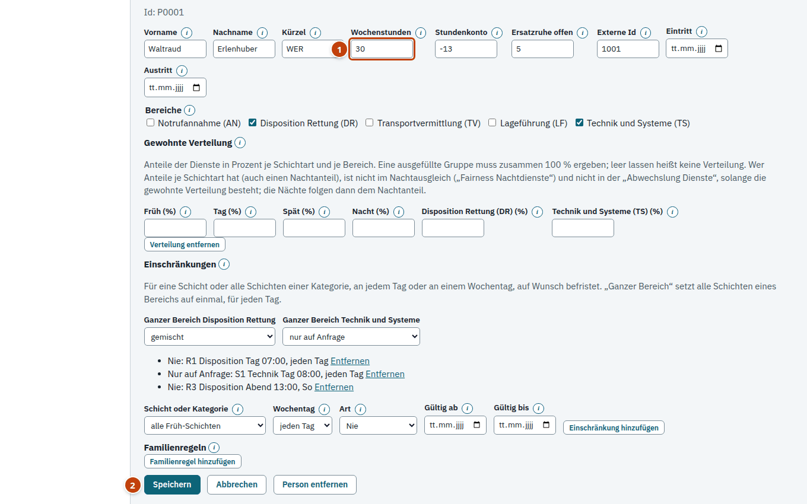

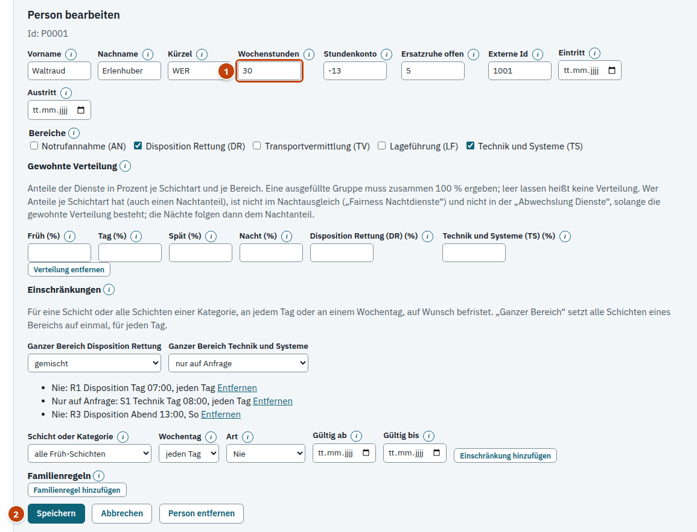

Das [Soll](begriffe.md#soll) und das [Ziel](begriffe.md#ziel) der Person sind ab jetzt kleiner. Die Änderung merkt
sich Dispofold für die [Korrekturdatei](begriffe.md#korrekturdatei) (Schritt 11).

## 4. Den Bedarf anpassen

Angenommen, die Notrufannahme braucht an Werktagen von 14:30 bis 19:00 eine Person mehr.

1. **Einstellungen**, Reiter **Stammdaten**, Tabelle **Bedarf**.
2. Unter **Bedarf filtern** „Notrufannahme“ eingeben.
3. In der Zeile „Mo, Di, Mi, Do, Fr, 14:30 bis 19:00“ **Bearbeiten** klicken.
4. **Mindestens** (1) um eins erhöhen und **Speichern** (2).

[Bedarf](begriffe.md#bedarf) gilt in Abschnitten; jeder Abschnitt hat seine eigene Mindestbesetzung. Was dabei zu
beachten ist, etwa dass ein Bedarf „an einem Datum“ den ganzen Tag ersetzt, steht unter
[Bedarf](stammdaten.md#bedarf).

## 5. Eingaben erfassen

Die Demodaten bringen schon viele Abwesenheiten und Wünsche mit. Drei kommen dazu: Anna Ahornbichler hat vom
25. bis 29. Jänner Urlaub, Jakob Steinmayr wünscht sich den 15. frei, und am 22., den er sich schon frei
gewünscht hat, soll er sicher frei haben.

1. **Eingaben**, oben bei **Person** „Ahornbichler Anna“ wählen. Die Seite zeigt dann nur ihre Einträge, und die
   Formulare darunter haben sie schon gewählt.
2. In der Zeile über der Liste **Abwesenheiten** (3) **Von** 25.01., **Bis** 29.01. und **Art** „U Urlaub“ wählen,
   **Hinzufügen**. Die neue Zeile ist markiert: „Hinzugefügt, noch nicht gespeichert“.
3. Oben bei **Person** „Steinmayr Jakob“ wählen. Unter **Wünsche** **Datum** 15.01. und **Art** „frei“ wählen,
   **Hinzufügen**; unter **Vorgaben** **Datum** 22.01. und **Dienst** „frei (freier Tag)“, **Hinzufügen**. Die
   Links **Abwesenheiten**, **Wünsche** und **Vorgaben** unter dem Titel springen zu den Abschnitten.
4. In der Leiste unten steht neben **Speichern** (1) **Ungespeicherte Änderungen** (2). **Speichern** klicken.

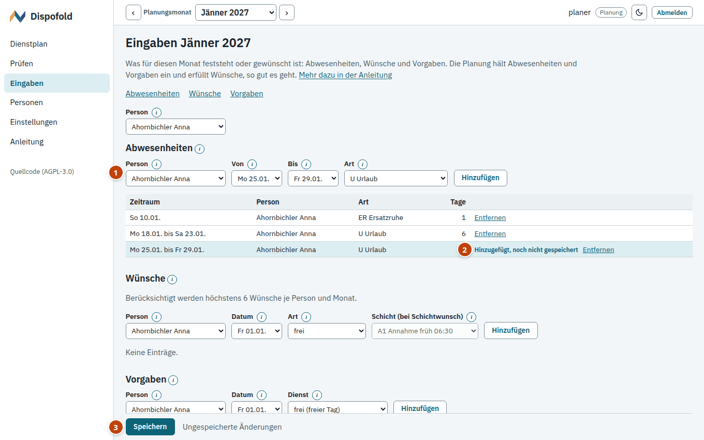

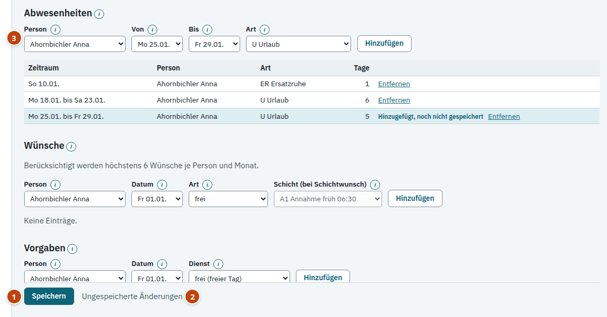

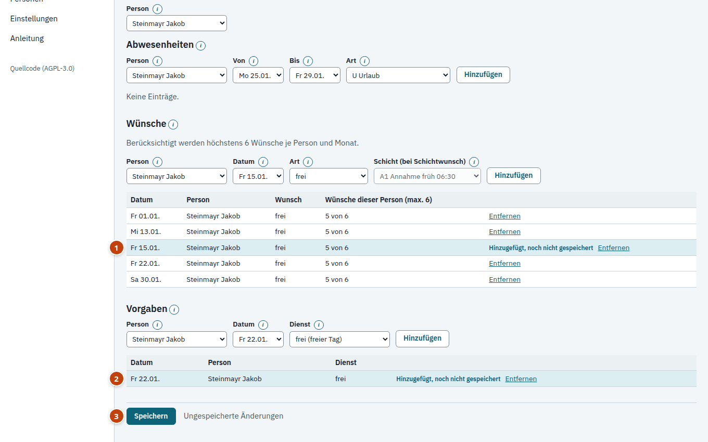

[Abwesenheiten](begriffe.md#abwesenheit) sind fest: An diesen Tagen plant das Programm keinen Dienst.
[Wünsche](begriffe.md#wunsch) erfüllt es, so gut es geht. Was sicher gelten muss, ist eine
[Vorgabe](begriffe.md#vorgabe) (siehe [Vorgaben](eingaben.md#vorgaben)).

## 6. Planen

1. **Dienstplan**, Reiter **Personen**.
2. **Planen** klicken. Die Zeile über dem Plan zeigt „Planung läuft“ (2) mit der Laufzeit; **Stopp** (1) würde
   früher beenden. Mit den Standardwerten dauert das bei den Demodaten ein bis zwei Minuten.

Ist die Planung fertig, meldet das Programm „Planung beendet“, und die Zeile zeigt das Ergebnis:

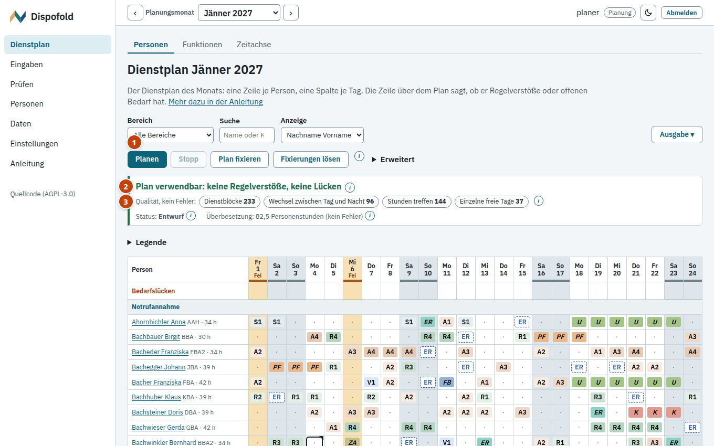

1. Grün: „Plan verwendbar: keine Regelverstöße, keine Lücken“. Gelb stünde hier die Zahl der Lücken, rot die der
   Regelverstöße. Nur diese Farbe entscheidet, ob der Plan verwendbar ist.
2. Nach „Qualität, kein Fehler:“ die Qualitätsregeln mit den meisten Treffern, etwa **Dienstblöcke** und
   **Einzelne freie Tage**. Sie sind keine Fehler, sondern ein Maß für die Güte; ein Klick listet Person und Tag.
3. **Status:** **Entwurf** und die [Überbesetzung](begriffe.md#überbesetzung) in
   [Personenstunden](begriffe.md#personenstunden), mit dem Vermerk „(kein Fehler)“.

Der Plan ist breiter als der Bildschirm: Die Tage nach etwa dem 20. erreicht man, indem man den Plan seitlich
scrollt (Wischen, Umschalt und Mausrad oder die Bildlaufleiste unten).

## 7. Das Ergebnis prüfen

**Prüfen**, Reiter **Probleme**, steht in der Reihenfolge, in der man arbeitet; alle Gruppen sind zugeklappt:

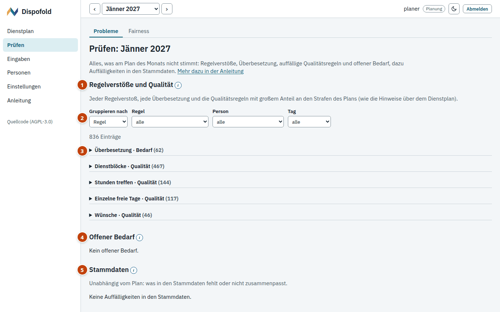

1. **Das Urteil:** „Nichts zu tun: 0 Regelverstöße, 0 Lücken“. Darunter steht, dass die Hinweise zur Qualität und
   die Stammdaten keine Fehler im Plan sind.
2. **Regelverstöße:** „Keine Regelverstöße.“
3. **Offener Bedarf:** „Kein offener Bedarf.“
4. **Hinweise zur Qualität (keine Fehler):** zugeklappt hinter „… Hinweise anzeigen“. Hier stehen viele Einträge,
   auch bei diesem grünen Plan, etwa **Überbesetzung · Bedarf**: Zeiten, in denen mehr Personen da sind als
   vorgesehen. Das entsteht, wo eine Schicht über mehrere Abschnitte des Bedarfs reicht. Kein Fehler.
5. **Stammdaten:** keine Auffälligkeiten.

Der Plan ist verwendbar. Typischerweise würde man jetzt einzelne Personen ansehen (auf den Namen klicken, dann
**Warum dieser Dienst?**, siehe [Auswertungen](auswertungen.md#warum-dieser-dienst)) und den Plan ausdrucken. Was
die Zahlen im Einzelnen bedeuten: [Was die Zahlen bedeuten](zahlen.md).

## 8. Eine Krankmeldung nach dem Planen

Nach dem Planen meldet sich Rosa Erleneder aus Technik und Systeme für Dienstag, 19., und Mittwoch, 20. Jänner
krank. Sie hat an beiden Tagen Dienst „S1“. Das ergibt zwei typische Befunde nacheinander: einen Regelverstoß und
danach eine Lücke.

**Erster Befund: Regelverstoß „Abwesenheit“.**

1. **Eingaben**: bei **Person** „Erleneder Rosa“ wählen, **Von** 19.01., **Bis** 20.01., **Art** „K Krankenstand“,
   **Hinzufügen**, **Speichern**.
2. **Dienstplan**, unter **Bereich** „Technik und Systeme“ wählen, dann **Zum ersten Konflikt springen** (3)
   klicken: Der Plan scrollt zur ersten roten Zelle.

1. Die Überschrift ist rot: „2 Regelverstöße“. Der Knopf **Abwesenheit 2** darunter listet sie.
2. **Plan veraltet: neu planen**: Die Eingaben haben sich nach der Planung geändert.
3. **Zum ersten Konflikt springen** führt zur ersten roten Zelle, auch wenn sie seitlich außerhalb des Bildschirms
   liegt.
4. Die beiden Zellen sind rot und tragen beide Codes, „K/S1“: Dienst trotz Abwesenheit.

Behoben wird der Regelverstoß in der Zelle:

1. Die rote Zelle anklicken. Die Auswahl sagt „Konflikt: Krankenstand, aber Dienst … geplant. Das ist ein
   Regelverstoß.“
2. **Dienst entfernen (frei)** (1) klicken. Dasselbe für den zweiten Tag.

**Zweiter Befund: Lücke.** Ohne die beiden Dienste fehlt in Technik und Systeme an diesen Tagen jemand:

1. Die Überschrift ist jetzt gelb, etwa „2 Lücken (17 Personenstunden)“, keine Regelverstöße mehr.
2. Die Zeile **Bedarfslücken** zeigt an beiden Tagen eine 1. Ein Klick darauf öffnet die Lücken des Tages.

Über der Liste **Auf Anfrage verfügbar** steht „Klick auf einen Namen setzt den Dienst und fixiert ihn.“ Die Liste
nennt Personen, die diese Schicht nur auf Anfrage machen und an dem Tag frei sind, mit ihren Stunden, etwa
„geplant 96,0 h von Ziel 101,1 h“. In Technik und Systeme ist das Waltraud Erlenhuber, wenn sie an dem Tag frei
ist. Man fragt die Person und
klickt bei Zusage auf ihren Namen: Der Dienst ist gesetzt und [fixiert](begriffe.md#fixiert), im Plan mit einer
kleinen Ecke unten links.

**Wenn niemand passt.** Am 19. hat Waltraud Erlenhuber selbst Ersatzruhe; dort sagt die Liste:

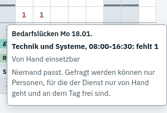

„Niemand passt. Gefragt werden können nur Personen, die den Dienst nur auf Anfrage machen und an dem Tag frei
sind.“ Dann gibt es zwei Wege:

- **Von Hand einteilen:** jemanden fragen, der den Dienst normal machen darf, die leere Zelle dieser Person am Tag
  der Lücke anklicken und die Schicht wählen (in Technik und Systeme „S1“). Danach in der Zeile über dem Plan
  prüfen, dass kein Regelverstoß entstanden ist; sonst den Dienst wieder entfernen und jemand anderen nehmen.
- **Neu planen** (Schritt 9): Der Solver sucht unter allen Personen, ohne die von Hand gesetzten Zellen zu ändern.

## 9. Neu planen

**Planen** klicken und warten. Die Planung behält die von Hand gesetzten Zellen und füllt die Lücken, wenn jemand
frei ist und den Dienst machen darf:

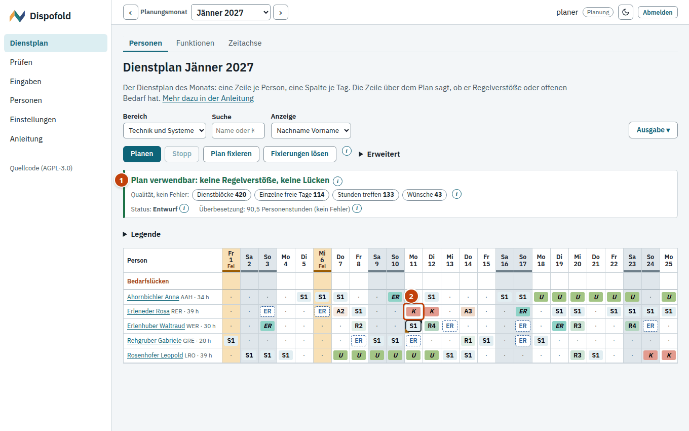

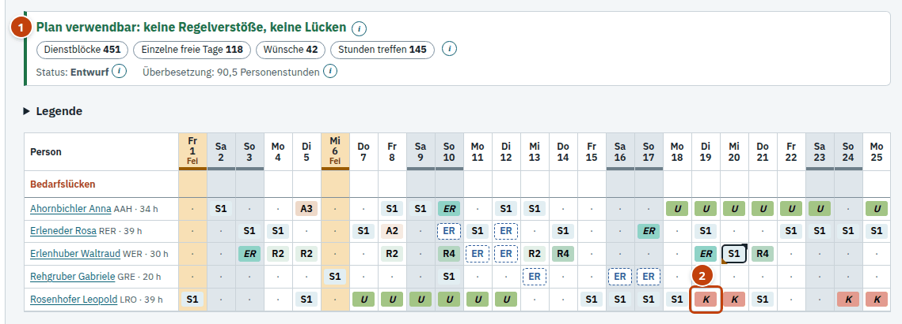

1. Wieder grün: „Plan verwendbar: keine Regelverstöße, keine Lücken“. Der Hinweis „Plan veraltet“ ist weg.
2. An den Krankentagen steht „K“; die Dienste haben andere übernommen, auf Anfrage gesetzte Dienste mit der
   kleinen Ecke.

**Achtung bei einem ausgehängten Plan:** Neu planen darf alle Zellen ändern, die nicht fixiert sind, auch die
Dienste anderer Personen. Ist der Plan schon ausgehängt, vorher **Plan fixieren** klicken: Das fixiert alle
Dienste und Ersatzruhetage des Monats, und neu planen füllt die Lücken nur noch an freien Tagen. Einzelne Zellen
fixiert man in ihrer Auswahl mit **Fixieren**.

## 10. Den Monat abschließen

1. **Dienstplan**, **Ausgabe** (1), **Monat abschließen** (3). **Drucken** (2) im selben Menü öffnet vorher die
   Druckansicht (siehe [Drucken](plan-bearbeiten.md#drucken)).

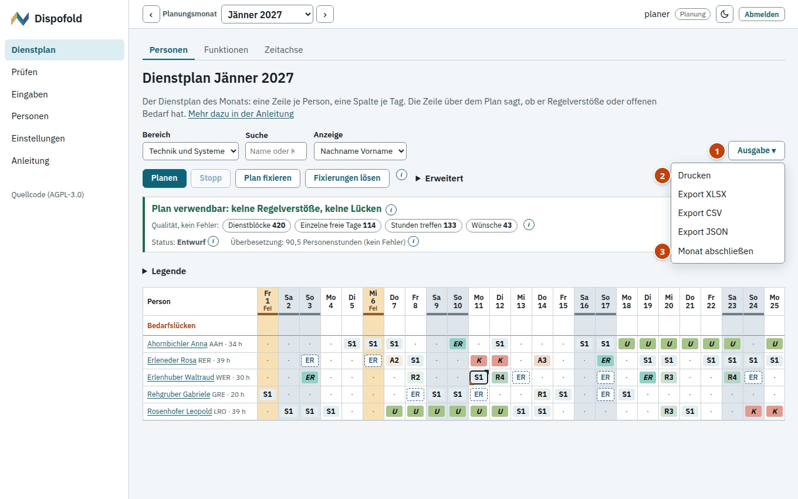

2. Das Fenster prüft den Plan: keine Regelverstöße, keine offenen Lücken, Plan aktuell. Alles hat einen Haken.
   Darunter steht, was danach gilt: Der Monat ist nur noch lesbar, und wieder öffnen lässt er sich unter
   „Einstellungen > Daten“.
3. **Monat abschließen** klicken.

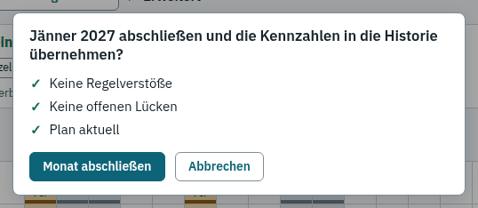

Danach steht im Status **abgeschlossen** (1). Die Zahlen des Monats sind in der Historie, Plan und Eingaben sind nur
noch lesbar.

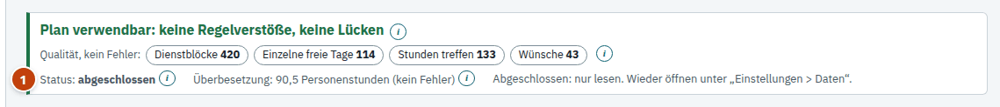

Wäre noch etwas offen gewesen, etwa eine Lücke, die außerhalb des Programms besetzt wird, ginge der Abschluss erst
nach dem Häkchen **Trotzdem abschließen** (siehe [Monat abschließen](monatsabschluss.md)).

## 11. Die Korrekturdatei speichern

Die Wochenstunden von Waltraud Erlenhuber und der Bedarf der Notrufannahme wurden in Dispofold geändert. Damit der
nächste Datensatz aus dem Quellsystem sie schon enthält, bekommt das Exportprogramm eine Korrekturdatei:

1. **Einstellungen**, Reiter **Daten**, Abschnitt **Korrekturdatei**.
2. **Änderungen als Korrekturdatei exportieren** klicken. Der Browser speichert `korrekturen.json`.

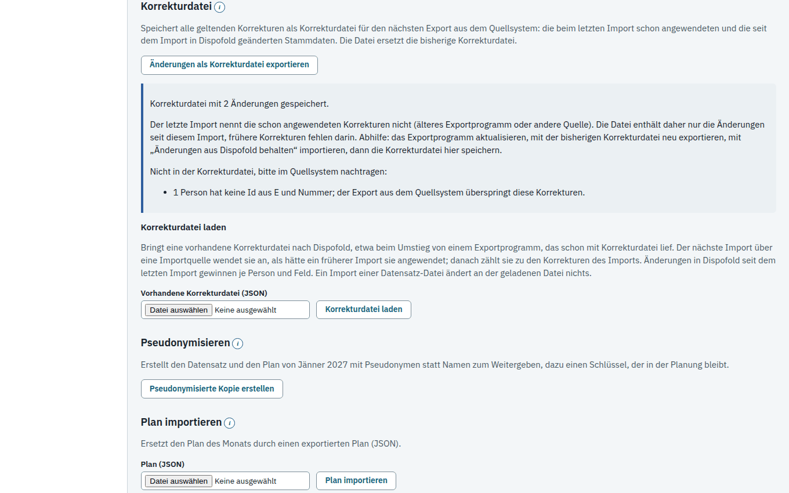

Die Meldung nennt die zwei Änderungen. Die beiden weiteren Hinweise gehören zu den Demodaten: Sie kommen nicht aus
einem Exportprogramm, deshalb kennt der Import keine früheren Korrekturen, und die erfundenen Personen haben keine
Ids, die das Exportprogramm versteht. Mit echten Daten fallen diese Hinweise weg. Die Datei geht an die IT oder an die Person,
die das Exportprogramm betreut (siehe [Korrekturdatei](daten.md#korrekturdatei)).

## Wie es weitergeht

- Der nächste Monat: Planungsmonat auf Februar stellen, Eingaben erfassen, planen. Die Historie des Jänners zählt
  für Fairness, Stundenkonto und Ersatzruhe mit.
- Zum Üben den Jänner wieder öffnen (**Einstellungen**, **Daten**, **Monat wieder öffnen**), etwas ändern und neu
  abschließen.
- Die Regeln an die eigene Vereinbarung anpassen: [Regeln einstellen](einstellungen.md).
