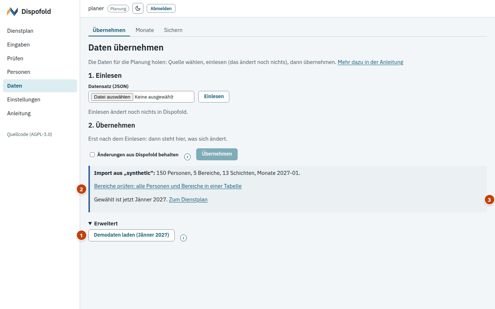
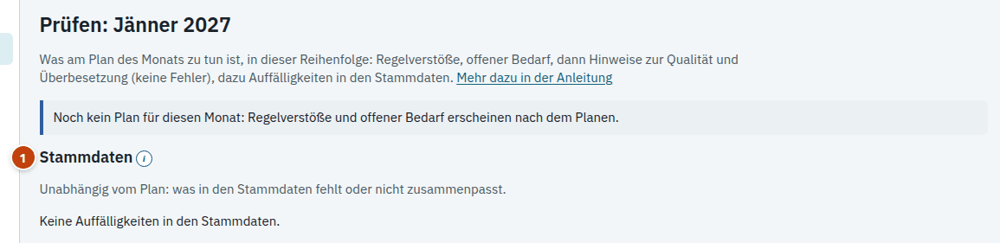
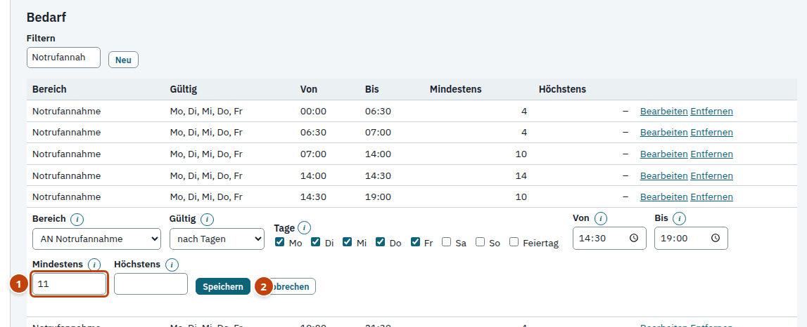
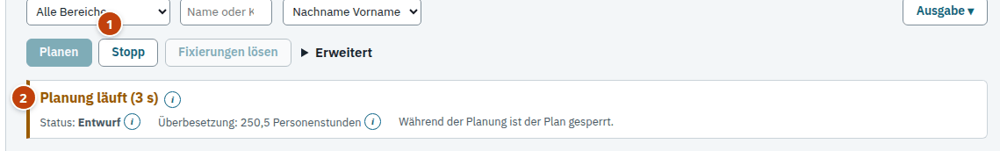
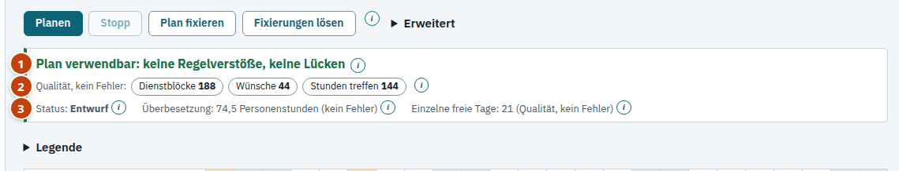
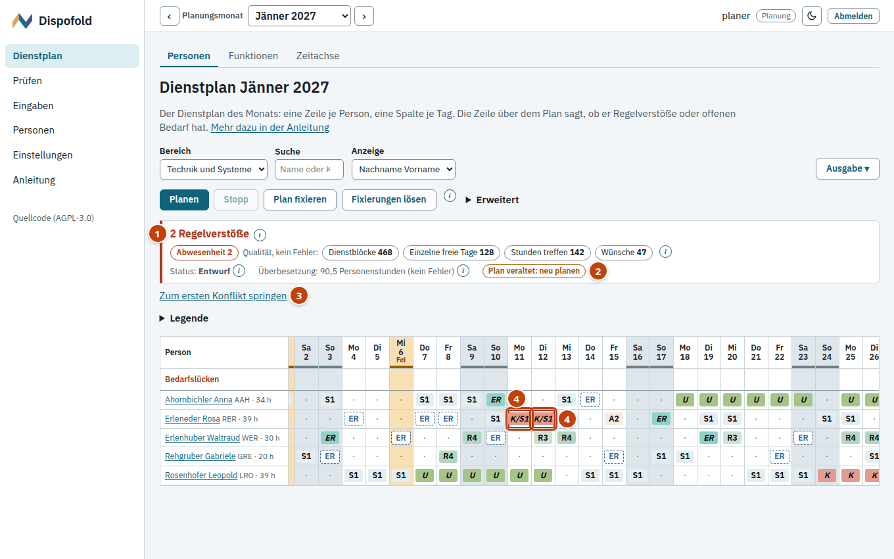
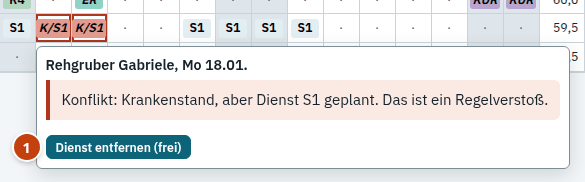
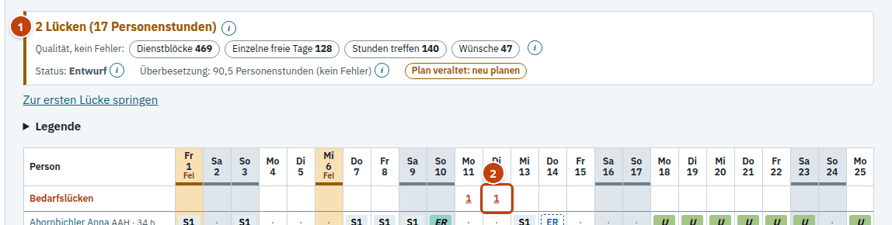
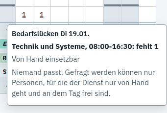
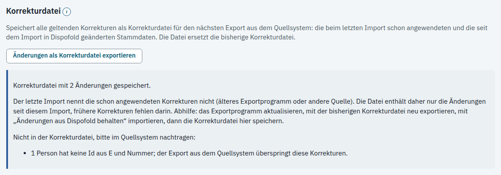

# Ein Monat Schritt für Schritt

Dieses Beispiel führt durch einen ganzen Monat mit den Demodaten: Daten laden, Personen und Bedarf prüfen und
anpassen, Eingaben erfassen, planen, das Ergebnis lesen, eine Krankmeldung nach dem Planen behandeln, den Monat
abschließen und die Änderungen als Korrekturdatei zurückgeben. Wer es am eigenen Rechner oder auf einem Testserver
nachspielt, sieht dieselben Seiten; nur die Personen und Tage der Krankmeldung können anders sein, weil der Plan
etwas anders ausfällt.

Die Demodaten sind erfunden: 150 Personen in fünf Bereichen (Notrufannahme, Disposition Rettung,
Transportvermittlung, Lageführung, Technik und Systeme) mit Abwesenheiten und Wünschen für Jänner 2027. Sie
ersetzen alle Stammdaten: also nur in einer Installation zum Ausprobieren laden, nie neben echten Daten.

Die Zahlen in den Bildern gehören zu einem der Monate, an denen diese Anleitung entstand. Sie zeigen, wo etwas
steht, nicht, was herauskommen muss.

## 1. Demodaten laden

1. Im Menü **Einstellungen**, Reiter **Daten**.
2. **Erweitert** aufklappen und **Demodaten laden (Jänner 2027)** (1) klicken, die Rückfrage mit **OK**
   bestätigen.
3. Die Meldung (2) nennt, was geladen wurde: 150 Personen, 5 Bereiche, 13 Schichten, Monat 2027-01.
4. Oben den **Planungsmonat** auf Jänner 2027 stellen, falls er nicht schon dort steht.

## 2. Die Stammdaten prüfen lassen

Bevor man plant, lohnt ein Blick auf **Prüfen**. Ohne Plan zeigt die Seite nur den Abschnitt **Stammdaten** (1):
Personen ohne Bereich, Bereiche ohne Bedarf, gewohnte Verteilungen, die nicht aufgehen. Bei den Demodaten steht
dort „Keine Auffälligkeiten in den Stammdaten.“ Mit echten Daten arbeitet man hier jeden Hinweis ab (siehe
[Stammdaten](planen.md#stammdaten)).

## 3. Eine Person anpassen

Angenommen, Waltraud Erlenhuber arbeitet ab Jänner 30 statt 34 Wochenstunden, und das Quellsystem weiß es noch
nicht.

1. **Personen**, in **Suchen** „Erlenhuber“ eingeben, auf den Namen klicken.
2. Auf ihrer Seite **Bearbeiten** klicken; die Seite springt zum Formular.
3. **Wochenstunden** (1) auf 30 setzen und **Speichern** (2).

Das Soll und das Ziel der Person sind ab jetzt kleiner. Die Änderung merkt sich Dispofold für die Korrekturdatei
(Schritt 11).

## 4. Den Bedarf anpassen

Angenommen, die Notrufannahme braucht an Werktagen von 14:30 bis 19:00 eine Person mehr.

1. **Einstellungen**, Reiter **Stammdaten**, Tabelle **Bedarf**.
2. Unter **Filtern** „Notrufannahme“ eingeben.
3. In der Zeile „Mo, Di, Mi, Do, Fr, 14:30 bis 19:00“ **Bearbeiten** klicken.
4. **Mindestens** (1) um eins erhöhen und **Speichern** (2).

Bedarf gilt in Abschnitten; jeder Abschnitt hat seine eigene Mindestbesetzung. Was dabei zu beachten ist, etwa
dass ein Bedarf „an einem Datum“ den ganzen Tag ersetzt, steht unter [Bedarf](stammdaten.md#bedarf).

## 5. Eingaben erfassen

Die Demodaten bringen schon viele Abwesenheiten und Wünsche mit. Zwei kommen dazu: Anna Ahornbichler hat vom
25. bis 29. Jänner Urlaub, Jakob Steinmayr wünscht sich den 15. frei.

1. **Eingaben**.
2. In der Zeile über der Liste **Abwesenheiten** (3) Person, **Von** 25.01., **Bis** 29.01. und Art „U Urlaub“
   wählen, **Hinzufügen**.
3. Weiter unten in der Zeile über **Wünsche** Person, Datum 15.01. und Art „frei“ wählen, **Hinzufügen**.
4. Neben **Speichern** (1) steht jetzt **Ungespeicherte Änderungen** (2). **Speichern** klicken.

Abwesenheiten sind fest: An diesen Tagen plant das Programm keinen Dienst. Wünsche erfüllt es, so gut es geht. Was
sicher gelten muss, wäre eine Vorgabe (siehe [Vorgaben](eingaben.md#vorgaben)).

## 6. Planen

1. **Dienstplan**, Reiter **Personen**.
2. **Planen** klicken. Die Zeile über dem Plan zeigt „Planung läuft“ (2) mit der Laufzeit; **Stopp** (1) würde
   früher beenden. Mit den Standardwerten dauert das bei den Demodaten etwa eine halbe Minute.

Ist die Planung fertig, meldet das Programm „Planung beendet“, und die Zeile zeigt das Ergebnis:

1. Grün: „Plan verwendbar: keine Regelverstöße, keine Lücken“. Gelb stünde hier die Zahl der Lücken, rot die der
   Regelverstöße.
2. Die Qualitätsregeln mit den meisten Treffern, etwa **Dienstblöcke** und **Einzelne freie Tage**. Sie sind keine
   Fehler, sondern ein Maß für die Güte; ein Klick listet Person und Tag.
3. Status **Entwurf** und die Überbesetzung in Personenstunden.

## 7. Das Ergebnis prüfen

**Prüfen**, Reiter **Probleme**, listet alles in drei Abschnitten:

1. **Regelverstöße und Qualität:** hier keine Regelverstöße, aber Einträge zur Überbesetzung und zu den
   Qualitätsregeln.
2. **Gruppieren nach** und die Auswahlen daneben zeigen die Liste nach Regel, Person oder Tag.
3. Jede Gruppe klappt mit einem Klick auf. **Überbesetzung · Bedarf** nennt Zeiten, in denen mehr Personen da sind
   als vorgesehen. Das entsteht, wo eine Schicht über mehrere Abschnitte des Bedarfs reicht: Braucht der nächste
   Abschnitt weniger Personen, sind dort mehr da als nötig. Kleine Werte sind kein Fehler.
4. **Offener Bedarf:** „Kein offener Bedarf.“
5. **Stammdaten:** keine Auffälligkeiten.

Der Plan ist verwendbar. Typischerweise würde man jetzt einzelne Personen mit vielen Treffern ansehen (auf den Namen
klicken, dann **Warum dieser Dienst?**, siehe [Auswertungen](auswertungen.md#warum-dieser-dienst)) und den Plan
ausdrucken.

## 8. Eine Krankmeldung nach dem Planen

Nach dem Planen meldet sich eine Person aus Technik und Systeme für zwei Werktage krank. Das ergibt zwei typische
Befunde nacheinander: einen Regelverstoß und danach eine Lücke.

**Erster Befund: Regelverstoß „Abwesenheit“.**

1. **Eingaben**: Abwesenheit für die Person mit Art „K Krankenstand“, **Von** und **Bis** die beiden Tage,
   **Hinzufügen**, **Speichern**.
2. **Dienstplan**, unter **Bereich** „Technik und Systeme“ wählen.

1. Die Überschrift ist rot: „2 Regelverstöße“. Der Knopf **Abwesenheit 2** darunter listet sie.
2. **Plan veraltet: neu planen**: Die Eingaben haben sich nach der Planung geändert.
3. Die beiden Zellen sind rot und tragen beide Kürzel, etwa „K/S1“: Dienst trotz Abwesenheit.

Behoben wird der Regelverstoß in der Zelle:

1. Die rote Zelle anklicken. Die Auswahl sagt „Konflikt: Krankenstand, aber Dienst … geplant. Das ist ein
   Regelverstoß.“
2. **Dienst entfernen (frei)** (1) klicken. Dasselbe für den zweiten Tag.

**Zweiter Befund: Lücke.** Ohne die beiden Dienste fehlt in Technik und Systeme an diesen Tagen jemand:

1. Die Überschrift ist jetzt gelb, etwa „2 Lücken (17 Personenstunden)“, keine Regelverstöße mehr.
2. Die Zeile **Bedarfslücken** zeigt an beiden Tagen eine 1. Ein Klick darauf öffnet die Lücken des Tages.

Die Liste **Auf Anfrage verfügbar** nennt Personen, die diese Schicht nur auf Anfrage machen und an dem Tag frei
sind; hier ist es Waltraud Erlenhuber, die Technik und Systeme nur auf Anfrage macht. Man fragt die Person und
klickt bei Zusage auf ihren Namen: Der Dienst ist gesetzt und fixiert, im Plan mit einer kleinen Ecke unten links.
Ist die Liste leer („Niemand passt.“), gibt es zwei Wege:

- jemanden von Hand einteilen, der den Dienst normal machen darf (die Zelle anklicken, Schicht wählen) und
  danach in der Zeile über dem Plan prüfen, dass kein Regelverstoß entstanden ist; oder
- **neu planen**: Der Solver sucht unter allen Personen, ohne die von Hand gesetzten Zellen zu ändern.

## 9. Neu planen

**Planen** klicken und warten. Die Planung behält die von Hand gesetzten Zellen und füllt die Lücken, wenn jemand
frei ist und den Dienst machen darf:

1. Wieder grün: „Plan verwendbar: keine Regelverstöße, keine Lücken“. Der Hinweis „Plan veraltet“ ist weg.
2. An den Krankentagen steht „K“; die Dienste haben andere übernommen, am zweiten Tag die Person auf Anfrage.

Neu planen ändert auch andere Zellen, die nicht fixiert sind. Soll ein Teil des Plans sicher bleiben (etwa weil er
schon ausgehängt ist), vorher diese Zellen fixieren (Zelle anklicken, **Fixieren**).

## 10. Den Monat abschließen

1. **Dienstplan**, **Ausgabe**, **Monat abschließen**.
2. Das Fenster prüft den Plan: keine Regelverstöße, keine offenen Lücken, Plan aktuell. Alles hat einen Haken.
3. **Monat abschließen** klicken.

Danach steht im Status **abgeschlossen** (1). Die Zahlen des Monats sind in der Historie, Plan und Eingaben sind nur
noch lesbar.

Wäre noch etwas offen gewesen, etwa eine Lücke, die außerhalb des Programms besetzt wird, ginge der Abschluss erst
nach dem Häkchen **Trotzdem abschließen** (siehe [Monat abschließen](monatsabschluss.md)).

## 11. Die Korrekturdatei speichern

Die Wochenstunden von Waltraud Erlenhuber und der Bedarf der Notrufannahme wurden in Dispofold geändert. Damit der
nächste Datensatz aus dem Quellsystem sie schon enthält, bekommt das Exportprogramm eine Korrekturdatei:

1. **Einstellungen**, Reiter **Daten**, Abschnitt **Korrekturdatei**.
2. **Änderungen als Korrekturdatei exportieren** klicken. Der Browser speichert `korrekturen.json`.

Die Meldung nennt die zwei Änderungen. Die beiden weiteren Hinweise gehören zu den Demodaten: Sie kommen nicht aus
einem Exportprogramm, deshalb kennt der Import keine früheren Korrekturen, und die erfundenen Personen haben keine
Ids, die das Exportprogramm versteht. Mit echten Daten fallen diese Hinweise weg. Die Datei geht an die IT oder an die Person,
die das Exportprogramm betreut (siehe [Korrekturdatei](daten.md#korrekturdatei)).

## Wie es weitergeht

- Der nächste Monat: Planungsmonat auf Februar stellen, Eingaben erfassen, planen. Die Historie des Jänners zählt
  für Fairness, Stundenkonto und Ersatzruhe mit.
- Zum Üben den Jänner wieder öffnen (**Einstellungen**, **Daten**, **Monat wieder öffnen**), etwas ändern und neu
  abschließen.
- Die Regeln an die eigene Vereinbarung anpassen: [Regeln einstellen](einstellungen.md).
