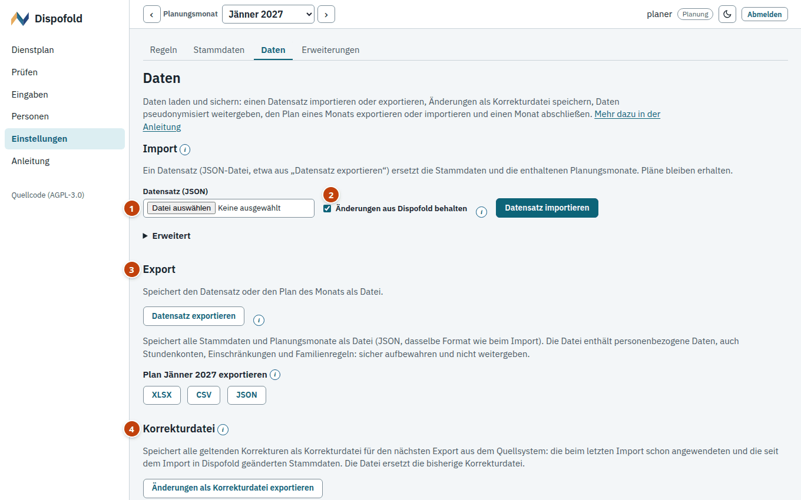
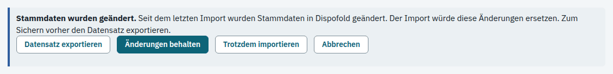
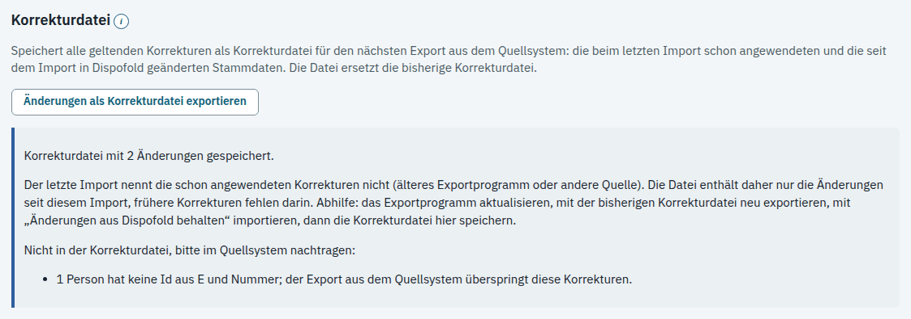
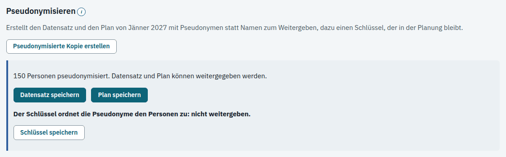

# Daten und Korrekturdatei

Unter **Einstellungen**, **Daten** lädt und sichert man Daten: einen Datensatz importieren oder exportieren, den
Plan eines Monats exportieren oder importieren, Änderungen als Korrekturdatei für das Exportprogramm speichern,
Daten pseudonymisiert weitergeben und einen Monat abschließen. Die Seite gehört zum gewählten Monat. Die Rolle
„nur lesen“ sieht sie nicht.

1. **Datensatz (JSON)** und **Datensatz importieren**, siehe [Import](#import).
2. **Änderungen aus Dispofold behalten**, siehe
   [Neuer Datensatz, Änderungen aus Dispofold behalten](#neuer-datensatz-änderungen-aus-dispofold-behalten).
3. **Export**: Datensatz und Plan als Datei, siehe [Exportieren](#exportieren).
4. **Korrekturdatei**, siehe [Korrekturdatei](#korrekturdatei).

Weiter unten folgen [Anonymisieren](#anonymisieren), [Plan importieren](#plan-importieren) und **Monat
abschließen** oder **Monat wieder öffnen** (siehe [Monat abschließen](monatsabschluss.md)).

## Import

1. Unter **Datensatz (JSON)** die Datei wählen, im Format von [datenformat.md](../datenformat.md). Sie kommt vom
   Exportprogramm oder aus **Datensatz exportieren**.
2. **Datensatz importieren**. Das Programm fragt „Der Datensatz ersetzt die Stammdaten. Fortfahren?“.
3. Der Import prüft die ganze Datei. Danach nennt die Seite, was importiert wurde („Import aus „…“: 150 Personen, 5
   Bereiche, 13 Schichten, Monate 2027-01.“), und bietet bei Bedarf an, zum Monat der Datei zu wechseln.

- Ein Import ersetzt die Stammdaten und die Planungsmonate, die in der Datei stehen. Vorhandene Pläne bleiben.
- Ein abgeschlossener Monat kann nicht überschrieben werden.
- Während einer Planung eines Monats aus der Datei kann nicht importiert werden.
- **Warnungen** (etwa zwei Abwesenheiten einer Person am selben Tag) stehen unter der Meldung; der Import läuft
  trotzdem.

**Wenn etwas falsch ist,** wird nichts übernommen, und die Liste aller Fehler erscheint, nur mit Ids, ohne Namen:

Die Fehler sind im Quellsystem oder in der Datei zu beheben, dann neu importieren. Häufige Fehler und ihre
Bedeutung stehen unter [Häufige Fragen und Fehlerbehebung](fragen.md#import).

**Wenn Stammdaten in Dispofold geändert wurden** und das Häkchen **Änderungen aus Dispofold behalten** nicht gesetzt
ist, würde der Import diese Änderungen überschreiben. Das Programm fragt dann nach:

- **Datensatz exportieren** sichert den jetzigen Stand als Datei.
- **Änderungen behalten** zeigt die Vorschau wie mit dem Häkchen.
- **Trotzdem importieren** ersetzt die Stammdaten; die Änderungen gehen verloren.
- **Abbrechen** importiert nichts.

**Demodaten:** **Demodaten laden (Jänner 2027)** unter **Erweitert** lädt 150 erfundene Personen in fünf
Bereichen mit Eingaben für Jänner 2027, gut zum Ausprobieren (siehe [Ein Monat Schritt für Schritt](beispiel.md)).
Die Demodaten ersetzen alle Stammdaten; nie in einer Installation mit echten Daten laden.

## Neuer Datensatz, Änderungen aus Dispofold behalten

Wer Personen, Einschränkungen oder Bedarf in Dispofold ändert und später einen neuen Datensatz aus dem
Quellsystem importiert, würde diese Änderungen überschreiben. Dafür gibt es zwei Wege, die man auch zusammen
verwenden kann:

1. **Beim Import behalten:** unter **Einstellungen**, **Daten** den neuen Datensatz wählen, das Häkchen
   **Änderungen aus Dispofold behalten** setzen (es ist gesetzt, sobald seit dem letzten Import etwas geändert
   wurde) und **Datensatz importieren**. Eine Vorschau nennt, wie viele Änderungen übernommen werden, wo auch der
   neue Datensatz etwas geändert hat (dort gilt der Wert aus Dispofold; hat der neue Datensatz schon denselben
   Wert, etwa über die Korrekturdatei, steht das Feld nicht dort) und was nicht übernommen werden kann.
   **Jetzt importieren** führt den Import aus.

   
2. **Im Quellsystem nachtragen:** **Änderungen als Korrekturdatei exportieren** speichert alle geltenden
   Korrekturen als Datei `korrekturen.json`: die, die das Exportprogramm beim letzten Import schon angewendet
   hatte, und die Änderungen seit dem Import, je Person und Feld mit dem neueren Wert. Die neue Datei ersetzt die
   bisherige `korrekturen.json` einfach; zusammenführen muss man nichts. Das Exportprogramm wendet sie bei jedem
   weiteren Export an, so kommen sie mit jedem neuen Datensatz wieder mit. Die Meldung nennt, wie viele Einträge
   aus früheren Korrekturen stammen und wie viele seit dem Import geändert wurden. Was die Datei nicht
   ausdrücken kann (zum Beispiel in Dispofold neu angelegte Personen), steht darunter als Liste: Das ist im
   Quellsystem nachzutragen.

   Nennt der letzte Import die schon angewendeten Korrekturen nicht (ein älteres Exportprogramm oder eine andere
   Quelle), sagt die Meldung das: Dann enthält die Datei nur die Änderungen seit dem Import und darf eine
   bisherige Korrekturdatei nicht ersetzen. Abhilfe: das Exportprogramm aktualisieren, mit der bisherigen
   Korrekturdatei neu exportieren, mit **Änderungen aus Dispofold behalten** importieren (sonst gehen die
   Änderungen seit dem letzten Import verloren), dann die Korrekturdatei speichern. Nach den Demodaten erscheint
   dieser Hinweis immer, denn sie kommen nicht aus einem Exportprogramm.

In Dispofold neu angelegte Personen und geänderte Namen lassen sich weder mit der Korrekturdatei noch mit
**Änderungen aus Dispofold behalten** übernehmen (die Vorschau des Imports listet sie weiter auf): Man trägt sie im
Quellsystem ein, dann kommen sie mit dem nächsten Export, oder legt die Person nach dem Import in Dispofold wieder
an beziehungsweise ändert den Namen dort erneut.

Behalten werden Änderungen an Personen (Wochenstunden, Bereiche, Stundenkonto, Ersatzruhe, Eintritt und
Austritt, gewohnte Verteilung, Familienregeln), an ihren Einschränkungen, entfernte Personen, Personen, die nicht
mehr aus dem Quellsystem übernommen werden (oder wieder), und der Bedarf je Bereich. Nicht behalten werden neu
angelegte Personen, geänderte Namen und Kürzel sowie Änderungen an Bereichen, Schichten, Abwesenheitsarten und
Feiertagen.

## Exportieren

- **Datensatz exportieren** speichert alle Stammdaten und Planungsmonate als Datei im Format von
  [datenformat.md](../datenformat.md). Die Datei lässt sich später wieder importieren. Sie enthält personenbezogene
  Daten (auch Stundenkonten, Einschränkungen und Familienregeln) und ist entsprechend sicher aufzubewahren.
- **Plan Jänner 2027 exportieren** (mit dem gewählten Monat) als XLSX (Excel), CSV oder JSON, hier oder im Menü
  **Ausgabe** des Dienstplans. XLSX ist zum Weiterbearbeiten in einer Tabellenkalkulation, CSV für andere
  Programme, JSON zum späteren **Plan importieren**. Im Programmfenster der Desktop-Version landet die Datei im
  Ordner Downloads, eine Meldung nennt den Namen.
- Während einer Planung ist der Export gesperrt.
- Hat der Plan Regelverstöße, endet der Dateiname auf `-mit-verstoessen`. In XLSX heißt das Blatt „Dienstplan mit
  Verstößen“ und trägt den Hinweis „Achtung: … Regelverstöße, Plan nicht verwendbar“; in CSV steht dieser Hinweis
  in der ersten Zeile.

## Korrekturdatei

**Änderungen als Korrekturdatei exportieren** speichert alle geltenden Korrekturen (die beim letzten Import schon
angewendeten und die seit dem Import in Dispofold geänderten Stammdaten) als `korrekturen.json` für das
Exportprogramm; sie ersetzt die bisherige Datei, siehe
[Neuer Datensatz, Änderungen aus Dispofold behalten](#neuer-datensatz-änderungen-aus-dispofold-behalten). Die
Meldung danach sagt:

- wie viele Änderungen die Datei enthält („Korrekturdatei mit 2 Änderungen gespeichert.“) und, wenn der letzte
  Import sie nennt, wie viele aus früheren Korrekturen stammen;
- ob der letzte Import die schon angewendeten Korrekturen nennt; wenn nicht, enthält die Datei nur die Änderungen
  seit diesem Import und darf eine bisherige Korrekturdatei nicht einfach ersetzen;
- was nicht in die Datei kommt und im Quellsystem nachzutragen ist, zum Beispiel neu angelegte Personen. Mit den
  Demodaten steht dort außerdem „1 Person hat keine Id aus E und Nummer; der Export aus dem Quellsystem überspringt
  diese Korrekturen.“: Das Exportprogramm kennt Personen nur unter Ids aus dem Buchstaben E und einer Nummer, die
  erfundenen Personen der Demodaten haben andere Ids.

Gibt es keine Korrektur, wird keine Datei gespeichert („Es gibt keine Änderung für die Korrekturdatei; es wurde
keine Datei gespeichert.“). Wurde seit dem Import aber etwas geändert und wieder zurückgenommen, etwa ein
Ausschluss (siehe [Nicht mehr aus dem Quellsystem übernehmen](personen.md#nicht-mehr-aus-dem-quellsystem-übernehmen)),
wird eine Datei ohne Einträge gespeichert, die eine dazwischen gespeicherte ersetzt, und die Meldung nennt, wie
viele Personen wieder übernommen werden.

**Wann:** nach jeder Änderung an Personen, Einschränkungen oder Bedarf, spätestens vor dem nächsten Export aus dem
Quellsystem. Die Datei bekommt die IT oder wer das Exportprogramm betreut.

## Anonymisieren

**Pseudonymisieren** erstellt den Datensatz und den Plan des gewählten Monats mit Pseudonymen
(P001, P002, ...) statt Namen, zum Weitergeben, etwa für eine Fehlersuche. Namen, Kürzel und Ids der Personen
werden ersetzt, die Namen von Bereichen, Schichten und Abwesenheitsarten durch ihr Kürzel, Notizen der
Familienregeln geleert. Danach speichern **Datensatz speichern** und **Plan speichern** die beiden Dateien zum
Weitergeben. **Schlüssel speichern** speichert die Zuordnung der Pseudonyme zu den Personen: Sie bleibt in der
Planung und wird nie weitergegeben. Steht nach dem Pseudonymisieren noch ein Name in den Dateien, exportiert das
Programm nichts und nennt die Stelle.

## Plan importieren

**Plan importieren** ersetzt den Plan des gewählten Monats durch einen früher exportierten Plan desselben Monats
im JSON-Format, nach einer Rückfrage. Gehört die Datei zu einem anderen Monat, meldet das Programm „Die Datei
enthält den Plan für …, gewählt ist …“; dann zuerst den Planungsmonat umstellen. **Wann:** um einen früheren Stand
zurückzuholen, etwa nach einer missglückten Planung.

## Monat abschließen und wieder öffnen

Ganz unten auf der Seite: **Monat abschließen** oder, in einem abgeschlossenen Monat, **Monat wieder öffnen**. Siehe
[Monat abschließen](monatsabschluss.md).
