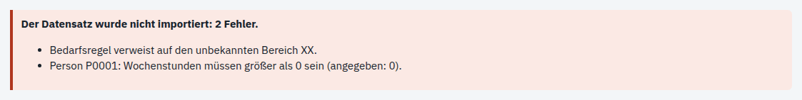
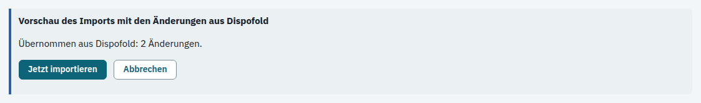
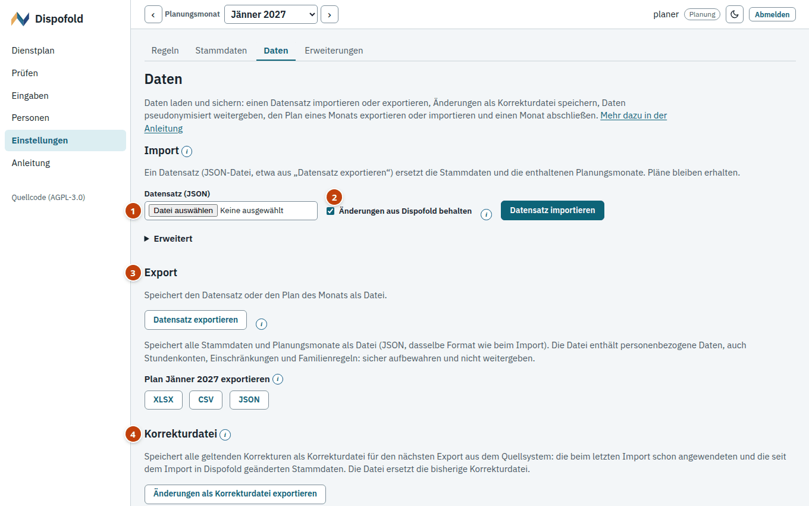
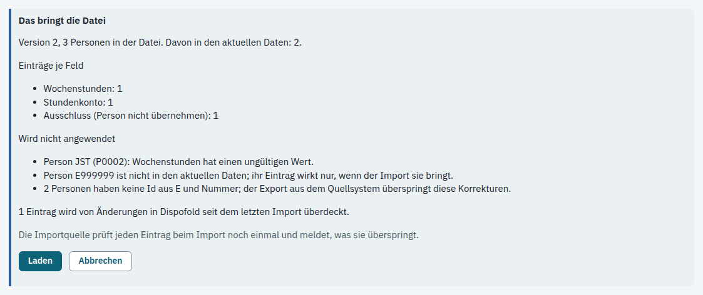

# Daten und Korrekturdatei

Das Menü **Daten** ist für die Arbeit jeden Monat:

- **Übernehmen** holt die Daten für die Planung, siehe [Übernehmen](#übernehmen).
- **Zuordnung** gibt es nur mit einer Erweiterung, die sie braucht (siehe [Erweiterungen](erweiterungen.md)).
- **Monate** zeigt die Monate, offen oder abgeschlossen, siehe [Monate](#monate).
- **Sichern** exportiert und holt Sicherungen zurück, siehe [Sichern](#sichern).

Die Rolle „nur lesen“ sieht das Menü nicht.

## Übernehmen

1. **Quelle**: eine Datensatz-Datei oder, mit einer eingeschalteten Erweiterung, deren Quelle. Die Wahl bleibt für
   das nächste Mal.
2. **1. Einlesen**: die Datei wählen, im Format von [datenformat.md](../datenformat.md) (vom Exportprogramm oder aus
   **Datensatz exportieren**), und **Einlesen**. Das ändert noch nichts in Dispofold. Darunter steht, was gelesen
   wurde: Personen, Bereiche, Schichten und Monate.
3. **2. Übernehmen**: erst nach dem Einlesen. Darüber steht, was sich ändert, etwa „150 Personen, 5 Bereiche, Jänner
   2027; ersetzt die Daten aus …“. Mit dem Häkchen **Änderungen aus Dispofold behalten**, siehe
   [Neuer Datensatz, Änderungen aus Dispofold behalten](#neuer-datensatz-änderungen-aus-dispofold-behalten).

Nach dem Übernehmen nennt die Seite, was übernommen wurde („Import aus „…“: 150 Personen, 5 Bereiche, 13
Schichten, Monate 2027-01.“), wählt den ersten Monat der Daten und bietet **Bereiche prüfen** an (siehe
[Bereiche aller Personen](personen.md#bereiche-aller-personen)).

- Übernehmen ersetzt die Stammdaten und die Planungsmonate, die in der Datei stehen. Vorhandene Pläne bleiben.
- Ein abgeschlossener Monat kann nicht überschrieben werden.
- Während einer Planung eines Monats aus der Datei kann nicht übernommen werden.
- **Warnungen** (etwa zwei Abwesenheiten einer Person am selben Tag) stehen unter der Meldung; übernommen wird
  trotzdem.

**Wenn etwas falsch ist,** wird nichts übernommen, und die Liste aller Fehler erscheint, nur mit Ids, ohne Namen:

Die Fehler sind im Quellsystem oder in der Datei zu beheben, dann neu einlesen und übernehmen. Häufige Fehler und
ihre Bedeutung stehen unter [Häufige Fragen und Fehlerbehebung](fragen.md#import).

**Wenn Stammdaten in Dispofold geändert wurden** und das Häkchen **Änderungen aus Dispofold behalten** nicht gesetzt
ist, würde das Übernehmen diese Änderungen überschreiben. Das Programm fragt dann nach:

- **Datensatz exportieren** sichert den jetzigen Stand als Datei.
- **Änderungen behalten** zeigt die Vorschau wie mit dem Häkchen.
- **Trotzdem importieren** ersetzt die Stammdaten; die Änderungen gehen verloren.
- **Abbrechen** übernimmt nichts.

**Demodaten:** **Demodaten laden (Jänner 2027)** unter **Erweitert** lädt 150 erfundene Personen in fünf
Bereichen mit Eingaben für Jänner 2027, gut zum Ausprobieren (siehe [Ein Monat Schritt für Schritt](beispiel.md)).
Die Demodaten ersetzen alle Stammdaten; nie in einer Installation mit echten Daten laden.

## Neuer Datensatz, Änderungen aus Dispofold behalten

> **Für den Anfang überspringen:** Wichtig erst, wenn nach Änderungen in Dispofold ein neuer Datensatz aus dem
> Quellsystem kommt.

Wer Personen, Einschränkungen oder Bedarf in Dispofold ändert und später einen neuen Datensatz aus dem
Quellsystem importiert, würde diese Änderungen überschreiben. Dafür gibt es zwei Wege, die man auch zusammen
verwenden kann:

1. **Beim Übernehmen behalten:** unter **Daten**, **Übernehmen** den neuen Datensatz einlesen, das Häkchen
   **Änderungen aus Dispofold behalten** setzen (es ist gesetzt, sobald seit dem letzten Import etwas geändert
   wurde) und **Übernehmen**. Eine Vorschau nennt, wie viele Änderungen übernommen werden, wo auch der
   neue Datensatz etwas geändert hat (dort gilt der Wert aus Dispofold; hat der neue Datensatz schon denselben
   Wert, etwa über die Korrekturdatei, steht das Feld nicht dort) und was nicht übernommen werden kann.
   **Jetzt importieren** führt den Import aus.

   
2. **Im Quellsystem nachtragen:** **Änderungen als Korrekturdatei exportieren** speichert alle geltenden
   Korrekturen als Datei `korrekturen.json`: die, die das Exportprogramm beim letzten Import schon angewendet
   hatte, und die Änderungen seit dem Import, je Person und Feld mit dem neueren Wert. Die neue Datei ersetzt die
   bisherige `korrekturen.json` einfach; zusammenführen muss man nichts. Das Exportprogramm wendet sie bei jedem
   weiteren Export an, so kommen sie mit jedem neuen Datensatz wieder mit. Die Meldung nennt, wie viele Einträge
   aus früheren Korrekturen stammen und wie viele seit dem Import geändert wurden. Was die Datei nicht
   ausdrücken kann (zum Beispiel in Dispofold neu angelegte Personen), steht darunter als Liste: Das ist im
   Quellsystem nachzutragen.

   Nennt der letzte Import die schon angewendeten Korrekturen nicht (ein älteres Exportprogramm oder eine andere
   Quelle), sagt die Meldung das: Dann enthält die Datei nur die Änderungen seit dem Import und darf eine
   bisherige Korrekturdatei nicht ersetzen. Abhilfe: das Exportprogramm aktualisieren, mit der bisherigen
   Korrekturdatei neu exportieren, mit **Änderungen aus Dispofold behalten** importieren (sonst gehen die
   Änderungen seit dem letzten Import verloren), dann die Korrekturdatei speichern. Nach den Demodaten erscheint
   dieser Hinweis immer, denn sie kommen nicht aus einem Exportprogramm.

In Dispofold neu angelegte Personen und geänderte Namen lassen sich weder mit der Korrekturdatei noch mit
**Änderungen aus Dispofold behalten** übernehmen (die Vorschau des Imports listet sie weiter auf): Man trägt sie im
Quellsystem ein, dann kommen sie mit dem nächsten Export, oder legt die Person nach dem Import in Dispofold wieder
an beziehungsweise ändert den Namen dort erneut.

Behalten werden Änderungen an Personen (Wochenstunden, Bereiche, Stundenkonto, Ersatzruhe, Eintritt und
Austritt, gewohnte Verteilung, Familienregeln), an ihren Einschränkungen, entfernte Personen, Personen, die nicht
mehr aus dem Quellsystem übernommen werden (oder wieder), und der Bedarf je Bereich. Nicht behalten werden neu
angelegte Personen, geänderte Namen und Kürzel sowie Änderungen an Bereichen, Schichten, Abwesenheitsarten und
Feiertagen.

## Monate

Die Monate mit Daten oder Plan, je Zeile der Zustand (**offen** oder **abgeschlossen**) und der Stand des Plans.
**Monat abschließen …** zeigt dieselbe Prüfliste wie auf dem Dienstplan, **Monat wieder öffnen** öffnet einen
abgeschlossenen Monat nach einer Rückfrage. Ein Klick auf den Monat wählt ihn und öffnet den Dienstplan. Mehr dazu
unter [Monat abschließen](monatsabschluss.md).

## Sichern

Sicherungen und Dateien, für den gewählten Monat: einen Datensatz zurückholen (dieselben zwei Schritte wie unter
Übernehmen), exportieren, die Korrekturdatei, pseudonymisieren und einen Plan zurückholen. Eine Erweiterung kann
unter **Für Fachleute** eigene Dateien anbieten.

### Exportieren

- **Datensatz exportieren** speichert alle Stammdaten und Planungsmonate als Datei im Format von
  [datenformat.md](../datenformat.md). Die Datei lässt sich später wieder importieren. Sie enthält personenbezogene
  Daten (auch Stundenkonten, Einschränkungen und Familienregeln) und ist entsprechend sicher aufzubewahren.
- **Plan Jänner 2027 exportieren** (mit dem gewählten Monat) als XLSX (Excel), CSV oder JSON, hier oder im Menü
  **Ausgabe** des Dienstplans. XLSX ist zum Weiterbearbeiten in einer Tabellenkalkulation, CSV für andere
  Programme, JSON zum späteren **Plan importieren**. Im Programmfenster der Desktop-Version landet die Datei im
  Ordner Downloads, eine Meldung nennt den Namen.
- Während einer Planung ist der Export gesperrt.
- Hat der Plan Regelverstöße, endet der Dateiname auf `-mit-verstoessen`. In XLSX heißt das Blatt „Dienstplan mit
  Verstößen“ und trägt den Hinweis „Achtung: … Regelverstöße, Plan nicht verwendbar“; in CSV steht dieser Hinweis
  in der ersten Zeile.

### Korrekturdatei

**Änderungen als Korrekturdatei exportieren** speichert alle geltenden Korrekturen (die beim letzten Import schon
angewendeten und die seit dem Import in Dispofold geänderten Stammdaten) als `korrekturen.json` für das
Exportprogramm; sie ersetzt die bisherige Datei, siehe
[Neuer Datensatz, Änderungen aus Dispofold behalten](#neuer-datensatz-änderungen-aus-dispofold-behalten). Die
Meldung danach sagt:

- wie viele Änderungen die Datei enthält („Korrekturdatei mit 2 Änderungen gespeichert.“) und, wenn der letzte
  Import sie nennt, wie viele aus früheren Korrekturen stammen;
- ob der letzte Import die schon angewendeten Korrekturen nennt; wenn nicht, enthält die Datei nur die Änderungen
  seit diesem Import und darf eine bisherige Korrekturdatei nicht einfach ersetzen;
- was nicht in die Datei kommt und im Quellsystem nachzutragen ist, zum Beispiel neu angelegte Personen. Mit den
  Demodaten steht dort außerdem „1 Person hat keine Id aus E und Nummer; der Export aus dem Quellsystem überspringt
  diese Korrekturen.“: Das Exportprogramm kennt Personen nur unter Ids aus dem Buchstaben E und einer Nummer, die
  erfundenen Personen der Demodaten haben andere Ids.

Gibt es keine Korrektur, wird keine Datei gespeichert („Es gibt keine Änderung für die Korrekturdatei; es wurde
keine Datei gespeichert.“). Wurde seit dem Import aber etwas geändert und wieder zurückgenommen, etwa ein
Ausschluss (siehe [Nicht mehr aus dem Quellsystem übernehmen](personen.md#nicht-mehr-aus-dem-quellsystem-übernehmen)),
wird eine Datei ohne Einträge gespeichert, die eine dazwischen gespeicherte ersetzt, und die Meldung nennt, wie
viele Personen wieder übernommen werden.

**Wann:** nach jeder Änderung an Personen, Einschränkungen oder Bedarf, spätestens vor dem nächsten Export aus dem
Quellsystem. Die Datei bekommt die IT oder wer das Exportprogramm betreut.

#### Korrekturdatei laden

Wer bisher mit einem Exportprogramm und einer Korrekturdatei gearbeitet hat und nun über eine Erweiterung direkt
importiert (siehe [Erweiterungen](erweiterungen.md)), bringt diese Datei einmal nach Dispofold, am besten vor dem
ersten Import. Ohne sie fehlen dem Import die Korrekturen daraus (Einschränkungen, Ausschlüsse, Wochenstunden und so
weiter), und der Plan gibt Personen Dienste, die sie nie machen.

1. Unter **Vorhandene Korrekturdatei (JSON)** die Datei wählen (meist `korrekturen.json`) und **Korrekturdatei
   laden**. Gespeichert wird noch nichts.
2. Dispofold prüft die Datei wie das Exportprogramm. Ist sie keine Korrekturdatei, hat sie eine unbekannte
   Version (verstanden werden die Versionen 1 und 2) oder sind ihre Abschnitte kein Objekt, sagt die Meldung das und
   lädt nichts.
3. Sonst zeigt **Das bringt die Datei**: wie viele Personen sie nennt und wie viele davon schon in den Daten sind
   (auf einer leeren Datenbank zeigt das erst der Import), die Einträge je Feld und unter **Wird nicht angewendet**
   die Einträge, die nicht wirken, mit dem Grund (ein unbekanntes Feld, ein ungültiger Wert, ein unbekannter
   Bereich, eine Person, die es nicht gibt, und so weiter). Die Importquelle prüft jeden Eintrag beim Import noch
   einmal und meldet, was sie überspringt.
4. **Laden** speichert die Datei. Darunter steht dann „Geladene Korrekturdatei vom …: sie wartet auf den nächsten
   Import über eine Importquelle.“ mit derselben Zusammenfassung.

So wirkt die geladene Datei:

- Der nächste Import über eine Importquelle (etwa eine Erweiterung) wendet sie an, als hätte ein früherer Import
  sie angewendet. Danach gehört sie zu den Korrekturen dieses Imports: Die Meldung „Geladene Korrekturdatei“
  verschwindet, und **Änderungen als Korrekturdatei exportieren** enthält ihre Einträge weiter.
- Änderungen in Dispofold seit dem letzten Import gewinnen je Person und Feld. Hat man etwa die Wochenstunden
  einer Person in Dispofold geändert, gelten diese, ihre übrigen Einträge aus der Datei gelten weiter. Die
  Zusammenfassung sagt, wie viele Einträge so überdeckt werden.
- Die geladene Datei ersetzt die Korrekturen, die der letzte Import angewendet hat; auch das nennt die
  Zusammenfassung.
- Erneutes Laden ersetzt die geladene Datei (die Schaltfläche heißt dann **Laden und die geladene Datei
  ersetzen**). **Geladene Datei entfernen** nimmt sie zurück, solange kein Import sie angewendet hat.
- Das Übernehmen einer Datensatz-Datei ändert an der geladenen Datei nichts und wendet sie nicht an.
- Bis zum Import bekommt auch **Änderungen als Korrekturdatei exportieren** die geladene Datei mit den Änderungen
  aus Dispofold darüber, auch auf einer leeren Datenbank.

Gibt es gar keine Korrekturen (keine geladene Datei, keine Änderung in Dispofold und keine Korrektur aus dem letzten
Import), steht über jedem Import einer Importquelle ein Hinweis mit dem Weg hierher, auf dieser Seite und auf den
Seiten einer Erweiterung, die importiert.

### Pseudonymisieren

> **Für den Anfang überspringen:** Nur nötig, wenn Daten für eine Fehlersuche weitergegeben werden.

**Pseudonymisierte Kopie erstellen** erstellt den Datensatz und den Plan des gewählten Monats mit Pseudonymen
(P001, P002, ...) statt Namen, zum Weitergeben, etwa für eine Fehlersuche. Namen, Kürzel und Ids der Personen
werden ersetzt, die Namen von Bereichen, Schichten und Abwesenheitsarten durch ihren Code, Notizen der
Familienregeln geleert. Danach speichern **Datensatz speichern** und **Plan speichern** die beiden Dateien zum
Weitergeben. **Schlüssel speichern** speichert die Zuordnung der Pseudonyme zu den Personen: Sie bleibt in der
Planung und wird nie weitergegeben. Steht nach dem Pseudonymisieren noch ein Name in den Dateien, exportiert das
Programm nichts und nennt die Stelle.

### Plan importieren

> **Für den Anfang überspringen:** Nur nötig, um einen früher exportierten Plan zurückzuholen.

**Plan importieren** ersetzt den Plan des gewählten Monats durch einen früher exportierten Plan desselben Monats
im JSON-Format, nach einer Rückfrage. Gehört die Datei zu einem anderen Monat, meldet das Programm „Die Datei
enthält den Plan für …, gewählt ist …“; dann zuerst den Planungsmonat umstellen. **Wann:** um einen früheren Stand
zurückzuholen, etwa nach einer missglückten Planung.
