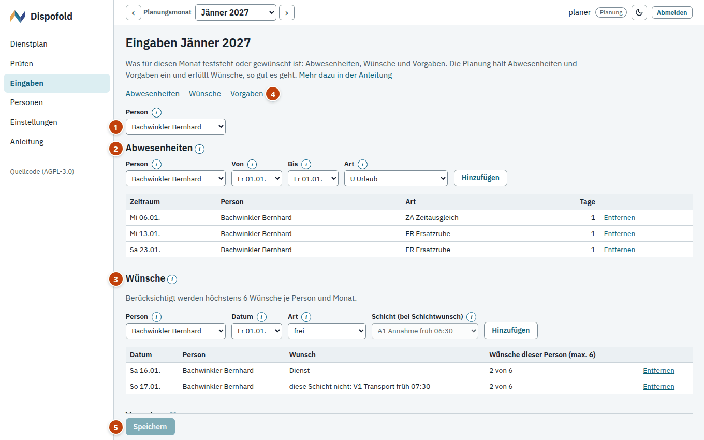

# Abwesenheiten, Wünsche und Vorgaben

## Eingaben

Unter **Eingaben** steht, was für den gewählten Monat feststeht oder gewünscht ist:

- **Abwesenheiten:** Person, **Von**, **Bis** und Art (zum Beispiel Urlaub oder Krankenstand). Eine
  Abwesenheit über mehrere Tage ist ein Eintrag mit Zeitraum und Zahl der Tage. An diesen Tagen plant der Solver
  keinen Dienst. Ob die Tage wie gearbeitet zählen oder vom Stundenkonto gehen, sagt die Abwesenheitsart.
- **Wünsche:** frei, Dienst, diese Schicht oder diese Schicht nicht. Je Person zählen höchstens so viele Wünsche,
  wie unter **Regeln** eingestellt ist (Standard 6), und zwar die ersten nach Datum. Die Spalte **Wünsche der
  Person** zeigt, wenn es zu viele sind.
- **Vorgaben:** Dienste oder freie Tage, die fest gelten. Der Solver ändert sie nicht, auch nicht beim Lösen der
  Fixierungen.

Die Auswahl **Person** oben zeigt nur die Einträge einer Person; neue Einträge sind dann für diese Person
vorbelegt. Gespeichert wird immer der ganze Monat. Mit **Hinzufügen** und **Entfernen** ändert man die Listen,
mit **Speichern** übernimmt man sie. Solange etwas nicht gespeichert ist, steht **Ungespeicherte Änderungen** da;
wer die Seite dann verlässt, wird gefragt. In einem abgeschlossenen Monat sind die Eingaben nur lesbar.

**Wenn jemand anderer inzwischen gespeichert hat** (nur im Serverbetrieb mit mehreren Planerinnen und Planern
möglich), fragt das Programm beim Speichern nach:

- **OK:** Die eigenen Änderungen werden in die neue Fassung übernommen. Hat die andere Person denselben Eintrag
  (gleiche Person, gleicher Tag) anders geändert, gilt die eigene Änderung. Die Meldung nennt, wie viele Einträge
  das betrifft. Danach die Eingaben prüfen und noch einmal **Speichern**.
- **Abbrechen:** Die eigenen Änderungen werden verworfen, die neue Fassung wird geladen.
