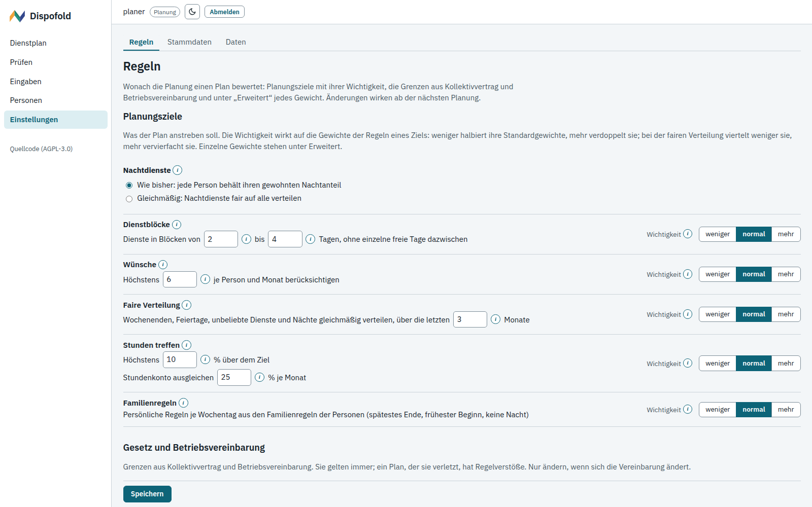

# Regeln einstellen

## Einstellungen

**Einstellungen** hat die Reiter **Regeln**, **Stammdaten**, **Daten** und im Programm am eigenen Rechner
**Updates**.

### Regeln

Die Regeln gelten für alle Monate und wirken ab der nächsten Planung. Drei Abschnitte:

- **Planungsziele:** oben die Einstellung **Nachtdienste**: „Wie bisher“ (jede Person behält ihren gewohnten
  Nachtanteil, Standard) oder „Gleichmäßig“ (Nachtdienste fair auf alle verteilen). Bei „Wie bisher“ ergeben sich
  die Nächte einer Person mit Anteilen je Schichtart aus ihrem Nachtanteil; sie ist nicht im Nachtausgleich
  (Fairness Nachtdienste) und nicht in der Abwechslung Dienste. Bei „Gleichmäßig“ zählt der Nachtanteil nicht:
  Die Person ist im Nachtausgleich, die übrigen Anteile gelten für ihre Dienste außer Nächten. In beiden Fällen
  ist nicht im Nachtausgleich, wer nie Nacht macht (eine Einschränkung „Nie“ für jeden Tag auf alle
  Nachtschichten der eigenen Bereiche oder eine Familienregel „keine Nacht“ an allen sieben Wochentagen). Ist „Wie
  bisher“ gewählt und das Gewicht von **Gewohnte Verteilung** 0, warnt die Seite.

  Darunter die Ziele **Dienstblöcke** (Blöcke von ... bis ... Tagen), **Wünsche** (höchstens ... je Person und
  Monat), **Faire Verteilung** (Wochenenden, Feiertage, unbeliebte Dienste und Nächte, über die letzten ...
  Monate), **Stunden treffen** (höchstens ... % über dem Ziel, Stundenkonto ausgleichen ... % je Monat) und
  **Familienregeln**, jedes mit einer **Wichtigkeit**: **weniger**, **normal** oder **mehr** setzt die Gewichte
  der Regeln dieses Ziels auf das 0,5-, 1- oder 2-Fache ihres Standards, bei der fairen Verteilung auf das
  0,25-, 1- oder 4-Fache. Wurde ein Gewicht des Ziels unter
  **Erweitert** von Hand geändert, steht dort **angepasst**; die Wahl einer Wichtigkeit überschreibt diese
  Gewichte wieder.
- **Gesetz und Betriebsvereinbarung:** Ruhezeiten, Höchstdauer eines Dienstes, Höchstarbeitszeit je Woche,
  Höchststunden im Monat, durchschnittliche Wochenarbeitszeit mit dem Durchrechnungszeitraum, freie Sonntage und
  Ersatzruhe für Feiertagsdienste, als Text. Erst **Ändern** macht die Felder bearbeitbar. Die tägliche Ruhezeit
  kann nicht unter 11 Stunden gesetzt werden.
- **Erweitert** (zugeklappt): die Nachtzeit (Beginn, Ende, Mindeststunden) und alle Regeln mit Beschreibung,
  nach Qualität, Regelverstoß und Bedarf. Die Gewichte der Qualitätsregeln sind Zahlenfelder mit dem
  Standardwert und **Zurücksetzen**; bei den Regeln eines Planungsziels steht, zu welchem Ziel sie gehören. Das
  Gewicht von **Dienst nur auf Anfrage** ist fest: Solche Dienste plant das Programm ohnehin nie selbst ein.

Die Beschreibungen der Regeln nennen die eingestellten Werte. Die Leiste mit **Speichern** bleibt beim Blättern
sichtbar und zeigt **Nicht gespeichert**, solange Änderungen offen sind; wer die Seite dann verlässt, wird
gefragt. Regeln, die mit einer älteren Version gespeichert wurden, laden unverändert; ohne Einstellung der
Nachtdienste gilt „Wie bisher“.
