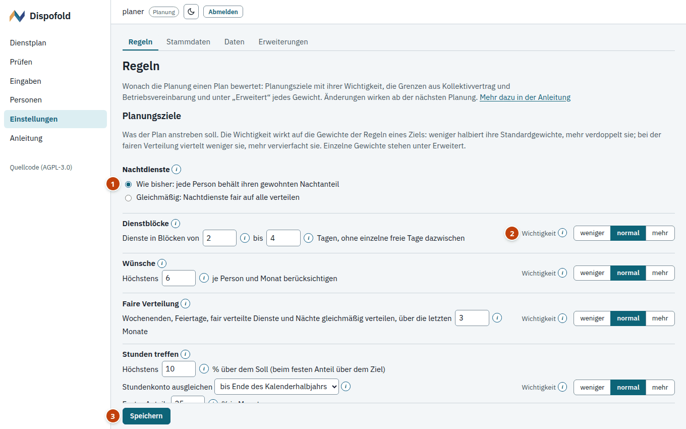

# Regeln einstellen

**Einstellungen** hat die Reiter **Regeln**, **Stammdaten** (siehe
[Bereiche, Schichten und Bedarf](stammdaten.md)), **Erweiterungen** (siehe [Erweiterungen](erweiterungen.md))
und im Programm am eigenen Rechner **Updates** (siehe [Updates](updates.md)); sie öffnet mit dem Reiter, der
zuletzt offen war. Daten übernehmen, Monate und Sicherungen stehen im eigenen Menü **Daten** (siehe
[Daten und Korrekturdatei](daten.md)). Diese Seite beschreibt den Reiter **Regeln**:
wonach die Planung einen Plan bewertet. Die Regeln gelten für alle Monate und wirken ab der nächsten Planung;
schon geplante Monate zeigen nach dem Speichern „Plan veraltet: neu planen“.

1. **Nachtdienste:** wie Nächte verteilt werden, siehe unten.
2. **Wichtigkeit** eines Planungsziels: **weniger**, **normal** oder **mehr**.
3. **Speichern:** Die Leiste bleibt beim Blättern sichtbar und zeigt **Nicht gespeichert**, solange Änderungen
   offen sind; wer die Seite dann verlässt, wird gefragt.

Jede Regel, jede Einstellung und jedes Feld hat ein **i** mit einer Erklärung, was ein höherer oder niedrigerer
Wert bewirkt. Die Regeln im Einzelnen, mit Beispielen, was jede verhindert, stehen in [regeln.md](../regeln.md).

**Vor dem ersten Monat:** die Werte unter [Gesetz und Betriebsvereinbarung](#gesetz-und-betriebsvereinbarung) mit
der eigenen Vereinbarung vergleichen. Die Planungsziele kann man zunächst auf **normal** lassen und erst ändern,
wenn ein Plan in einer Richtung auffällt.

## Planungsziele

**Nachtdienste** ganz oben:

- **Wie bisher** (Standard): Jede Person behält ihren gewohnten Nachtanteil. Die Nächte einer Person mit Anteilen
  je Schichtart ergeben sich aus ihrem Nachtanteil; sie ist nicht im Nachtausgleich (Fairness Nachtdienste) und
  nicht in der Abwechslung Dienste.
- **Gleichmäßig:** Nachtdienste werden fair auf alle verteilt. Der Nachtanteil der gewohnten Verteilung zählt
  nicht: Die Person ist im Nachtausgleich, die übrigen Anteile gelten für ihre Dienste außer Nächten.
- In beiden Fällen ist nicht im Nachtausgleich, wer [nie Nacht](begriffe.md#nie-nacht) macht.
- **Gewohnter Nachtanteil über 3 Monate** (Standard 3, nur bei „Wie bisher“ zu sehen): Der Nachtanteil einer Person gilt über diesen Monat und die
  Vormonate in der Historie zusammen, nicht in jedem einzelnen Monat. Wer in den zwei Monaten davor viele Nächte
  hatte, bekommt jetzt wenige, und umgekehrt; so wechseln in einem Monat weniger Personen zwischen Tag und
  Nacht. 1 heißt: jeder Monat für sich, wie bis Version 0.27.
- Ist „Wie bisher“ gewählt und das Gewicht von **Gewohnte Verteilung** 0, warnt die Seite: Personen mit gewohnter
  Verteilung hätten dann keine Regel für Nachtdienste.
- **Wann ändern:** „Gleichmäßig“, wenn die Nächte bewusst neu verteilt werden sollen, etwa nach einer neuen
  Vereinbarung. Personen mit hohem Nachtanteil bekommen dann weniger, andere mehr.

Darunter die Ziele, jedes mit seinen Werten und einer **Wichtigkeit**:

| Ziel | Werte (Standard) | Was es bewirkt |
|---|---|---|
| Dienstblöcke | Blöcke von 2 bis 4 Tagen | Dienste in Blöcken dieser Länge, ohne einzelne freie Tage dazwischen |
| Wechsel zwischen Tag und Nacht | nach der letzten Nacht eines Blocks 2 freie Tage vor einem Dienst am Tag, vor der ersten Nacht 0; Nächte in Blöcken von 2 bis 4 Nächten | Nächte liegen in Blöcken, danach kommt Erholung, und eine Person wechselt selten zwischen Tag und Nacht |
| Wünsche | höchstens 6 je Person und Monat | so viele Wünsche je Person zählen, die ersten nach Datum |
| Faire Verteilung | über die letzten 3 Monate | Wochenenden, Feiertage, fair verteilte Dienste und Nächte gleichmäßig verteilen |
| Stunden treffen | höchstens 10 % über dem Soll (beim festen Anteil über dem Ziel), Stundenkonto ausgleichen bis Ende des Kalenderhalbjahrs (fester Anteil 25 % je Monat als Alternative), Minus am Halbjahresende verfällt | geplante und angerechnete Stunden nahe am Ziel; die Obergrenze ist ein Regelverstoß |
| Familienregeln | keine Werte | die persönlichen Regeln der Personen einhalten, wenn es geht |

- **Ausgleich des Stundenkontos:** Standard ist **bis Ende des Kalenderhalbjahrs**. Am Ende jedes Halbjahrs soll
  das Stundenkonto bei 0 stehen, denn über das Halbjahr sind die vereinbarten Stunden geschuldet, bei Teilzeit
  die Stunden laut Vertrag. Jeder Monat gleicht seinen Teil aus: Ziel = Soll minus Stundenkonto geteilt durch die
  Monate, die im Halbjahr noch bleiben. Im Jänner und im Juli beginnt das Konto bei 0. Was am Halbjahresende
  übrig war, wird außerhalb des Plans abgerechnet; die Personenseite zeigt es als **Abgerechnet Ende
  Vorhalbjahr**. Beispiel, eine Person mit 168 h Soll in jedem Monat:

  | Monat | Konto vorher | Monate übrig | Ziel | geplant | Konto danach |
  |---|---|---|---|---|---|
  | Jänner | 0 h | 6 | 168 h | 180 h | +12 h |
  | Februar | +12 h | 5 | 165,6 h | 165,6 h | +9,6 h |
  | März | +9,6 h | 4 | 165,6 h | 160 h | +1,6 h |
  | April | +1,6 h | 3 | 167,5 h | 167,5 h | +1,1 h |
  | Mai | +1,1 h | 2 | 167,5 h | 172 h | +5,1 h |
  | Juni | +5,1 h | 1 | 162,9 h | 162,9 h | 0 h |

  Wer den Zielen folgt, kommt am Ende auf 0; im Juni ist der ganze Rest dran. Das Ziel geht dabei höchstens bis Soll plus 10 % (die Obergrenze) und nicht
  unter 0 h; was nicht hineinpasst, zeigt die Seite **Prüfen** unter **Stundenkonto: Rest passt nicht in den
  Monat**, kein Regelverstoß. **Minus ins nächste Halbjahr mitnehmen:** aus (Standard), dann verfällt ein Minus
  am Halbjahresende; ein, dann beginnt das neue Halbjahr damit. Ein Plus kommt nie mit.
  Die Alternative **mit festem Anteil je Monat** zieht jeden Monat denselben Anteil des Kontos ab (Standard 25 %:
  ein Viertel), das Konto läuft über das Halbjahr hinaus weiter. Bei gleitender Durchrechnung gilt immer der feste
  Anteil.
- **Höchstens über dem Soll:** Mit 10 % darf eine Person mit Soll 120 h bis 132 h bekommen (beim festen Anteil des Stundenkontos gilt das Ziel statt des Solls). Höher: mehr Spielraum
  für den Bedarf. Niedriger: Stunden bleiben enger am Ziel, eher offener Bedarf.

**Wichtigkeit:** **weniger**, **normal** oder **mehr** setzt die Gewichte der Regeln dieses Ziels auf das 0,5-, 1-
oder 2-Fache ihres Standards, bei der fairen Verteilung auf das 0,25-, 1- oder 4-Fache. Wurde ein Gewicht des Ziels
unter **Erweitert** von Hand geändert, steht dort **angepasst**; die Wahl einer Wichtigkeit überschreibt diese
Gewichte wieder. Was eine Wichtigkeit in der Praxis ändert und wie sicher das ist, steht je Ziel in
[regeln.md](../regeln.md#qualität). Kurz: Sie verschiebt nur die Qualitätsregeln gegeneinander; Regelverstöße und
offener Bedarf gehen immer vor. Gemessen ist die Wirkung bisher nur für die faire Verteilung, und dort ist sie
klein.

**Wann ändern:** wenn ein Plan in einer Richtung auffällt, zum Beispiel viele unerfüllte Wünsche (Wünsche auf
„mehr“), zu viele kurze Blöcke (Dienstblöcke auf „mehr“) oder zu viele Wechsel zwischen Tag und Nacht (Wechsel
zwischen Tag und Nacht auf „mehr“). Danach neu planen und die Zahlen über dem Plan vergleichen.

**Wechsel zwischen Tag und Nacht** im Einzelnen:

- **Freie Tage nach Nächten** (Standard 2, 0 bis 4): nach der letzten Nacht eines Blocks so viele freie Tage,
  bevor wieder ein Dienst am Tag kommt. Abwesenheiten und Ersatzruhe zählen als frei.
- **Freie Tage vor der ersten Nacht** (Standard 0, 0 bis 4): nach Tagdiensten vor der ersten Nacht. 0 erlaubt
  Tag direkt auf Nacht; das ist Vorwärtsrotation.
- **Kürzester Nachtblock** und **Längster Nachtblock** (Standard 2 und 4 Nächte): Eine einzelne Nacht oder fünf
  Nächte hintereinander kosten. Ein Block am Monatsende darf im nächsten Monat weitergehen.
- Jeder Wechsel zwischen Nacht und Dienst am Tag kostet außerdem ein wenig, auch über freie Tage hinweg (Regel
  **Wechsel zwischen Tag und Nacht** unter Erweitert, Gewicht 3000; 0 schaltet das ab).
- 0 freie Tage oder Gewicht 0 schaltet die jeweilige Regel aus.

## Gesetz und Betriebsvereinbarung

Grenzen aus Kollektivvertrag und Betriebsvereinbarung. Sie gelten immer; ein Plan, der sie verletzt, hat
Regelverstöße. Die Seite zeigt sie als Text; erst **Ändern** macht die Felder bearbeitbar. Nur ändern, wenn sich
die Vereinbarung ändert.

| Feld | Standard | Bedeutung |
|---|---|---|
| Tägliche Ruhezeit (h) | 11 | Ruhe zwischen zwei Diensten; nicht unter 11 einstellbar |
| Wöchentliche Ruhezeit (h) | 36 | Ruhe am Stück je Kalenderwoche |
| Höchstdauer eines Dienstes (h) | 12 | kein Dienst länger |
| Höchstarbeitszeit je Woche (h) | 60 | Stunden je Kalenderwoche |
| Durchschnittliche Wochenarbeitszeit bei Vollzeit (h) | 46,16 | Obergrenze des Wochenschnitts für alle |
| Durchrechnung | je Kalenderhalbjahr | Zeitraum des Wochenschnitts: je Kalenderhalbjahr (Jänner bis Juni, Juli bis Dezember) oder gleitend über den Durchrechnungszeitraum |
| Durchrechnungszeitraum (Wochen) | 52 | nur bei gleitender Durchrechnung; mindestens 7 eintragen, bei 1 bis 6 Wochen zählt kein Vormonat und der Schnitt wird nie zum Regelverstoß |
| Spielraum über den eigenen Wochenstunden (%) | 10 | eigene Grenze des Wochenschnitts: Wochenstunden plus dieser Anteil, höchstens der Vollzeitschnitt; 0 = genau die Wochenstunden |
| Freie Sonntage je Monat | 2 | Sonntage ohne Dienst je Person und Kalendermonat; 0 schaltet die Regel aus |
| Frei mitten in einer Abwesenheit | ja | ein Feiertag, Samstag oder Sonntag zwischen zwei Werktagen mit Urlaub, Krankenstand oder Zeitausgleich bekommt keinen Dienst |
| Feiertagsdienst ergibt Ersatzruhe | ja | ein Dienst an einem Feiertag bringt einen Ersatzruhetag |

**Wochenschnitt:** Jede Person wird an ihrem eigenen Vertrag gemessen. Mit 10 % Spielraum darf eine Person mit
20 Wochenstunden im Schnitt des Durchrechnungszeitraums 22 Stunden arbeiten, mit 40 Wochenstunden 44, nie mehr
als 46,16. Standard ist die Durchrechnung je Kalenderhalbjahr: Im März zählen Jänner, Februar und März, im Juli
nur der Juli. Ein Regelverstoß ist der Schnitt erst, wenn die Historie alle Vormonate des Zeitraums enthält; die
Personenseite zeigt den Schnitt und die eigene Grenze.

**Frei mitten in einer Abwesenheit:** Ist der Mittwoch ein Feiertag und hat die Person Montag, Dienstag, Donnerstag
und Freitag Urlaub, bleibt der Mittwoch frei. Ebenso das Wochenende zwischen zwei Urlaubswochen; nach einer
einzelnen Urlaubswoche bleibt das Wochenende planbar. Ein Feiertag ist auch frei, wenn die Person an allen
anderen Werktagen seiner Woche abwesend ist, etwa am Pfingstmontag bei Urlaub von Dienstag bis Freitag. Soll und Stundenkonto ändern sich dadurch nicht. Einzelheiten
in den [Planungsregeln](../regeln.md).

Die Höchststunden im Monat stehen hier als Text („Im Monat höchstens 10 % über dem Soll, beim festen Anteil über dem Ziel“), eingestellt werden sie
beim Ziel **Stunden treffen**.

## Erweitert

> **Für den Anfang überspringen:** Die Planungsziele oben reichen fast immer; die einzelnen Gewichte sind für
> Fortgeschrittene.

Zugeklappt. Darin:

**Gründlichkeit:** wie lange die Planung nach einem besseren Plan sucht.

| Wahl | Schritte | Dauer mit etwa 150 Personen | Wann |
|---|---|---|---|
| schnell | 250 000 | etwa 1,5 Minuten | zum Ausprobieren; so plante Dispofold bis Version 0.27 |
| normal (Standard) | 1 000 000 | etwa 6 bis 7 Minuten | für den Monatsplan |
| gründlich | 3 000 000 | etwa 20 Minuten | wenn der Plan noch besser werden soll, etwa über Nacht |

Die Dauer hängt vom Rechner und von der Größe des Monats ab, mit weniger Personen ist sie kürzer. Die Zahl der
Schritte hängt nicht davon ab: Gleiche Daten, gleicher Startwert und gleiche Gründlichkeit ergeben denselben
Plan. Während die Planung läuft, zeigt die Zeile über dem Plan, wie lange sie schon rechnet und vor wie vielen
Sekunden sie zuletzt einen besseren Plan gefunden hat.

**Nachtzeit:** wann ein Dienst als Nacht zählt.

| Feld | Standard |
|---|---|
| Nachtzeit Beginn | 22:00 |
| Nachtzeit Ende | 06:00 |
| Mindeststunden in der Nachtzeit | 2 (so viele Stunden eines Dienstes müssen in der Nachtzeit liegen) |

**Alle Regeln mit Beschreibung,** nach Qualität, Regelverstoß und Bedarf. Die Gewichte der Qualitätsregeln sind
Zahlenfelder (ganze Zahlen ab 0) mit dem Standardwert daneben und **Zurücksetzen**; bei den Regeln eines
Planungsziels steht, zu welchem Ziel sie gehören. Die Standardgewichte:

| Regel | Standard | Ziel |
|---|---|---|
| Stunden treffen | 20 | Stunden treffen |
| Fairness Nachtdienste, Wochenenden, Feiertage | je 3 | Faire Verteilung |
| Fairness fair verteilte Dienste | 2 | Faire Verteilung |
| Wünsche | 300 | Wünsche |
| Dienstblöcke | 18000 | Dienstblöcke |
| Einzelne freie Tage | 30000 | Dienstblöcke |
| Abstand zwischen Tag und Nacht | 10000 | Wechsel zwischen Tag und Nacht |
| Wechsel zwischen Tag und Nacht | 3000 | Wechsel zwischen Tag und Nacht |
| Nachtblöcke | 6000 | Wechsel zwischen Tag und Nacht |
| Familienregel | 800 | Familienregeln |
| Gewohnte Verteilung | 100 | keines |
| Vorwärtsrotation | 500 | keines |
| Ganze Wochenenden frei | 300 | keines |
| Ersatzruhe abbauen | 500 | keines |
| Abwechslung Dienste | 5 | keines |
| Abwechslung Bereiche | 1 | keines |
| Dienst nur von Hand | 1000, fest | keines |

Die Zahlen sind nur im Verhältnis zueinander wichtig, nicht für sich. Das Gewicht von **Dienst nur von Hand**
ist fest: Solche Dienste plant das Programm ohnehin nie selbst ein. Regeln der Gruppen Regelverstoß und Bedarf
haben kein Gewicht. **Wann ändern:** selten, und nur eine Regel auf einmal; meist reicht die Wichtigkeit eines
Ziels. Ein Gewicht 0 schaltet eine Regel aus.

Die Beschreibungen der Regeln nennen die eingestellten Werte. Regeln, die mit einer älteren Version gespeichert
wurden, laden unverändert; ohne Einstellung der Nachtdienste gilt „Wie bisher“. Ausnahme ab Version 0.28: Stehen
die Gewichte von **Dienstblöcke** und **Einzelne freie Tage** noch auf den alten Standards (6000 und 10000, oder
beide auf derselben Wichtigkeit davon), bekommen sie beim ersten Laden die neuen (18000 und 30000, oder dieselbe
Wichtigkeit davon). Von Hand gesetzte Gewichte bleiben. Die neuen Regeln und die Gründlichkeit beginnen mit
ihrem Standard.
