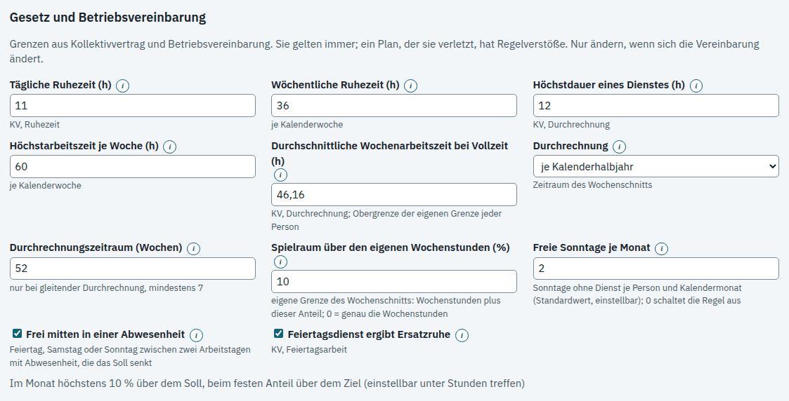
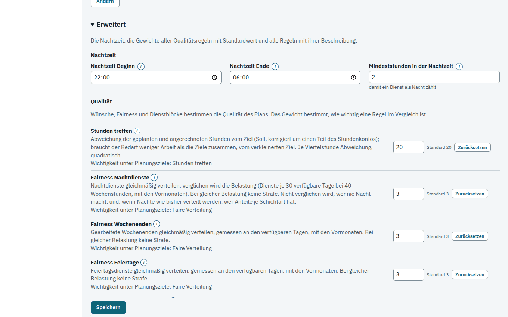

# Regeln einstellen

**Einstellungen** hat die Reiter **Regeln**, **Stammdaten** (siehe
[Bereiche, Schichten und Bedarf](stammdaten.md)), **Daten** (siehe [Daten und Korrekturdatei](daten.md)) und im
Programm am eigenen Rechner **Updates** (siehe [Updates](updates.md)). Diese Seite beschreibt den Reiter **Regeln**:
wonach die Planung einen Plan bewertet. Die Regeln gelten für alle Monate und wirken ab der nächsten Planung;
schon geplante Monate zeigen nach dem Speichern „Plan veraltet: neu planen“.

1. **Nachtdienste:** wie Nächte verteilt werden, siehe unten.
2. **Wichtigkeit** eines Planungsziels: **weniger**, **normal** oder **mehr**.
3. **Speichern:** Die Leiste bleibt beim Blättern sichtbar und zeigt **Nicht gespeichert**, solange Änderungen
   offen sind; wer die Seite dann verlässt, wird gefragt.

Jede Regel, jede Einstellung und jedes Feld hat ein **i** mit einer Erklärung, was ein höherer oder niedrigerer
Wert bewirkt. Die Regeln im Einzelnen, mit Beispielen, was jede verhindert, stehen in [regeln.md](../regeln.md).

**Vor dem ersten Monat:** die Werte unter [Gesetz und Betriebsvereinbarung](#gesetz-und-betriebsvereinbarung) mit
der eigenen Vereinbarung vergleichen. Die Planungsziele kann man zunächst auf **normal** lassen und erst ändern,
wenn ein Plan in einer Richtung auffällt.

## Planungsziele

**Nachtdienste** ganz oben:

- **Wie bisher** (Standard): Jede Person behält ihren gewohnten Nachtanteil. Die Nächte einer Person mit Anteilen
  je Schichtart ergeben sich aus ihrem Nachtanteil; sie ist nicht im Nachtausgleich (Fairness Nachtdienste) und
  nicht in der Abwechslung Dienste.
- **Gleichmäßig:** Nachtdienste werden fair auf alle verteilt. Der Nachtanteil der gewohnten Verteilung zählt
  nicht: Die Person ist im Nachtausgleich, die übrigen Anteile gelten für ihre Dienste außer Nächten.
- In beiden Fällen ist nicht im Nachtausgleich, wer [nie Nacht](begriffe.md#nie-nacht) macht.
- Ist „Wie bisher“ gewählt und das Gewicht von **Gewohnte Verteilung** 0, warnt die Seite: Personen mit gewohnter
  Verteilung hätten dann keine Regel für Nachtdienste.
- **Wann ändern:** „Gleichmäßig“, wenn die Nächte bewusst neu verteilt werden sollen, etwa nach einer neuen
  Vereinbarung. Personen mit hohem Nachtanteil bekommen dann weniger, andere mehr.

Darunter die Ziele, jedes mit seinen Werten und einer **Wichtigkeit**:

| Ziel | Werte (Standard) | Was es bewirkt |
|---|---|---|
| Dienstblöcke | Blöcke von 2 bis 4 Tagen | Dienste in Blöcken dieser Länge, ohne einzelne freie Tage dazwischen |
| Wünsche | höchstens 6 je Person und Monat | so viele Wünsche je Person zählen, die ersten nach Datum |
| Faire Verteilung | über die letzten 3 Monate | Wochenenden, Feiertage, unbeliebte Dienste und Nächte gleichmäßig verteilen |
| Stunden treffen | höchstens 10 % über dem Ziel, Stundenkonto ausgleichen 25 % je Monat | geplante und angerechnete Stunden nahe am Ziel; die Obergrenze ist ein Regelverstoß |
| Familienregeln | keine Werte | die persönlichen Regeln der Personen einhalten, wenn es geht |

- **Ausgleich des Stundenkontos:** Mit 25 % zieht das Ziel jeden Monat ein Viertel des Stundenkontos ab
  (Plusstunden) oder rechnet es dazu (Minusstunden). Höher: Konten gleichen sich schneller aus. 0: Das Konto
  beeinflusst das Ziel nicht.
- **Höchstens über dem Ziel:** Mit 10 % darf eine Person mit Ziel 120 h bis 132 h bekommen. Höher: mehr Spielraum
  für den Bedarf. Niedriger: Stunden bleiben enger am Ziel, eher offener Bedarf.

**Wichtigkeit:** **weniger**, **normal** oder **mehr** setzt die Gewichte der Regeln dieses Ziels auf das 0,5-, 1-
oder 2-Fache ihres Standards, bei der fairen Verteilung auf das 0,25-, 1- oder 4-Fache. Wurde ein Gewicht des Ziels
unter **Erweitert** von Hand geändert, steht dort **angepasst**; die Wahl einer Wichtigkeit überschreibt diese
Gewichte wieder. Was eine Wichtigkeit in der Praxis ändert und wie sicher das ist, steht je Ziel in
[regeln.md](../regeln.md#qualität). Kurz: Sie verschiebt nur die Qualitätsregeln gegeneinander; Regelverstöße und
offener Bedarf gehen immer vor. Gemessen ist die Wirkung bisher nur für die faire Verteilung, und dort ist sie
klein.

**Wann ändern:** wenn ein Plan in einer Richtung auffällt, zum Beispiel viele unerfüllte Wünsche (Wünsche auf
„mehr“) oder zu viele kurze Blöcke (Dienstblöcke auf „mehr“). Danach neu planen und die Zahlen über dem Plan
vergleichen.

## Gesetz und Betriebsvereinbarung

Grenzen aus Kollektivvertrag und Betriebsvereinbarung. Sie gelten immer; ein Plan, der sie verletzt, hat
Regelverstöße. Die Seite zeigt sie als Text; erst **Ändern** macht die Felder bearbeitbar. Nur ändern, wenn sich
die Vereinbarung ändert.

| Feld | Standard | Bedeutung |
|---|---|---|
| Tägliche Ruhezeit (h) | 11 | Ruhe zwischen zwei Diensten; nicht unter 11 einstellbar |
| Wöchentliche Ruhezeit (h) | 36 | Ruhe am Stück je Kalenderwoche |
| Höchstdauer eines Dienstes (h) | 12 | kein Dienst länger |
| Höchstarbeitszeit je Woche (h) | 60 | Stunden je Kalenderwoche |
| Durchschnittliche Wochenarbeitszeit (h) | 46,16 | im Schnitt über den Durchrechnungszeitraum; ein Regelverstoß, sobald die Historie ihn abdeckt |
| Durchrechnungszeitraum (Wochen) | 52 | für den Schnitt |
| Freie Sonntage je Monat | 2 | Sonntage ohne Dienst je Person und Kalendermonat; 0 schaltet die Regel aus |
| Feiertagsdienst ergibt Ersatzruhe | ja | ein Dienst an einem Feiertag bringt einen Ersatzruhetag |

Die Höchststunden im Monat stehen hier als Text („Im Monat höchstens 10 % über dem Ziel“), eingestellt werden sie
beim Ziel **Stunden treffen**.

## Erweitert

Zugeklappt. Darin:

**Nachtzeit:** wann ein Dienst als Nacht zählt.

| Feld | Standard |
|---|---|
| Nachtzeit Beginn | 22:00 |
| Nachtzeit Ende | 06:00 |
| Mindeststunden in der Nachtzeit | 2 (so viele Stunden eines Dienstes müssen in der Nachtzeit liegen) |

**Alle Regeln mit Beschreibung,** nach Qualität, Regelverstoß und Bedarf. Die Gewichte der Qualitätsregeln sind
Zahlenfelder (ganze Zahlen ab 0) mit dem Standardwert daneben und **Zurücksetzen**; bei den Regeln eines
Planungsziels steht, zu welchem Ziel sie gehören. Die Standardgewichte:

| Regel | Standard | Ziel |
|---|---|---|
| Stunden treffen | 20 | Stunden treffen |
| Fairness Nachtdienste, Wochenenden, Feiertage | je 3 | Faire Verteilung |
| Fairness unbeliebte Dienste | 2 | Faire Verteilung |
| Wünsche | 300 | Wünsche |
| Dienstblöcke | 6000 | Dienstblöcke |
| Einzelne freie Tage | 10000 | Dienstblöcke |
| Familienregel | 800 | Familienregeln |
| Gewohnte Verteilung | 100 | keines |
| Vorwärtsrotation | 500 | keines |
| Ganze Wochenenden frei | 300 | keines |
| Ersatzruhe abbauen | 500 | keines |
| Abwechslung Dienste | 5 | keines |
| Abwechslung Bereiche | 1 | keines |
| Dienst nur auf Anfrage | 1000, fest | keines |

Die Zahlen sind nur im Verhältnis zueinander wichtig, nicht für sich. Das Gewicht von **Dienst nur auf Anfrage**
ist fest: Solche Dienste plant das Programm ohnehin nie selbst ein. Regeln der Gruppen Regelverstoß und Bedarf
haben kein Gewicht. **Wann ändern:** selten, und nur eine Regel auf einmal; meist reicht die Wichtigkeit eines
Ziels. Ein Gewicht 0 schaltet eine Regel aus.

Die Beschreibungen der Regeln nennen die eingestellten Werte. Regeln, die mit einer älteren Version gespeichert
wurden, laden unverändert; ohne Einstellung der Nachtdienste gilt „Wie bisher“.
