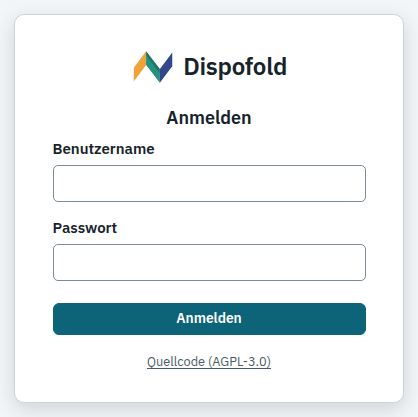
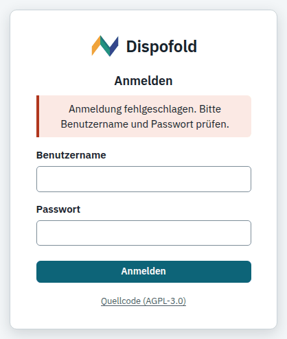
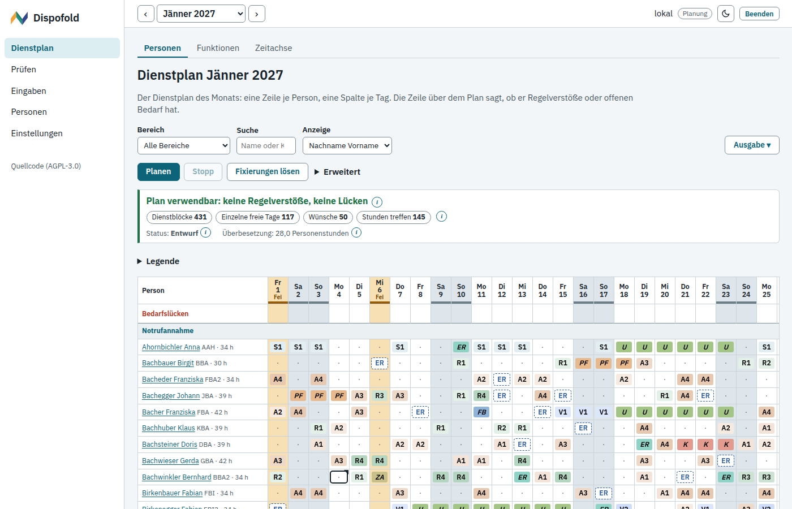
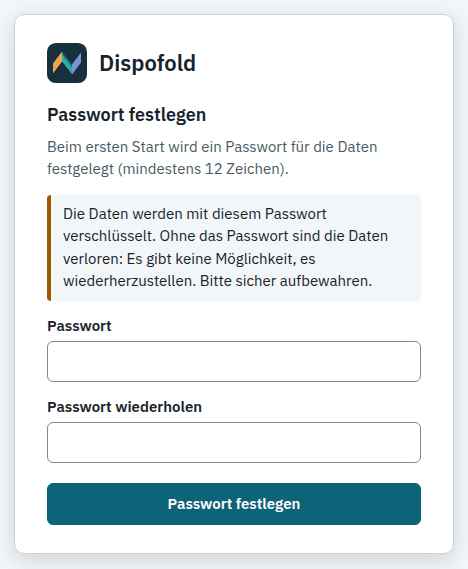
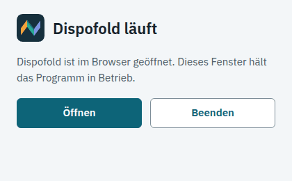
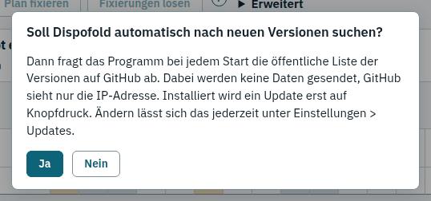

# Erste Schritte

Diese Seite beginnt dort, wo Dispofold läuft: welche Form man vor sich hat, Anmelden oder Starten, und wie die
ersten Daten hineinkommen. Wer nur schnell ausprobieren will, nimmt den [Schnellstart in 10
Schritten](schnellstart.md). Installieren, sichern und aktualisieren beschreibt [betrieb.md](../betrieb.md) für die
IT.

## Welche Form habe ich?

Dispofold gibt es in zwei Formen. Bedienung und Planung sind gleich, nur Anmeldung und Updates unterscheiden sich.
Am einfachsten erkennt man die Form oben rechts: Steht dort **Abmelden**, ist es der Server; steht dort **Beenden**,
ist es das Programm am eigenen Rechner.

- **Server (Docker):** Die IT betreibt Dispofold auf einem Server, alle arbeiten im Browser. Man meldet sich mit
  Benutzername und Passwort an; oben rechts stehen der Benutzername, die Rolle und **Abmelden**. Mehrere Personen
  können zugleich planen; daneben gibt es die Rolle „nur lesen“.
- **Programm am eigenen Rechner (Desktop):** Dispofold läuft auf einem einzelnen Rechner unter Windows, macOS (Mac
  mit M-Prozessor) oder Linux (auch auf ARM-Rechnern), ohne Server. Man startet es wie jedes Programm und gibt
  nur das Passwort für die Daten ein; oben rechts stehen „lokal“ und **Beenden**. Die Daten liegen verschlüsselt
  auf diesem Rechner. Die Programme sind nicht signiert: Beim ersten Start warnt das System. Unter macOS dann mit
  gedrückter Ctrl-Taste auf Dispofold klicken und **Öffnen** wählen, unter Windows **Weitere Informationen** und
  **Trotzdem ausführen** (Einzelheiten in [betrieb.md](../betrieb.md#unsignierte-programme)).

In beiden Formen ist diese Anleitung eingebaut und geht ohne Internet: im Menü **Anleitung**.

## Am Server anmelden

1. Die Adresse von Dispofold im Browser öffnen. Sie kommt von der IT, zum Beispiel
   `https://dispofold.example.org`.
2. **Benutzername** und **Passwort** eingeben, **Anmelden**. Beides vergibt die IT; ändern lässt es sich nur dort.
3. Oben rechts stehen danach der Benutzername und die Rolle: **Planung** darf alles, **nur lesen** sieht den Plan,
   ändert aber nichts (siehe [Rolle „nur lesen“](nur-lesen.md)).

- **Falsches Passwort:** Die Seite meldet „Anmeldung fehlgeschlagen. Bitte Benutzername und Passwort prüfen.“ Auf
  Groß- und Kleinschreibung achten.
- **Zu viele Versuche:** Nach zehn Anmeldeversuchen in einer Minute von derselben Adresse lehnt der Server weitere
  für kurze Zeit ab (der Browser zeigt den Fehler 429). Eine Minute warten.
- **Abmelden** oben rechts beendet die Sitzung. Nach zwei Stunden ohne Aktivität endet sie von selbst; die nächste
  Aktion führt dann zur Anmeldeseite. Was noch nicht gespeichert war, ist danach verloren, deshalb Eingaben und
  Regeln immer speichern, bevor man die Arbeit unterbricht.

## Programm am eigenen Rechner starten

1. **Erster Start:** Dispofold fragt nach einem Passwort für die Daten. Es muss mindestens 12 Zeichen lang sein und
   wird zweimal eingegeben. Mit diesem Passwort sind die Daten verschlüsselt. **Ohne dieses Passwort sind die Daten
   verloren.** Es gibt keine Möglichkeit, es wiederherzustellen, auch nicht durch die IT. Das Passwort also sicher
   aufbewahren, etwa in einem Passwortmanager.

   

2. **Jeder weitere Start:** Dispofold fragt nach dem Passwort. Bei einem falschen Passwort meldet es „Das Passwort
   ist falsch.“ Ein Benutzername und eine Rolle gibt es nicht; am eigenen Rechner hat man immer die Rolle
   Planung, oben rechts steht „lokal“.
3. **Beenden** oben rechts (nach einer Rückfrage) oder das Schließen des Fensters beendet das Programm.

Unter Windows und macOS erscheint Dispofold in einem eigenen Fenster. Unter Linux öffnet sich die Oberfläche im
Standardbrowser; ein kleines Fenster „Dispofold läuft“ hält das Programm dann in Betrieb: **Öffnen** zeigt die
Oberfläche wieder im Browser, **Beenden** beendet das Programm.

Ein zweiter Start öffnet kein zweites Programm, sondern holt das laufende nach vorn.

Beim ersten Start fragt Dispofold außerdem einmal, ob es nach neuen Versionen suchen soll:

**Ja** sucht bei jedem Start auf GitHub nach einer neuen Version, gesendet werden dabei keine Daten. **Nein**
sucht nie; Dispofold geht dann gar nicht ins Netz. Die Wahl lässt sich jederzeit unter
[Updates](updates.md#updates-im-programm-am-eigenen-rechner) ändern.

Wo die Daten liegen und wie man sie sichert, steht in [betrieb.md](../betrieb.md#gemeinsam-für-alle-systeme). Vor
jeder neuen Version legt das Programm selbst eine Sicherung an; eine regelmäßige Sicherung ersetzt das nicht.

## Die ersten Daten

Nach der Installation ist Dispofold leer: Der **Dienstplan** zeigt **Noch keine Daten**, und **Planen** ist grau.
Es gibt drei Wege zu Daten:

- **Zum Ausprobieren:** die Demodaten. Auf dem leeren Start **Demodaten zum Ausprobieren laden** klicken (oder
  unter **Einstellungen**, **Daten**, **Erweitert** **Demodaten laden (Jänner 2027)**). Das lädt 150 erfundene
  Personen in fünf Bereichen mit Abwesenheiten und Wünschen für Jänner 2027. Der
  [Schnellstart](schnellstart.md) und [Ein Monat Schritt für Schritt](beispiel.md) beginnen genau so. Die
  Demodaten ersetzen alle Stammdaten, also nie in einer Installation laden, in der schon echte Daten stehen.
- **Aus dem bisherigen Planungsprogramm:** Die mitgelieferte Erweiterung liest dessen Datenordner und übernimmt
  Personen, Bereiche, Schichten, Bedarf, Abwesenheiten und Dienste. Schritt für Schritt mit Bildern:
  [Echte Daten aus dem bisherigen Planungsprogramm übernehmen](plugin-sp5-echte-daten.md).
- **Als Datensatz:** eine Datei aus dem Quellsystem importieren (auf dem leeren Start **Datensatz importieren**
  oder unter **Einstellungen**, **Daten**). Die Datei liefert das Exportprogramm, das die IT einrichtet. Siehe
  [Daten und Korrekturdatei](daten.md#import).

Danach den **Planungsmonat** oben auf den Monat der Daten stellen. Nach einem Import bietet die Seite dafür einen
Knopf an, etwa **Zu Jänner 2027 wechseln**, wenn der gewählte Monat nicht in der Datei steht.

## Wie es weitergeht

1. Einen Probemonat mit den Demodaten: [Schnellstart in 10 Schritten](schnellstart.md), ausführlicher
   [Ein Monat Schritt für Schritt](beispiel.md).
2. Die Oberfläche kennenlernen: [Die Oberfläche](index.md#die-oberfläche).
3. Die Regeln an den eigenen Betrieb anpassen: [Regeln einstellen](einstellungen.md).
4. Bei einer Meldung, die man nicht versteht: [Häufige Fragen und Fehlerbehebung](fragen.md).
