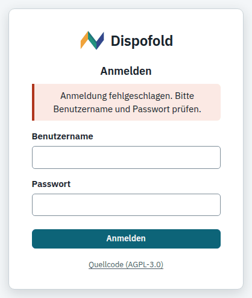
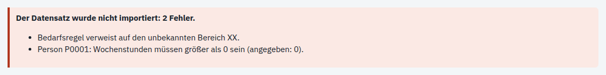
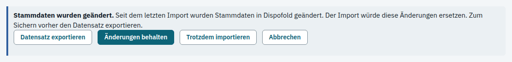
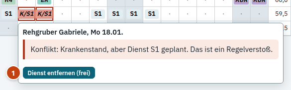
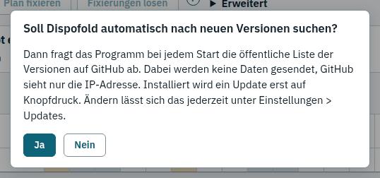

# Häufige Fragen und Fehlerbehebung

Oben die Fragen, die beim Planen oft kommen, darunter die Meldungen des Programms nach Bereich: was sie bedeuten
und was zu tun ist. Die Meldungen stehen hier so, wie sie im Programm erscheinen; „…“ steht für einen Namen, ein
Datum oder eine Zahl. *Kursiv* steht, was keine Meldung ist, sondern beschreibt, was man sieht. Fehlermeldungen
erscheinen unten rechts und bleiben, bis man sie schließt; Fehler eines Imports oder Formulars stehen als Liste auf
der Seite.

## Häufige Fragen

**Braucht Dispofold Internet?** Nein. Geplant wird auf dem eigenen Rechner oder dem eigenen Server, ohne
Cloud-Dienst, und keine Daten verlassen ihn; auch diese Anleitung ist eingebaut. Ins Netz gehen kann Dispofold nur
für zwei Dinge:

- die Suche nach einer neuen Version: Der Server fragt beim Start und einmal am Tag anonym bei GitHub nach; die IT
  kann das abschalten. Das Programm am eigenen Rechner fragt beim ersten Start, ob es suchen soll, und geht nach
  **Nein** nie ins Netz (siehe [Updates](updates.md)).
- unter Windows das Setup, wenn die WebView2-Runtime von Microsoft fehlt: Dann lädt es sie herunter. Ohne
  Internet installiert die IT sie vorher.

**Warum ist eine Lücke geblieben, obwohl noch Leute frei sind?** Frei heißt nicht, dass jemand den Dienst machen
darf. Meist verhindert es eine Regel: die tägliche Ruhezeit nach einem Dienst am Vortag, die Höchststunden im
Monat, die freien Sonntage, eine Einschränkung „Nie“ oder ein anderer Bereich. Wer die Schicht nur auf Anfrage
macht, steht in der Liste **Auf Anfrage verfügbar** an der Lücke. Ist die Liste leer, kann man jemanden von Hand
einteilen und in der Zeile über dem Plan sehen, ob das eine Regel verletzt. Siehe
[Offener Bedarf](planen.md#offener-bedarf).

**Warum hat jemand mehr oder weniger Stunden als das Soll?** Die Planung zielt auf das [Ziel](begriffe.md#ziel),
nicht auf das Soll: Ein Plus auf dem Stundenkonto senkt das Ziel, ein Minus erhöht es. Braucht der Bedarf weniger
Arbeit, als alle Ziele zusammen ergeben, werden alle Ziele um denselben Anteil kleiner. Die Kachel **Stunden** auf
der Seite der Person nennt beide Zahlen, **Warum dieser Dienst?** den Grund.

**Warum wurde ein Wunsch nicht erfüllt?** Wünsche sind Qualitätsregeln: Bedarf und Regeln gehen vor, und die
Erfüllung wird gleichmäßig verteilt. Je Person zählen höchstens 6 Wünsche (einstellbar). Was sicher gelten muss,
trägt man als [Vorgabe](eingaben.md#vorgaben) ein.

**Wie bekommt jemand an einem Tag sicher frei?** Unter **Eingaben** eine Vorgabe **frei (freier Tag)** für den
Tag eintragen, oder eine Abwesenheit, wenn es eine ist. Ein Wunsch „frei“ ist nur ein Wunsch.

**Nach dem neuen Planen sieht der Plan anders aus.** Eine Planung verbessert den gespeicherten Plan und darf dabei
alles ändern, was nicht fixiert ist. Was bleiben soll, vorher von Hand setzen oder fixieren (die Zelle anklicken,
**Fixieren**). Siehe [Planen](planen.md#planen).

**Was tun bei einer Krankmeldung nach dem Planen?** Die Abwesenheit unter **Eingaben** eintragen, im Dienstplan die
rote Zelle anklicken und **Dienst entfernen (frei)**, dann die Lücke füllen oder neu planen. Schritt für Schritt
mit Bildern: [Ein Monat Schritt für Schritt](beispiel.md#8-eine-krankmeldung-nach-dem-planen).

**Ich habe in Dispofold etwas geändert. Was passiert beim nächsten Import?** Mit dem Häkchen **Änderungen aus
Dispofold behalten** bleiben Änderungen an Personen, Einschränkungen und Bedarf erhalten. Damit sie dauerhaft
bleiben, die [Korrekturdatei](daten.md#korrekturdatei) an das Exportprogramm geben.

**Jemand ist ausgeschieden. Wie wird er nicht mehr geplant?** Den **Austritt** im Formular der Person eintragen.
Fehlt der Austritt im Quellsystem und lässt sich die Person nicht entfernen, **Aus dem Quellsystem nicht mehr
übernehmen** einschalten (siehe [Personen](personen.md#nicht-mehr-aus-dem-quellsystem-übernehmen)).

**Kann ich einen abgeschlossenen Monat noch ändern?** Ja: unter **Einstellungen**, **Daten** **Monat wieder
öffnen**, ändern, prüfen und wieder abschließen. Ist schon der Folgemonat abgeschlossen, zuerst diesen öffnen.

**Die Planung dauert lange.** Mit den Standardwerten endet sie nach 250 000 Schritten, spätestens nach 300
Sekunden. Man kann in der Zwischenzeit weiterarbeiten oder mit **Stopp** den bisher besten Stand behalten. Für einen
schnellen Entwurf unter **Erweitert** eine kleinere Schrittzahl eintragen.

**Ich sehe Prüfen, Eingaben oder Einstellungen nicht.** Dann ist man mit der Rolle „nur lesen“ angemeldet (oben
rechts steht die Rolle). Die Rolle vergibt die IT. Siehe [Rolle „nur lesen“](nur-lesen.md).

**Wie sichere ich meine Daten?** Die Sicherung der Datenbank ist Sache der IT (siehe
[betrieb.md](../betrieb.md#sicherung-und-wiederherstellung)). Zusätzlich speichert **Datensatz exportieren** unter
**Einstellungen**, **Daten** alle Stammdaten und Eingaben als Datei; Pläne exportiert man je Monat als JSON.

## Anmeldung

| Meldung | Ursache | Was tun |
|---|---|---|
| Anmeldung fehlgeschlagen. Bitte Benutzername und Passwort prüfen. | Benutzername oder Passwort falsch | erneut eingeben; ein vergessenes Passwort setzt die IT neu |
| *Fehler 429 im Browser* | mehr als zehn Anmeldeversuche in einer Minute | eine Minute warten |
| *die Anmeldeseite erscheint mitten in der Arbeit* | die Sitzung ist nach zwei Stunden ohne Aktivität abgelaufen | neu anmelden; nicht Gespeichertes ist verloren |
| Server nicht erreichbar | der Server oder das Netz antwortet nicht | Verbindung prüfen, Seite neu laden, sonst die IT fragen |
| Keine Berechtigung für diese Aktion | die Rolle „nur lesen“ hat versucht, etwas zu ändern | mit einem Benutzer der Planung anmelden |

## Import

Ein abgelehnter Import nennt alle Fehler auf einmal, nur mit Ids, ohne Namen. Nichts wird übernommen.

| Meldung | Ursache | Was tun |
|---|---|---|
| Der Datensatz wurde nicht importiert: … Fehler. | mindestens ein Fehler in der Datei, die Liste darunter nennt alle | die Einträge im Quellsystem oder in der Datei beheben und neu importieren |
| Die Datei ist kein gültiges JSON (Zeile …, Spalte …). | die Datei ist beschädigt oder keine JSON-Datei | die richtige Datei wählen oder neu exportieren |
| Die Datei ist kein Dispofold-Datensatz. | eine andere Datei, etwa ein exportierter Plan | einen Datensatz aus dem Exportprogramm oder aus **Datensatz exportieren** wählen |
| Der Datensatz stammt aus einer nicht unterstützten Version von Dispofold. | die Datei ist neuer oder älter, als dieses Programm lesen kann | Dispofold aktualisieren oder mit passender Version exportieren |
| Person …: Wochenstunden müssen größer als 0 sein | ein Fehler in den Daten einer Person | im Quellsystem korrigieren |
| … verweist auf den unbekannten Bereich … (*ebenso Person, Schicht, Abwesenheitsart*) | ein Eintrag nennt etwas, das es im Datensatz nicht gibt | im Quellsystem den Eintrag oder den fehlenden Bereich ergänzen |
| Person …: Die gewohnte Verteilung ist ungültig | die Anteile ergeben nicht 100 % oder nennen einen fremden Bereich | im Quellsystem korrigieren |
| Schicht … dauert … h, erlaubt sind höchstens … h. | eine Schicht ist länger als die Höchstdauer eines Dienstes | die Schicht oder die Regel prüfen |
| Der Monat … ist abgeschlossen; der Import würde ihn ändern. | die Datei enthält einen abgeschlossenen Monat mit anderen Eingaben | den Monat wieder öffnen oder eine Datei ohne diesen Monat importieren |
| Während der Planung von … kann nicht importiert werden. | für einen Monat der Datei läuft eine Planung | warten oder **Stopp** |
| Stammdaten wurden geändert. … | seit dem letzten Import wurde in Dispofold etwas geändert | siehe [Import](daten.md#import): exportieren, behalten oder bewusst ersetzen |
| Der Stand des letzten Imports ist nicht gespeichert (…) | die Installation stammt aus einer älteren Version | einmal neu importieren, danach gehen Vorschau und Korrekturdatei |
| Die Daten sind zu groß (höchstens 50 MB). | die Datei ist zu groß | die IT fragen |
| … Warnungen: | der Import ist gelungen, aber etwas ist auffällig, etwa zwei Abwesenheiten am selben Tag | die genannten Einträge im Quellsystem prüfen |

## Speichern und Konflikte

| Meldung | Ursache | Was tun |
|---|---|---|
| Die Eingaben wurden inzwischen von jemand anderem gespeichert. OK: … Abbrechen: … | jemand anderer hat die Eingaben desselben Monats gespeichert | **OK** übernimmt die eigenen Änderungen in die neue Fassung, danach prüfen und speichern; **Abbrechen** verwirft sie |
| Die Stammdaten wurden inzwischen von jemand anderem geändert. OK: … Abbrechen: … | jemand anderer hat Stammdaten gespeichert | wie oben; wurde derselbe Eintrag geändert, stehen die eigenen Angaben wieder im Formular |
| Die Änderung wurde nicht gespeichert: … Fehler. | das Formular enthält einen Fehler, die Liste nennt ihn | den Fehler im Formular beheben und speichern |
| … wird noch …-mal verwendet (in …). Mit allen Verweisen entfernen? | der Eintrag steht noch in offenen Monaten oder anderen Stammdaten | **OK** entfernt ihn mit allen Verweisen, sonst abbrechen |
| Der Eintrag kommt in abgeschlossenen Monaten vor (…) und kann nicht entfernt werden. | der Eintrag gehört zur Historie | stehen lassen; bei Personen den Austritt eintragen oder nicht mehr übernehmen |
| Der Bereich … hat noch … Schichten. Bitte zuerst diese Schichten entfernen. | ein Bereich mit Schichten | zuerst die Schichten entfernen |
| Das Kürzel … ist vergeben oder war schon vergeben und bleibt gesperrt. | Kürzel von Bereichen und Abwesenheitsarten sind eindeutig, auch nach dem Entfernen | ein anderes Kürzel wählen |
| Es gibt ungespeicherte Änderungen. Trotzdem verlassen? | die Seite hat Änderungen, die noch nicht gespeichert sind | **Abbrechen** und speichern, oder **OK**, um sie zu verwerfen |

## Planen

| Meldung | Ursache | Was tun |
|---|---|---|
| … Regelverstöße (*rot über dem Plan*) | ein Dienst verletzt eine Regel, meist von Hand gesetzt, durch eine Vorgabe oder eine nachträgliche Abwesenheit | die Knöpfe darunter oder **Prüfen** nennen Person und Tag; ändern oder neu planen. Siehe [Probleme](planen.md#probleme) |
| … Lücken (… Personenstunden) (*gelb*) | der Bedarf ist nicht gedeckt; es war niemand mehr frei, der den Dienst machen darf | **Auf Anfrage verfügbar** an der Lücke, von Hand einteilen oder den Bedarf prüfen |
| Plan veraltet: neu planen | Eingaben, Stammdaten, Regeln, die Historie oder der Vormonat haben sich nach der Planung geändert | neu planen. Siehe [Plan veraltet](planen.md#hinweis-plan-veraltet-neu-planen) |
| Konflikt: …, aber Dienst … geplant. Das ist ein Regelverstoß. | ein Dienst an einem Tag mit Abwesenheit | **Dienst entfernen (frei)** in der Auswahl der Zelle |
| Niemand passt. Gefragt werden können nur Personen, die den Dienst nur auf Anfrage machen und an dem Tag frei sind. | an der Lücke gibt es niemanden auf Anfrage | jemanden von Hand einteilen oder die Lücke bewusst offen lassen |
| Während der Planung ist das nicht möglich. / Während der Planung ist der Plan gesperrt. | eine Planung läuft | warten oder **Stopp** |
| Letzte Planung fehlgeschlagen | der letzte Lauf ist mit einem Fehler abgebrochen | noch einmal planen, bei Wiederholung mit **Neu beginnen**; hilft das nicht, die IT fragen |
| Die Planung ist gerade nicht verfügbar. Bitte später noch einmal versuchen. / Die Planung konnte nicht gestartet werden. | der Server ist überlastet oder hat einen Fehler | später noch einmal; sonst die IT fragen |
| Status nicht abrufbar: … | die Abfrage des Planungsstands scheitert wiederholt, etwa weil das Netz weg ist | Verbindung prüfen; die Planung läuft am Server weiter |
| Der Monat … ist abgeschlossen und kann nicht geändert werden. | Planen, Zellen oder Eingaben in einem abgeschlossenen Monat | den Monat wieder öffnen, wenn er wirklich geändert werden soll |

## Monat abschließen

| Meldung | Ursache | Was tun |
|---|---|---|
| … kann erst abgeschlossen werden, wenn … abgeschlossen ist. Monate werden der Reihe nach abgeschlossen. | der Vormonat hat einen Plan und ist offen | zuerst den Vormonat abschließen |
| … kann erst wieder geöffnet werden, wenn … wieder offen ist. Monate werden von hinten her geöffnet. | der Folgemonat ist abgeschlossen | zuerst den Folgemonat öffnen |
| Für … gibt es noch keinen Plan. | es gibt nichts abzuschließen | zuerst planen |
| Es gibt offene Punkte. … | Regelverstöße, Lücken oder ein veralteter Plan | beheben, oder bewusst **Trotzdem abschließen** |

## Daten weitergeben

| Meldung | Ursache | Was tun |
|---|---|---|
| Nach dem Pseudonymisieren steht noch ein Name in den Dateien (… Stelle(n): …). Es wurde nichts exportiert; bitte dort umbenennen. | ein Personenname steht in einem anderen Feld, etwa im Namen einer Schicht | an den genannten Stellen umbenennen und noch einmal pseudonymisieren |
| Während der Planung kann nicht exportiert werden. | eine Planung läuft | warten |
| Die Datei enthält den Plan für …, gewählt ist … | beim Plan importieren passt der Monat nicht | den Planungsmonat umstellen |

## Programm am eigenen Rechner

Beim Start und während der Arbeit:

| Meldung | Ursache | Was tun |
|---|---|---|
| Das Passwort ist falsch. | beim Start ein falsches Passwort | erneut eingeben; ohne Passwort gibt es keinen Zugang zu den Daten |
| Das Passwort muss mindestens 12 Zeichen lang sein. / Die beiden Passwörter stimmen nicht überein. | beim ersten Start | ein längeres Passwort wählen, zweimal gleich eingeben |
| Dispofold läuft bereits mit diesem Datenordner. Bitte das schon geöffnete Fenster verwenden. | das Programm ist schon offen | das offene Fenster verwenden |
| Der Datenordner liegt auf einem Netzlaufwerk. Das kann die Datenbank beschädigen. … | der Datenordner liegt nicht lokal | die IT fragen; ein lokaler Ordner ist empfohlen |
| Dispofold startet neu … | ein Update wird eingespielt oder das Programm startet seinen Hintergrunddienst neu | warten, die Seite lädt von selbst |
| Kein Zugriff: Bitte Dispofold über das Programm öffnen. | die Seite wurde nicht über das Programm geöffnet, etwa aus einem Lesezeichen | Dispofold über das Programm starten |
| Dispofold … wurde unerwartet beendet (Code …). / Dispofold … konnte nicht gestartet werden. | ein Fehler im Hintergrunddienst | neu starten; kommt es wieder, die IT mit dem Protokoll fragen (siehe [betrieb.md](../betrieb.md#protokolle-des-desktop-programms)) |
| Die Programmdateien von Dispofold sind unvollständig. … / Programmfenster und Hintergrunddienst von Dispofold passen nicht zusammen. … | die Installation ist beschädigt | Dispofold neu installieren; die Daten bleiben |
| Die Daten wurden zuletzt mit der neueren Version … geöffnet. Version … kann sie nicht verwenden. … | eine ältere Version wurde auf neueren Daten gestartet | die neuere Version installieren |
| Gespeichert: … im Ordner … | ein Export wurde gespeichert | die Datei liegt im Ordner Downloads |

Updates:

| Meldung | Ursache | Was tun |
|---|---|---|
| Keine Update-Quelle eingestellt: Dispofold sucht nicht nach Updates und geht nicht ins Netz. | so eingestellt (nach **Nein** beim ersten Start) | nichts, oder unter **Updates** eine Quelle eintragen |
| Die Update-Quelle ist nicht erreichbar. / Der Update-Ordner ist nicht erreichbar. | kein Internet, falsche Adresse oder Netzlaufwerk nicht verbunden | Verbindung und Adresse prüfen |
| Kein Update verfügbar. | die installierte Version ist die neueste | nichts |
| Die Datei ist kein Update-Paket (kein ZIP-Archiv). | beim Einspielen aus einer Datei die falsche Datei | das Update-Paket `dispofold-…-update.zip` wählen |
| Die Signatur des Update-Pakets ist ungültig. / Eine Datei im Update-Paket wurde verändert. | das Paket ist beschädigt, unvollständig geladen oder nicht von Dispofold | das Paket neu herunterladen |
| Version … ist nicht neuer als die installierte Version … | das Paket ist alt | nichts; eine ältere Version lässt sich so nicht einspielen |
| Ein Update wurde abgelehnt, weil es die Prüfung nicht bestanden hat (Grund: …). Dispofold arbeitet mit der bisherigen Version weiter. | beim Start nach einem Update | das Paket neu besorgen |
| Die Version … ist nicht gestartet. Dispofold arbeitet wieder mit der vorherigen Version. | die neue Version ist beim Probestart gescheitert und wurde zurückgenommen | weiterarbeiten; das Update später noch einmal versuchen oder die IT fragen |
