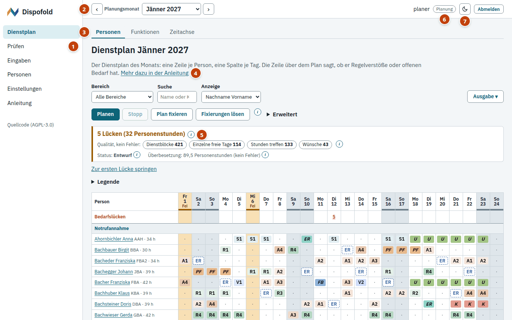

# Anleitung für die Dienstplanung

Diese Anleitung beschreibt die Arbeit mit Dispofold für alle, die Dienstpläne machen. Wer neu ist, beginnt mit dem
[Schnellstart in 10 Schritten](schnellstart.md): ein Probemonat mit Demodaten, ein Bild je Schritt. Danach helfen
[Erste Schritte](erste-schritte.md) beim Start mit echten Daten und [Ein Monat Schritt für
Schritt](beispiel.md) mit allen Einzelheiten. Die anderen Seiten schlägt man nach, wenn man sie braucht. Wörter wie
Soll, Ziel oder Vorgabe erklärt [Begriffe](begriffe.md).

Die Anleitung ist in jede Form von Dispofold eingebaut, am Server wie im Programm am eigenen Rechner, und geht auch
ohne Internet.

## Typischer Ablauf

Ein Monat, von den Daten bis zum Abschluss. [Ein Monat Schritt für Schritt](beispiel.md) zeigt denselben Ablauf mit
Bildern.

1. **Daten laden** (einmal und nach jedem neuen Export aus dem Quellsystem): unter **Daten**, **Übernehmen** die
   Quelle wählen, **Einlesen** und **Übernehmen**, mit einem Datensatz oder über die Erweiterung für das bisherige
   Planungsprogramm (siehe [Echte Daten übernehmen](plugin-sp5-echte-daten.md)). Was sich selten ändert
   (Schichten, Bedarf, Feiertage), pflegt man unter **Einstellungen**, **Stammdaten**, die Personen unter
   **Personen**. Siehe [Daten](daten.md#übernehmen).
2. **Eingaben erfassen:** unter **Eingaben** die Abwesenheiten (Urlaub, Krankenstand), die Wünsche und die
   Vorgaben des Monats eintragen und **Speichern**. Siehe [Eingaben](eingaben.md).
3. **Planen:** im **Dienstplan** auf **Planen** klicken. Der Solver rechnet im Hintergrund, mit den Demodaten etwa
   sieben Minuten. Siehe [Planen](planen.md#planen).
4. **Prüfen:** Die Überschrift über dem Plan sagt in Farbe, ob er verwendbar ist. **Prüfen** sagt oben, was zuerst
   zu tun ist, und listet darunter die Regelverstöße, den offenen Bedarf mit den Personen, die man fragen kann,
   die Hinweise zur Qualität und Auffälligkeiten in den Stammdaten. Siehe [Prüfen](planen.md#probleme) und
   [Was die Zahlen bedeuten](zahlen.md).
5. **Von Hand nachbessern:** Zellen im Dienstplan ändern, Lücken mit Diensten nur von Hand füllen, bei Bedarf
   noch einmal **Planen** (die von Hand gesetzten Zellen bleiben dabei fixiert). Ist der Plan schon ausgehängt,
   vorher **Plan fixieren**. Siehe [Von Hand ändern und fixieren](plan-bearbeiten.md#von-hand-ändern-und-fixieren).
6. **Drucken und exportieren:** im **Dienstplan** das Menü **Ausgabe**: **Drucken** oder Export als XLSX, CSV
   oder JSON. Siehe [Drucken](plan-bearbeiten.md#drucken) und [Exportieren](daten.md#exportieren).
7. **Monat abschließen:** im Menü **Ausgabe** oder unter **Daten**, **Monate**. Die Zahlen des Monats
   kommen in die Historie, der nächste Monat baut darauf auf. Siehe [Monat abschließen](monatsabschluss.md).
8. **Änderungen zurückgeben:** Wurden Personen oder Bedarf in Dispofold geändert, die Korrekturdatei für das
   Exportprogramm speichern. Siehe [Korrekturdatei](daten.md#korrekturdatei).

## Die Oberfläche

1. **Menü:** **Dienstplan**, **Eingaben**, **Prüfen**, **Personen**, **Daten**, **Einstellungen** und
   **Anleitung**. Die Rolle „nur lesen“ sieht weniger, siehe [Rolle „nur lesen“](nur-lesen.md). Darunter führt
   **Quellcode (AGPL-3.0)** zum Quellcode des Programms. Auf einem schmalen Bildschirm, etwa am Telefon, steckt das
   Menü hinter dem Knopf mit den drei Strichen (☰) oben und klappt nach der Wahl wieder zu.
2. **Planungsmonat:** Auf den Seiten eines Monats steht oben der Monat, um den es geht. Die Pfeile daneben wechseln
   einen Monat zurück oder vor, die Auswahl reicht ein Jahr zurück und eines voraus. Beim ersten Öffnen ist der
   nächste Monat gewählt, wenn es für ihn Daten gibt, sonst der letzte Monat mit Daten; danach merkt sich der
   Browser die Wahl, bis er geschlossen wird. Seiten, die nicht von einem Monat abhängen (Regeln, Stammdaten,
   Updates), zeigen die Auswahl nicht.
3. **Reiter:** Hat ein Menüpunkt mehrere Seiten, stehen sie als Reiter oben, zum Beispiel **Personen**,
   **Funktionen** und **Zeitachse** im Dienstplan.
4. **Seitentext:** Unter jedem Seitentitel sagt ein kurzer Text, wozu die Seite da ist. **Mehr dazu in der
   Anleitung** führt zum passenden Abschnitt dieser Anleitung.
5. **Erklärungen:** Ein **i** neben einer Regel, einer Einstellung, einer Zahl oder einem Formularfeld öffnet eine
   Erklärung: was die Zahl zählt oder was ein höherer oder niedrigerer Wert bewirkt. Das **i** geht mit Klick,
   Tippen oder Tastatur (Tab, dann Enter oder Leertaste); Escape oder ein Klick daneben schließt die Erklärung. Es
   ist immer nur eine Erklärung offen.
6. **Benutzer und Rolle:** der Name, mit dem man angemeldet ist, und die Rolle **Planung** oder **nur lesen**.
   Daneben **Abmelden** (am Server) oder **Beenden** (Programm am eigenen Rechner).
7. **Hell und dunkel:** Der Knopf mit dem Mond wechselt zwischen hellem und dunklem Design. Ohne Wahl folgt
   Dispofold der Einstellung des Systems; eine Wahl merkt sich der Browser.

Meldungen erscheinen unten rechts: Erfolgsmeldungen („Eingaben gespeichert“) verschwinden nach einigen Sekunden,
Fehlermeldungen bleiben, bis man sie schließt. Was eine Meldung bedeutet, steht unter
[Häufige Fragen und Fehlerbehebung](fragen.md).

Der Menüpunkt **Anleitung** und die Links „Mehr dazu in der Anleitung“ führen zu dieser Anleitung, und zwar zur
eingebauten Anleitung genau dieser Version, die auch ohne Internet geht: am Server wie im Programm am eigenen
Rechner. Unter jeder Seite führen Links zur Übersicht und zur vorigen und nächsten Seite; darunter steht die
Adresse derselben Seite auf der Website (mit Suche, Stand des neuesten Releases).

## Seiten dieser Anleitung

| Seite | Inhalt |
|---|---|
| [Schnellstart in 10 Schritten](schnellstart.md) | ein Probemonat mit Demodaten, ein Bild je Schritt |
| [Erste Schritte](erste-schritte.md) | welche Form man hat, Anmelden am Server, das Programm am eigenen Rechner, die ersten Daten |
| [Ein Monat Schritt für Schritt](beispiel.md) | ein ganzer Monat mit den Demodaten, vom Import bis zur Korrekturdatei |
| [Was die Zahlen bedeuten](zahlen.md) | die Zeile über dem Plan, Prüfen, Fairness und die Seite einer Person: was ein Fehler ist und was nicht |
| [Wie das Programm plant](wie-plant.md) | was hineingeht, was herauskommt, wie der Solver abwägt, was fest ist und was nur gewünscht |
| [Personen](personen.md) | Liste, Person anlegen und bearbeiten, Einschränkungen, nicht mehr aus dem Quellsystem übernehmen |
| [Bereiche, Schichten und Bedarf](stammdaten.md) | die Stammdaten: Bereiche, Abwesenheitsarten, Schichten, Bedarf, Feiertage |
| [Abwesenheiten, Wünsche und Vorgaben](eingaben.md) | die Eingaben eines Monats |
| [Planen und Prüfen](planen.md) | planen, das Ergebnis lesen, [Probleme](planen.md#probleme) und offener Bedarf |
| [Plan bearbeiten](plan-bearbeiten.md) | Dienstplan, Funktionen, Zeitachse, Zellen von Hand ändern, Dienste nur von Hand, drucken |
| [Auswertungen](auswertungen.md) | Fairness, die Zahlen einer Person, „Warum dieser Dienst?“ |
| [Monat abschließen](monatsabschluss.md) | Abschluss, Historie, wieder öffnen |
| [Daten und Korrekturdatei](daten.md) | Übernehmen, Änderungen behalten, Monate, Sichern: Export, Korrekturdatei, Pseudonymisieren |
| [Regeln einstellen](einstellungen.md) | Planungsziele, Gesetz und Betriebsvereinbarung, Gewichte, mit allen Standardwerten |
| [Updates](updates.md) | Hinweis auf neue Versionen, Update am Server und am eigenen Rechner |
| [Erweiterungen](erweiterungen.md) | Erweiterungen ein- und ausschalten, was sie zeigen |
| [Rolle „nur lesen“](nur-lesen.md) | was die Ansicht sieht und was nicht |
| [Häufige Fragen und Fehlerbehebung](fragen.md) | Meldungen des Programms, ihre Ursache und was zu tun ist |
| [Begriffe](begriffe.md) | die Wörter des Programms von A bis Z |

## Was ist Dispofold?

Dispofold plant den Monatsdienstplan: Es verteilt die Dienste so, dass die Regeln eingehalten und der Bedarf
gedeckt ist, und berücksichtigt dabei Stunden, Wünsche und eine faire Verteilung. Das Rechnen übernimmt die freie
Planungs-Engine Timefold, auf dem eigenen Rechner oder dem eigenen Server; keine Daten verlassen ihn. Was in eine
Planung hineingeht und wie das Programm abwägt, erklärt [Wie das Programm plant](wie-plant.md).

> **Mehr Hintergrund:** Die Regeln, nach denen das Programm plant, stehen im Einzelnen in
> [regeln.md](../regeln.md), das Format der Datensätze in [datenformat.md](../datenformat.md). Installation und
> Sicherung sind Sache der IT: [betrieb.md](../betrieb.md).
