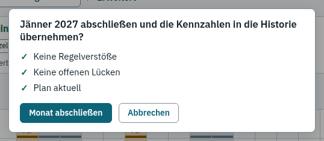
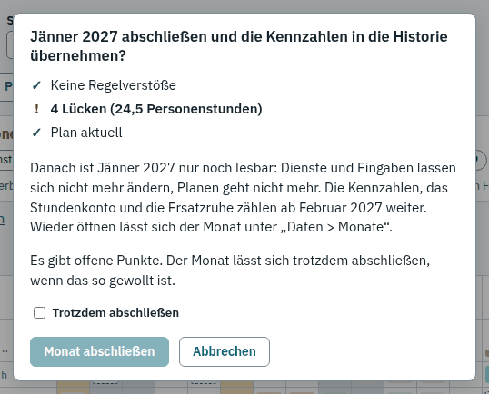
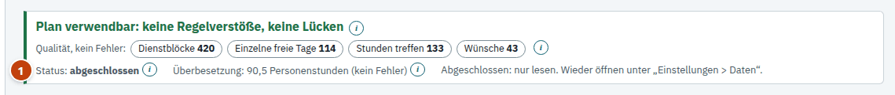
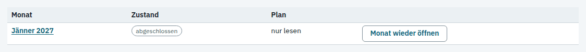

# Monat abschließen

Ist der Plan eines Monats fertig, wird der Monat abgeschlossen. Seine Zahlen kommen in die
[Historie](begriffe.md#historie), auf der Fairness, Stundenkonto und Ersatzruhe der Folgemonate aufbauen, und der
Monat ist danach nur noch lesbar.

## Abschließen

1. Den Plan prüfen: keine Regelverstöße, Lücken geklärt, kein Hinweis „Plan veraltet“ (siehe
   [Planen und Prüfen](planen.md)).
2. Im **Dienstplan** **Ausgabe**, **Monat abschließen** wählen, oder unter **Einstellungen**, **Daten** ganz unten
   **Monat abschließen**.
3. Ein Fenster prüft den Plan in einer Liste: Regelverstöße, offene Lücken, Plan aktuell oder veraltet. Ein Haken
   heißt erfüllt, ein Ausrufezeichen offen. Darunter steht, was danach gilt: Der Monat ist nur noch lesbar,
   Kennzahlen, Stundenkonto und Ersatzruhe zählen ab dem nächsten Monat weiter, und wieder öffnen lässt er sich
   unter „Einstellungen > Daten“ mit „Monat wieder öffnen“.
4. **Monat abschließen** im Fenster schließt ab. **Abbrechen** lässt alles, wie es ist.

Ist ein Punkt offen, steht darunter „Es gibt offene Punkte. Der Monat lässt sich trotzdem abschließen, wenn das so
gewollt ist.“; der Knopf geht dann erst nach dem Häkchen **Trotzdem abschließen**.

Das ist für bewusste Entscheidungen gedacht, etwa eine Lücke, die außerhalb von Dispofold besetzt wurde. Während
einer Planung lässt sich kein Monat abschließen.

Danach steht im Status **abgeschlossen**:

## Was gespeichert wird

Je Person die Zahlen des Monats (Nächte, Wochenenden, Feiertage, fair verteilte Dienste, Wünsche), die geplanten
Stunden, die Wochenstunden des Monats, das Stundenkonto nach dem Monat und die Ersatzruhe nach dem Monat (genommen
und neu erworben; ein Dienst an einem Feiertag bringt einen Ersatzruhetag). Diese Werte sind die Grundlage für
Fairness, Wochenschnitt und Stundenkonto der Folgemonate; mit den Wochenstunden zählt jeder Monat im Wochenschnitt
mit dem Vertrag, der damals galt. Von außen importierte Ist-Werte (die Historie im Datensatz) haben Vorrang und werden nie
überschrieben.

## Reihenfolge

Monate werden der Reihe nach abgeschlossen. Gibt es einen Plan für den Vormonat, muss dieser zuerst abgeschlossen
sein; sonst meldet das Programm „… kann erst abgeschlossen werden, wenn … abgeschlossen ist. Monate werden der
Reihe nach abgeschlossen.“ Ohne Plan lässt sich ein Monat nicht abschließen („Für … gibt es noch keinen Plan.“).

## Abgeschlossen heißt nur lesen

Plan, Eingaben und Import sind für diesen Monat gesperrt. Der Dienstplan sagt „Abgeschlossen: nur lesen. Wieder
öffnen unter „Einstellungen > Daten“.“ Drucken und Export gehen weiter. Ein Datensatz, der den Monat mit anderen
Eingaben enthält, lässt sich nicht importieren („Der Monat … ist abgeschlossen; der Import würde ihn ändern.“).

## Monat wieder öffnen

Unter **Einstellungen**, **Daten** steht in einem abgeschlossenen Monat statt **Monat abschließen** der Knopf
**Monat wieder öffnen** (nach einer Rückfrage). Monate werden von hinten her geöffnet: Ist der Folgemonat
abgeschlossen, muss er zuerst wieder geöffnet werden. Beim Öffnen verlassen die Abschlusswerte die Historie. Beim
erneuten Abschließen werden sie neu geschrieben.

**Wann:** wenn nach dem Abschluss noch etwas zu ändern ist, etwa ein Tausch, der in den Ist-Daten stehen soll. Danach
den Plan prüfen und den Monat wieder abschließen; Folgemonate, die schon geplant sind, zeigen dann „Plan veraltet“,
weil sich ihre Historie geändert hat.
