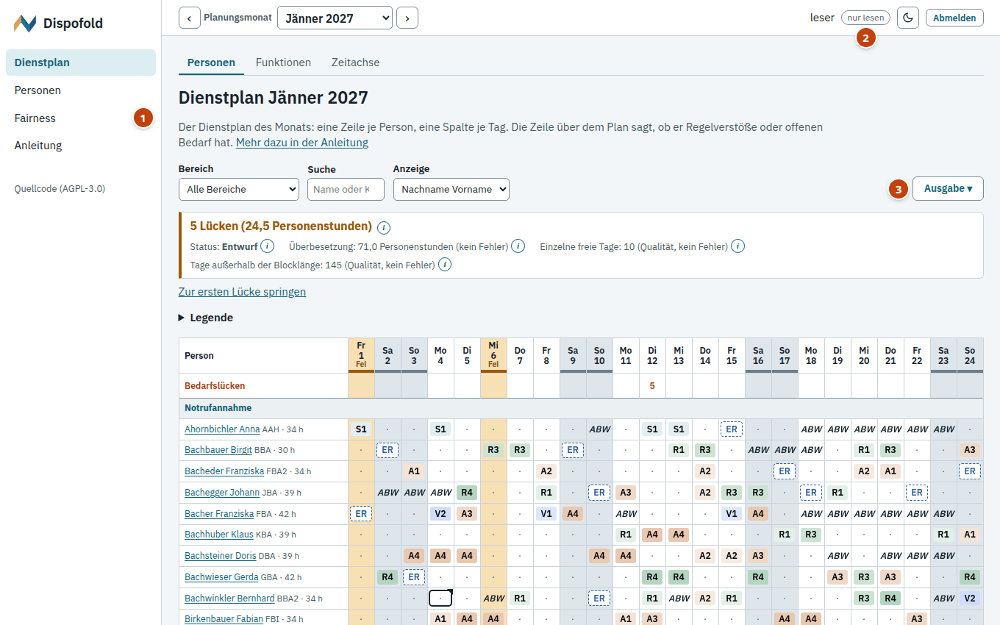

# Hinweise für die Rolle „nur lesen“

Im Serverbetrieb gibt es neben der Planung die Rolle **nur lesen** (`viewer`), zum Beispiel für alle, die ihren
Dienstplan ansehen sollen. Diese Seite ist für sie: was sie sieht, was nicht und wie sie den Plan liest. Die
Zugangsdaten vergibt die IT (siehe [Erste Schritte](erste-schritte.md#am-server-anmelden)). Im Programm am eigenen
Rechner gibt es diese Rolle nicht.

1. **Menü:** **Dienstplan** (mit den Reitern Personen, Funktionen und Zeitachse), **Personen**, **Fairness** und
   **Anleitung**.
2. Oben rechts steht die Rolle **nur lesen**.
3. Im Menü **Ausgabe** steht nur **Drucken**.

## Was die Rolle kann

- Den Plan jedes Monats ansehen, in allen drei Ansichten: [Dienstplan, Funktionen und Zeitachse](plan-bearbeiten.md).
  **Bereich**, **Suche** und **Anzeige** gehen wie für die Planung; mit **Suche** und dem eigenen Namen sieht man
  nur die eigene Zeile.
- Den Plan drucken oder als PDF speichern (**Ausgabe**, **Drucken**), so wie er am Bildschirm steht.
- Die Seite jeder Person mit ihren Diensten, Stunden und Soll und der Antwort auf „Warum dieser Dienst?“.
- Die Fairness-Übersicht: wie Nächte, Wochenenden, Feiertage und fair verteilte Dienste verteilt sind.
- Die Zeile über dem Plan: ob der Plan Lücken hat und ob er **Entwurf** oder **abgeschlossen** ist. Ein Entwurf
  kann sich noch ändern; verbindlich ist ein abgeschlossener Monat oder was die Planung sagt.

Sie kann nichts ändern, nicht planen, nicht abschließen und nicht exportieren. Die Zellen und die Zahlen der
Bedarfslücken lassen sich nicht anklicken, und Seiten der Planung (Prüfen, Eingaben, Einstellungen) gibt es nicht;
wer ihre Adresse eingibt, landet im Dienstplan. Den Hinweis auf eine neue Version sieht sie nie.

## Was die Rolle nicht sieht

Aus Datenschutzgründen sieht sie nicht:

- Wünsche und die Quote erfüllter Wünsche,
- Einschränkungen und Familienregeln von Personen (auch nicht die Markierung „nur auf Anfrage“ und nicht die
  Liste **Auf Anfrage verfügbar**),
- die gewohnte Verteilung, das Formular **Person bearbeiten** und die externe Id,
- den Grund einer Abwesenheit (sie erscheint nur als „abwesend“, im Plan und in der Legende als „ABW“),
- das Stundenkonto, das Ziel und die Ersatzruhe-Guthaben,
- die Belastung in der Fairness-Übersicht.

Das gilt auch für den Ausdruck: gedruckt wird nur, was diese Rolle am Bildschirm sieht.
