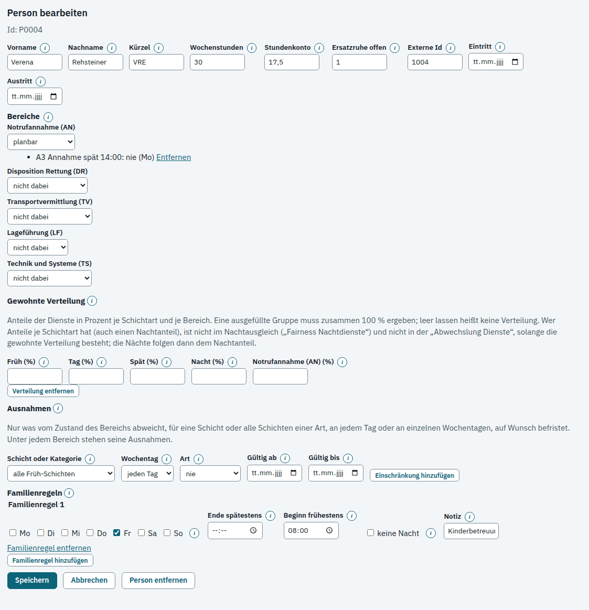

# Personen

Unter **Personen** stehen alle Personen, die geplant werden können, mit ihrer eigenen Seite. Dort sieht man ihre
Zahlen im gewählten Monat und bearbeitet alles, was zu ihr gehört: Wochenstunden, Bereiche, Einschränkungen,
Familienregeln und gewohnte Verteilung. Personen kommen meist mit dem Datensatz aus dem Quellsystem; was hier
geändert wird, kommt in die [Korrekturdatei](daten.md#korrekturdatei).

## Liste der Personen

1. **Suchen** findet nach Name, Kürzel oder Bereich. Mehrere Wörter müssen alle passen, „Ahorn Notruf“ findet
   also alle mit „Ahorn“ im Namen, die in der Notrufannahme sind.
2. **Person anlegen** öffnet ein leeres Formular für eine neue Person (siehe [Person anlegen](#person-anlegen)).
3. Die Zeile über der Liste zählt die Personen und davon die, die nicht mehr aus dem Quellsystem übernommen werden.
4. Solche Personen stehen grau mit „nicht mehr übernommen“ in der Liste (siehe
   [Nicht mehr aus dem Quellsystem übernehmen](#nicht-mehr-aus-dem-quellsystem-übernehmen)).

Ein Klick auf einen Namen öffnet die Seite der Person. Die Liste zeigt Kürzel, Bereiche und Wochenstunden.

## Seite einer Person

Oben stehen Kürzel, Wochenstunden, Bereiche und der Beschäftigungszeitraum; **Alle Personen** führt zurück zur
Liste, **Bearbeiten** springt zum Formular. Darunter folgen die Zahlen der Person im gewählten Monat (Stunden,
Belastung und Wünsche, Verteilung der Dienste, Historie) und **Warum dieser Dienst?**. Was die Zahlen bedeuten,
erklärt [Auswertungen](auswertungen.md#die-zahlen-einer-person). Hat ein Import die Dienste der Person in der
Historie mitgebracht, folgt **Gewohnte Schichten der Person** (siehe unten). Ganz unten stehen
**Übernahme aus dem Quellsystem** und das Formular **Person bearbeiten**.

### Gewohnte Schichten der Person

Die Dienste der Person in den Monaten der [Historie](begriffe.md#historie), je Schicht und je Dienstlänge, wie die
Import-Erweiterung sie gezählt hat (ab 0.31.0; Feld `dutyHistory`). Von Hand lassen sie sich nicht ändern; das
nächste Einlesen schreibt sie neu.

- Die Tabelle nennt die Schichten mit ihren Diensten. Eine Schicht, die es in den Stammdaten nicht mehr gibt, steht
  mit ihrer Id da und zählt über ihre Länge weiter.
- **Dienstlängen** nennt die Längen mit ihren Diensten. Darunter steht, welche Längenklassen die Person nie
  gearbeitet hat: unter 8 Stunden, 8 bis unter 10, 10 bis unter 12, 12 Stunden und mehr.
- Beim Planen kostet ein Dienst auf einer Schicht, die nicht in der Tabelle steht, etwas (Regel **Ungewohnte
  Schicht**), ein Dienst in einer nie gearbeiteten Längenklasse mehr (Regel **Ungewohnte Dienstlänge**). Siehe
  [Gewohnte Schichten je Person](begriffe.md#gewohnte-schichten-je-person).
- Mit weniger als 10 Diensten in der Historie, etwa nach einem Eintritt, gilt für die Person alles als gewohnt; der
  Abschnitt sagt es dann.
- Von Hand ist jede Schicht möglich: Ein solcher Dienst erscheint unter **Prüfen** nur als Treffer der Regel, mit
  Person und Tag.

## Person bearbeiten

Unter **Person bearbeiten** steht alles zu einer Person in einem Formular. Geändert wird erst mit **Speichern**;
**Abbrechen** stellt die gespeicherten Werte wieder her. Die Felder:

| Feld | Bedeutung | Wann ändern |
|---|---|---|
| Vorname, Nachname | Pflichtfelder | bei einer Namensänderung (kommt nicht in die Korrekturdatei, siehe unten) |
| Kürzel | Namenskürzel für die Anzeige „Kürzel“ in den Plänen, zum Beispiel „WER“ | wenn zwei Personen gleiche Kürzel hätten |
| Wochenstunden | vertragliche Wochenstunden (Pflichtfeld, mehr als 0); daraus kommen Soll und angerechnete Stunden | bei einer Vertragsänderung |
| Stundenkonto | Plus- oder Minusstunden (Pflichtfeld, darf negativ sein). Gilt für einen Monat nur, solange der Vormonat nicht abgeschlossen ist; sonst zählt der Stand nach dem Vormonat aus der Historie. | beim Start mit Dispofold oder wenn das Quellsystem einen anderen Stand kennt |
| Ersatzruhe offen | offene Ersatzruhetage (Pflichtfeld, ganze Zahl ab 0); gilt wie das Stundenkonto nur ohne abgeschlossenen Vormonat | wie beim Stundenkonto |
| Externe Id | die Kennung im Quellsystem, zum Beispiel die Personalnummer | selten; das Exportprogramm braucht sie |
| Eintritt, Austritt | erster und letzter Tag der Beschäftigung; davor und danach keine Dienste, das Soll zählt nur dazwischen. Leer: unbegrenzt. | bei Eintritt, Austritt oder einer Karenz über Monate |
| Bereiche | je Bereich **planbar**, **nur von Hand**, **nie** oder **nicht dabei** (siehe unten); ohne Bereich wird sie nie eingeplant | wenn jemand neu eingeschult ist oder einen Bereich nicht mehr macht |

Über den Feldern steht die Id der Person. Neue Personen bekommen ihre Id vom Programm.

Je Bereich wählt man einen Zustand:

- **planbar:** Die Planung darf die Person in jeder Schicht des Bereichs einplanen.
- **nur von Hand:** Die Planung plant die Person dort nie selbst; die Planung kann einen Dienst aber von Hand
  setzen, er steht dann in der Liste **Von Hand einsetzbar** (siehe
  [Dienste nur von Hand](plan-bearbeiten.md#dienste-nur-von-hand)).
- **nie:** Ein Dienst in dem Bereich ist ein Regelverstoß.
- **nicht dabei:** Der Bereich gehört nicht zur Person.

Ein Bereich ohne Schichten kann nur planbar oder nicht dabei sein: Der Zustand hängt an seinen Schichten. Kommt
später eine Schicht dazu oder wird eine in den Bereich verschoben, gilt der Zustand der Personen auch für sie.

Unter einem Bereich stehen nur seine [Ausnahmen](#einschränkungen), eine Zeile je Schicht, mit den Wochentagen und
Zeiten, etwa „R4 Disposition Nacht: nur von Hand (Mo, Di, Fr)“. Daneben steht, woher der Bereich kommt, wenn ein
Import es mitgegeben hat: „Herkunft: Gruppe Team Annahme“, „Herkunft: Historie: 14 Dienste“ oder „Herkunft: von
Hand“ für einen Bereich, den der Import nicht gegeben hat. Alle Personen auf einmal bearbeitet man unter
[Bereiche aller Personen](#bereiche-aller-personen).

### Gewohnte Verteilung

> **Für den Anfang überspringen:** Gewohnte Verteilung, Einschränkungen und Familienregeln kommen meist mit dem
> Datensatz; ändern muss man sie selten.

Wie sich die Dienste der Person üblicherweise verteilen, in Prozent je Schichtart (Früh, Tag, Spät, Nacht) und je
Bereich, zum Beispiel Tag 90 % und Nacht 10 %. Die Werte kommen meist aus dem Datensatz (Feld `shiftMix`), ein
Feld je Schichtart und je Bereich der Person.

- Eine ausgefüllte Gruppe muss zusammen 100 % ergeben, eine leere Gruppe heißt keine Verteilung. **Verteilung
  entfernen** leert alle Felder.
- Beim Planen nähert die Regel „Gewohnte Verteilung“ die Dienste an diese Anteile an.
- Was mit dem Nachtanteil geschieht, hängt von der Einstellung **Nachtdienste** ab (siehe
  [Regeln einstellen](einstellungen.md#planungsziele)); der Hinweis unter der Überschrift sagt es für die gewählte
  Einstellung, bei einer Person, die [nie Nacht](begriffe.md#nie-nacht) macht, für sie. Zählt der Nachtanteil
  nicht, nennt eine Zeile unter den Feldern die Anteile, die dann gelten (die übrigen, auf 100 % hochgerechnet).
- Für Personen mit Anteilen je Bereich gilt die Abwechslung der Bereiche nicht.
- **Wann ändern:** wenn sich jemand dauerhaft anders einteilen lässt, etwa nach einer Vereinbarung über weniger
  Nachtdienste. Für einzelne Tage sind Wünsche oder Vorgaben der richtige Weg.

### Einschränkungen

Ausnahmen vom Zustand eines Bereichs: welche Schicht oder [Schichtart](begriffe.md#schichtart) (zum Beispiel alle
Nachtschichten) für die Person **nie** oder **nur von Hand** gilt, an jedem Tag oder an einzelnen Wochentagen, auf
Wunsch befristet. Ausnahmen für eine Schichtart oder für Schichten eines Bereichs, den die Person nicht hat,
stehen unter **Für alle Bereiche oder Schichten anderer Bereiche**.

1. In der Zeile unter der Liste **Schicht oder Kategorie**, **Wochentag** (Standard **jeden Tag**) und **Art**
   wählen, auf Wunsch **Gültig ab** und **Gültig bis** (leer heißt: schon immer und auf Dauer).
2. **Einschränkung hinzufügen** nimmt die Zeile in die Liste auf, **Entfernen** in der Liste nimmt sie heraus.
3. **Speichern** speichert das ganze Formular.

- **nie:** Die Person bekommt diesen Dienst nie. Ein Dienst dagegen, etwa von Hand gesetzt, ist ein Regelverstoß.
- **nur von Hand:** Die Planung plant den Dienst nie von selbst. Er darf aber nach Rückfrage von Hand gesetzt
  werden und steht dann in der Liste **Von Hand einsetzbar**.
- Für einen ganzen Bereich wählt man oben den Zustand, nicht eine Ausnahme je Schicht.
- **Wann verwenden:** für dauerhafte Grenzen (keine Nachtdienste aus gesundheitlichen Gründen, ein Bereich nur
  zur Aushilfe). Für einen einzelnen Tag ist ein Wunsch oder eine Vorgabe richtig.

### Familienregeln

Persönliche Regeln für gewählte Wochentage, zum Beispiel für Kinderbetreuung. **Familienregel hinzufügen** fügt
eine Regel an; jede hat:

| Feld | Bedeutung |
|---|---|
| Wochentage | an welchen Tagen sie gilt; mindestens einer |
| Ende spätestens | ein Dienst endet an diesen Tagen spätestens zu dieser Uhrzeit; leer: keine Grenze |
| Beginn frühestens | ein Dienst beginnt an diesen Tagen frühestens zu dieser Uhrzeit; leer: keine Grenze |
| keine Nacht | an diesen Tagen kein Nachtdienst |
| Notiz | freier Text, etwa der Grund; die Planung liest ihn nicht |

Die Planung hält Familienregeln ein, wenn es geht; ein Dienst dagegen ist ein Nachteil in der Qualität, kein
Regelverstoß. Wie stark sie zählen, stellt man unter [Regeln einstellen](einstellungen.md#planungsziele) bei
**Familienregeln** ein. Eine Regel „keine Nacht“ an allen sieben Wochentagen heißt: Die Person macht
[nie Nacht](begriffe.md#nie-nacht).

### Speichern und Fehler

Das Programm prüft jede Änderung wie einen Import. Ist etwas falsch (etwa eine gewohnte Verteilung, die nicht
100 % ergibt, oder ein Austritt vor dem Eintritt), wird nichts gespeichert, und die Liste der Fehler erscheint im
Formular. Offene Monate, die eine Änderung betrifft, zeigen danach „Plan veraltet: neu planen“.

Was in die Korrekturdatei kommt: Wochenstunden, Bereiche, Stundenkonto, Ersatzruhe, Eintritt und Austritt,
gewohnte Verteilung, Familienregeln und Einschränkungen. Nicht dorthin kommen neu angelegte Personen und
geänderte Namen und Kürzel; sie trägt man im Quellsystem nach (siehe
[Daten und Korrekturdatei](daten.md#neuer-datensatz-änderungen-aus-dispofold-behalten)).

## Bereiche aller Personen

Der Reiter **Bereiche** unter **Personen** zeigt alle Personen (Zeilen) und alle Bereiche (Spalten) in einer
Tabelle. Jede Zelle zeigt den Zustand mit Zeichen und Wort: ● planbar, ◐ nur von Hand, ✕ nie, · nicht dabei.

- **Ändern:** Ein Klick oder die Leertaste schaltet eine Zelle weiter: planbar, nur von Hand, nie, nicht dabei.
  Die Pfeiltasten wechseln die Zelle.
- **Viele auf einmal:** Personen (Häkchen vorn) und Bereiche (Häkchen im Kopf) auswählen, unter **Auswahl setzen
  auf** einen Zustand wählen und **… Zellen setzen**. Ohne ausgewählte Personen gilt es für alle angezeigten, ohne
  ausgewählte Bereiche für alle Bereiche.
- **Filtern:** nach Name, Bereich und Zustand.
- **Ausnahmen und Herkunft:** Ein Stern in einer Zelle heißt, die Person hat in dem Bereich Ausnahmen. Die Zeile
  unter der Tabelle nennt für die gewählte Zelle die Herkunft und die Ausnahmen; die Maus zeigt dasselbe.
- **Speichern** speichert alle geänderten Personen auf einmal, genau so, wie die Seite einer Person speichert:
  dieselbe Prüfung, und die Änderungen sind Änderungen in Dispofold. Beim nächsten Import ersetzt das Quellsystem
  sie, außer man wählt **Änderungen aus Dispofold behalten**; dann kommen die Bereiche und ihre Zustände über die
  [Korrekturdatei](daten.md#korrekturdatei) wieder dazu.

Die Kopfzeile und die Namen bleiben beim Blättern stehen. Unter **Ansicht** gibt es drei Ansichten; das Programm
merkt sich die gewählte:

- **Personen als Zeilen:** die Tabelle wie oben.
- **Bereiche als Zeilen:** dieselbe Tabelle, Zeilen und Spalten getauscht. Ändern, Filtern, viele auf einmal und
  Speichern gehen genauso.
- **Ein Bereich:** Einen Bereich wählen; seine Personen stehen in vier Gruppen mit ihrer Zahl: planbar, nur von
  Hand, nie, nicht dabei. Ein Klick oder die Leertaste schaltet eine Person weiter wie in der Tabelle; sie wechselt
  dann in die nächste Gruppe. So sieht man auf einen Blick, wer in einem Bereich ist.

Ungespeicherte Änderungen bleiben beim Wechsel der Ansicht erhalten. Wer nur lesen darf, sieht alle Ansichten ohne
Ändern.

## Person anlegen

**Person anlegen** in der Liste öffnet das Formular **Neue Person**. Pflichtfelder sind Vorname, Nachname,
Wochenstunden, Stundenkonto und Ersatzruhe offen; ohne Bereich wird die Person nie eingeplant. Die Id vergibt das
Programm. Eine in Dispofold angelegte Person kommt nicht in die Korrekturdatei: Wer dauerhaft bleibt, gehört ins
Quellsystem, sonst fehlt die Person nach dem nächsten Import wieder.

## Person entfernen

**Person entfernen** im Formular entfernt die Person nach einer Rückfrage. Kommt sie noch in offenen Monaten vor,
nennt das Programm die Zahl der Verweise und die Monate und fragt, ob sie mit allen Verweisen entfernt werden soll.
Kommt sie in einem abgeschlossenen Monat oder in der Historie vor, lässt sie sich nicht entfernen; dann trägt man
den Austritt ein oder schaltet **Aus dem Quellsystem nicht mehr übernehmen** ein.

## Nicht mehr aus dem Quellsystem übernehmen

> **Für den Anfang überspringen:** Nur nötig, wenn das Quellsystem eine ausgeschiedene Person weiter liefert.

Für Personen, die nicht mehr geplant werden sollen, im Quellsystem aber noch geführt werden (etwa nach einem
Austritt, der dort fehlt), und die sich nicht entfernen lassen, weil sie in abgeschlossenen Monaten oder in der
Historie vorkommen. Der Schalter steht auf der Seite der Person unter **Übernahme aus dem Quellsystem**, nur für die
Planung, und wirkt sofort (nach einer Rückfrage):

- **Eingeschaltet:** Die Person bleibt mit allem in den abgeschlossenen Monaten und in der Historie, dort ändert
  sich nichts. Ab dem ersten Tag nach dem letzten abgeschlossenen Monat (ohne abgeschlossenen Monat ab dem
  ersten Planungsmonat) wird sie nicht mehr geplant, wie nach einem Austritt; der Tag bleibt, auch wenn später
  weitere Monate abgeschlossen oder wieder geöffnet werden. Die Seite der Person nennt den Tag. Offene Monate, die
  schon geplant sind, zeigen „Plan veraltet: neu planen“; Dienste, die sie dort schon hat, meldet die Prüfung als
  Regelverstoß „Beschäftigungszeitraum“, die nächste Planung lässt sie frei (von Hand gesetzte Dienste nimmt man
  selbst heraus). Abwesenheiten und Wünsche in offenen Monaten bleiben stehen und wirken nicht mehr. Im
  Dienstplan steht sie weiter als Zeile ohne Dienste, wie eine Person nach dem Austritt.
- In der Korrekturdatei steht für sie `"exclude": true`. Das Exportprogramm lässt sie dann im nächsten Datensatz
  weg; Dispofold behält sie beim Import mit ihrer Historie und weiter ausgeschlossen, ohne Hinweis „fehlt im
  neuen Datensatz“.
- **Ausgeschaltet:** Die Person wird wieder geplant, und die nächste Korrekturdatei schließt sie nicht mehr aus,
  auch wenn der Ausschluss aus einer früheren Korrekturdatei stammt. Bis zum nächsten Export und Import plant
  Dispofold mit den Daten, die es von ihr hat; danach kommt sie mit den Daten aus dem Quellsystem. Hat sich
  sonst nichts geändert, speichert **Änderungen als Korrekturdatei exportieren** trotzdem eine Datei (ohne
  Einträge), denn sie muss die bisherige ersetzen. Das gilt auch, wenn der Schalter seit dem Import ein- und
  wieder ausgeschaltet wurde und dazwischen eine Korrekturdatei gespeichert wurde.

Hat das Exportprogramm eine Person ausgeschlossen, die Dispofold kennt (etwa mit einem Eintrag, der von Hand in
`korrekturen.json` geschrieben wurde), ist der Schalter nach dem Import eingeschaltet und lässt sich genauso
ausschalten. Solange eine Person ausgeschlossen ist, kommen Änderungen an ihren anderen Feldern nicht in die
Korrekturdatei; nach dem Ausschalten kommt sie mit den Werten aus dem Quellsystem zurück.

## Wenn jemand anderer inzwischen gespeichert hat

Im Serverbetrieb fragt das Programm wie bei den Eingaben nach, wenn jemand anderer seit dem Öffnen der Seite
Stammdaten gespeichert hat: **OK** übernimmt die eigene Änderung in die neue Fassung, **Abbrechen** verwirft sie und
lädt die neue Fassung. Wurde dieselbe Person auch von der anderen Person geändert, speichert das Programm nicht von
selbst: Die eigenen Angaben stehen wieder im Formular, sie sind zu prüfen und noch einmal zu speichern.
