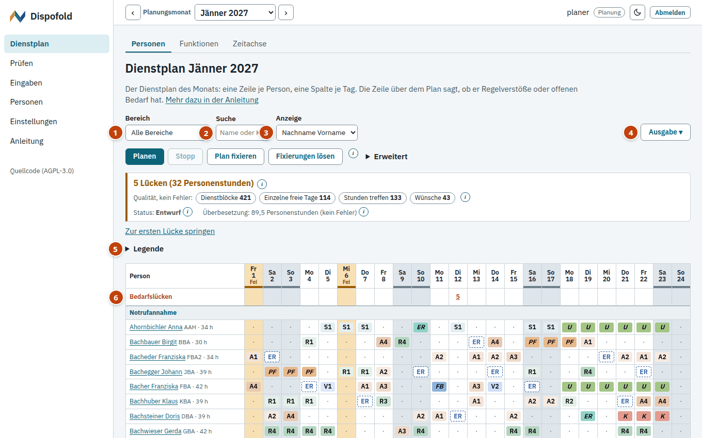
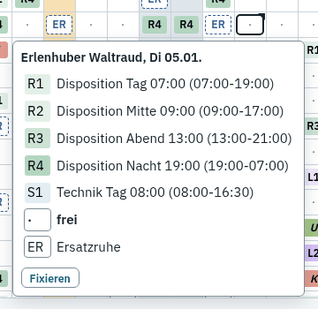
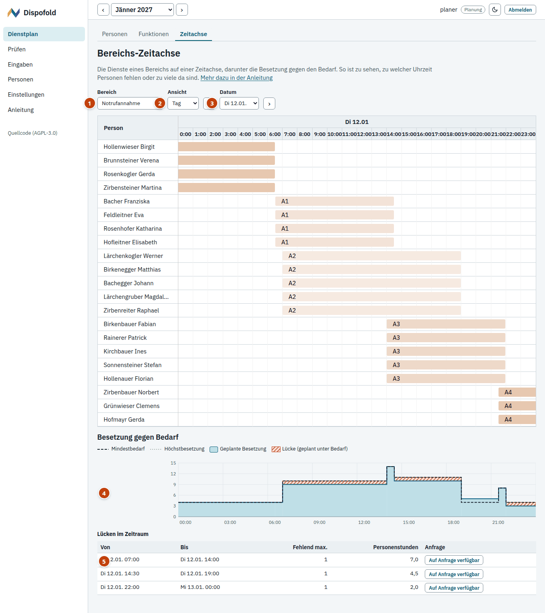
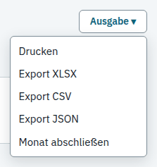

# Plan bearbeiten

Der **Dienstplan** zeigt den Plan des gewählten Monats auf drei Reitern: **Personen** (eine Zeile je Person, eine
Spalte je Tag), **Funktionen** (derselbe Plan je Schicht, siehe [Plan nach Funktion](#plan-nach-funktion)) und
**Zeitachse** (siehe [Bereichs-Zeitachse](#bereichs-zeitachse)). Hier ändert man einzelne Zellen, füllt Lücken
mit Diensten auf Anfrage und druckt den Plan. Planen und das Ergebnis lesen: [Planen und Prüfen](planen.md).

## Dienstplan

1. **Bereich:** zeigt nur die Personen eines Bereichs (Standard: **Alle Bereiche**). Die Wahl gilt, bis der
   Browser geschlossen wird.
2. **Suche:** zeigt nur Personen, deren Name oder Kürzel den Text enthält.
3. **Anzeige:** „Nachname Vorname“ (Standard) oder „Kürzel“ in der ersten Spalte; der Browser merkt sich die Wahl.
4. **Ausgabe:** **Drucken**, der Export als XLSX, CSV und JSON und **Monat abschließen**.
5. **Legende:** zugeklappt; ein Klick öffnet sie, der Browser merkt sich die Wahl.
6. **Bedarfslücken:** die Zahl der Lücken je Tag. Die Zeile bleibt beim Scrollen unter den Tagen stehen; ein Klick
   auf eine Zahl listet die Lücken des Tages mit **Auf Anfrage verfügbar**.

Darüber stehen **Planen**, **Stopp**, **Plan fixieren**, **Fixierungen lösen** und **Erweitert** und die Zeile mit
dem Ergebnis; beides beschreibt [Planen und Prüfen](planen.md). Hat der Plan einen Konflikt oder eine Lücke, führt
**Zum ersten Konflikt springen** (oder **Zur ersten Lücke springen**) unter dieser Zeile zur ersten solchen Zelle,
auch wenn der Plan dafür seitlich scrollen muss.

### Was in den Zellen steht

- **Kürzel der Schicht**, zum Beispiel „A1“, in der Farbe der Schicht; **·** heißt frei.
- **Abwesenheiten** mit ihrem Kürzel (kursiv, in ihrer Farbe), Ersatzruhe als „ER“.
- **Wochenenden** und **Feiertage** sind hinterlegt, der Kopf eines Feiertags trägt „Fei“.
- **Fixierte Zellen** sind eingerahmt, eine geplante Ersatzruhe ist gestrichelt eingerahmt.
- **Konflikt:** ein Dienst trotz Abwesenheit, rot, mit beiden Kürzeln („K/A1“). Das ist ein Regelverstoß.
- **Nur auf Anfrage:** ein von Hand gesetzter Dienst, den die Person nur auf Anfrage macht, hat unten links eine
  kleine Ecke.
- Neben dem Namen stehen Kürzel und Wochenstunden; der Name führt zur Seite der Person.

Mit den Pfeiltasten bewegt man sich durch die Zellen, **Pos1** und **Ende** springen an den Anfang oder das Ende
der Zeile (mit Strg an den Anfang oder das Ende des Plans), **Bild auf** und **Bild ab** um zehn Zeilen. Enter
öffnet die Auswahl der Zelle.

## Von Hand ändern und fixieren

Eine Zelle anklicken (oder mit den Pfeiltasten hingehen und Enter drücken). Es öffnet sich eine Auswahl mit den
Schichten der Bereiche der Person, **frei** und **Ersatzruhe**; die jetzige Wahl ist fett.

- Einen Dienst, **frei** oder **Ersatzruhe** wählen. Eine von Hand gesetzte Zelle ist danach **fixiert**: Die
  nächste Planung behält sie bei.
- **Fixieren** oder **Fixierung lösen** schaltet die Fixierung einer Zelle um, ohne den Dienst zu ändern.
- Eine Vorgabe aus den **Eingaben** bleibt auch beim Lösen der Fixierungen bestehen und wird nur dort entfernt; die
  Auswahl sagt das.
- Abwesenheiten werden nicht im Plan geändert, sondern unter **Eingaben**. Die Auswahl einer Abwesenheit sagt nur,
  welche es ist.
- Bei einem **Konflikt** (Dienst trotz Abwesenheit) bietet die Auswahl nur **Dienst entfernen (frei)** an.
- Escape schließt die Auswahl ohne Änderung.

Ein von Hand gesetzter Dienst kann eine Regel verletzen, etwa die Ruhezeit. Dann steigen die **Regelverstöße**; die
Überschrift wird rot. Deshalb nach Änderungen von Hand die Zeile über dem Plan ansehen und vor dem Abschluss prüfen.
Während einer Planung und in einem abgeschlossenen Monat lassen sich Zellen nicht ändern.

## Dienste nur auf Anfrage

Eine Einschränkung „Nur auf Anfrage“ (auf der Seite der Person, siehe
[Einschränkungen](personen.md#einschränkungen)) heißt: Das Programm plant diese Schicht für diese Person nie von
selbst ein. Fehlt dadurch Personal, bleibt die Lücke im Plan stehen. Die Planung fragt die Person und setzt den
Dienst dann von Hand.

- **Auf Anfrage verfügbar:** Diese Liste steht bei jeder Lücke: im **Dienstplan** nach einem Klick auf die Zahl
  in der Zeile **Bedarfslücken**, unter **Funktionen** nach einem Klick auf eine Zelle der Zeile „offen“, in der
  Lückenliste der **Zeitachse** und unter **Prüfen**, **Offener Bedarf**. Sie nennt die Personen, für die eine
  Schicht des Bereichs in dieser Lücke an diesem Tag nur auf Anfrage geht, die an dem Tag frei sind (kein Dienst,
  keine Abwesenheit, nicht fixiert) und für die der Dienst keinen Regelverstoß ergibt (auch nicht die
  Höchststunden im Monat). Je Person stehen Schicht, Datum und Stunden (geplant von Soll); wer am wenigsten
  Stunden hat, steht oben. Passt niemand, sagt die Liste das: „Niemand passt.“
- **Ein Klick auf einen Namen** setzt den Dienst für diese Person und fixiert ihn. Die nächste Planung behält
  ihn bei.
- Im Plan ist ein solcher Dienst unten links mit einer kleinen Ecke markiert (**nur auf Anfrage**). Er zählt
  nicht als Regelverstoß.

## Plan nach Funktion

Der Reiter **Funktionen** zeigt denselben Monat je Funktion: Eine Funktion ist eine Schicht eines Bereichs. Die
Spalten sind die Tage des Monats, die Zeilen die Funktionen, nach Bereichen gruppiert. Gezeigt werden Schichten
mit mindestens einem Dienst im Monat und Schichten, deren Zeit ein Bedarf des Bereichs überschneidet. Diese
Ansicht beantwortet die Frage „Wer macht am 12. die Frühschicht in der Notrufannahme?“.

- **Eine Zeile je Position:** Arbeiten an einem Tag zwei Personen in derselben Schicht, stehen sie in zwei
  Zeilen untereinander (nach Namen sortiert). Eine Schicht hat so viele Zeilen, wie an ihrem vollsten Tag
  Personen eingeteilt sind.
- **In der Zelle** steht das Kürzel der Person, der ganze Name erscheint beim Darüberfahren. Unter **Anzeige**
  lässt sich stattdessen „Nachname Vorname“ wählen (Standard hier: „Kürzel“). Fixierte Dienste, Konflikte und
  Dienste nur auf Anfrage sind markiert wie im Dienstplan.
- **Zeile „offen“** (rot): Hat ein Bereich im Monat Bedarfslücken, steht direkt unter seinem Namen eine Zeile
  „offen“. Beim Scrollen bleiben Name und Zeile „offen“ des obersten Bereichs unter den Tagen stehen. Jede Lücke
  steht dort genau einmal, am Tag ihres Beginns (eine Lücke von 19:00 bis 07:00 also am ersten Tag), mit der Zahl
  der fehlenden Personen und der Uhrzeit, zum Beispiel „1 · 07:00-19:00“. Hat ein Tag mehr als drei Lücken,
  zeigt die Zelle die ersten zwei und „+N weitere“; alle stehen im Hinweis der Zelle und im Ausdruck.
- **Ein Klick auf einen Namen** öffnet dieselbe Auswahl wie im Dienstplan (Dienst ändern, frei, fixieren).
  **Ein Klick auf eine Zelle der Zeile „offen“** öffnet die Liste **Auf Anfrage verfügbar** für die Lücken
  dieses Tages.
- Mit den Pfeiltasten bewegt man sich wie im Dienstplan durch die Zellen, Enter öffnet die Auswahl.
- Das Menü **Ausgabe** hat hier **Drucken** und den Export.
- Bereich und Suche gibt es hier nicht; der Reiter zeigt immer alle Bereiche.

## Bereichs-Zeitachse

Der Reiter **Zeitachse** zeigt die Besetzung gegen den Bedarf eines Bereichs und darunter seine Dienste als Balken
auf einer Zeitachse. Sie beantwortet die Frage „Wann genau fehlt jemand, und wie lange?“.

1. **Bereich:** welcher Bereich (Standard: der erste, danach der zuletzt gewählte).
2. **Ansicht:** **Tag** (Standard) oder **Woche**.
3. **Datum:** der Tag oder der erste Tag der Woche; die Pfeile daneben gehen einen Tag oder eine Woche weiter oder
   zurück. Dienste aus dem Vormonat, die in den Monat hineinreichen, sind als „(Vormonat)“ markiert, fixierte als
   „(fixiert)“.
4. **Besetzung gegen Bedarf:** die Mindestbesetzung (gestrichelt), die Höchstbesetzung und die geplante Besetzung
   als Fläche. Wo die Fläche unter der Mindestbesetzung liegt, ist die Lücke rot schraffiert.
5. **Lücken im Zeitraum:** jede Lücke mit Von, Bis, der größten Zahl fehlender Personen und den Personenstunden.
   **Auf Anfrage verfügbar** in einer Zeile klappt darunter die Personen auf, die man für diese Lücke fragen kann.

Die Links **Zeitachse** unter **Prüfen** öffnen diesen Reiter gleich auf Bereich und Tag des Eintrags.

## Drucken

**Ausgabe**, **Drucken** in den Reitern **Personen** und **Funktionen** öffnet den Druckdialog des Browsers (im
Desktop-Programm den Druckdialog des Systems) mit einer eigenen Druckansicht; die Druckfunktion des Browsers
(Strg+P) liefert dasselbe. Im Dialog lässt sich auch „Als PDF speichern“ wählen.

- **Papier:** A4 quer. Der Monat steht in zwei Tabellen, Tag 1 bis 15 und Tag 16 bis zum Monatsende; jede
  Hälfte beginnt auf einer neuen Seite. Reicht eine Hälfte über mehrere Seiten, steht der Tabellenkopf auf jeder
  Seite.
- **Kopf:** eine Zeile mit Ansicht und Monat, dem Status des Plans („Entwurf“ oder „abgeschlossen“) und dem
  Druckdatum, darunter eine kurze Legende der Markierungen.
- **Ohne Bedienelemente:** Menü, Kopfleiste, Schaltflächen und Statuszeile werden nicht gedruckt; gedruckt wird
  immer hell auf weißem Papier, auch im dunklen Design.
- **Dienstplan:** dieselben Personen in derselben Reihenfolge und Gruppierung wie am Bildschirm (also auch mit
  gewähltem **Bereich** oder einer **Suche**). In den Zellen stehen die Kürzel der Schichten, Abwesenheiten mit
  ihrem Kürzel, Ersatzruhe als „ER“; Wochenenden und Feiertage sind hinterlegt, fixierte Dienste eingerahmt,
  Konflikte rot. Neben dem Namen stehen die Wochenstunden, rechts die geplanten Stunden des Monats (**Std.**),
  unten die Zeile **Bedarfslücken** mit der Zahl der Lücken je Tag.
- **Plan nach Funktion:** die Funktionen nach Bereichen wie am Bildschirm, die Zeile „offen“ mit den Lücken
  wird mitgedruckt.
- **Anzeige:** Der Druck zeigt die Namen so, wie unter **Anzeige** gewählt. Im Reiter **Personen** ist
  „Nachname Vorname“ voreingestellt, im Reiter **Funktionen** „Kürzel“.
- **Rolle „nur lesen“:** gedruckt wird nur, was diese Rolle auch am Bildschirm sieht (Abwesenheiten als „ABW“).

**Tipp:** Für einen Aushang je Bereich unter **Bereich** den Bereich wählen und dann drucken.

## Exportieren

Der Export als XLSX (Excel), CSV oder JSON im Menü **Ausgabe** speichert den Plan des Monats als Datei. Einzelheiten,
auch zum Dateinamen bei Regelverstößen: [Daten und Korrekturdatei](daten.md#exportieren).
