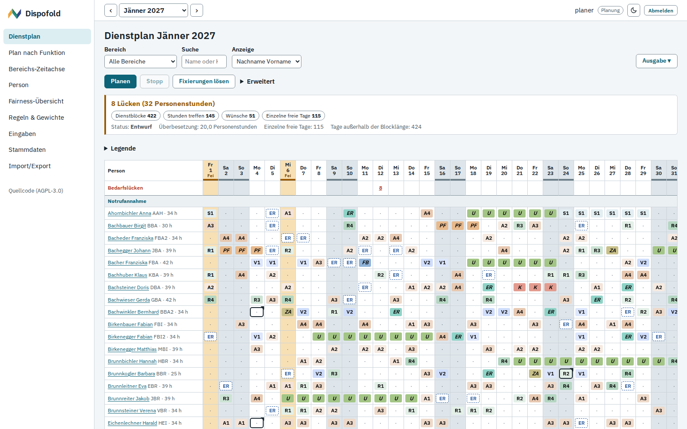
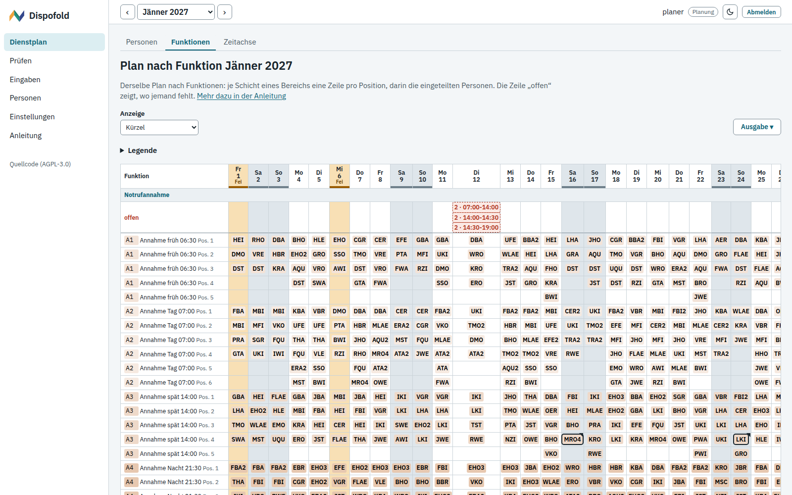
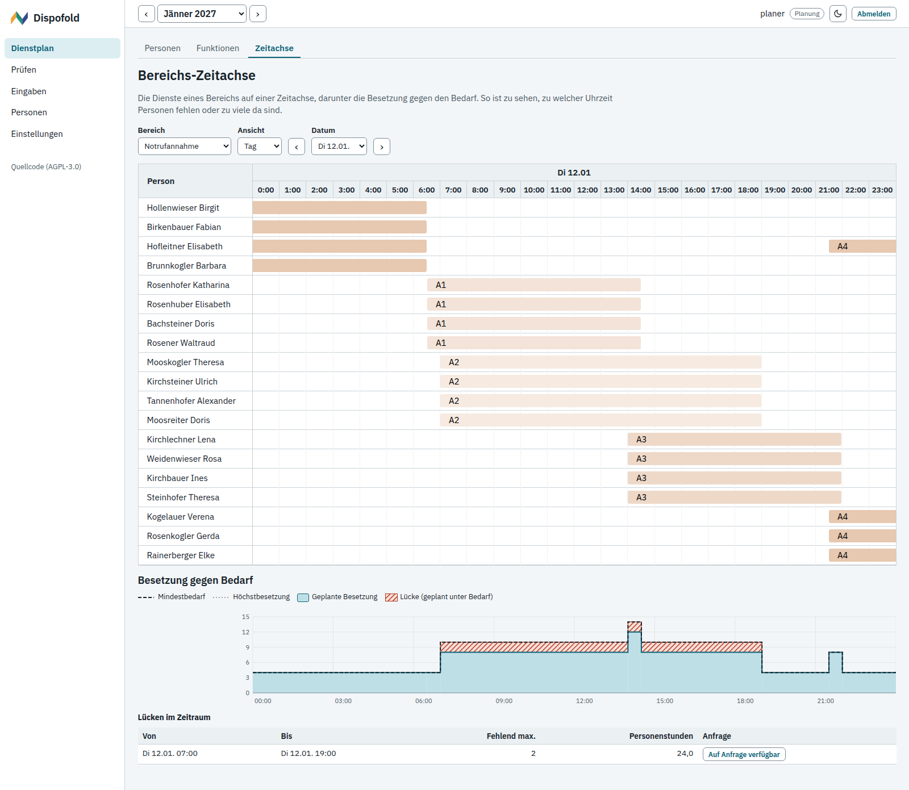
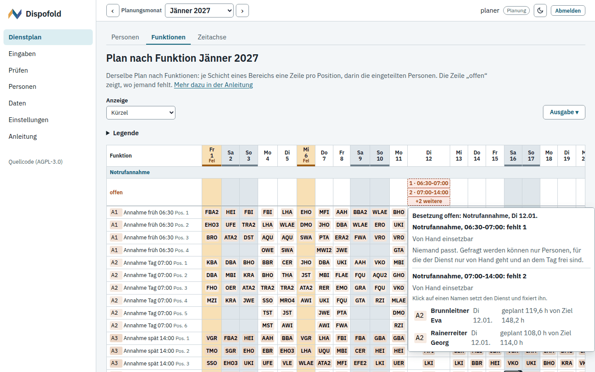
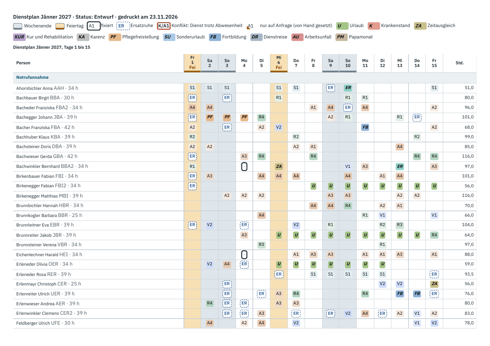
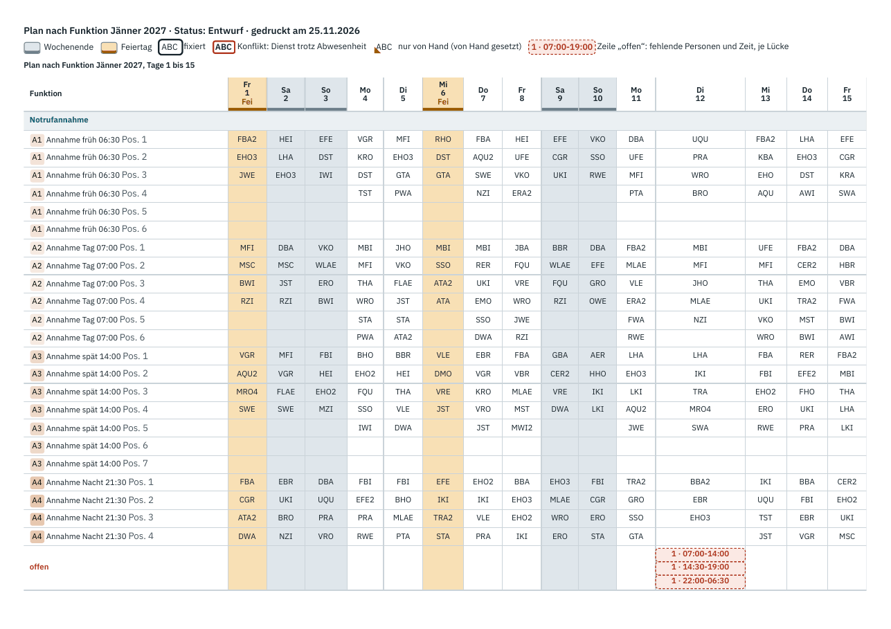

# Plan bearbeiten

## Dienstplan

Der Dienstplan hat drei Reiter: **Personen** (eine Zeile je Person, eine Spalte je Tag), **Funktionen** (derselbe
Plan je Schicht, siehe [Plan nach Funktion](#plan-nach-funktion)) und **Zeitachse** (siehe
[Bereichs-Zeitachse](#bereichs-zeitachse)).

Über dem Plan stehen **Bereich** (nur die Personen eines Bereichs), **Suche** (Name oder Kürzel) und **Anzeige**
(„Nachname Vorname“ oder „Kürzel“ in der ersten Spalte; der Browser merkt sich die Wahl). Rechts steht das Menü
**Ausgabe** mit **Drucken**, dem Export als XLSX, CSV und JSON und **Monat abschließen**. Die **Legende** über dem
Plan ist zugeklappt; ein Klick öffnet sie, der Browser merkt sich die Wahl.

In den Zellen stehen die Kürzel der Schichten, Abwesenheiten mit ihrem Kürzel und Ersatzruhe als „ER“.
Wochenenden und Feiertage sind hinterlegt, fixierte Zellen eingerahmt, ein Dienst trotz Abwesenheit ist rot. Die
Zeile **Bedarfslücken** direkt unter den Tagen zeigt die Zahl der Lücken je Tag und bleibt beim Scrollen stehen.

### Plan nach Funktion

Der Reiter **Funktionen** zeigt denselben Monat je Funktion: Eine Funktion ist eine Schicht eines Bereichs. Die
Spalten sind die Tage des Monats, die Zeilen die Funktionen, nach Bereichen gruppiert. Gezeigt werden Schichten
mit mindestens einem Dienst im Monat und Schichten, deren Zeit ein Bedarf des Bereichs überschneidet.

- **Eine Zeile je Position:** Arbeiten an einem Tag zwei Personen in derselben Schicht, stehen sie in zwei
  Zeilen untereinander (nach Namen sortiert). Eine Schicht hat so viele Zeilen, wie an ihrem vollsten Tag
  Personen eingeteilt sind.
- **In der Zelle** steht das Kürzel der Person, der ganze Name erscheint beim Darüberfahren. Unter **Anzeige**
  lässt sich stattdessen „Nachname Vorname“ wählen. Fixierte Dienste, Konflikte und Dienste nur auf Anfrage sind
  markiert wie im Dienstplan.
- **Zeile „offen“** (rot): Hat ein Bereich im Monat Bedarfslücken, steht direkt unter seinem Namen eine Zeile
  „offen“. Beim Scrollen bleiben Name und Zeile „offen“ des obersten Bereichs unter den Tagen stehen. Jede Lücke
  steht dort genau einmal, am Tag ihres Beginns (eine Lücke von 19:00 bis 07:00 also am ersten Tag), mit der Zahl
  der fehlenden Personen und der Uhrzeit, zum Beispiel „1 · 07:00-19:00“. Hat ein Tag mehr als drei Lücken,
  zeigt die Zelle die ersten zwei und „+N weitere“; alle stehen im Hinweis der Zelle und im Ausdruck.
- **Ein Klick auf einen Namen** öffnet dieselbe Auswahl wie im Dienstplan (Dienst ändern, frei, fixieren).
  **Ein Klick auf eine Zelle der Zeile „offen“** öffnet die Liste **Auf Anfrage verfügbar** für die Lücken
  dieses Tages.
- Mit den Pfeiltasten bewegt man sich wie im Dienstplan durch die Zellen, Enter öffnet die Auswahl.
- Das Menü **Ausgabe** hat hier **Drucken** und den Export.

### Bereichs-Zeitachse

Der Reiter **Zeitachse** zeigt die Dienste eines Bereichs als Tag oder Woche auf einer Zeitachse, darunter die
Besetzung gegen den Bedarf (Mindestbedarf, Höchstbesetzung, geplante Besetzung). Lücken sind rot markiert und
darunter als Liste mit Uhrzeit, fehlender Besetzung und Personenstunden aufgeführt. **Auf Anfrage verfügbar** in
einer Zeile der Liste klappt darunter die Personen auf, die man für diese Lücke fragen kann.

### Von Hand ändern und fixieren

Eine Zelle im Dienstplan anklicken (oder mit den Pfeiltasten hingehen und Enter drücken). Es öffnet sich eine
Auswahl:

- Einen Dienst, **frei** oder **Ersatzruhe** wählen. Eine von Hand gesetzte Zelle ist danach **fixiert**: Die
  nächste Planung behält sie bei.
- **Fixieren** oder **Fixierung lösen** schaltet die Fixierung einer Zelle um, ohne den Dienst zu ändern.
- Eine Vorgabe aus den **Eingaben** bleibt auch beim Lösen der Fixierungen bestehen und wird nur dort entfernt.
- Abwesenheiten werden nicht im Plan geändert, sondern unter **Eingaben**.

Ein von Hand gesetzter Dienst kann eine Regel verletzen. Dann steigen die **Regelverstöße**; die Überschrift wird
rot. Vor dem Abschluss prüfen.

### Dienste nur auf Anfrage

Eine Einschränkung „Nur auf Anfrage“ (auf der Seite der Person, siehe [Person bearbeiten](personen.md#person-bearbeiten))
heißt: Das Programm plant diese Schicht für diese Person nie von selbst ein. Fehlt dadurch Personal, bleibt die
Lücke im Plan stehen. Die Planung fragt die Person und setzt den Dienst dann von Hand.

- **Auf Anfrage verfügbar:** Diese Liste steht bei jeder Lücke: im **Dienstplan** nach einem Klick auf die Zahl
  in der Zeile **Bedarfslücken**, unter **Funktionen** nach einem Klick auf eine Zelle der Zeile „offen“, in der
  Lückenliste der **Zeitachse** und unter **Prüfen**, **Offener Bedarf**. Sie nennt die Personen, für die eine
  Schicht des Bereichs in dieser Lücke an diesem Tag nur auf Anfrage geht, die an dem Tag frei sind (kein Dienst,
  keine Abwesenheit, nicht fixiert) und für die der Dienst keinen Regelverstoß ergibt (auch nicht die
  Höchststunden im Monat). Je Person stehen Schicht, Datum und Stunden (geplant von Soll); wer am wenigsten
  Stunden hat, steht oben. Passt niemand, sagt die Liste das.
- **Ein Klick auf einen Namen** setzt den Dienst für diese Person und fixiert ihn. Die nächste Planung behält
  ihn bei.
- Im Plan ist ein solcher Dienst unten links mit einer kleinen Ecke markiert (**nur auf Anfrage**). Er zählt
  nicht als Regelverstoß.

### Drucken

**Ausgabe**, **Drucken** in den Reitern **Personen** und **Funktionen** öffnet den Druckdialog des Browsers (im
Desktop-Programm den Druckdialog des Systems) mit einer eigenen Druckansicht; die Druckfunktion des Browsers
(Strg+P) liefert dasselbe. Im Dialog lässt sich auch „Als PDF speichern“ wählen.

- **Papier:** A4 quer. Der Monat steht in zwei Tabellen, Tag 1 bis 15 und Tag 16 bis zum Monatsende; jede
  Hälfte beginnt auf einer neuen Seite. Reicht eine Hälfte über mehrere Seiten, steht der Tabellenkopf auf jeder
  Seite.
- **Kopf:** eine Zeile mit Ansicht und Monat, dem Status des Plans („Entwurf“ oder „abgeschlossen“) und dem
  Druckdatum, darunter eine kurze Legende der Markierungen.
- **Ohne Bedienelemente:** Menü, Kopfleiste, Schaltflächen und Statuszeile werden nicht gedruckt; gedruckt wird
  immer hell auf weißem Papier, auch im dunklen Design.
- **Dienstplan:** dieselben Personen in derselben Reihenfolge und Gruppierung wie am Bildschirm (also auch mit
  gewähltem **Bereich** oder einer **Suche**). In den Zellen stehen die Kürzel der Schichten, Abwesenheiten mit
  ihrem Kürzel, Ersatzruhe als „ER“; Wochenenden und Feiertage sind hinterlegt, fixierte Dienste eingerahmt,
  Konflikte rot. Neben dem Namen stehen die Wochenstunden, rechts die geplanten Stunden des Monats (**Std.**),
  unten die Zeile **Bedarfslücken** mit der Zahl der Lücken je Tag.
- **Plan nach Funktion:** die Funktionen nach Bereichen wie am Bildschirm, die Zeile „offen“ mit den Lücken
  wird mitgedruckt.
- **Anzeige:** Der Druck zeigt die Namen so, wie unter **Anzeige** gewählt. Im Reiter **Personen** ist
  „Nachname Vorname“ voreingestellt, im Reiter **Funktionen** „Kürzel“.
- **Rolle „nur lesen“:** gedruckt wird nur, was diese Rolle auch am Bildschirm sieht (Abwesenheiten als „ABW“).
