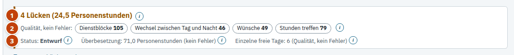
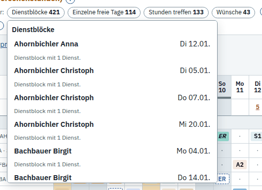
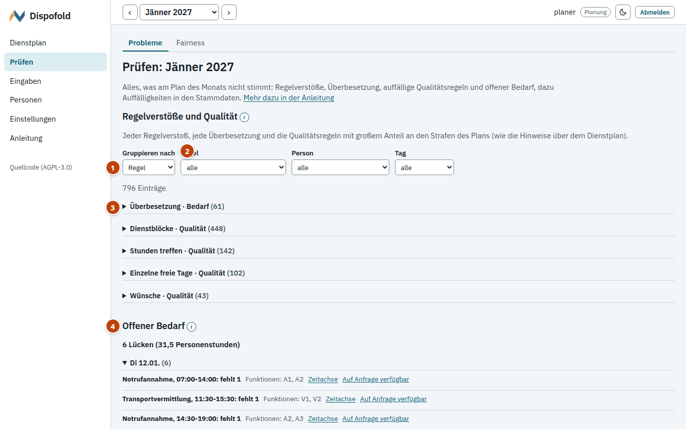
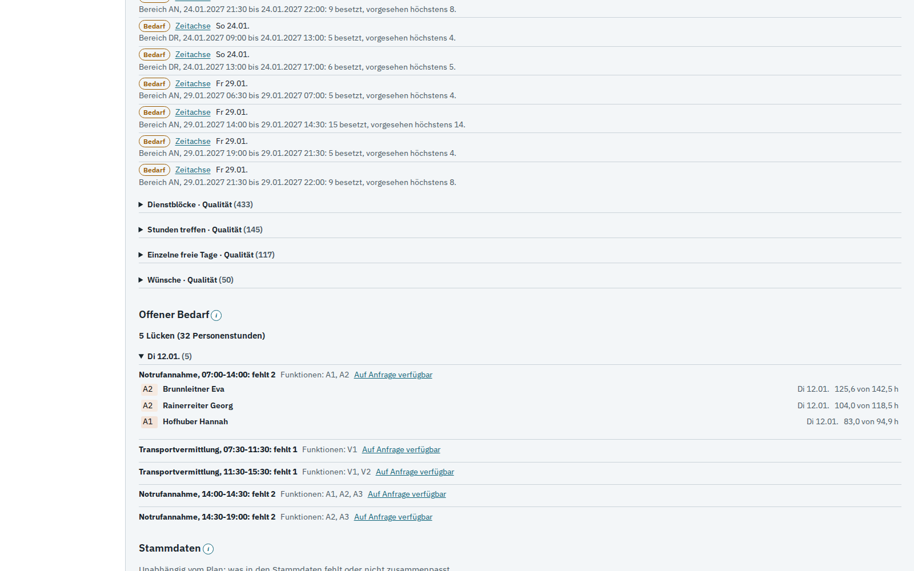

# Planen und Prüfen

Geplant wird im **Dienstplan** mit einem Klick auf **Planen**. Danach sagt die Zeile über dem Plan, ob er
verwendbar ist, und **Prüfen** listet alles auf, was nicht stimmt. Wie man einzelne Zellen ändert, steht unter
[Plan bearbeiten](plan-bearbeiten.md).

## Planen

1. Im **Dienstplan** auf **Planen** klicken. Der Solver rechnet im Hintergrund, die Laufzeit steht in der Zeile über
   dem Plan („Planung läuft (12 s)“); die Zahlen dort zeigen den bisher besten Stand. Man kann währenddessen auf
   anderen Seiten weiterarbeiten.
2. Während der Planung ist der Plan gesperrt: Zellen, Export, Monatsabschluss und Änderungen an den Daten dieses
   Monats gehen erst danach.
3. Die Planung endet von selbst nach der **Schrittzahl** (Standard 250 000 Schritte), spätestens nach dem
   **Zeitlimit** (Standard 300 Sekunden). Mit den Demodaten dauert das auf einem üblichen Rechner etwa eine halbe
   Minute. **Stopp** beendet sie früher; der beste Stand bis dahin bleibt erhalten. Am Ende meldet das Programm
   „Planung beendet“.

Eine neue Planung baut auf dem gespeicherten Plan auf: Sie verbessert ihn, statt von vorn zu beginnen. Fixierte
Zellen (von Hand gesetzt) und Vorgaben bleiben, wie sie sind. **Fixierungen lösen** löst alle Fixierungen des
Monats, damit die nächste Planung auch diese Zellen ändern darf; Vorgaben aus den **Eingaben** bleiben dabei
erhalten. **Plan fixieren** macht das Gegenteil: Es fixiert alle geplanten Dienste und Ersatzruhetage des Monats,
etwa wenn der Plan schon ausgehängt ist. Neu planen ändert sie dann nicht mehr und füllt Lücken nur noch an freien
Tagen; freie Tage bleiben offen, damit sich für eine Lücke noch jemand findet.

**Wann neu planen:** nach jeder Änderung, die den Hinweis
[„Plan veraltet: neu planen“](#hinweis-plan-veraltet-neu-planen) bringt, und wenn der Plan Regelverstöße oder Lücken
hat, die ein neuer Lauf beheben kann. Von Hand gesetzte Zellen bleiben dabei.

### Erweitert

Unter **Erweitert** (zugeklappt) steuert man einen einzelnen Lauf. Alle Felder sind optional; ein leeres Feld
(„Standard“) nimmt den Wert, den die IT eingestellt hat (siehe [betrieb.md](../betrieb.md)).

1. **Startwert (Seed):** der Startwert für den Zufall der Planung, Standard 1. Gleiche Daten, gleicher
   Ausgangsplan, gleicher Startwert und gleiche Schrittzahl ergeben denselben Plan, sofern die Planung vor dem
   Zeitlimit endet. Ein anderer Startwert ergibt einen anderen, ähnlich guten Plan. **Wann ändern:** wenn man
   eine zweite Variante sehen will.
2. **Zeitlimit (s):** wie viele Sekunden die Planung höchstens rechnet, Standard 300, mindestens 5. Ein
   Sicherheitsnetz für langsame Rechner.
3. **Schrittzahl:** nach wie vielen geprüften Änderungen die Planung aufhört, Standard 250 000. Unabhängig von der
   Geschwindigkeit des Rechners, deshalb wiederholbar. **Wann ändern:** mehr Schritte für einen etwas besseren
   Plan, wenn die Zeit da ist; weniger für einen schnellen Entwurf.
4. **Neu beginnen:** Der gespeicherte Plan wird nicht als Ausgangspunkt genommen, nur fixierte Dienste und
   Vorgaben bleiben. Hilft, wenn der Plan in einer schlechten Lösung festsitzt, etwa nach großen Änderungen am
   Bedarf. Eine Wiederholung mit demselben Ergebnis gelingt nur mit diesem Häkchen.

Daneben steht der **Score**, die Bewertung des Plans in den drei Gruppen (siehe [Begriffe](begriffe.md#score)).

## Das Ergebnis lesen

1. **Überschrift** in Farbe: grün „Plan verwendbar: keine Regelverstöße, keine Lücken“, gelb die Zahl der Lücken
   mit den fehlenden Personenstunden (fehlende Personen mal Stunden), rot die Zahl der Regelverstöße.
2. **Regeln mit Treffern:** je Regel mit Regelverstößen (rot) und je Qualitätsregel mit großem Anteil an der
   Bewertung (höchstens die fünf größten) ein Knopf mit der Zahl der Treffer. Ein Klick listet Person und Tag mit
   einer kurzen Erklärung; ein Klick auf einen Eintrag öffnet die Seite der Person. Die ganze Liste steht unter
   [Probleme](#probleme).
3. **Status:** **Entwurf** oder **abgeschlossen**. Daneben:
   - **Überbesetzung:** Personenstunden über der Höchstbesetzung (wo keine gesetzt ist, über der
     Mindestbesetzung) und Dienste, die keinen Bedarf abdecken.
   - **Einzelne freie Tage** und **Tage außerhalb der Blocklänge**, wenn ihre Regel oben keinen Knopf hat: freie
     Tage zwischen zwei Diensten und um wie viele Tage die Dienstblöcke kürzer oder länger sind als unter
     **Regeln** eingestellt. Beide sollen klein sein; sie sind keine Fehler, sondern ein Maß für die Güte des
     Plans.
   - **Plan veraltet: neu planen**, siehe [unten](#hinweis-plan-veraltet-neu-planen).
   - **Letzte Planung fehlgeschlagen**, wenn ein Lauf mit einem Fehler abgebrochen ist; dann noch einmal
     planen, bei Wiederholung mit **Neu beginnen**.

Ein Klick auf die Zahl eines Tages in der Zeile **Bedarfslücken** des Dienstplans listet die Lücken dieses Tages
mit Bereich, Uhrzeit und fehlender Besetzung, jeweils mit der Liste **Auf Anfrage verfügbar**.

**Was ist ein guter Plan?** Keine Regelverstöße (sonst darf er so nicht verwendet werden) und keine Lücken, die
sich füllen lassen. Die Zahlen der Qualitätsregeln sind nie 0; sie helfen, zwei Läufe zu vergleichen. Wichtige
Regeln im Einzelnen (alle mit **i** auf der Seite **Regeln**, ausführlich in [regeln.md](../regeln.md)):

- **Freie Sonntage:** Jede Person hat im Kalendermonat mindestens so viele Sonntage ohne Dienst wie eingestellt
  (Standard 2; 0 schaltet die Regel aus). Ein Sonntag ist nur frei, wenn kein Dienst ihn berührt, auch kein
  Nachtdienst von Samstag auf Sonntag; Abwesenheiten zählen als frei.
- **Höchststunden im Monat:** Die Stunden einer Person im Monat (Dienste, angerechnete Abwesenheitstage und
  Ersatzruhe) dürfen das Ziel höchstens um eine Toleranz übersteigen, voreingestellt 10 %. Das Programm plant nie
  darüber. Ein von Hand gesetzter Dienst darf darüber gehen, zählt dann aber als Regelverstoß. Die gesetzlichen
  Grenzen wie die Höchstarbeitszeit je Woche gelten unabhängig davon. Für die Obergrenze zählt immer das echte,
  nicht das verkleinerte Ziel.
- **Bedarfslücken** sind kein Fehler des Solvers: Reicht das Personal nicht, bleibt die Lücke sichtbar. Ist
  jemand frei und darf den Dienst machen, wird eine Lücke immer zuerst gefüllt.

### Hinweis „Plan veraltet: neu planen“

Neben dem Status kann der Hinweis **Plan veraltet: neu planen** stehen. Er bedeutet: Der Plan passt nicht mehr
ganz zu den Daten, bitte neu planen. Der Grund steht im Tooltip (Maus auf den Hinweis):

- „Eingaben, Stammdaten, Regeln, Gewichte oder die Historie der Vormonate wurden nach dieser Planung geändert.“
- „Der Plan des Vormonats wurde nach dieser Planung geändert (Ruhezeiten am Monatsanfang).“ Die Ruhezeiten am
  Monatsanfang hängen von den letzten Diensten des Vormonats ab, deshalb nimmt der Solver sie aus dem
  gespeicherten Plan des Vormonats.

Zellen, die man von Hand ändert, machen den Plan nicht veraltet: Sie sind Teil des Plans. Der Hinweis verschwindet
erst mit der nächsten Planung. Abschließen lässt sich ein veralteter Monat nur mit **Trotzdem abschließen**.

## Prüfen

**Prüfen** hat zwei Reiter: **Probleme** und **Fairness** (siehe [Auswertungen](auswertungen.md#fairness)). Die
Rolle „nur lesen“ hat statt **Prüfen** den Menüpunkt **Fairness**.

### Probleme

Die Seite listet alles, was am Plan des gewählten Monats nicht stimmt, in drei Abschnitten. Der erste:
**Regelverstöße und Qualität**: jeder Regelverstoß, jede Überbesetzung und die Qualitätsregeln mit großem Anteil an
der Bewertung (dieselben wie die Knöpfe über dem Dienstplan), ein Eintrag je Treffer.

1. **Gruppieren nach** ordnet die Liste nach **Regel** (Standard), **Person** oder **Tag**.
2. Die drei Auswahlen daneben zeigen nur eine **Regel**, eine **Person** oder einen **Tag** (Standard: alle).
   Darunter steht die Zahl der Einträge.
3. Jede Gruppe klappt mit einem Klick auf ihre Überschrift auf und zu; bei langen Listen ist nur die erste offen.
   Die Überschrift nennt die Regel, ihre Gruppe und die Zahl der Treffer.
4. **Offener Bedarf**, siehe unten.

Ein Eintrag nennt die Gruppe (**Regelverstoß**, **Bedarf**, **Qualität**), die Person (ein Klick öffnet ihre Seite)
oder bei Bedarfseinträgen die **Zeitachse** (sie öffnet sich auf Bereich und Tag des Eintrags), den Tag und eine
kurze Erklärung, etwa bei der täglichen Ruhezeit „Nur … h Ruhe nach Dienst … am …“.

**Wie man die Liste abarbeitet:** zuerst alle Einträge der Gruppe **Regelverstoß**, denn ein Plan mit
Regelverstößen darf so nicht verwendet werden; dann den offenen Bedarf; die Qualität zuletzt und nur, wo eine
Zahl auffällt (eine Person mit vielen Treffern). Typische Regelverstöße und was zu tun ist:

| Eintrag | Ursache | Was tun |
|---|---|---|
| Abwesenheit | ein Dienst an einem Tag, für den nachträglich eine Abwesenheit eingetragen wurde | die Zelle anklicken, **Dienst entfernen (frei)**, oder neu planen |
| Tägliche Ruhezeit, Wöchentliche Ruhezeit | ein von Hand gesetzter Dienst oder eine Vorgabe zu knapp nach dem vorigen Dienst | einen anderen Dienst oder eine andere Person wählen, die Vorgabe ändern |
| Höchststunden im Monat | ein von Hand gesetzter Dienst bringt die Person über ihr Ziel plus Toleranz | jemand anderen einteilen |
| Beschäftigungszeitraum | ein Dienst vor dem Eintritt, nach dem Austritt oder nach dem Ausschluss aus dem Quellsystem | den Dienst entfernen oder neu planen |
| Dienstsperre | ein Dienst, den die Person laut Einschränkung „Nie“ nicht macht | den Dienst entfernen oder die Einschränkung prüfen |

### Offener Bedarf

Die Lücken nach Tagen, je Lücke Bereich, Uhrzeit, wie viele Personen fehlen, welche Funktionen des Bereichs in
diese Zeit fallen und ein Link zur **Zeitachse** auf Bereich und Tag. **Auf Anfrage verfügbar** klappt die
Personen auf, die man fragen kann; ein Klick auf einen Namen setzt den Dienst. Siehe
[Dienste nur auf Anfrage](plan-bearbeiten.md#dienste-nur-auf-anfrage). Während einer Planung und in einem
abgeschlossenen Monat fehlt dieser Knopf.

Bleibt eine Lücke, obwohl niemand auf Anfrage passt, gibt es drei Wege: jemanden von Hand einteilen, der den
Dienst normal machen darf (die Prüfung zeigt danach, ob das eine Regel verletzt), den Bedarf an diesem Tag prüfen
oder die Lücke bewusst offen lassen und den Monat mit **Trotzdem abschließen** abschließen.

### Stammdaten

Unabhängig vom Plan, was in den Stammdaten fehlt oder nicht zusammenpasst, mit dem Vermerk **Hinweis**. Jeder
Eintrag sagt, was zu tun ist, und verweist auf die Person, die **Stammdaten** (beim Bedarf auf seine Zeile) oder die
**Regeln**:

| Hinweis | Was tun |
|---|---|
| „… hat keinen Bereich und wird nie eingeplant.“ | auf der Seite der Person mindestens einen Bereich zuordnen |
| „In ihrem Bereich gibt es keine Schicht.“ | für den Bereich Schichten anlegen oder der Person einen anderen Bereich zuordnen |
| „Einschränkungen „Nie“ schließen jede Schicht ihrer Bereiche aus.“ | die Einschränkungen der Person prüfen |
| „Bereich … hat keinen Bedarf.“ | Bedarf für den Bereich anlegen, sonst zählt jeder Dienst dort als Überbesetzung |
| „Bereich …, Mo 07:00-15:00: an … Tagen kann niemand eingeplant werden (ab …).“ | für eine Bedarfszeile gibt es an diesen Tagen niemanden, der beschäftigt ist, den Bereich hat, nicht abwesend ist und eine Schicht des Bereichs zu dieser Zeit machen darf („Nur auf Anfrage“ zählt als möglich): Personen den Bereich zuordnen, Einschränkungen „Nie“ und Abwesenheiten prüfen oder den Bedarf ändern. Der Verweis **Zum Bedarf** zeigt die Zeile in den Stammdaten |
| „Die gewohnte Verteilung … ergibt … statt 100 %.“ | die Anteile so ändern, dass sie 100 % ergeben |
| „Die gewohnte Verteilung nennt den Bereich …, den die Person nicht hat.“ | den Anteil entfernen oder den Bereich zuordnen |
| „Der Nachtanteil der gewohnten Verteilung zählt nicht, …“ | nichts, wenn das so gewollt ist (Einstellung **Nachtdienste** oder nie Nacht) |
| „… bekommt keine Nachtdienste: …“ | soll die Person Nächte machen, einen Nachtanteil eintragen oder unter Regeln „Gleichmäßig“ wählen |

Ohne Plan zeigt die Seite nur die Prüfung der Stammdaten. Es lohnt sich, sie vor dem ersten Planen eines Monats
anzusehen.
