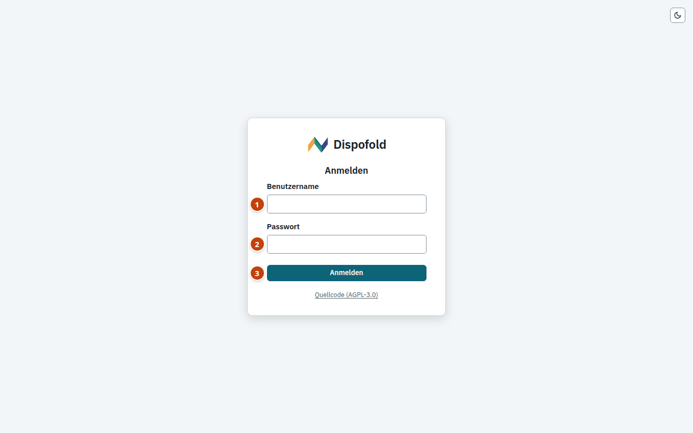
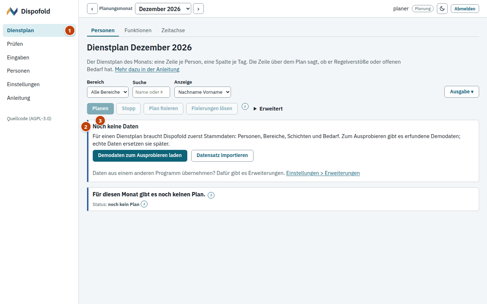
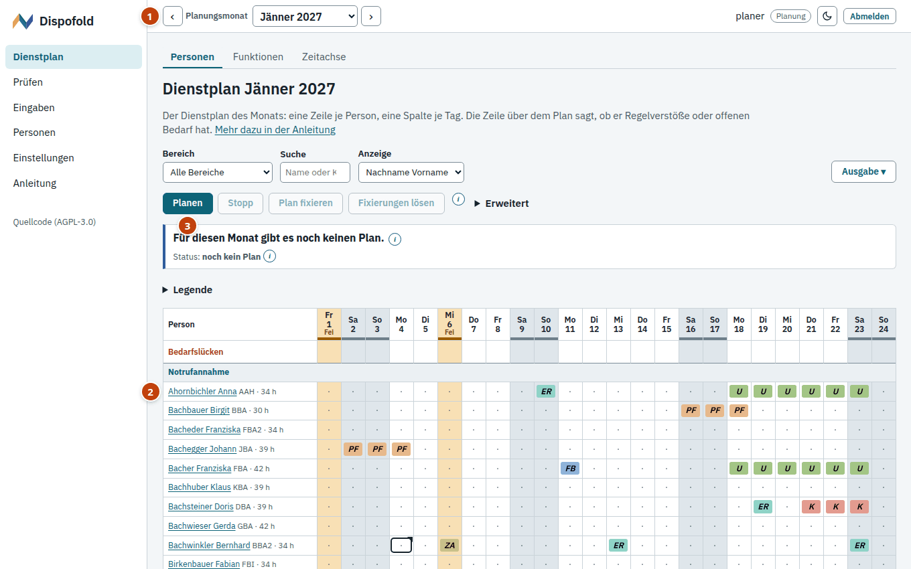
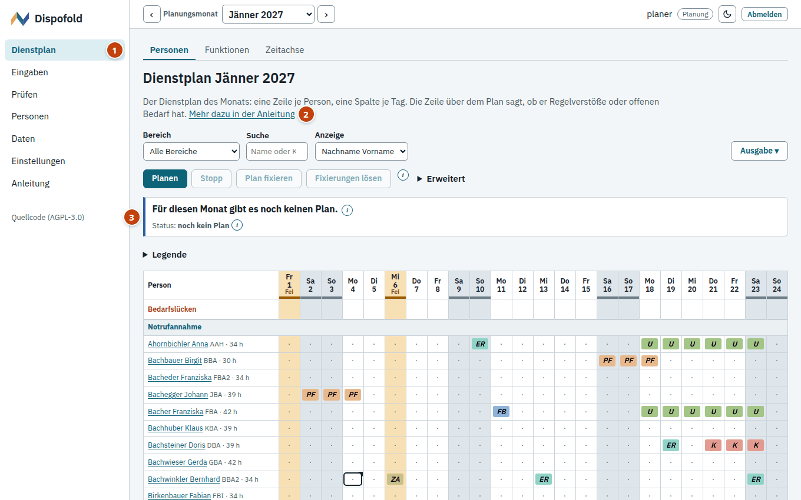
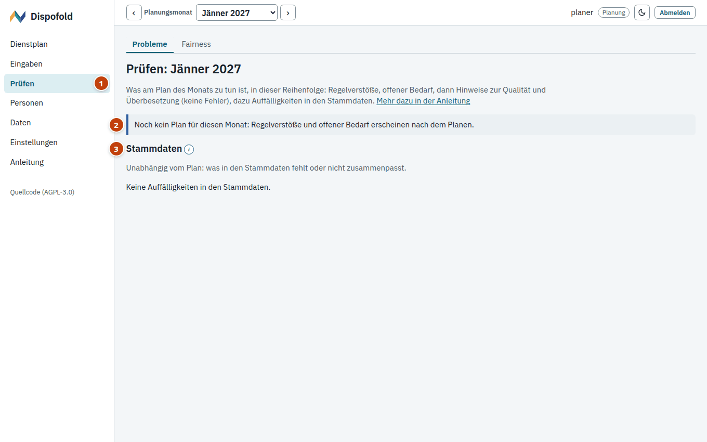
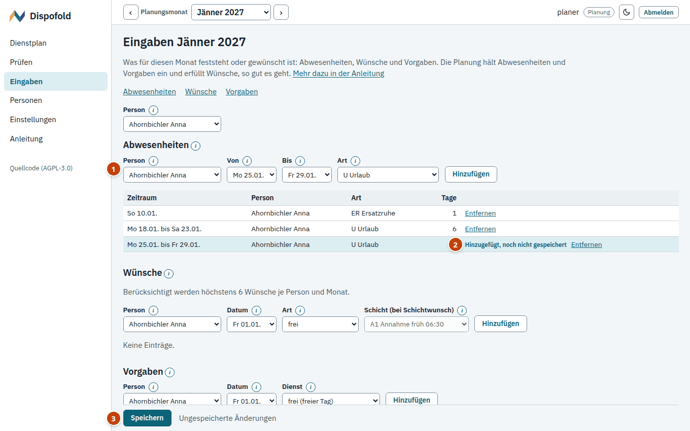
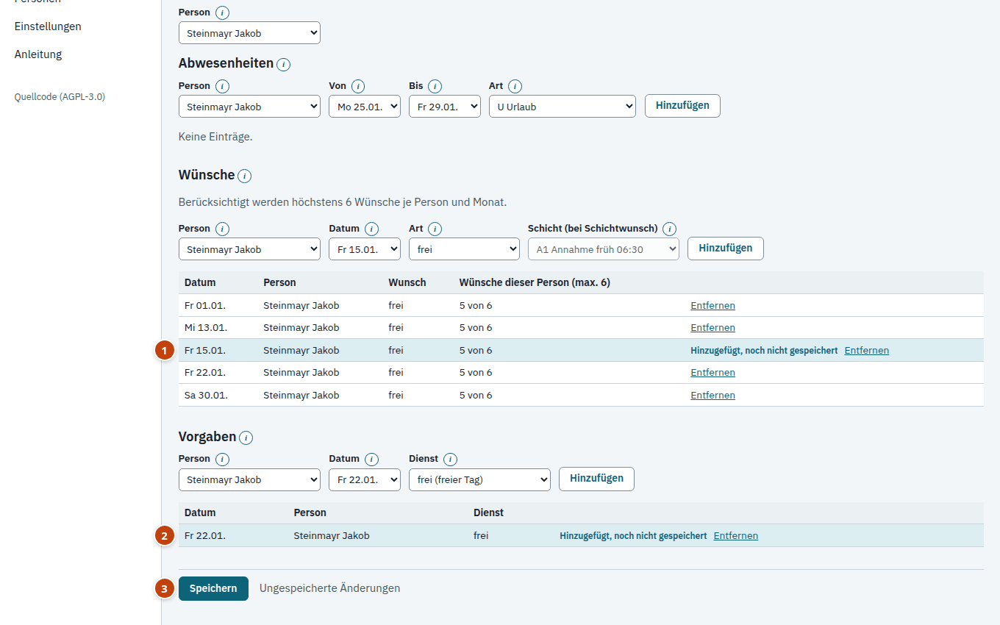
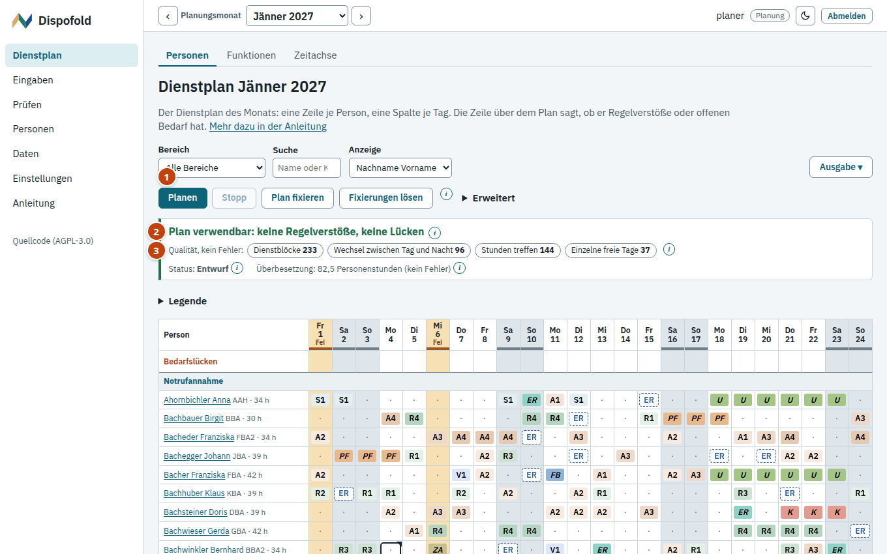
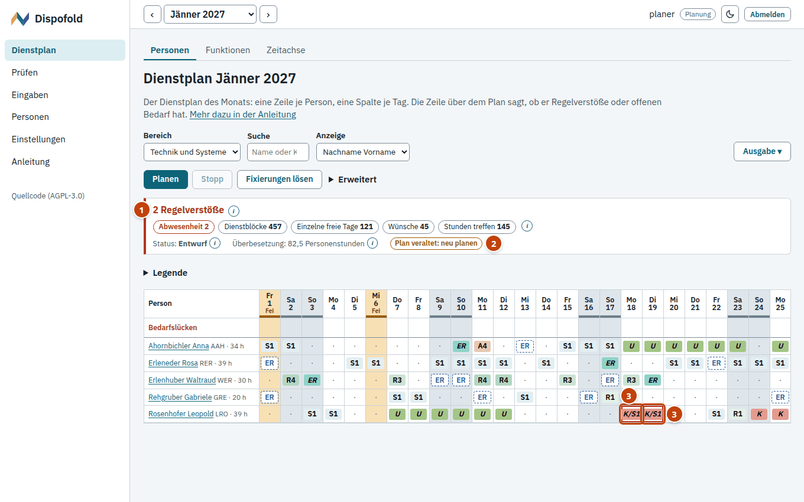
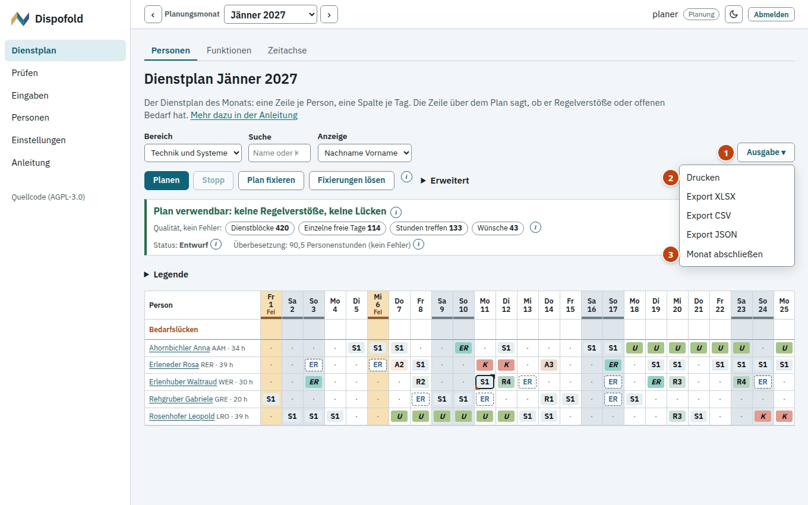

# Schnellstart in 10 Schritten

Diese Seite führt in zehn kurzen Schritten durch einen Probemonat mit erfundenen Demodaten: vom ersten Öffnen bis
zum abgeschlossenen Monat. Jeder Schritt ist eine Handlung mit einem Bild. Die roten Zahlen im Bild zeigen, wohin
man klickt oder schaut. Erklärungen kommen später; die Wörter in Links erklärt [Begriffe](begriffe.md).

Diese Anleitung ist in jede Form von Dispofold eingebaut, am Server wie im Programm am eigenen Rechner, und geht
auch ohne Internet: im Menü **Anleitung** und über **Mehr dazu in der Anleitung** unter jedem Seitentitel.

Wer gleich mit echten Daten anfangen will: [Echte Daten aus dem bisherigen Planungsprogramm
übernehmen](plugin-sp5-echte-daten.md) oder einen [Datensatz importieren](daten.md#import). Der Probemonat hier
lohnt sich trotzdem vorher, am besten in einer Installation zum Ausprobieren.

## 1. Anmelden oder starten

**Am Server:** Die Adresse von Dispofold im Browser öffnen, **Benutzername** (1) und **Passwort** (2) eingeben
und **Anmelden** (3) klicken. Beides kommt von der IT. **Am eigenen Rechner:** das Programm Dispofold starten und
das Passwort für die Daten eingeben (beim allerersten Start legt man es fest, siehe
[Erste Schritte](erste-schritte.md#programm-am-eigenen-rechner-starten)).

So sieht es aus, wenn es geklappt hat: Links steht das Menü, oben rechts die Rolle **Planung** und daneben
**Abmelden** (am Server) oder **Beenden** (am eigenen Rechner).

## 2. Den leeren Start ansehen

Im Menü **Dienstplan** (1) anklicken; beim ersten Öffnen ist er schon offen.

So sieht es aus, wenn es geklappt hat: Der Dienstplan sagt **Noch keine Daten** (2), und **Planen** (3) ist grau.
Ohne [Stammdaten](begriffe.md#stammdaten) (Personen, Bereiche, Schichten, Bedarf) gibt es nichts zu planen.

## 3. Demodaten laden

Auf dem leeren Start **Demodaten zum Ausprobieren laden** klicken.

So sieht es aus, wenn es geklappt hat: Oben steht der [Planungsmonat](begriffe.md#planungsmonat) **Jänner 2027**
(1). Der Dienstplan zeigt 150 erfundene Personen (2), schon mit Urlauben und anderen
[Abwesenheiten](begriffe.md#abwesenheit), aber noch ohne Dienste. **Planen** (3) ist nicht mehr grau.

Dasselbe geht auch unter **Einstellungen**, **Daten**, **Erweitert** mit **Demodaten laden (Jänner 2027)**; danach
führt der Knopf **Zu Jänner 2027 wechseln** zum Monat der Demodaten. Die Demodaten ersetzen alle Stammdaten: nie
laden, wenn schon echte Daten da sind.

## 4. Einen kurzen Rundgang machen

Die drei Stellen ansehen, die auf jeder Seite gleich sind.

1. **Menü:** **Dienstplan**, **Prüfen**, **Eingaben**, **Personen**, **Einstellungen** und **Anleitung**. Auf einem
   schmalen Bildschirm, etwa am Telefon, steckt das Menü hinter dem Knopf mit den drei Strichen (☰) oben.
2. **Mehr dazu in der Anleitung:** Unter jedem Seitentitel sagt ein kurzer Text, wozu die Seite da ist; der Link
   öffnet den passenden Abschnitt dieser Anleitung. Ein **i** neben einer Zahl oder einem Feld erklärt sie.
3. **Die Zeile über dem Plan:** Sie sagt nach dem Planen in Farbe, ob der Plan verwendbar ist. Jetzt steht dort
   „Für diesen Monat gibt es noch keinen Plan.“

So sieht es aus, wenn es geklappt hat: Ein Klick auf **Anleitung** im Menü öffnet diese Anleitung im Programm; der
Planungsmonat bleibt dabei Jänner 2027.

## 5. Die Stammdaten prüfen lassen

Im Menü **Prüfen** (1) anklicken.

So sieht es aus, wenn es geklappt hat: Oben steht „Noch kein Plan für diesen Monat …“ (2), darunter unter
**Stammdaten** (3) „Keine Auffälligkeiten in den Stammdaten.“ Mit echten Daten steht hier, was fehlt oder nicht
zusammenpasst, jeweils mit dem nächsten Schritt.

## 6. Einen Urlaub eintragen und speichern

Im Menü **Eingaben** oben bei **Person** „Ahornbichler Anna“ wählen. Unter **Abwesenheiten** (1) **Von** 25.01.,
**Bis** 29.01. und **Art** „U Urlaub“ wählen, **Hinzufügen** klicken, dann unten **Speichern** (3).

So sieht es aus, wenn es geklappt hat: Vor dem Speichern ist die neue Zeile markiert: „Hinzugefügt, noch nicht
gespeichert“ (2). Nach **Speichern** ist die Markierung weg, und unten erscheint kurz „Eingaben gespeichert“.

## 7. Einen Wunsch und eine Vorgabe eintragen

Ein [Wunsch](begriffe.md#wunsch) heißt: vielleicht. Eine [Vorgabe](begriffe.md#vorgabe) heißt: sicher. Bei
**Person** „Steinmayr Jakob“ wählen. Unter **Wünsche** (1) **Datum** 15.01. und **Art** „frei“ wählen,
**Hinzufügen**. Für den 22. hat er sich schon frei gewünscht; das soll sicher gelten: Unter **Vorgaben** (2)
**Datum** 22.01. und **Dienst** „frei (freier Tag)“ wählen, **Hinzufügen**. Dann **Speichern** (3).

So sieht es aus, wenn es geklappt hat: Beide neuen Zeilen sind markiert, bis man speichert; danach erscheint kurz
„Eingaben gespeichert“. Am 15. bekommt Jakob Steinmayr frei, wenn es geht; am 22. bekommt er sicher frei.

## 8. Planen

Im Menü **Dienstplan**, dann **Planen** (1) klicken und warten. Das dauert mit den Demodaten ein bis zwei Minuten.

So sieht es aus, wenn es geklappt hat: Die Überschrift über dem Plan (2) ist grün: „Plan verwendbar: keine
Regelverstöße, keine Lücken“. Nur die Farbe dieser Überschrift zählt: grün ist gut, gelb heißt
[Lücken](begriffe.md#lücke), rot heißt [Regelverstöße](begriffe.md#regelverstoß). Die Knöpfe nach „Qualität, kein
Fehler:“ (3) sind Hinweise, wie gut der Plan ist, keine Fehler.

## 9. Eine Krankmeldung einarbeiten

Eine Person, die schon Dienste hat, meldet sich für zwei Tage krank. Unter **Eingaben** die Abwesenheit mit **Art**
„K Krankenstand“ eintragen und speichern, dann im **Dienstplan** **Zum ersten Konflikt springen** (2) klicken, die
rote Zelle (3) anklicken und **Dienst entfernen (frei)** wählen; dasselbe für den zweiten Tag. Im Bild ist es eine
Person aus Technik und Systeme.

So sieht es aus, wenn es geklappt hat: Zuerst ist die Überschrift (1) rot, „2 Regelverstöße“. Nach dem Entfernen
der Dienste ist sie gelb: An den beiden Tagen fehlt jemand. Ein Klick auf die Zahl in der Zeile **Bedarfslücken**
zeigt, wer gefragt werden kann ([Von Hand einsetzbar](begriffe.md#von-hand-einsetzbar)); ein Klick auf einen
Namen setzt den Dienst. Steht dort „Niemand passt.“, jemanden von Hand einteilen: die leere Zelle der Person
anklicken und die Schicht wählen. Ist die Überschrift wieder grün, ist alles erledigt.

Ist der Plan schon ausgehängt, nicht einfach **Planen** klicken: Neu planen darf alle Dienste ändern, die nicht
[fixiert](begriffe.md#fixiert) sind, auch die anderer Personen. Vorher **Plan fixieren** klicken. Alle Schritte
mit Bildern: [Eine Krankmeldung nach dem Planen](beispiel.md#8-eine-krankmeldung-nach-dem-planen).

## 10. Drucken und den Monat abschließen

Im **Dienstplan** **Ausgabe** (1) öffnen und **Drucken** (2) wählen. Danach **Ausgabe**, **Monat abschließen** (3)
und im Fenster noch einmal **Monat abschließen** klicken.

So sieht es aus, wenn es geklappt hat: Neben **Status:** steht **abgeschlossen**, und der Plan ist nur noch
lesbar. Zum Üben lässt sich der Monat unter **Einstellungen**, **Daten** mit **Monat wieder öffnen** wieder öffnen.

## Wie es weitergeht

- Denselben Monat ausführlicher, mit einer Änderung an einer Person und am Bedarf:
  [Ein Monat Schritt für Schritt](beispiel.md).
- Was die Überschrift, **Prüfen**, die Fairness und die Seite einer Person sagen:
  [Was die Zahlen bedeuten](zahlen.md).
- Mit echten Daten weiterarbeiten: [Erste Schritte](erste-schritte.md#die-ersten-daten).
- Etwas klappt nicht: [Häufige Fragen und Fehlerbehebung](fragen.md).

> **Mehr Hintergrund:** Wie der Solver abwägt und was fest ist und was nur gewünscht, steht unter
> [Wie das Programm plant](wie-plant.md); jede Regel im Einzelnen in [regeln.md](../regeln.md).
