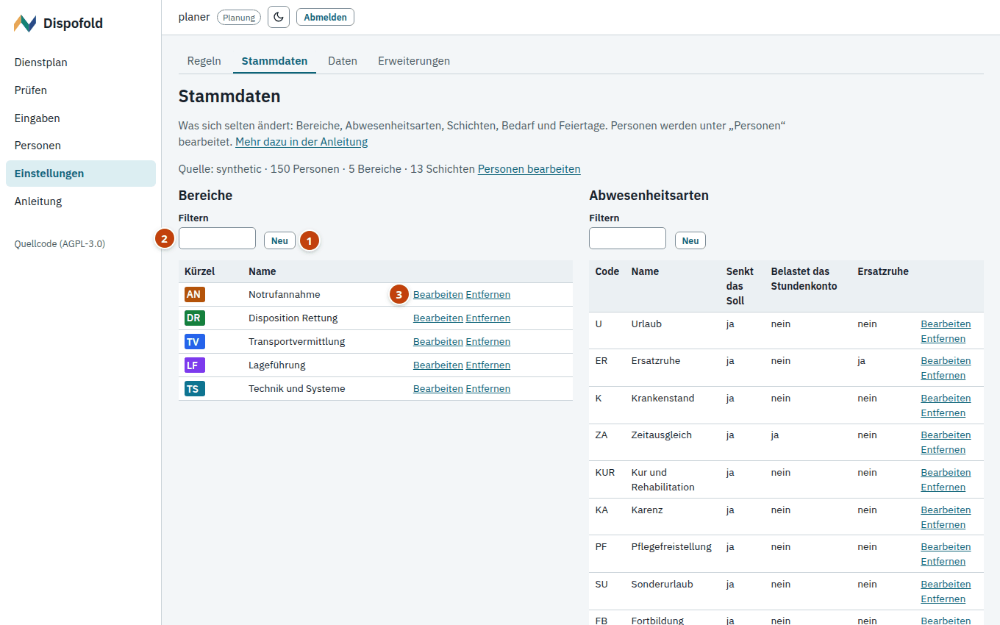
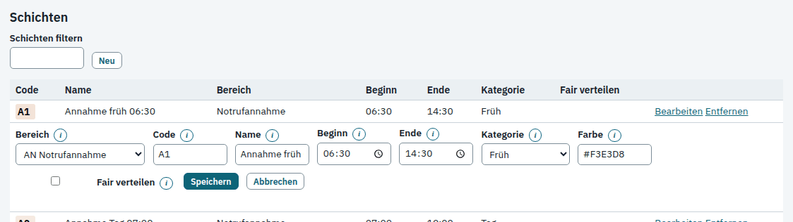
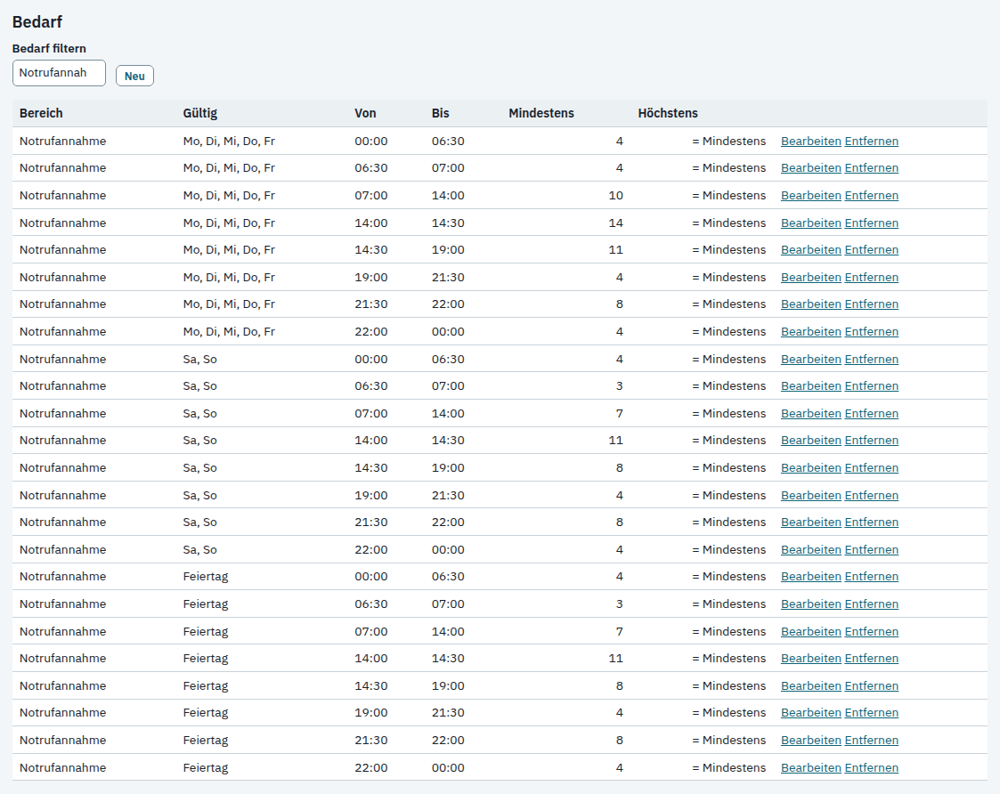

# Bereiche, Schichten und Bedarf

Unter **Einstellungen**, **Stammdaten** stehen die Daten, die für alle Monate gelten und sich selten ändern:
Bereiche, Abwesenheitsarten, Schichten, Bedarf und Feiertage. Sie kommen meist mit dem Datensatz aus dem
Quellsystem. Personen haben eine eigene Seite: [Personen](personen.md).

Über den Tabellen nennt eine Zeile die Quelle der Daten (zum Beispiel „synthetic“ für die Demodaten) und wie viele
Personen, Bereiche und Schichten es gibt; **Personen bearbeiten** führt zur Liste der Personen. Jede Tabelle hat
dieselben Knöpfe:

1. **Neu** legt einen Eintrag an. Unter der Überschrift öffnet sich ein Formular.
2. **Filtern** zeigt nur die Zeilen, in denen der eingegebene Text vorkommt.
3. **Bearbeiten** öffnet das Formular einer Zeile, **Entfernen** nimmt sie heraus (siehe
   [Entfernen](#entfernen)).

Es ist immer nur ein Formular offen. **Speichern** übernimmt die Änderung sofort, **Abbrechen** verwirft sie. Das
Programm prüft jede Änderung wie einen Import: Ist etwas falsch, wird nichts gespeichert, und die Liste der
Fehler erscheint im Formular. Offene Monate, die eine Änderung betrifft, zeigen danach „Plan veraltet: neu
planen“. Während einer Planung sind Änderungen gesperrt, die den geplanten Monat betreffen.

Jedes **i** neben einem Feld erklärt es. Die Felder im Einzelnen:

## Bereiche

| Feld | Bedeutung |
|---|---|
| Code | Kürzel des Bereichs, zugleich seine Id. Wird beim Anlegen eingegeben und lässt sich danach nicht ändern. |
| Name | wie der Bereich in Listen und im Plan heißt |
| Farbe | Farbe im Plan als `#RRGGBB`, zum Beispiel `#3A7BD5`; leer heißt ohne Farbe |

Ein Bereich lässt sich erst entfernen, wenn seine Schichten entfernt sind.

## Abwesenheitsarten

| Feld | Bedeutung |
|---|---|
| Code | Kürzel, wie es im Plan steht, zugleich die Id; lässt sich nach dem Anlegen nicht ändern |
| Name | zum Beispiel „Urlaub“ |
| Senkt das Soll | An Arbeitstagen zählt der Tag mit Wochenstunden durch 5 wie gearbeitet. Ein für Urlaub und Krankenstand, aus für unbezahlte Abwesenheit. |
| Belastet das Stundenkonto | Die angerechneten Stunden gehen vom Stundenkonto ab, etwa bei Zeitausgleich. |
| Ersatzruhe | Die Abwesenheit ist Ersatzruhe: Sie verringert die offenen Ersatzruhetage der Person. |
| Gutschrift | Womit ein Tag angerechnet wird, wenn die Art das Soll senkt. **Wochenstunden / 5 an Werktagen** (Standard), oder **Stunden des geplanten Dienstes**: der Dienst, den die Abwesenheit ersetzt hat, an jedem Wochentag, ohne Dienst nichts. Wie in vielen Zeitaufzeichnungen bei Krankenstand oder Urlaub an einem Diensttag. |
| Farbe | Farbe im Plan; leer heißt ohne Farbe |

**Stunden des geplanten Dienstes:** Dispofold merkt sich den Dienst, wenn eine Abwesenheit in einen Monat
eingetragen wird, der schon einen Plan hat: die Stunden des Dienstes an diesem Tag, oder 0, wenn an dem Tag kein
Dienst geplant war. Schon ein Probelauf der Planung gilt als Plan. Eine Abwesenheit, die schon vor der Planung da
war, ersetzt keinen Dienst; für sie und für Abwesenheiten aus einem Import gilt Wochenstunden / 5 an Werktagen, und die Personenseite sagt
das. Ein neuer Import lässt die hier gewählte Gutschrift stehen.

Im Demodatensatz sind Urlaub und Krankenstand „senkt das Soll“, Zeitausgleich zusätzlich „belastet das
Stundenkonto“.

## Schichten

| Feld | Bedeutung |
|---|---|
| Bereich | zu welchem Bereich die Schicht gehört; nur Personen dieses Bereichs bekommen sie |
| Code | Kürzel, wie es im Plan steht, zum Beispiel „A1“ |
| Name | zum Beispiel „Annahme früh“ |
| Beginn, Ende | Liegt das Ende vor dem Beginn, endet die Schicht am nächsten Tag (Nachtdienst). Ein Dienst darf höchstens so lang sein wie unter Regeln eingestellt (Standard 12 Stunden). |
| Kategorie | die [Schichtart](begriffe.md#schichtart) Früh, Tag, Spät oder Nacht für Vorwärtsrotation, Abwechslung, gewohnte Verteilung und Einschränkungen. Standard **aus den Zeiten**: Nacht, wenn genug Stunden in der Nachtzeit liegen (Standard 2 Stunden zwischen 22 und 6 Uhr), sonst nach Beginn und Ende Früh, Tag oder Spät. |
| Farbe | Farbe im Plan; leer heißt ohne Farbe |
| Fair verteilen | Dienste dieser Schicht werden über die Fairness gleichmäßig auf alle verteilt, die sie machen können. die Nachtschichten. |

Neue Schichten bekommen ihre Id vom Programm; der Code lässt sich ändern.

## Bedarf

Der Bedarf sagt, wie viele Personen ein Bereich zu welcher Zeit braucht. Er ist die wichtigste Vorgabe für die
Planung: Jede fehlende Person ist eine [Lücke](begriffe.md#lücke).

| Feld | Bedeutung |
|---|---|
| Bereich | für welchen Bereich der Bedarf gilt; jeder Dienst des Bereichs in dieser Zeit zählt zur Besetzung |
| Gültig | **nach Tagen** (an den gewählten Wochentagen und Feiertagen) oder **an einem Datum** (nur an diesem einen Tag) |
| Tage | Montag bis Sonntag und **Feiertag** |
| Datum | der eine Tag bei „an einem Datum“ |
| Von, Bis | der Zeitraum; liegt „Bis“ vor „Von“, endet er am nächsten Tag |
| Mindestens | so viele Personen müssen da sein; jede fehlende ist offener Bedarf |
| Höchstens | mehr Personen zählen als Überbesetzung; leer heißt: die Mindestbesetzung ist auch die Höchstbesetzung |

Wichtig, damit der Bedarf so wirkt wie gedacht:

- **Zeiträume nicht überlappen lassen.** Ein Tag wird in Abschnitte zerlegt, etwa 07:00 bis 14:00 mit 10 Personen
  und 14:00 bis 14:30 mit 14 Personen (Übergabe). Jeder Abschnitt hat seine eigene Mindestbesetzung.
- **Feiertage:** Hat ein Bereich Bedarf mit dem Tag **Feiertag**, ersetzt dieser an Feiertagen den Bedarf des
  Wochentags ganz. Ohne solchen Bedarf gilt an einem Feiertag der Bedarf seines Wochentags.
- **Ein Datum ersetzt den ganzen Tag.** Gibt es für einen Bereich Bedarf „an einem Datum“, gilt an diesem Tag für
  den Bereich nur noch dieser Bedarf; der Bedarf nach Tagen fällt an dem Tag weg. Für eine Veranstaltung am 20.,
  die tagsüber eine Person mehr braucht, also alle Zeiträume des 20. eintragen, nicht nur den zusätzlichen.
- **Höchstbesetzung:** Ohne Höchstwert ist jede Person über der Mindestbesetzung Überbesetzung, und die Planung
  vermeidet sie, auch wenn Personen dadurch unter ihrem Ziel bleiben. Mit einem Höchstwert darf sie bis dorthin
  einteilen, ohne dass es als Überbesetzung zählt. Einen Höchstwert setzt man also, wo zusätzliche Personen
  willkommen sind.
- **Wann ändern:** wenn sich die Besetzung dauerhaft ändert. Bedarf, der in Dispofold geändert wurde, kommt in die
  [Korrekturdatei](daten.md#korrekturdatei), sodass der nächste Datensatz ihn schon enthält.

## Feiertage

| Feld | Bedeutung |
|---|---|
| Datum | Der Tag zählt für Bedarf an Feiertagen, Feiertagsdienste, Ersatzruhe und die Arbeitstage des Solls. |
| Name | zum Beispiel „Neujahr“ |

Die Feiertage eines neuen Jahres kommen mit dem Datensatz oder werden hier eingetragen, bevor der erste Monat des
Jahres geplant wird.

## Ids und Kürzel

Bereiche und Abwesenheitsarten haben als Id ihr Kürzel. Es wird beim Anlegen eingegeben und lässt sich danach
nicht mehr ändern. Ein entferntes Kürzel bleibt gesperrt und kann nicht neu vergeben werden, damit alte Pläne und
die Historie eindeutig bleiben. Schichten und Personen bekommen ihre Id vom Programm.

## Entfernen

- Wird ein Eintrag noch verwendet (in offenen Monaten oder in anderen Stammdaten, zum Beispiel eine Schicht in
  Einschränkungen oder im Plan), nennt das Programm die Zahl der Verweise und die Monate und fragt, ob er mit allen
  Verweisen entfernt werden soll.
- Kommt ein Eintrag in einem abgeschlossenen Monat vor, lässt er sich nicht entfernen.
- Ein Bereich lässt sich erst entfernen, wenn seine Schichten entfernt sind.

## Wenn jemand anderer inzwischen gespeichert hat

Wie bei den Eingaben fragt das Programm nach, wenn jemand anderer seit dem Öffnen der Seite Stammdaten gespeichert
hat: **OK** übernimmt die eigene Änderung in die neue Fassung, **Abbrechen** verwirft sie und lädt die neue
Fassung. Wurde derselbe Eintrag auch von der anderen Person geändert, speichert das Programm nicht von selbst: Die
eigenen Angaben stehen wieder im Formular, sie sind zu prüfen und noch einmal zu speichern.

Änderungen an Bereichen, Schichten, Abwesenheitsarten und Feiertagen kommen nicht in die Korrekturdatei und werden
beim nächsten Import durch die Werte des Datensatzes ersetzt. Sie gehören deshalb ins Quellsystem.
