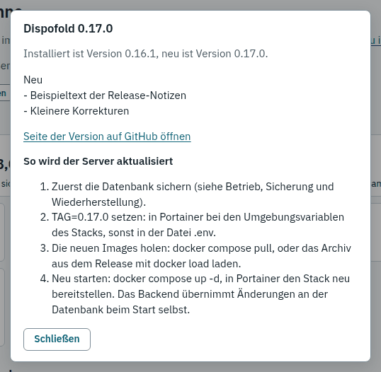
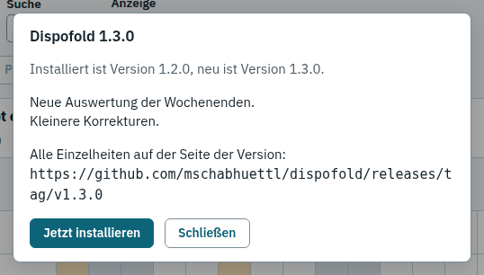
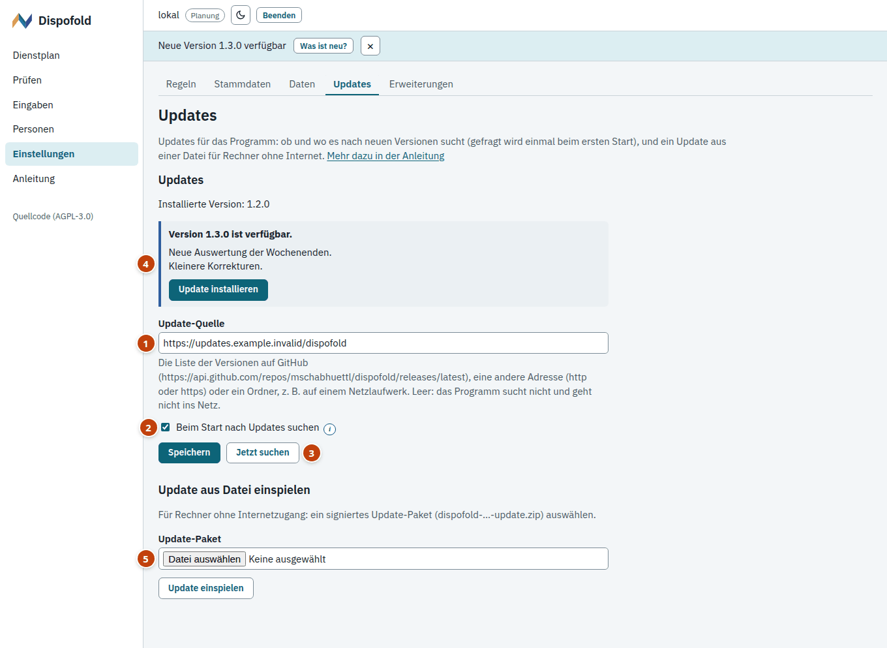

# Updates

Neue Versionen von Dispofold erscheinen auf GitHub. Das Programm sagt Bescheid, wenn es eine gibt; einspielen muss
man sie selbst: am Server die IT, am eigenen Rechner ein Klick. Was sich geändert hat, steht in den Notizen der
Version.

## Neue Version

Gibt es eine neuere Version von Dispofold, steht oben der Hinweis **Neue Version x.y.z verfügbar**. Ihn sieht nur
die Planung, die Rolle **nur lesen** nie. Vorabversionen zählen nicht.

- **Was ist neu?** öffnet ein Fenster mit den Notizen zu dieser Version und einem Link auf die Seite der Version
  auf GitHub.
- Das **×** blendet den Hinweis für diese Version aus; der Browser merkt sich das. Erst bei der nächsten Version
  erscheint er wieder.

### Am Server

Der Server sucht selbst, beim Start und einmal am Tag; die Planung sieht den Hinweis spätestens zehn Minuten
danach beim nächsten Seitenwechsel. Einspielen muss die IT das Update; das Fenster nennt die Schritte: zuerst die
Datenbank sichern, `TAG` auf die neue Version setzen, die neuen Images holen, neu starten. Das Backend übernimmt
Änderungen an der Datenbank beim Start selbst. Ausführlich: [betrieb.md](../betrieb.md#update). Die IT kann die
Suche abschalten; dann erscheint nie ein Hinweis.

Für die Planung heißt das: Bescheid geben, wann ein Update passt (nicht während einer laufenden Planung), und
danach kurz prüfen, ob alles wie gewohnt aussieht. Daten, Pläne und Regeln bleiben bei einem Update erhalten.

### Am eigenen Rechner

Beim ersten Start fragt das Programm einmal: **Soll Dispofold automatisch nach neuen Versionen suchen?** Mit **Ja**
sucht es bei jedem Start auf GitHub, mit **Nein** nicht. Gesendet werden dabei keine Daten; GitHub sieht nur die
IP-Adresse. **Jetzt installieren** im Fenster des Hinweises spielt das Update ein; Dispofold startet danach neu
(„Dispofold startet neu …“) und lädt die Seite von selbst wieder. Vorher legt es eine Sicherung der Daten an.
Ändern lässt sich das jederzeit unter
[Updates im Programm am eigenen Rechner](#updates-im-programm-am-eigenen-rechner).

## Updates im Programm am eigenen Rechner

Nur im Programm am eigenen Rechner gibt es unter **Einstellungen** den Reiter **Updates**. Oben steht die
installierte Version.

1. **Update-Quelle:** wo das Programm nach neuen Versionen sucht. Nach **Ja** beim ersten Start die Liste der
   Versionen auf GitHub, nach **Nein** leer. Möglich sind auch eine andere Adresse (http oder https) oder ein
   Ordner, zum Beispiel auf einem Netzlaufwerk, in den die IT die Update-Pakete legt. Leer heißt: Das Programm
   sucht nicht und geht nicht ins Netz.
2. **Beim Start nach Updates suchen:** ob das Programm bei jedem Start die Quelle fragt. **Speichern** übernimmt
   Quelle und Häkchen.
3. **Jetzt suchen** fragt die Quelle sofort.
4. Gibt es eine neue Version, steht sie mit ihren Notizen darunter; **Update installieren** spielt sie ein, und
   Dispofold startet neu. Sonst steht dort „Kein Update verfügbar.“ oder der Grund, warum die Suche nicht ging
   (etwa „Die Update-Quelle ist nicht erreichbar.“).
5. **Update aus Datei einspielen** ist für Rechner ohne Internetzugang: ein signiertes Update-Paket
   (`dispofold-…-update.zip`) wählen, **Update einspielen**, die Rückfrage bestätigen. Dispofold startet danach
   neu.

Jedes Update-Paket ist signiert; ein verändertes oder fremdes Paket lehnt das Programm ab und arbeitet mit der
bisherigen Version weiter. Startet eine neue Version nicht, kehrt Dispofold von selbst zur vorigen zurück und sagt
das beim nächsten Start. Die Meldungen dazu stehen unter
[Häufige Fragen und Fehlerbehebung](fragen.md#programm-am-eigenen-rechner), technische Einzelheiten in
[desktop.md](../desktop.md#updates).
