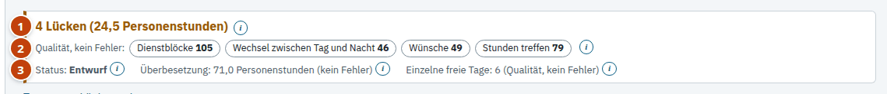
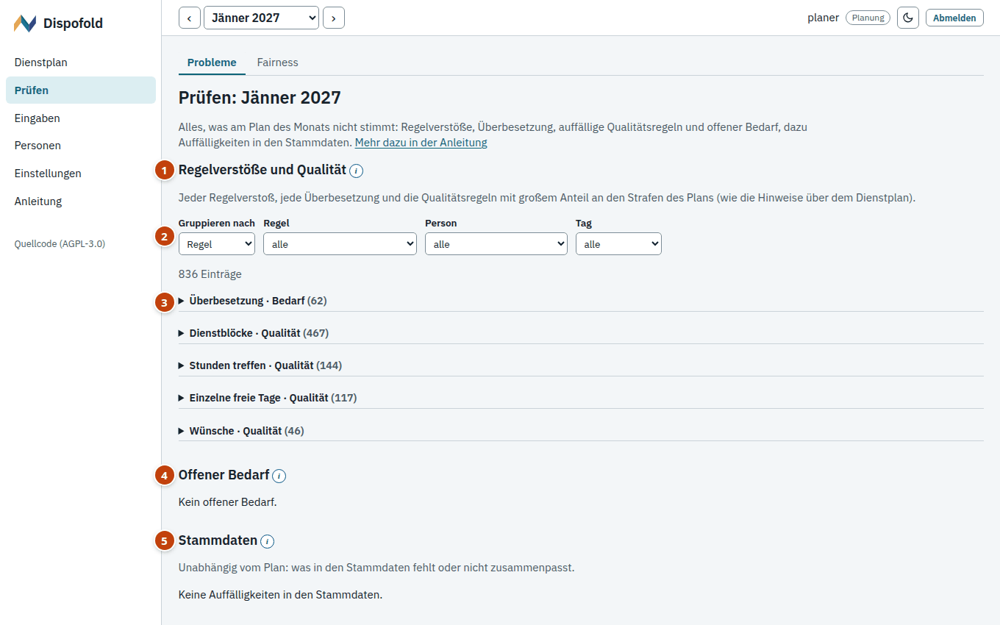
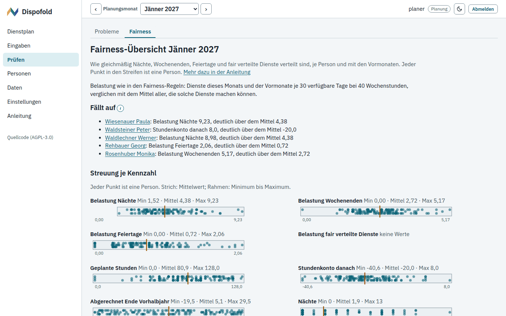
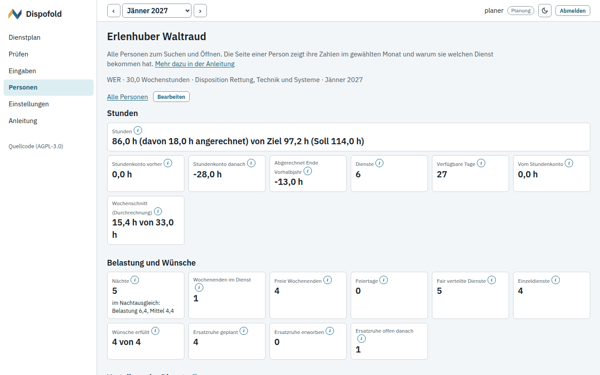
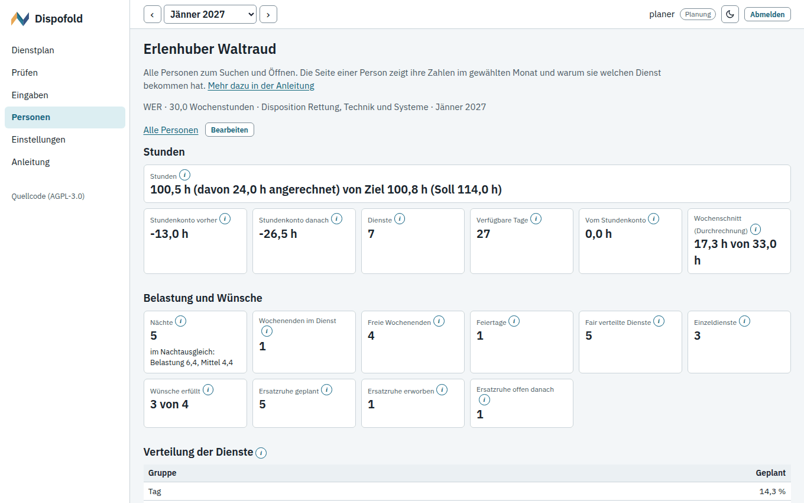

# Was die Zahlen bedeuten

Dispofold zeigt an vier Stellen Zahlen zum Plan: in der Zeile über dem Dienstplan, unter **Prüfen**, in der
Fairness-Übersicht und auf der Seite einer Person. Diese Seite sagt für jede Stelle, welche Zahl ein Problem ist
und welche nur ein Hinweis. Die Kurzfassung: **Nur Regelverstöße und Lücken sind Fehler.** Alles andere sagt, wie
gut ein Plan ist, und darf stehen bleiben.

## Die Zeile über dem Plan

1. **Die Überschrift.** Nur ihre Farbe zählt:
   - grün, „Plan verwendbar: keine Regelverstöße, keine Lücken“: alles in Ordnung;
   - gelb, etwa „2 Lücken (17 Personenstunden)“: An manchen Tagen fehlt jemand, siehe [Lücke](begriffe.md#lücke);
   - rot, etwa „2 Regelverstöße“: Der Plan verletzt eine Regel und darf so nicht verwendet werden, siehe
     [Regelverstoß](begriffe.md#regelverstoß);
   - ohne Farbe, „Für diesen Monat gibt es noch keinen Plan.“: Es wurde noch nicht geplant.
2. **Die Knöpfe darunter** ([Regeln mit Treffern](begriffe.md#regeln-mit-treffern)): rot je Regel mit
   Regelverstößen; nach „Qualität, kein Fehler:“ die Qualitätsregeln, die am meisten zur Bewertung beitragen,
   etwa **Dienstblöcke** oder **Einzelne freie Tage**. Ein Klick zeigt Person und Tag. Diese Knöpfe sind keine
   Fehler; ein guter Plan hat sie auch.
3. **Status und weitere Zahlen:**
   - **Status:** „noch kein Plan“, „Entwurf“ (kann geändert werden) oder „abgeschlossen“ (nur lesen).
   - **Überbesetzung**, mit dem Vermerk „(kein Fehler)“, siehe [unten](#überbesetzung).
   - **Einzelne freie Tage** und **Tage außerhalb der Blocklänge**, mit dem Vermerk „(Qualität, kein Fehler)“,
     wenn sie oben keinen eigenen Knopf haben.
   - **Plan veraltet: neu planen:** Seit der Planung hat sich etwas geändert, siehe
     [Plan veraltet](begriffe.md#plan-veraltet).

Unter **Erweitert** neben **Planen** steht die [Bewertung](begriffe.md#bewertung) in Worten, etwa
„Regelverstöße 0, fehlende Besetzung 0 Personenstunden, Überbesetzung 90 Personenstunden, Qualität: Abzüge
5 952 198“. Für den Alltag braucht man sie nicht.

### Überbesetzung

„Überbesetzung: 90 Personenstunden (kein Fehler)“ heißt: Über den ganzen Monat zusammengezählt waren 90 Stunden
lang eine Person mehr da, als der Bedarf verlangt; bei 150 Personen und 31 Tagen sind das im Schnitt keine drei
Stunden am Tag. Das entsteht vor allem, wo eine Schicht über mehrere Abschnitte des Bedarfs reicht: Braucht der
nächste Abschnitt weniger Personen, ist dort jemand mehr da. Zu tun ist nichts. Ist die Zahl auffällig groß, lohnt
ein Blick auf den [Bedarf](stammdaten.md#bedarf) und die Schichten des Bereichs.

## Prüfen

Die Seite **Prüfen** steht in der Reihenfolge, in der man arbeitet. Alle Gruppen sind zugeklappt; ein Klick auf die
Überschrift einer Gruppe öffnet sie.

1. **Das Urteil** oben: „Nichts zu tun: 0 Regelverstöße, 0 Lücken“ (grün), sonst „Zuerst: …“ mit dem, was zuerst
   zu tun ist, etwa „Zuerst: 2 Regelverstöße beheben, dann 2 Lücken schließen (17 Personenstunden)“.
2. **Regelverstöße:** jeder Verstoß gegen eine Regel, die der Plan einhalten muss. Diese zuerst beheben.
3. **Offener Bedarf:** die Lücken nach Tagen, mit **Auf Anfrage verfügbar**.
4. **Hinweise zur Qualität (keine Fehler):** Überbesetzung, Dienste ohne Bedarf und die Qualitätsregeln mit großem
   Anteil an den Abzügen der Planqualität. Zugeklappt hinter „… Hinweise anzeigen“. Hier stehen oft Hunderte
   Einträge, auch bei einem grünen Plan: Jede Abweichung von einer Qualitätsregel ist ein Eintrag. Man liest sie
   nur, wenn eine Person auffällt.
5. **Stammdaten:** was in den Stammdaten fehlt oder nicht zusammenpasst, unabhängig vom Plan.

Bleibt eine Person mit dem Plusstunden-Ausgleich hängen, steht vor den Stammdaten noch **Stundenkonto: Rest passt
nicht in den Monat**; auch das ist kein Regelverstoß. Wie man die Einträge abarbeitet:
[Planen und Prüfen](planen.md#probleme).

## Fairness

Unter **Prüfen**, **Fairness**. Oben **Fällt auf**: höchstens fünf Personen, deren Wert weit vom Mittel aller
liegt, mit dem Namen vorn, etwa „Belastung Nächte 4,10, deutlich über dem Mittel 1,52“. Steht dort „Niemand liegt weit vom Mittel entfernt.“, ist die
Verteilung ausgeglichen. Darunter zeigen Streifen jede Person als Punkt, und die Tabelle hat alle Zahlen.

Die wichtigste Zahl ist die [Belastung](begriffe.md#belastung): Nächte, Wochenenden, Feiertage und fair verteilte
Dienste mit den Vormonaten, umgerechnet auf gleiche Arbeitszeit. Wer diesen Monat mehr Nächte hat, kann in den
Vormonaten weniger gehabt haben. Eine Auffälligkeit ist kein Fehler; sie lohnt einen Blick auf die Person. Mehr
unter [Fairness](auswertungen.md#fairness).

## Die Seite einer Person

Vor dem Planen sagt die Seite „Noch kein Plan für Jänner 2027: …“ und zeigt nur, was ohne Plan feststeht: die
Kachel **Stunden** mit [Ziel](begriffe.md#ziel) und [Soll](begriffe.md#soll), etwa „Ziel 101,1 h (Soll 114,0 h)“,
und darunter den Grund, wenn beide sich unterscheiden, etwa „12,9 h weniger wegen Plusstunden im Stundenkonto“.
Dazu das [Stundenkonto](begriffe.md#stundenkonto) vorher, die verfügbaren Tage und die Historie.

Nach dem Planen kommen die Zahlen des Plans dazu:

- **Stunden:** etwa „96,0 h (davon 24,0 h angerechnet) von Ziel 101,1 h (Soll 114,0 h)“. Geplante und
  [angerechnete](begriffe.md#angerechnet) Stunden zusammen sollen nahe am Ziel liegen, nicht am Soll.
- **Stundenkonto danach:** der Stand nach diesem Plan.
- **Wochenschnitt (Durchrechnung):** etwa „41,2 h von 44,0 h“: der Schnitt je Woche über die
  [Durchrechnung](begriffe.md#durchrechnung) und die eigene Grenze der Person. Die Planung bleibt unter der Grenze;
  steht „Historie unvollständig“ davor, ist der Wert nur ein Hinweis.
- **Belastung und Wünsche** und **Warum dieser Dienst?**: Hinweise zur Qualität, keine Fehler.

Jede Kachel hat ein **i** mit einer Erklärung. Alle Kacheln im Einzelnen:
[Die Zahlen einer Person](auswertungen.md#die-zahlen-einer-person).
