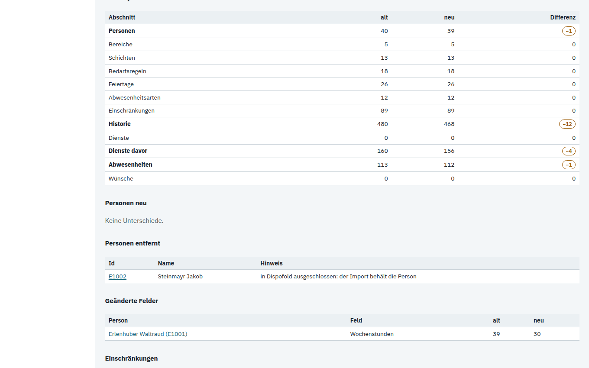

# Ablauf: von Schichtplaner 5 zum Import

Diese Seite beschreibt den ganzen Weg in der Reihenfolge, in der man ihn geht: die Erweiterung einrichten,
einlesen, Bericht und Warnungen lesen, die Zuordnung anpassen, mit dem letzten Import vergleichen, übernehmen und in
Dispofold bereinigen. Alles geschieht in Dispofold, unter **Daten → Übernehmen** mit der Quelle **Schichtplaner 5**
und unter **Daten → Zuordnung**; eine Kommandozeile, eine `mapping.json` von Hand oder eine `korrekturen.json`
braucht es nicht. Wer von `sp5_export.py` kommt und dort eine `korrekturen.json` hatte, lädt sie einmal
(Einrichten, Schritt 5), danach nur noch Dispofold. Den kürzesten Weg für den ersten Import zeigt
[Echte Daten aus Schichtplaner 5](plugin-sp5-echte-daten.md).

Alle Beispiele sind erfunden: die Bereiche und Kürzel (`AN`, `DR`, `A1`, `R1` usw.) und die Personen-Ids
(`E1001` usw.) eines synthetischen Ordners.

## 1. Einrichten

1. Unter [Einstellungen → Erweiterungen](erweiterungen.md#einschalten-und-ausschalten) die Erweiterung
   **Schichtplaner 5** einschalten und **Einrichten** wählen. Das öffnet **Daten → Übernehmen** mit der Quelle
   **Schichtplaner 5**; unter **Daten** kommt der Reiter **Zuordnung** dazu. Die Rolle **nur lesen** sieht
   **Daten** nicht.
2. Unter **Quelle** den **Ordner von Schichtplaner 5** wählen und **Ordner speichern** (siehe
   [Quelle](plugin-sp5-uebersicht.md#quelle)). Am Server sind nur die Ordner wählbar, die die IT freigegeben hat;
   am eigenen Rechner öffnet **Ordner wählen …** den Ordnerdialog. Der Ordner wird nur gelesen.
3. Die **Zuordnung** anlegen: **Zuordnung einrichten** führt zu [Daten → Zuordnung](plugin-sp5-zuordnung.md).
   Oben stehen dort die **Vorschläge**: Dispofold schlägt aus Gruppen, Bedarf und Diensten des Ordners Bereiche,
   Regeln für Schichten und Gruppen und die Listen zum Ignorieren vor, jeweils mit Grund. **Alle Vorschläge
   übernehmen und speichern** nimmt alle, die keine Wahl brauchen, und speichert. Wer genauer prüfen will,
   übernimmt die Vorschläge darunter einzeln
   ([Vorschläge aus dem Ordner](plugin-sp5-zuordnung.md#vorschläge-aus-dem-ordner)) und wählt dann
   **Zuordnung speichern**. Wer schon eine `mapping.json` hat, lädt sie stattdessen. Die Tabelle **Im Ordner**
   zeigt sofort, welche Schicht und welche Gruppe des Ordners noch keine Regel hat.

   
4. Die **Optionen** unter **Quelle** passen meist mit ihren Standardwerten; eine Änderung wird gleich gespeichert.
   **Bereiche einer Person aus** steht auf „Historie, Gruppen als Reserve“: Eine Person bekommt die Bereiche, in
   denen sie gearbeitet hat, ganz, und die übrigen Bereiche ihrer Gruppen nur von Hand. Die Option **Schichten
   seltener als … Dienste nur von Hand** unter **Erweitert** braucht es dazu meist nicht (siehe
   [Import aus Schichtplaner 5](plugin-sp5-sp5.md#einschalten-und-einstellen)).

5. **Umstieg von `sp5_export.py`:** Wer bisher `sp5_export.py --corrections korrekturen.json` aufgerufen hat, lädt
   diese `korrekturen.json` einmal unter **Daten → Sichern**,
   [Korrekturdatei laden](daten.md#korrekturdatei-laden), vor dem ersten Übernehmen. Der Import wendet sie genau
   so an wie `sp5_export.py` mit `--corrections`; danach enthält Dispofold die Korrekturen selbst, und die Datei
   wird nicht mehr gebraucht. Ohne die Datei steht über **Übernehmen** ein Hinweis, solange es gar keine
   Korrekturen gibt.

## 2. Einlesen und lesen

1. Unter [Daten → Übernehmen](plugin-sp5-uebersicht.md) bei **1. Einlesen** den **Ersten Monat** und, für mehrere
   Monate, den **Letzten Monat** wählen und **Einlesen**. Das rechnet den Datensatz genau so, wie ihn
   **Übernehmen** laden würde, mit der Korrekturdatei von Dispofold, ändert aber nichts.
2. Den Satz oben im Ergebnis lesen: Er sagt, was man zuerst ansieht. Ist er gelb, weil Bereiche keinen
   Mindestbedarf haben, zuerst die Option **Bedarf** prüfen. Dann die Zahlen: Personen, Bereiche, Schichten,
   Dienste, Bedarfsregeln und Warnungen. Weicht die Zahl der Personen vom erwarteten Personalstand ab, zuerst im
   Bericht nachsehen.

   

3. Den [Bericht](plugin-sp5-bericht.md) aufklappen und zuerst die **Warnungen** lesen. Viele kommen bei jedem
   Einlesen und sind Zählerstände, keine Fehler. Wichtig sind vor allem:
   - „… Mitarbeiter nicht übernommen (Grund)“: mit dem erwarteten Personalstand vergleichen;
   - „Schicht ohne Bereich ignoriert …“ und „Gruppe ohne Zuordnung …“: in der Zuordnung ergänzen;
   - „Bereich …: … ohne den Bereich aus Gruppen …“: passen Gruppen und Zuordnung zu dem, was die Leute
     tatsächlich arbeiten?
   - „Bedarf im Bereich …“: die Spitzen aus der Historie je Tagestyp; ein Bereich mit lauter `0-0` bekommt
     keinen Bedarf.
4. Dann die Zeilen des Berichts nach Art: **Personen**, **Bereiche der Personen**, **Schichten der Personen**,
   **Wochenstunden**, **Verworfene Dienste** und, sobald es Korrekturen gibt, **Korrekturen**.

   

## 3. Zuordnung anpassen

Was der Bericht, die Zeile **Zuordnung: … Kürzel ohne Regel** im Ergebnis oder die Tabelle **Im Ordner** als
„keine Regel“ zeigt, unter **Daten → Zuordnung** ergänzen: mit **Alle Vorschläge übernehmen und speichern** oder
**Zuordnung vorschlagen**, oder von Hand mit einer Schichtregel mit Muster und Bereich, einer Gruppenregel mit
ihren Bereichen, oder dem Kürzel in einer der Listen zum Ignorieren. Die Prüfung unter der Zuordnung meldet jeden
Fehler mit dem Eintrag, etwa „Schichtregel 2: Das Muster fehlt.“ **Zuordnung speichern**, dann im Reiter
**Übernehmen** noch einmal **Einlesen**.

## 4. Vergleichen

Vor dem Übernehmen zeigt der aufklappbare [Vergleich mit dem letzten Import](plugin-sp5-lauf-vergleich.md) im
Ergebnis, was das Eingelesene gegenüber dem letzten Import ändern würde: neue und entfernte Personen, geänderte
Felder und Einschränkungen, Dienste je Monat und Bereich und geänderter Bedarf. Mit **Korrekturen anwenden**
(Standard) ist das genau der Import; ohne zeigt der Vergleich auch, was die Korrekturen ausmachen. Vor dem
allerersten Import gibt es nichts zu vergleichen; dann lässt sich eine frühere Datensatz-Datei wählen.

## 5. Übernehmen

Bei **2. Übernehmen** wird genau das Eingelesene übernommen, mit seinen Monaten und Optionen, also der Datensatz,
den Bericht und Vergleich zeigen. Darüber steht, was es ändert. Die Schritte sind dieselben wie bei einer
Datensatz-Datei (siehe [Übernehmen](daten.md#übernehmen)):

- **Ohne Änderungen in Dispofold** seit dem letzten Import: **Übernehmen**. Ist etwas falsch, wird nichts
  übernommen und die Fehler erscheinen.
- **Mit Änderungen in Dispofold:** **Änderungen aus Dispofold behalten** anhaken. Die Vorschau zeigt, was
  übernommen wird, wo der neue Import dasselbe Feld geändert hat (es gilt der Wert aus Dispofold) und was sich
  nicht übertragen lässt; **Jetzt importieren** führt den Import aus.
- **Ordner oder Optionen seit dem Einlesen geändert:** **Übernehmen** ist aus, bis man neu einliest.
- **Ein Monat ist abgeschlossen:** Der Hinweis über **Übernehmen** nennt ihn. Einen späteren ersten Monat wählen
  und neu einlesen, oder den Monat unter **Daten → Monate** mit **Monat wieder öffnen** öffnen und dann
  übernehmen.

Danach ist der erste Monat der Daten gewählt, und **Bereiche prüfen** zeigt alle Personen und Bereiche in einer
Tabelle (siehe [Bereiche aller Personen](personen.md#bereiche-aller-personen)).

## 6. Bereinigen und wiederholen

Was in Schichtplaner 5 falsch oder veraltet ist, korrigiert man in Dispofold: auf der Seite der Person
(Wochenstunden, Bereiche, Eintritt und Austritt, gewohnte Verteilung, Einschränkungen, **Aus dem Quellsystem nicht
mehr übernehmen**) und unter **Stammdaten → Bedarf**. Die Erweiterung wendet diese Korrekturen bei jedem weiteren
Einlesen von selbst an; Dispofold bildet die Korrekturdatei aus den Änderungen seit dem letzten Import und den
Korrekturen, die der letzte Import schon enthielt. Im Bericht stehen sie als Zeilen **Korrekturen**:

- **angewendet:** Die Korrektur steht im Datensatz.
- **gleich wie die Quelle:** Sie steht im Datensatz, ihr Wert ist aber derselbe wie der aus Schichtplaner 5. Sie
  wirkt weiter, auch wenn sich der Wert dort später ändert.
- **ausgeschlossen:** Die Person fehlt im Datensatz; Dispofold behält sie beim Import ausgeschlossen.
- **Person fehlt:** Schichtplaner 5 liefert die Person gar nicht mehr. Die Korrektur fällt von selbst weg.
- **ungültig:** Das Feld wurde übersprungen (Grund in der Spalte **Grund**); in Dispofold neu korrigieren.

Jede weitere Runde geht genauso: korrigieren, **Einlesen**, den Satz oben, Bericht und Vergleich ansehen,
**Übernehmen**. In
Dispofold angelegte Personen und geänderte Namen kann die Korrekturdatei nicht ausdrücken; die Vorschau des
Imports listet sie unter „Nicht übernommen“. Sie gehören in Schichtplaner 5.

## 7. Fehlerbehebung

- **„Die Zuordnung fehlt“** oder „Zuordnung: noch keine.“: **Zuordnung einrichten** wählen und dort **Alle
  Vorschläge übernehmen und speichern**.
- **„Der Ordner … fehlt“:** unter **Daten → Übernehmen**, **Quelle** den Ordner wählen und **Ordner speichern**.
- **Ein Fehler beim Einlesen** nennt die Tabelle oder den Eintrag der Zuordnung. Mehr für die IT steht unter
  [Technik](plugin-sp5-technik.md#fehlermeldungen).
- **Bereich ohne Bedarf:** Schon der Satz oben im Ergebnis des Einlesens nennt ihn, gelb. Nach dem Übernehmen
  meldet Dispofold unter **Prüfen → Stammdaten** einen Bereich ohne Bedarf. Im Bericht
  zeigen die Zeilen **Bedarf**, dass dort in der Historie nie jemand gleichzeitig im Dienst war. Den Bedarf unter
  **Stammdaten → Bedarf** anlegen (er wird zur Korrektur) oder die Option **Bedarf** auf „aus Schichtplaner 5“
  stellen.
- **Ausgeblendete Schichten in Gebrauch:** Die Zeilen **Ausgeblendete Schichten** nennen je Schicht, ob sie
  übernommen wurde, und den letzten Dienst. Eine verworfene Schicht mit spätem letzten Dienst spricht für eine
  größere Zahl bei **Ausgeblendete Schichten mit Diensten in den … Monaten davor**.
- **Wochenstunden:** Die Zeilen **Wochenstunden** nennen Personen, bei denen HRSWEEK vom Wert nach CALCBASE
  abweicht. Ist der Wert im Datensatz falsch, in Schichtplaner 5 die Grundlage berichtigen oder die Wochenstunden
  in Dispofold korrigieren.
- **Nach einem Neustart des Servers** ist das Eingelesene weg: Das Ergebnis ist leer, und **Übernehmen**
  wartet auf das Einlesen. Einfach noch einmal **Einlesen**.

Bericht und Warnungen enthalten keine Namen, aber die Ids und Kürzel des Betriebs; Datensatz und Ergebnis-ZIP
enthalten personenbezogene Daten. Für eine Fehlersuche die pseudonymisierten Dateien von **Daten → Sichern**
weitergeben.
