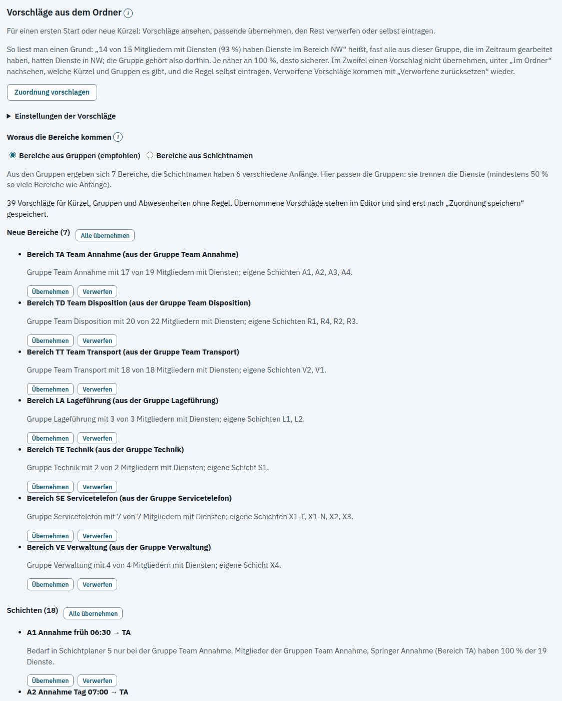
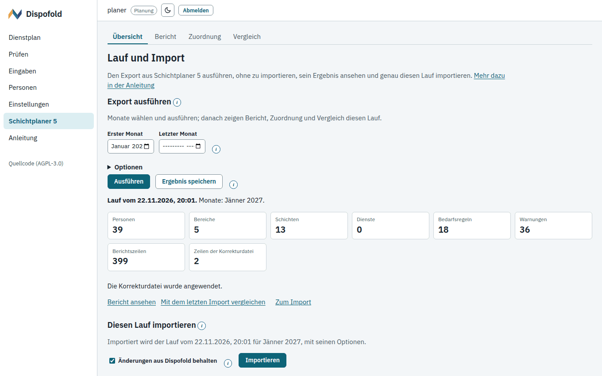
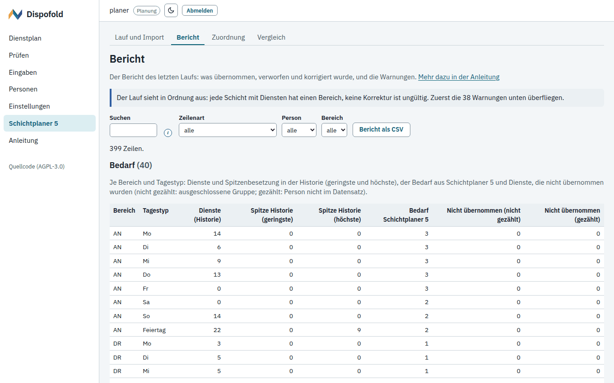
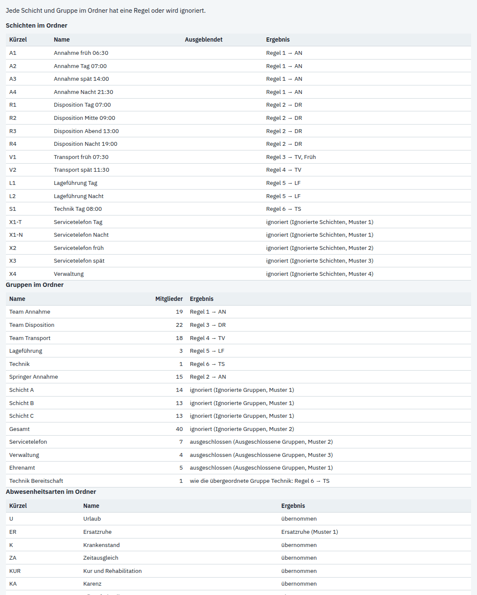
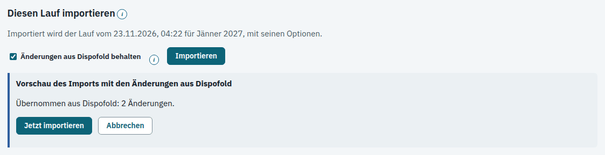

# Ablauf: von Schichtplaner 5 zum Import

Diese Seite beschreibt den ganzen Weg in der Reihenfolge, in der man ihn geht: die Erweiterung einrichten, den
Export ausführen, Bericht und Warnungen lesen, die Zuordnung anpassen, mit dem letzten Import vergleichen,
importieren und in Dispofold bereinigen. Alles geschieht in Dispofold, im Menü **Schichtplaner 5**; eine
Kommandozeile, eine `mapping.json` von Hand oder eine `korrekturen.json` braucht es nicht. Wer von `sp5_export.py`
kommt und dort eine `korrekturen.json` hatte, lädt sie einmal (Einrichten, Schritt 5), danach nur noch Dispofold.
Den kürzesten Weg für den ersten Import zeigt [Echte Daten aus Schichtplaner 5](plugin-sp5-echte-daten.md).

Alle Beispiele sind erfunden: die Bereiche und Kürzel (`AN`, `DR`, `A1`, `R1` usw.) und die Personen-Ids
(`E1001` usw.) eines synthetischen Ordners.

## 1. Einrichten

1. Unter [Einstellungen → Erweiterungen](erweiterungen.md#einschalten-und-ausschalten) die Erweiterung
   **Schichtplaner 5** einschalten. Im Menü erscheint die Gruppe **Schichtplaner 5** mit den Seiten
   **Lauf und Import**, **Bericht**, **Zuordnung** und **Vergleich**. Die Rolle **nur lesen** sieht sie nicht.
2. In den Einstellungen der Erweiterung den **Ordner von Schichtplaner 5** wählen (siehe
   [Import aus Schichtplaner 5](plugin-sp5-sp5.md#einschalten-und-einstellen)). Am Server sind nur die Ordner
   wählbar, die die IT freigegeben hat; am eigenen Rechner öffnet **Ordner wählen …** den Ordnerdialog. Der
   Ordner wird nur gelesen.
3. Die **Zuordnung** anlegen: auf der Seite [Zuordnung](plugin-sp5-zuordnung.md) **Zuordnung vorschlagen**
   wählen. Dispofold schlägt aus Gruppen, Bedarf und Diensten des Ordners Bereiche, Regeln für Schichten und
   Gruppen und die Listen zum Ignorieren vor, jeweils mit Grund
   ([Vorschläge aus dem Ordner](plugin-sp5-zuordnung.md#vorschläge-aus-dem-ordner)). Die passenden übernehmen,
   die übrigen verwerfen oder selbst eintragen, dann **Zuordnung speichern**. Wer schon eine `mapping.json` hat,
   lädt sie stattdessen. Die Tabelle **Im Ordner** zeigt sofort, welche Schicht und welche Gruppe des
   Ordners noch keine Regel hat.

   
4. Die **Optionen** passen meist mit ihren Standardwerten. Für den ersten Lauf mit einem neuen Bestand hilft
   **Bereiche aus der Historie ab … Diensten** mit 3; danach, wenn die Zeilen **Schichten der Personen** im
   Bericht das nahelegen, **Schichten seltener als … Dienste nur auf Anfrage**.

5. **Umstieg von `sp5_export.py`:** Wer bisher `sp5_export.py --corrections korrekturen.json` aufgerufen hat, lädt
   diese `korrekturen.json` einmal unter [Daten → Korrekturdatei laden](daten.md#korrekturdatei-laden), vor dem
   ersten Import. Der Import wendet sie genau so an wie `sp5_export.py` mit `--corrections`; danach enthält
   Dispofold die Korrekturen selbst, und die Datei wird nicht mehr gebraucht. Ohne die Datei zeigt die Seite
   **Lauf und Import** über dem Import einen Hinweis, solange es gar keine Korrekturen gibt.

## 2. Exportieren und lesen

1. Auf der Seite [Lauf und Import](plugin-sp5-uebersicht.md) den ersten und, für mehrere Monate, den letzten
   Monat wählen und **Ausführen**. Der Lauf rechnet den Datensatz genau so, wie ihn der Import laden würde, mit der
   Korrekturdatei von Dispofold, importiert aber nichts.
2. Die Zahlen prüfen: Personen, Bereiche, Schichten, Dienste, Bedarfsregeln und Warnungen. Weicht die Zahl der
   Personen vom erwarteten Personalstand ab, zuerst im Bericht nachsehen.

   

3. Auf der Seite [Bericht](plugin-sp5-bericht.md) zuerst die **Warnungen** lesen. Viele kommen bei jedem Lauf und
   sind Zählerstände, keine Fehler. Wichtig sind vor allem:
   - „… Mitarbeiter nicht übernommen (Grund)“: mit dem erwarteten Personalstand vergleichen;
   - „Schicht ohne Bereich ignoriert …“ und „Gruppe ohne Zuordnung …“: in der Zuordnung ergänzen;
   - „Bereich …: … ohne den Bereich aus Gruppen …“: passen Gruppen und Zuordnung zu dem, was die Leute
     tatsächlich arbeiten?
   - „Bedarf im Bereich …“: die Spitzen aus der Historie je Tagestyp; ein Bereich mit lauter `0-0` bekommt
     keinen Bedarf.
4. Dann die Zeilen des Berichts nach Art: **Personen**, **Bereiche der Personen**, **Schichten der Personen**,
   **Wochenstunden**, **Verworfene Dienste** und, sobald es Korrekturen gibt, **Korrekturen**.

   

## 3. Zuordnung anpassen

Was der Bericht oder die Tabelle **Im Ordner** als „keine Regel“ zeigt, auf der Seite **Zuordnung** ergänzen:
mit **Zuordnung vorschlagen** (die Seite Lauf und Import nennt nach dem Lauf, wie viele neue Vorschläge es gibt), oder von
Hand mit einer Schichtregel mit Muster und Bereich, einer Gruppenregel mit ihren Bereichen, oder dem Kürzel in
einer der Listen zum Ignorieren. Die Prüfung unter der Zuordnung meldet jeden Fehler mit dem Eintrag, etwa
„Schichtregel 2: Das Muster fehlt.“ **Zuordnung speichern**, dann auf der Seite **Lauf und Import** noch einmal
**Ausführen**.

## 4. Vergleichen

Vor dem Import zeigt die Seite [Vergleich](plugin-sp5-lauf-vergleich.md), was der Lauf gegenüber dem letzten
Import ändern würde: neue und entfernte Personen, geänderte Felder und Einschränkungen, Dienste je Monat und
Bereich und geänderter Bedarf. Mit **Korrekturen anwenden** (Standard) ist das genau der Import; ohne zeigt der
Vergleich auch, was die Korrekturen ausmachen. Vor dem allerersten Import gibt es nichts zu vergleichen; dann
lässt sich eine frühere Datensatz-Datei wählen.

## 5. Importieren

Auf der Seite **Lauf und Import** unter **Diesen Lauf importieren** wird der letzte Lauf importiert, mit seinen
Monaten und Optionen, also genau der Datensatz, den Bericht und Vergleich zeigen. Das ist die einzige Stelle, an
der aus Schichtplaner 5 importiert wird. Die Schritte sind dieselben wie beim Import einer Datensatz-Datei (siehe
[Daten und Korrekturdatei](daten.md)):

- **Ohne Änderungen in Dispofold** seit dem letzten Import: **Importieren**. Ist etwas falsch, wird nichts
  übernommen und die Fehler erscheinen.
- **Mit Änderungen in Dispofold:** **Änderungen aus Dispofold behalten** anhaken. Die Vorschau zeigt, was
  übernommen wird, wo der neue Import dasselbe Feld geändert hat (es gilt der Wert aus Dispofold) und was sich
  nicht übertragen lässt; **Jetzt importieren** führt den Import aus.
- **Ein Monat des Laufs ist abgeschlossen:** Der Hinweis über dem Import nennt ihn. Einen späteren ersten Monat
  wählen und noch einmal **Ausführen**, oder den Monat unter **Einstellungen → Daten** mit **Monat wieder öffnen**
  öffnen und dann importieren.

## 6. Bereinigen und wiederholen

Was in Schichtplaner 5 falsch oder veraltet ist, korrigiert man in Dispofold: auf der Seite der Person
(Wochenstunden, Bereiche, Eintritt und Austritt, gewohnte Verteilung, Einschränkungen, **Aus dem Quellsystem nicht
mehr übernehmen**) und unter **Stammdaten → Bedarf**. Die Erweiterung wendet diese Korrekturen bei jedem weiteren
Lauf von selbst an; Dispofold bildet die Korrekturdatei aus den Änderungen seit dem letzten Import und den
Korrekturen, die der letzte Import schon enthielt. Im Bericht stehen sie als Zeilen **Korrekturen**:

- **angewendet:** Die Korrektur steht im Datensatz.
- **gleich wie die Quelle:** Sie steht im Datensatz, ihr Wert ist aber derselbe wie der aus Schichtplaner 5. Sie
  wirkt weiter, auch wenn sich der Wert dort später ändert.
- **ausgeschlossen:** Die Person fehlt im Datensatz; Dispofold behält sie beim Import ausgeschlossen.
- **Person fehlt:** Schichtplaner 5 liefert die Person gar nicht mehr. Die Korrektur fällt von selbst weg.
- **ungültig:** Das Feld wurde übersprungen (Grund in der Spalte **Grund**); in Dispofold neu korrigieren.

Jede weitere Runde geht genauso: korrigieren, **Ausführen**, Bericht und Vergleich ansehen, importieren. In
Dispofold angelegte Personen und geänderte Namen kann die Korrekturdatei nicht ausdrücken; die Vorschau des
Imports listet sie unter „Nicht übernommen“. Sie gehören in Schichtplaner 5.

## 7. Fehlerbehebung

- **„Die Zuordnung fehlt“:** **Zur Zuordnung** wählen und dort **Zuordnung vorschlagen**.
- **„Der Ordner … fehlt“:** in den Einstellungen der Erweiterung den Ordner wählen.
- **Ein Fehler beim Lauf** nennt die Tabelle oder den Eintrag der Zuordnung. Mehr für die IT steht unter
  [Technik](plugin-sp5-technik.md#fehlermeldungen).
- **Bereich ohne Bedarf:** Dispofold meldet unter **Prüfen → Stammdaten** einen Bereich ohne Bedarf. Im Bericht
  zeigen die Zeilen **Bedarf**, dass dort in der Historie nie jemand gleichzeitig im Dienst war. Den Bedarf unter
  **Stammdaten → Bedarf** anlegen (er wird zur Korrektur) oder die Option **Bedarf** auf „aus Schichtplaner 5“
  stellen.
- **Ausgeblendete Schichten in Gebrauch:** Die Zeilen **Ausgeblendete Schichten** nennen je Schicht, ob sie
  übernommen wurde, und den letzten Dienst. Eine verworfene Schicht mit spätem letzten Dienst spricht für eine
  größere Zahl bei **Ausgeblendete Schichten mit Diensten in den … Monaten davor**.
- **Wochenstunden:** Die Zeilen **Wochenstunden** nennen Personen, bei denen HRSWEEK vom Wert nach CALCBASE
  abweicht. Ist der Wert im Datensatz falsch, in Schichtplaner 5 die Grundlage berichtigen oder die Wochenstunden
  in Dispofold korrigieren.
- **Nach einem Neustart des Servers** ist der letzte Lauf weg; die Seiten sagen das. Einfach noch einmal
  **Ausführen**.

Bericht und Warnungen enthalten keine Namen, aber die Ids und Kürzel des Betriebs; Datensatz und Ergebnis-ZIP
enthalten personenbezogene Daten. Für eine Fehlersuche die pseudonymisierten Dateien von der Seite **Daten**
weitergeben.
