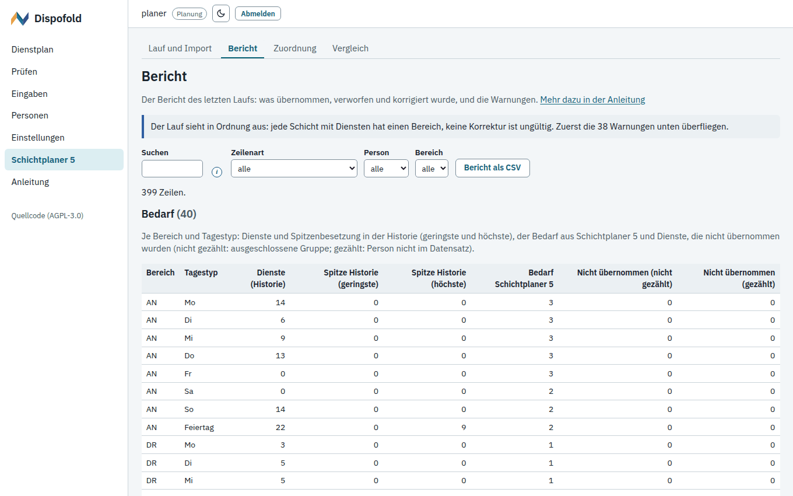

# Schichtplaner 5: Bericht

Die Seite **Schichtplaner 5 → Bericht** zeigt den Bericht und die Warnungen des letzten Laufs der
[Lauf und Import](plugin-sp5-uebersicht.md). Der Bericht enthält keine Namen, nur Personen-Ids (`E` und die Id aus
Schichtplaner 5, wie in Dispofold), Bereichs- und Schichtkürzel und Zahlen.

## Suchen, filtern, sortieren

- **Suchen** sucht in allen Spalten und in den Warnungen; mehrere Wörter müssen alle vorkommen.
- **Zeilenart** zeigt nur eine Art von Zeilen.
- **Person** und **Bereich** zeigen nur die Zeilen und Warnungen, die diese Person oder diesen Bereich nennen.
- Ein Klick auf eine Spaltenüberschrift sortiert nach ihr, ein zweiter umgekehrt; mit der Tastatur geht das mit
  Tab und Eingabe. Zahlen werden als Zahlen sortiert, Tagestypen in der Reihenfolge der Woche.
- Eine Person, die schon in Dispofold ist, ist ein Link auf ihre Seite.
- **Bericht als CSV** speichert den Bericht als Datei mit `;` als Trennzeichen und einem Punkt als
  Dezimaltrennzeichen, wie ihn das frühere Exportprogramm geschrieben hat.

## Die Zeilenarten

Jede Art hat ihren eigenen Abschnitt mit den Spalten, die sie füllt, und einem „i“ mit der Erklärung.

| Zeilenart | eine Zeile je |
|---|---|
| **Bedarf** | Bereich und Tagestyp (Mo bis So, Feiertag): Dienste und Spitzenbesetzung in der Historie, der Bedarf aus Schichtplaner 5, nicht übernommene Dienste |
| **Bereiche der Personen** | Person und Bereich aus ihren Gruppen oder mit Diensten |
| **Schichten der Personen** | Person und Schicht ihrer Bereiche, mit der Einschränkung („nur auf Anfrage“, „aus Schichtplaner 5“, „zu kurze Historie“) |
| **Personen** | übernommene Person: Dienste, Wochenstunden, Bereiche, gewohnte Verteilung, Zahl der Einschränkungen „nur auf Anfrage“ |
| **Schichten ohne Bereich**, **Ignorierte Schichten** | Schicht ohne Regel oder ignoriert, mit Diensten in der Historie |
| **Verworfene Dienste** | Grund und Schicht verworfener Dienste der Historie |
| **Wochenstunden** | Person, bei der HRSWEEK vom Wert nach CALCBASE abweicht |
| **Korrekturen** | Feld der Korrekturdatei, mit dem Status |
| **Ausgeblendete Schichten** | ausgeblendete Schicht mit Diensten: übernommen oder verworfen, mit dem letzten Dienst |
| **Bereiche, in denen jemand nicht mehr arbeitet** | Person und Bereich, in dem sie zuletzt nicht mehr gearbeitet hat; der Bereich wird „nur auf Anfrage“ |

Korrekturen mit dem Status **ungültig** oder **Person fehlt** sind hervorgehoben. Was die Status bedeuten, steht
unter [Ablauf, Bereinigen](plugin-sp5-ablauf.md#6-bereinigen-und-wiederholen). Eine Zeilenart, die die
Seite nicht kennt, erscheint mit allen Spalten, die Werte haben.

## Warnungen

Darunter stehen die Warnungen des Laufs, mit derselben Suche, den Filtern für Person und Bereich und einem
Filter nach ihrer Art (dem ersten Wort).
Warnungen nennen nur Ids, Kürzel und Anzahlen, nie Namen. Welche man zuerst liest, steht unter
[Ablauf, Exportieren und lesen](plugin-sp5-ablauf.md#2-exportieren-und-lesen).
