# Echte Daten aus Schichtplaner 5

Diese Seite zeigt Schritt für Schritt, wie die echten Daten aus Schichtplaner 5 zum ersten Mal in Dispofold
kommen: Erweiterung einschalten, Ordner wählen, Zuordnung anlegen, Export ausführen, prüfen und übernehmen. Jeder
Schritt ist eine Handlung mit einem Bild; ein Rahmen im Bild zeigt, worauf es ankommt. Schichtplaner 5 selbst bleibt
dabei, wie es ist: Dispofold liest den Ordner nur.

Was man braucht: die Rolle Planung und den Datenordner von Schichtplaner 5 (der Ordner mit `5EMPL.DBF` und den
anderen Tabellen). Am Server muss die IT ihn vorher freigeben (siehe [Betrieb](../betrieb.md#erweiterungen)).

Wer bisher mit dem Exportprogramm und einer Korrekturdatei `korrekturen.json` gearbeitet hat, lädt diese Datei vor
Schritt 12 einmal unter [Daten → Korrekturdatei laden](daten.md#korrekturdatei-laden).

## 1. Die Erweiterung einschalten

Unter **Einstellungen → Erweiterungen** bei **Schichtplaner 5** **Eingeschaltet** anhaken und die Rückfrage mit
**OK** bestätigen.

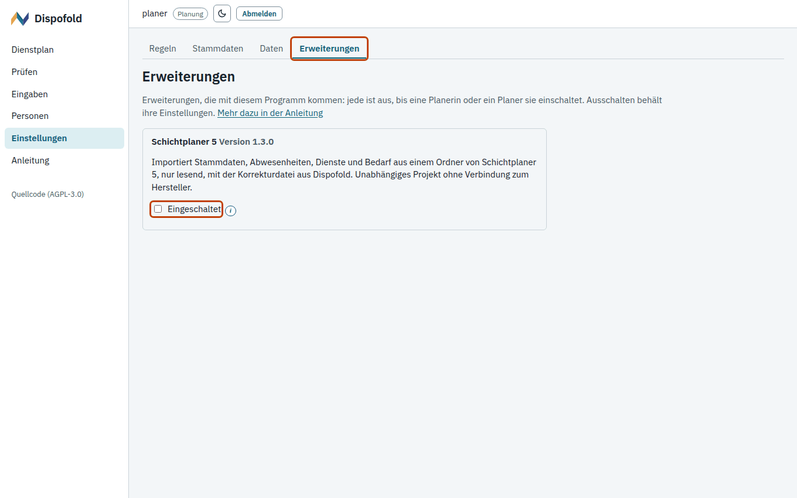

So sieht es aus, wenn es geklappt hat: Im Menü links steht **Schichtplaner 5**, und unter der Erweiterung stehen
ihre Einstellungen.

## 2. Den Ordner wählen

In den Einstellungen der Erweiterung bei **Ordner von Schichtplaner 5** den Datenordner wählen. Am Server die
freigegebene Stelle in der Liste wählen und die Unterordner anklicken, bis der Datenordner erreicht ist; am eigenen
Rechner **Ordner wählen …** anklicken und den Ordner im Dialog wählen.

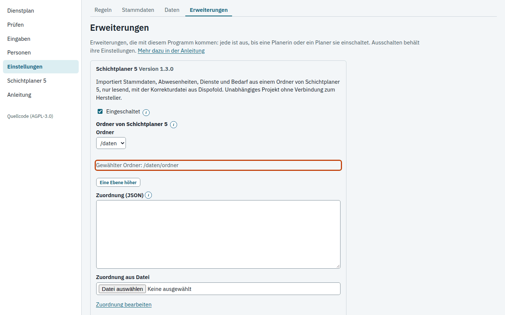

So sieht es aus, wenn es geklappt hat: Unter der Auswahl steht **Gewählter Ordner:** mit dem Datenordner.

## 3. Die Einstellungen speichern

**Einstellungen speichern** anklicken. Das Feld **Zuordnung (JSON)** bleibt leer, die Optionen bleiben, wie sie
sind; beides kommt später.

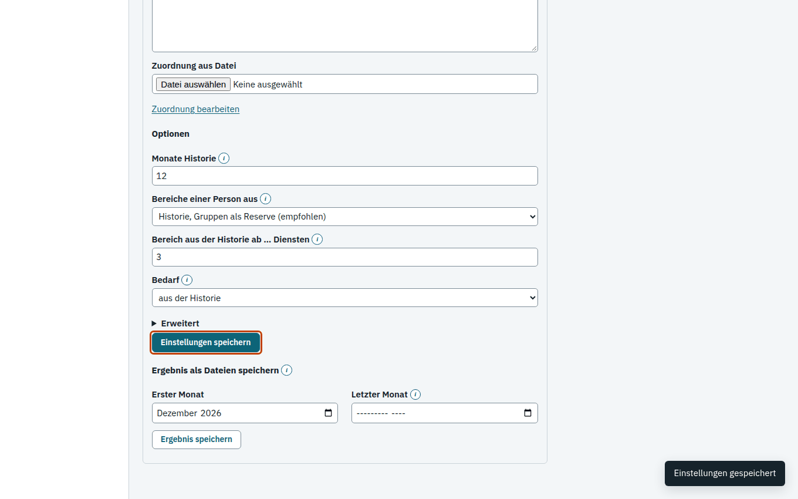

So sieht es aus, wenn es geklappt hat: Unten erscheint kurz **Einstellungen gespeichert**.

## 4. Die Seiten der Erweiterung öffnen

Im Menü links **Schichtplaner 5** anklicken.

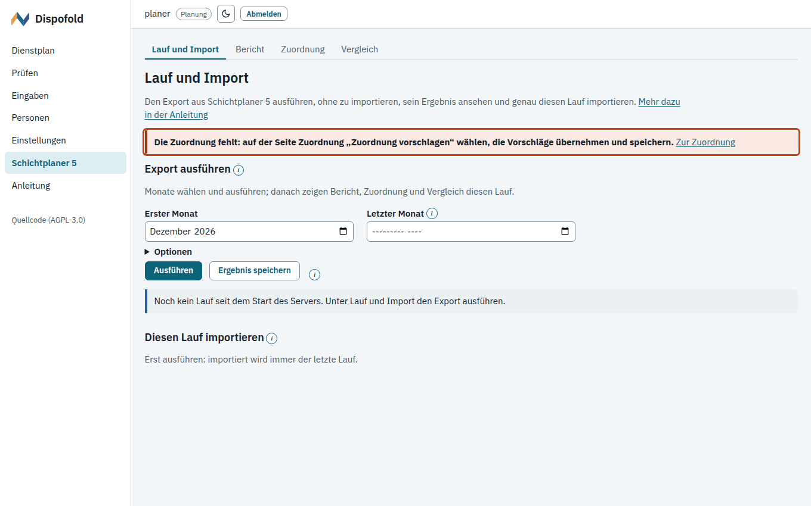

So sieht es aus, wenn es geklappt hat: Die Seite **Lauf und Import** ist offen, darüber die Reiter **Lauf und
Import**, **Bericht**, **Zuordnung** und **Vergleich**. Oben steht rot „Die Zuordnung fehlt“; das ist richtig so.

## 5. Zur Zuordnung wechseln

Im roten Hinweis **Zur Zuordnung** anklicken.

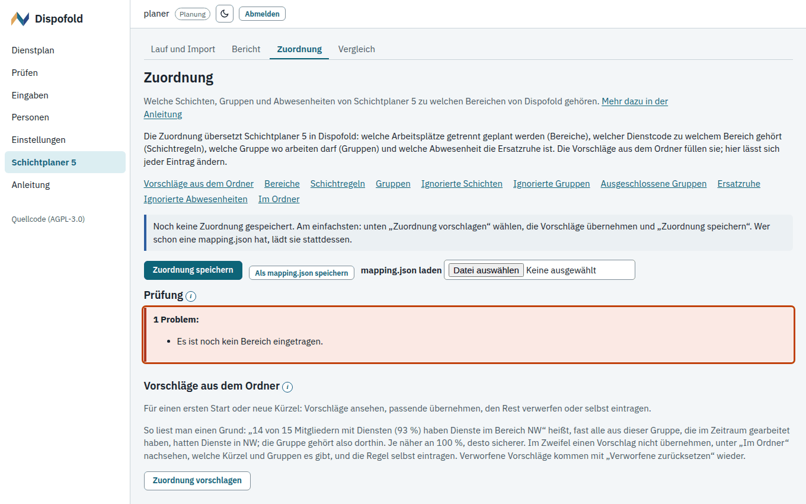

So sieht es aus, wenn es geklappt hat: Der Reiter **Zuordnung** ist gewählt, oben steht „Noch keine Zuordnung
gespeichert“, und unter **Prüfung** steht „Es ist noch kein Bereich eingetragen.“

Die [Zuordnung](plugin-sp5-zuordnung.md) übersetzt Schichtplaner 5 in Dispofold: welche Arbeitsplätze getrennt
geplant werden ([Bereiche](begriffe.md#bereich)), welcher Dienstcode zu welchem Bereich gehört (Schichtregeln),
welche Gruppe wo arbeiten darf (Gruppen) und welche Abwesenheit die Ersatzruhe ist. Über jedem Abschnitt steht ein
Satz, wofür er da ist.

## 6. Die Zuordnung vorschlagen lassen

Unter **Vorschläge aus dem Ordner** **Zuordnung vorschlagen** anklicken.

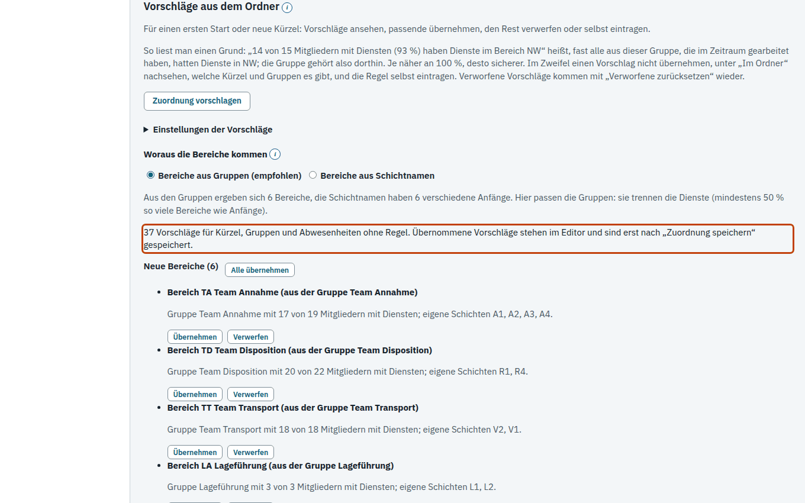

So sieht es aus, wenn es geklappt hat: Darunter stehen Vorschläge in Abschnitten (**Neue Bereiche**,
**Schichten**, **Gruppen**, **Ersatzruhe**), jeder mit seinem Grund, etwa „Mitglieder der Gruppe … haben 100 %
der … Dienste“.

Darüber steht, woraus die Bereiche kommen: **Bereiche aus Gruppen** oder **Bereiche aus Schichtnamen**, die
passende ist als „(empfohlen)“ markiert, mit einem Satz, warum. Die empfohlene passt fast immer. Sind die Gruppen in
Schichtplaner 5 grob (zwei oder drei Gruppen mit fast allen) und die Arbeitsplätze nur an den Schichtnamen zu
erkennen (`NW 7-19`, `NW 19-7`), schlägt Dispofold die Bereiche aus den Schichtnamen vor, je Schichtfamilie einen:

So liest man einen Grund: „14 von 15 Mitgliedern mit Diensten (93 %) haben Dienste im Bereich NW“ heißt, fast alle
aus dieser Gruppe hatten Dienste in NW; die Gruppe gehört dorthin. Je näher an 100 %, desto sicherer. Im Zweifel
einen Vorschlag nicht übernehmen und die Regel später selbst eintragen; mehr dazu unter
[Vorschläge aus dem Ordner](plugin-sp5-zuordnung.md#vorschläge-aus-dem-ordner).

## 7. Die Vorschläge übernehmen

In jedem Abschnitt **Alle übernehmen** anklicken. Wo zwei Bereiche zur Wahl stehen, den passenden mit
**Übernehmen: …** wählen. Ein Vorschlag, der nicht passt (etwa eine Gruppe, die nicht in den Plan gehört), wird mit
**Verwerfen** entfernt.

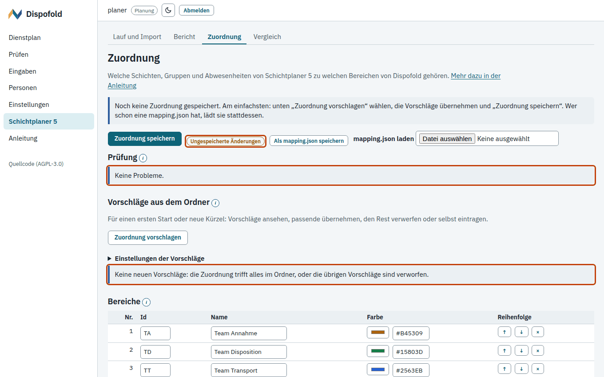

So sieht es aus, wenn es geklappt hat: Statt der Vorschläge steht „Keine neuen Vorschläge“, unter **Prüfung** steht
„Keine Probleme.“, und oben ist **Ungespeicherte Änderungen** markiert.

## 8. Die Zuordnung speichern

Oben **Zuordnung speichern** anklicken.

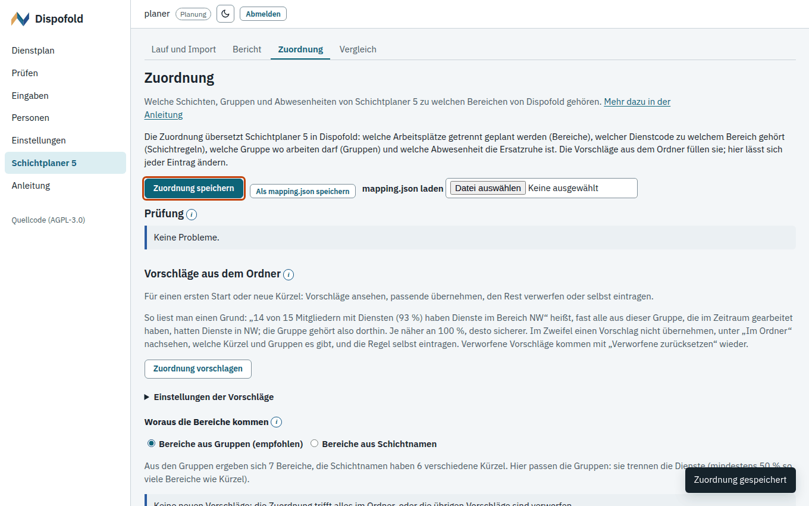

So sieht es aus, wenn es geklappt hat: Unten erscheint kurz **Zuordnung gespeichert**, und die Markierung
**Ungespeicherte Änderungen** und der Hinweis „Noch keine Zuordnung gespeichert“ sind weg.

## 9. Den Monat wählen

Den Reiter **Lauf und Import** anklicken und bei **Erster Monat** den ersten Monat wählen, der in Dispofold geplant
werden soll. **Letzter Monat** bleibt leer.

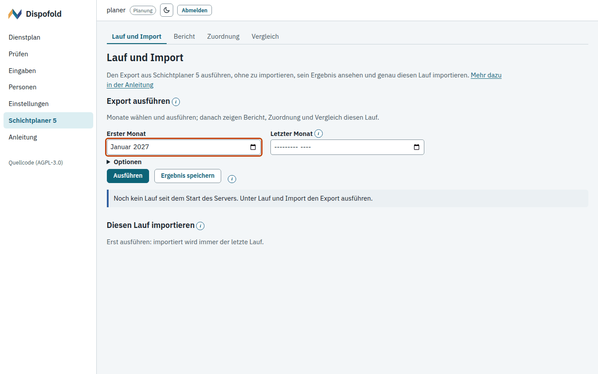

So sieht es aus, wenn es geklappt hat: Das Feld **Erster Monat** zeigt den Monat, und der rote Hinweis „Die
Zuordnung fehlt“ ist weg.

## 10. Den Export ausführen

**Ausführen** anklicken. Das liest den Ordner und rechnet die Daten, importiert aber noch nichts.

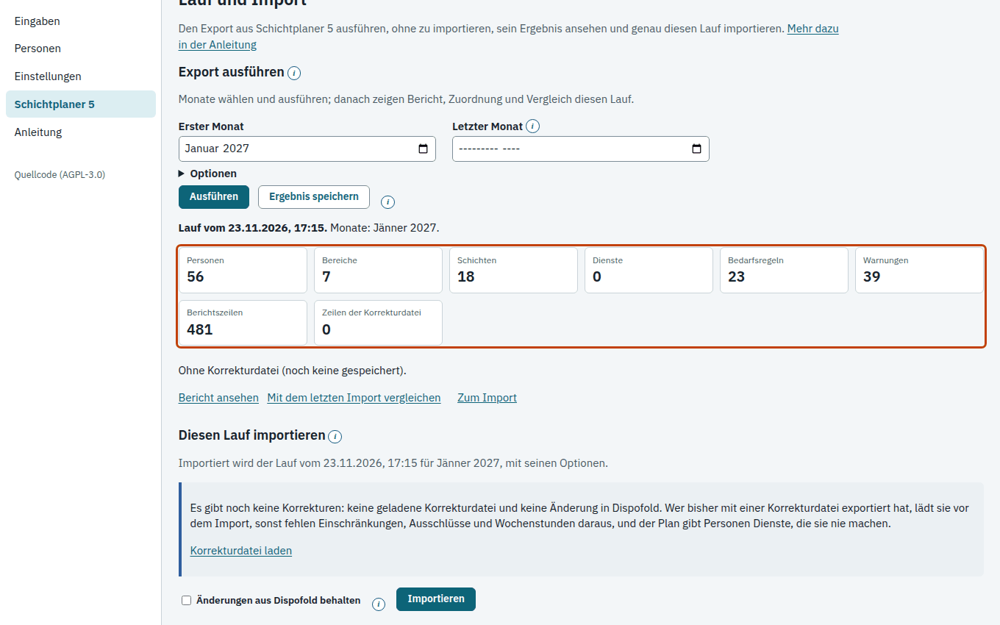

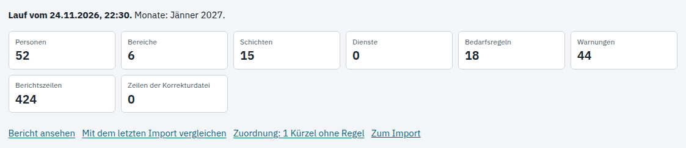

So sieht es aus, wenn es geklappt hat: Darunter steht „Lauf vom …“ mit dem Monat und den Zahlen: Personen,
Bereiche, Schichten, Dienste, Bedarfsregeln und Warnungen.

## 11. Das Ergebnis prüfen

**Bericht ansehen** anklicken und die Zahl der Personen und die **Warnungen** lesen. Viele Warnungen sind nur
Zählerstände; wichtig ist vor allem, ob Personen fehlen oder Schichten ohne Bereich geblieben sind.

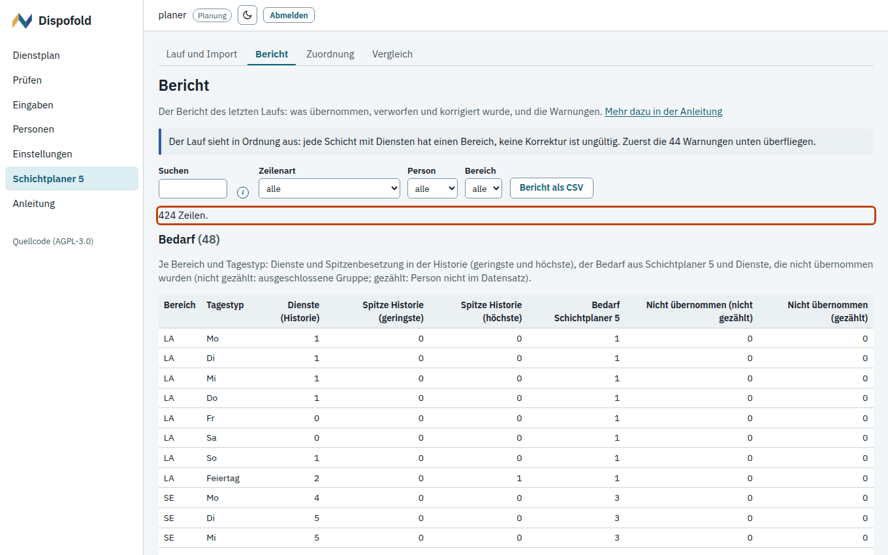

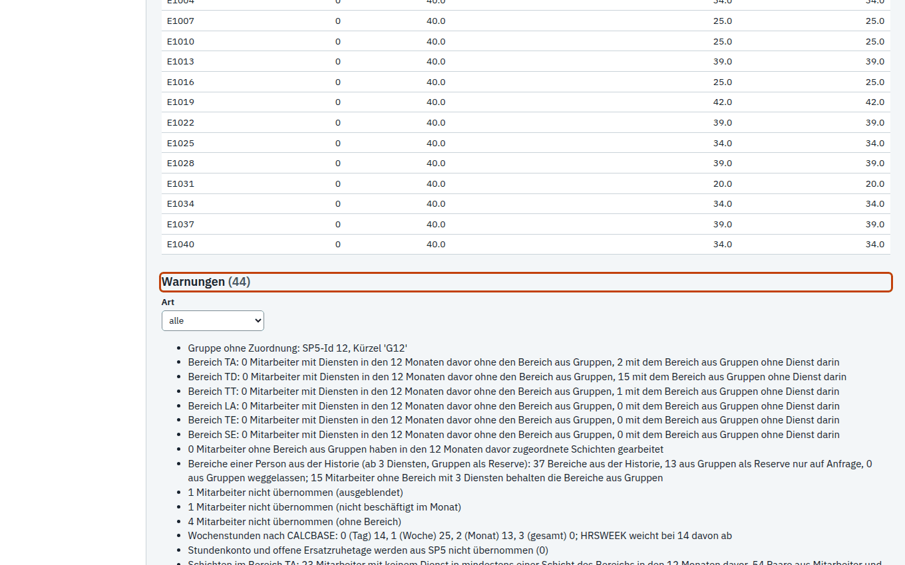

So sieht es aus, wenn es geklappt hat: Die Seite **Bericht** zeigt die Zeilen nach Art und darunter die Warnungen.
Stimmt die Zahl der Personen ungefähr mit dem Personalstand überein, kann es weitergehen. Was die einzelnen Zeilen
bedeuten, steht unter [Bericht](plugin-sp5-bericht.md).

## 12. Die Daten übernehmen

Den Reiter **Lauf und Import** anklicken, unter **Diesen Lauf importieren** **Importieren** anklicken und die
Rückfrage „Der Datensatz ersetzt die Stammdaten. Fortfahren?“ mit **OK** bestätigen.

**Änderungen aus Dispofold behalten** bleibt dabei leer: Beim ersten Import aus Schichtplaner 5 gibt es in Dispofold
nichts zu behalten. Ist das Häkchen schon gesetzt, weil vorher etwa die Demodaten geändert wurden, es vor dem Klick
entfernen. Erscheint nach der Rückfrage noch „Stammdaten wurden geändert.“, **Trotzdem importieren** wählen; die
Stammdaten zum Ausprobieren werden dann durch die echten ersetzt.

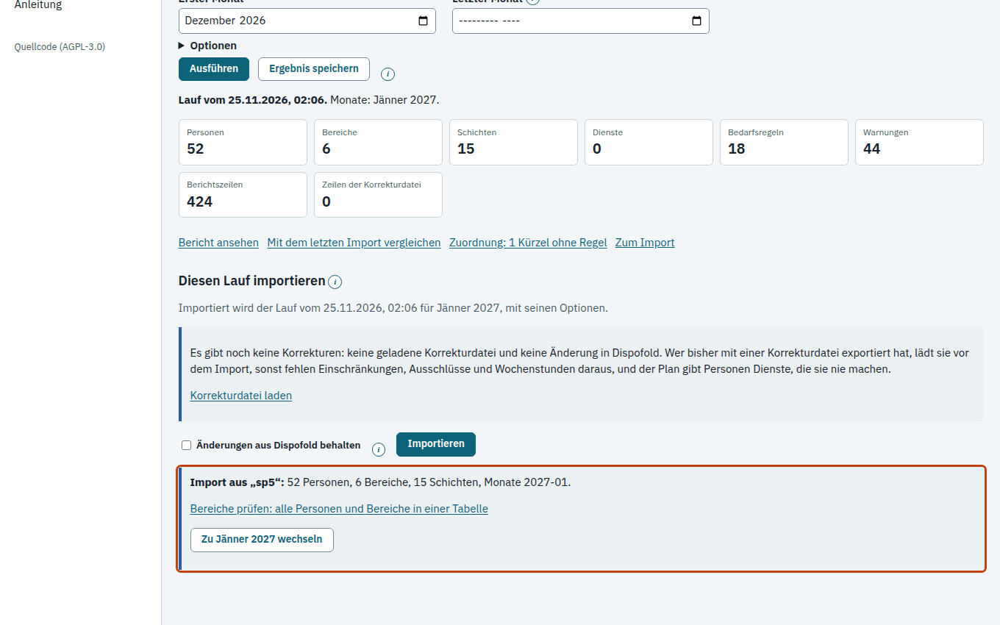

So sieht es aus, wenn es geklappt hat: Unter dem Knopf steht „Import aus …“ mit der Zahl der Personen, Bereiche und
Schichten und den Monaten.

## 13. Zum Monat wechseln

Im Ergebnis des Imports **Zu … wechseln** anklicken (der Knopf erscheint, wenn gerade ein anderer Monat gewählt
ist), dann im Menü **Dienstplan** öffnen.

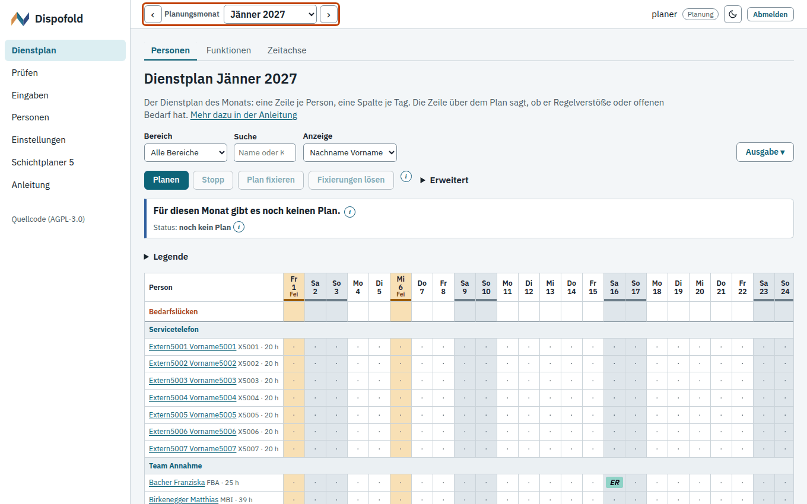

So sieht es aus, wenn es geklappt hat: Der Dienstplan zeigt den importierten Monat mit den Personen aus
Schichtplaner 5. Geplant wird wie unter [Planen](planen.md) beschrieben.

## Wenn etwas nicht klappt

- **„Der Ordner von Schichtplaner 5 fehlt oder ist nicht lesbar“:** Schritt 2 und 3 wiederholen; am Server die IT
  fragen, ob der Ordner freigegeben ist.
- **„Die Zuordnung fehlt“:** Schritt 5 bis 8.
- **Ein Monat ist abgeschlossen** (etwa der Monat, der vorher mit den Demodaten ausprobiert und abgeschlossen
  wurde): Über dem Import steht ein Hinweis mit dem nächsten Schritt. Am einfachsten einen späteren ersten Monat
  wählen und Schritt 10 wiederholen (siehe auch
  [Lauf und Import](plugin-sp5-uebersicht.md#diesen-lauf-importieren)).

  
- **Weitere Runden** (Korrekturen in Dispofold, neue Monate, der Vergleich mit dem letzten Import) beschreibt
  [Ablauf](plugin-sp5-ablauf.md).
