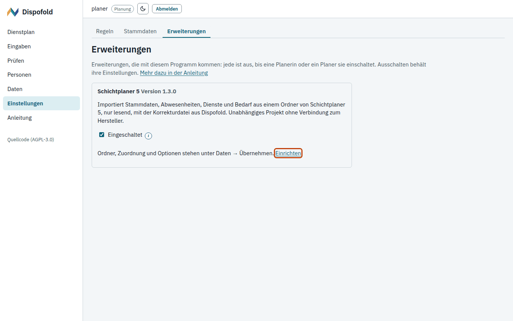
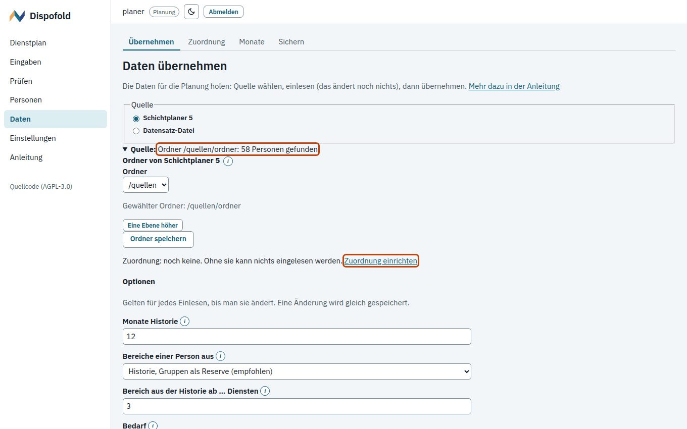
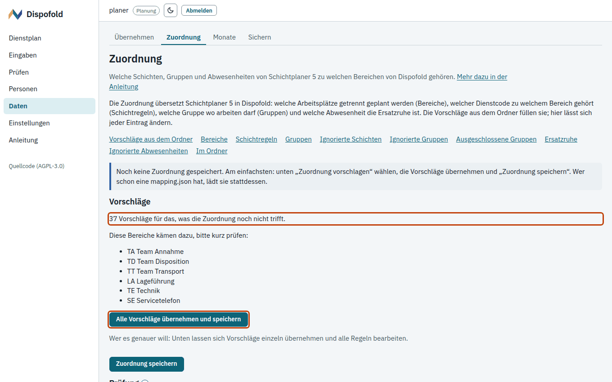
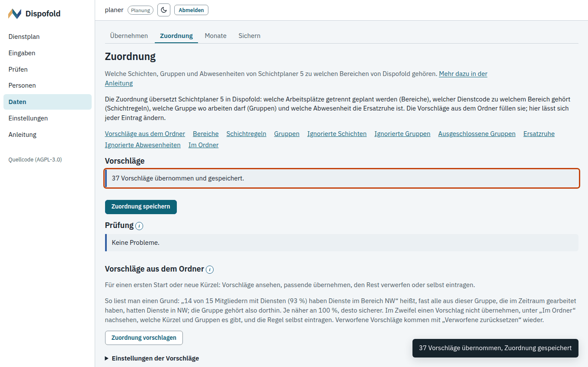
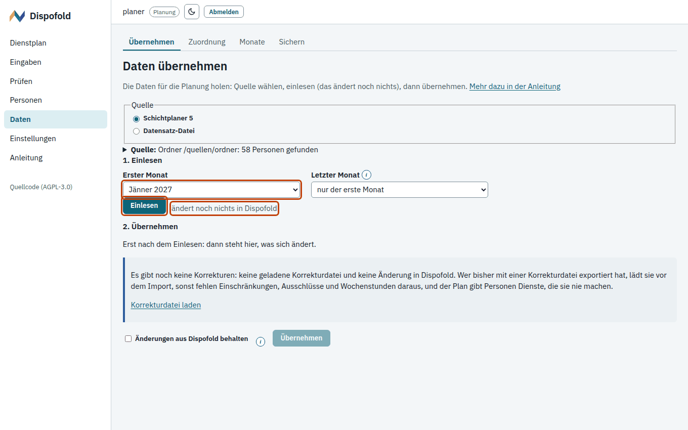
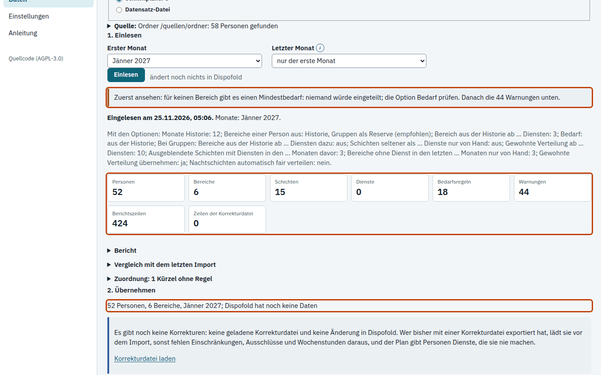
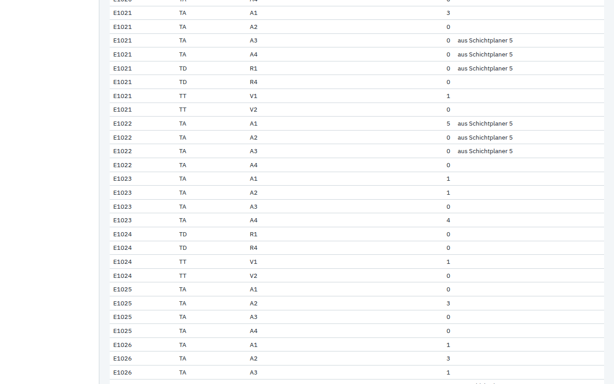
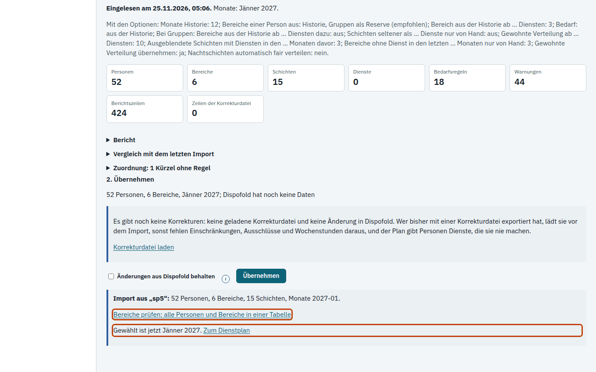
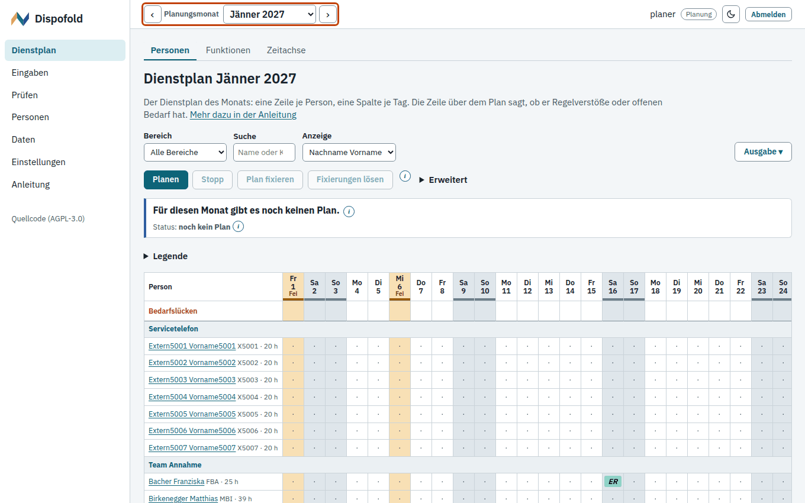
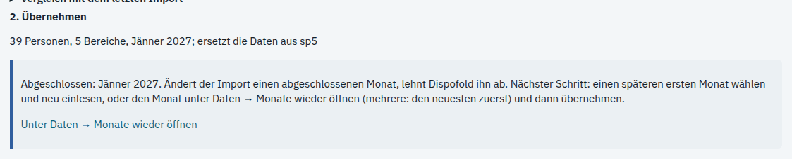

# Echte Daten aus Schichtplaner 5

Diese Seite zeigt Schritt für Schritt, wie die echten Daten aus Schichtplaner 5 zum ersten Mal in Dispofold
kommen: Erweiterung einschalten, Ordner wählen, Zuordnung vorschlagen lassen, einlesen, prüfen und übernehmen.
Jeder Schritt ist eine Handlung mit einem Bild; ein Rahmen im Bild zeigt, worauf es ankommt. Schichtplaner 5 selbst
bleibt dabei, wie es ist: Dispofold liest den Ordner nur.

Was man braucht: die Rolle Planung und den Datenordner von Schichtplaner 5 (der Ordner mit `5EMPL.DBF` und den
anderen Tabellen). Am Server muss die IT ihn vorher freigeben (siehe [Betrieb](../betrieb.md#erweiterungen)).

Wer bisher mit dem Exportprogramm und einer Korrekturdatei `korrekturen.json` gearbeitet hat, lädt diese Datei vor
Schritt 9 einmal unter **Daten → Sichern**, [Korrekturdatei laden](daten.md#korrekturdatei-laden).

## 1. Die Erweiterung einschalten

Unter **Einstellungen → Erweiterungen** bei **Schichtplaner 5** **Eingeschaltet** anhaken und die Rückfrage mit
**OK** bestätigen.

So sieht es aus, wenn es geklappt hat: Bei der Erweiterung steht „Ordner, Zuordnung und Optionen stehen unter
Daten → Übernehmen.“ mit dem Link **Einrichten**. **Einrichten** anklicken.

## 2. Den Ordner wählen

**Daten → Übernehmen** ist offen, bei **Quelle** ist **Schichtplaner 5** gewählt, und der Abschnitt **Quelle** ist
aufgeklappt. Bei **Ordner von Schichtplaner 5** den Datenordner wählen: am Server die freigegebene Stelle in der
Liste wählen und die Unterordner anklicken, bis der Datenordner erreicht ist; am eigenen Rechner **Ordner wählen …**
anklicken und den Ordner im Dialog wählen. Dann **Ordner speichern** anklicken.

So sieht es aus, wenn es geklappt hat: Unten erscheint kurz **Ordner gespeichert**.

## 3. Zur Zuordnung

Die Zeile **Quelle:** nennt jetzt den Ordner und wie viele Personen darin stehen, etwa „Ordner …: 40 Personen
gefunden“. Darunter steht „Zuordnung: noch keine. Ohne sie kann nichts eingelesen werden.“; das ist richtig so.
**Zuordnung einrichten** anklicken.

Die [Zuordnung](plugin-sp5-zuordnung.md) übersetzt Schichtplaner 5 in Dispofold: welche Arbeitsplätze getrennt
geplant werden ([Bereiche](begriffe.md#bereich)), welcher Dienstcode zu welchem Bereich gehört (Schichtregeln),
welche Gruppe wo arbeiten darf (Gruppen) und welche Abwesenheit die Ersatzruhe ist.

## 4. Die Vorschläge ansehen

Der Reiter **Daten → Zuordnung** ist offen. Oben steht der Kasten **Vorschläge**: „… Vorschläge für das, was die
Zuordnung noch nicht trifft.“ und darunter „Diese Bereiche kämen dazu, bitte kurz prüfen:“ mit der Liste.

Die Liste kurz lesen: Sind das die Arbeitsplätze, die getrennt geplant werden? Meist passt sie. Fehlt einer oder
ist einer zu viel, hilft der Editor weiter unten (siehe
[Vorschläge aus dem Ordner](plugin-sp5-zuordnung.md#vorschläge-aus-dem-ordner)); für den ersten Import ist das
nicht nötig.

## 5. Die Vorschläge übernehmen und speichern

**Alle Vorschläge übernehmen und speichern** anklicken.

So sieht es aus, wenn es geklappt hat: Im Kasten steht „… Vorschläge übernommen und gespeichert.“ Steht dazu
„… Vorschläge brauchen eine Wahl: unten unter Zuordnung vorschlagen.“, dort bei jedem den passenden Bereich mit
**Übernehmen: …** wählen und oben **Zuordnung speichern**.

## 6. Den Monat wählen und einlesen

Den Reiter **Übernehmen** anklicken. Bei **1. Einlesen** unter **Erster Monat** den ersten Monat wählen, der in
Dispofold geplant werden soll; **Letzter Monat** bleibt bei „nur der erste Monat“. Dann **Einlesen** anklicken.
Das liest den Ordner und rechnet die Daten, ändert aber noch nichts in Dispofold.

So sieht es aus, wenn es geklappt hat: Darunter erscheint das Ergebnis mit „Eingelesen am …“, und der Abschnitt
**Quelle** ist zu einer Zeile zugeklappt.

## 7. Das Ergebnis ansehen

Zuerst den Satz oben im Ergebnis lesen: Er sagt, was man zuerst ansieht. Dann die Zahlen: Personen, Bereiche,
Schichten, Dienste, Bedarfsregeln und Warnungen.

So sieht es aus, wenn es geklappt hat: Die Zahl der Personen stimmt ungefähr mit dem Personalstand überein. Ist der
Satz oben gelb, weil Bereiche keinen Mindestbedarf haben, würde dort niemand eingeteilt: dann unter **Quelle**,
**Optionen** die Option **Bedarf** prüfen und Schritt 6 wiederholen.

## 8. Den Bericht ansehen

Im Ergebnis **Bericht** aufklappen und die **Warnungen** lesen. Viele Warnungen sind nur Zählerstände; wichtig ist
vor allem, ob Personen fehlen oder Schichten ohne Bereich geblieben sind.

So sieht es aus, wenn es geklappt hat: Der Bericht zeigt die Zeilen nach Art und darunter die Warnungen. Was die
einzelnen Zeilen bedeuten, steht unter [Bericht](plugin-sp5-bericht.md).

## 9. Übernehmen

Bei **2. Übernehmen** steht, was sich ändert, etwa „40 Personen, 5 Bereiche, Jänner 2027; ersetzt die Daten aus
…“. **Übernehmen** anklicken.

**Änderungen aus Dispofold behalten** bleibt dabei leer: Beim ersten Import aus Schichtplaner 5 gibt es in Dispofold
nichts zu behalten. Ist das Häkchen schon gesetzt, weil vorher etwa die Demodaten geändert wurden, es vor dem Klick
entfernen. Erscheint noch „Stammdaten wurden geändert.“, **Trotzdem importieren** wählen; die Stammdaten zum
Ausprobieren werden dann durch die echten ersetzt.

So sieht es aus, wenn es geklappt hat: Darunter steht „Import aus …“ mit der Zahl der Personen, Bereiche und
Schichten und den Monaten, dazu „Gewählt ist jetzt …“ mit dem Monat und dem Link **Zum Dienstplan** und der Link
**Bereiche prüfen** (siehe [Bereiche aller Personen](personen.md#bereiche-aller-personen)).

## 10. Den Dienstplan öffnen

**Zum Dienstplan** anklicken.

So sieht es aus, wenn es geklappt hat: Der Dienstplan zeigt den übernommenen Monat mit den Personen aus
Schichtplaner 5. Geplant wird wie unter [Planen](planen.md) beschrieben.

## Jeden Monat

**Daten** öffnen (die Quelle **Schichtplaner 5** ist gemerkt), bei **Erster Monat** den Monat wählen,
**Einlesen**, den Satz oben im Ergebnis lesen und **Übernehmen**. Vorbelegt sind die Monate des letzten
Einlesens.

## Wenn etwas nicht klappt

- **„Der Ordner von Schichtplaner 5 fehlt oder ist nicht lesbar“:** Schritt 2 wiederholen; am Server die IT
  fragen, ob der Ordner freigegeben ist.
- **„Zuordnung: noch keine.“** oder **„Die Zuordnung fehlt“:** Schritt 3 bis 5.
- **„Seit dem Einlesen wurden Ordner oder Optionen geändert: bitte zuerst neu einlesen.“:** Schritt 6
  wiederholen.
- **Ein Monat ist abgeschlossen** (etwa der Monat, der vorher mit den Demodaten ausprobiert und abgeschlossen
  wurde): Über **Übernehmen** steht ein Hinweis mit dem nächsten Schritt. Am einfachsten einen späteren ersten
  Monat wählen und Schritt 6 wiederholen, oder den Monat mit **Unter Daten → Monate wieder öffnen** wieder öffnen
  (siehe auch [Ein Monat ist abgeschlossen](plugin-sp5-uebersicht.md#ein-monat-ist-abgeschlossen)).

  
- **Weitere Runden** (Korrekturen in Dispofold, neue Monate, der Vergleich mit dem letzten Import) beschreibt
  [Ablauf](plugin-sp5-ablauf.md).
