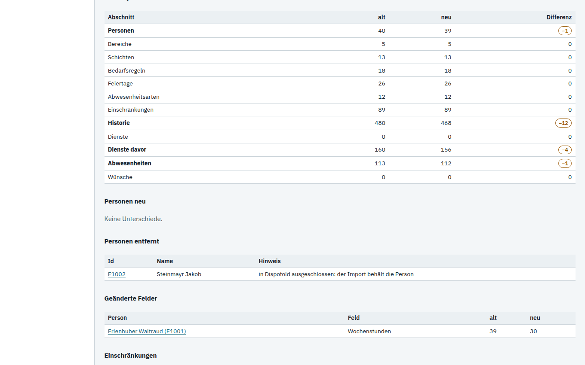

# Schichtplaner 5: Vergleich mit dem letzten Import

Der aufklappbare Abschnitt **Vergleich mit dem letzten Import** im Ergebnis von **1. Einlesen** unter
[Daten → Übernehmen](plugin-sp5-uebersicht.md#1-einlesen) zeigt, was das Eingelesene gegenüber dem letzten Import
ändern würde, bevor man übernimmt. Früher war das die Seite **Vergleich**; sie führt jetzt dorthin.

## Womit verglichen wird

- **Vergleichen mit dem letzten Import** (Standard): mit den Stammdaten, wie sie zuletzt importiert wurden, und den
  Monaten des Eingelesenen, wie Dispofold sie jetzt hat. Personen, die schon beim letzten Import mit **Aus dem
  Quellsystem nicht mehr übernehmen** ausgeschlossen waren und im Eingelesenen fehlen, zählen nicht als Unterschied: Der
  Import behält sie.
- **Vergleichen mit einer Datensatz-Datei:** mit einem früheren Datensatz, etwa aus **Daten → Sichern**, **Datensatz exportieren**, oder aus
  einem gespeicherten Ergebnis. Vor dem ersten Import ist das der einzige Vergleich.
- **Korrekturen anwenden** (Standard an): Das Eingelesene ist dann genau das, was **Übernehmen** laden würde. Ohne zeigt der
  Vergleich auch die Unterschiede, die die Korrekturen ausmachen.

## Was er zeigt

- **Anzahl je Abschnitt:** Personen, Bereiche, Schichten, Bedarfsregeln, Feiertage, Abwesenheitsarten,
  Einschränkungen, Historie und, für die Monate des Eingelesenen, Dienste, Dienste davor, Abwesenheiten und Wünsche,
  alt, neu und die Differenz.
- **Personen neu** und **Personen entfernt**, nach Id sortiert; eine Person, die schon in Dispofold ist, ist ein
  Link auf ihre Seite. Wer seit dem letzten Import in Dispofold ausgeschlossen wurde, steht unter **Personen
  entfernt** mit dem Hinweis, dass der Import die Person behält; ihre Historie und ihre Einträge der Monate
  zählen dann in der Anzahl mit.
- **Geänderte Felder:** je Person und Feld der alte und der neue Wert; **Einschränkungen** als neu (+) und
  entfernt (−).
- **Dienste je Monat und Bereich:** wo sich die Zahl der Dienste geändert hat.
- **Bedarf geändert:** je Bereich, Tagen oder Datum und Zeit die Besetzung alt und neu, als mindestens bis
  höchstens; eine Zahl allein heißt: die Mindestbesetzung ist auch die Höchstbesetzung, „–“: keine Regel.
