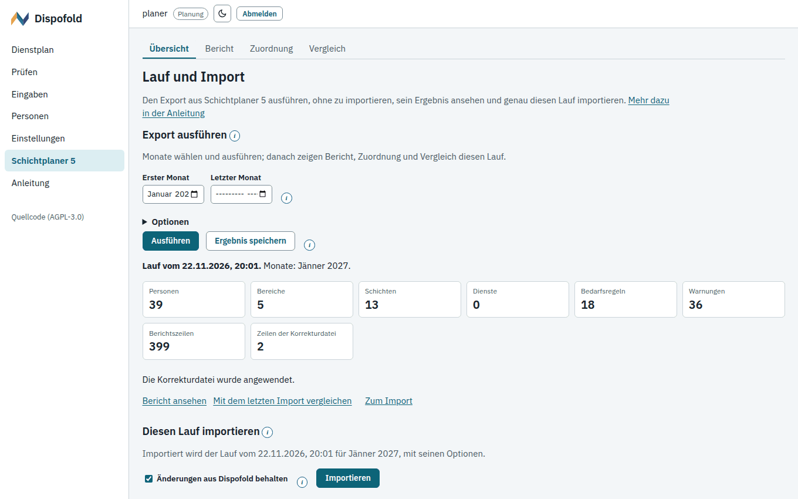

# Schichtplaner 5: Übersicht

Die Seite **Schichtplaner 5 → Übersicht** führt den Export aus, ohne zu importieren, zeigt sein Ergebnis und
importiert genau diesen Lauf. Den ganzen Weg beschreibt [Ablauf](plugin-sp5-ablauf.md).

## Export ausführen

- **Erster Monat** und **Letzter Monat:** der Zeitraum, für mehrere Monate bis zu 12 Monate nach dem ersten.
  Leer beim letzten Monat heißt: nur der erste.
- **Optionen:** vorbelegt mit denen aus den Einstellungen. Was man hier ändert, gilt nur für diesen Lauf und
  seinen Import; **Als Standard speichern** übernimmt die Optionen in die Einstellungen. Was jede Option tut, sagt
  ihr „i“ und die Tabelle unter [Import aus Schichtplaner 5](plugin-sp5-sp5.md#einschalten-und-einstellen).
- **Ausführen:** liest den Ordner, wendet die Korrekturdatei von Dispofold an und rechnet den Datensatz. Danach
  stehen die Zahlen des Laufs da: Personen, Bereiche, Schichten, Dienste, Bedarfsregeln, Warnungen,
  Berichtszeilen und Zeilen der Korrekturdatei, dazu die Zeit des Laufs und die Monate.

Von dort führen Links zum [Bericht](plugin-sp5-bericht.md), zur [Zuordnung](plugin-sp5-zuordnung.md), wenn
Kürzel ohne Regel geblieben sind, zum [Vergleich](plugin-sp5-lauf-vergleich.md) und zum Import.

Der letzte Lauf bleibt, bis jemand den nächsten ausführt oder der Server neu startet. Danach sagen die Seiten
„Noch kein Lauf seit dem Start des Servers“; dann einfach noch einmal **Ausführen**.

## Diesen Lauf importieren

Importiert wird immer der letzte Lauf, mit seinen Monaten und Optionen. Hat sich seit dem Lauf etwas geändert
(jemand hat einen neuen Lauf ausgeführt, die Zuordnung, eine Korrektur in Dispofold, die Optionen oder der Ordner),
lehnt Dispofold den Import ab: dann noch einmal **Ausführen**, damit Bericht und Vergleich zeigen, was importiert
wird. Die Schritte sind dieselben wie auf der
Seite **Daten**: **Änderungen aus Dispofold behalten** anhaken, wenn seit dem letzten Import in Dispofold etwas
geändert wurde, dann **Importieren**; die Vorschau zeigt, was übernommen wird, Konflikte und was sich nicht
übertragen lässt (siehe [Daten und Korrekturdatei](daten.md)).

## Ergebnis speichern

**Ergebnis speichern** neben **Ausführen** (und in den Einstellungen der Erweiterung) speichert Datensatz, Bericht und Warnungen eines
Laufs als ZIP-Datei, für den Vergleich mit dem früheren Exportprogramm (siehe
[Vergleich mit sp5-export](plugin-sp5-vergleich.md)). Die Datei enthält personenbezogene Daten.
