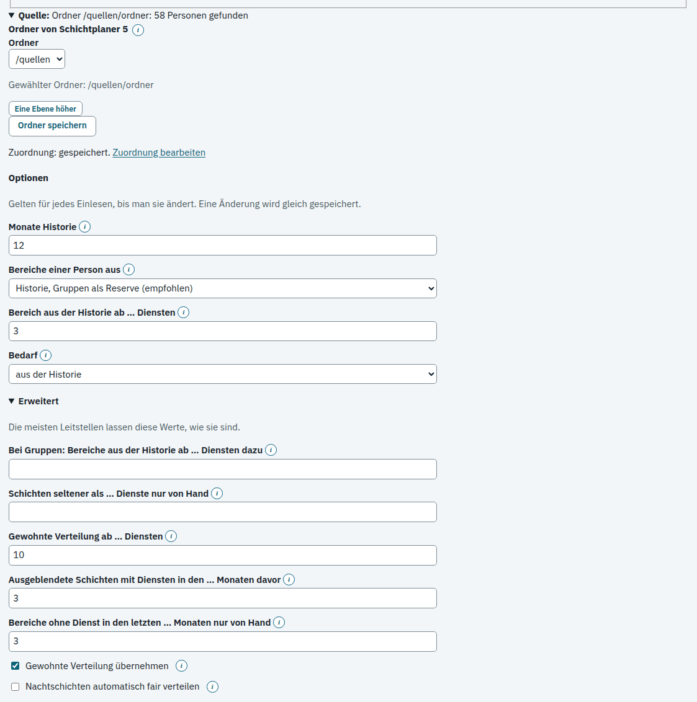
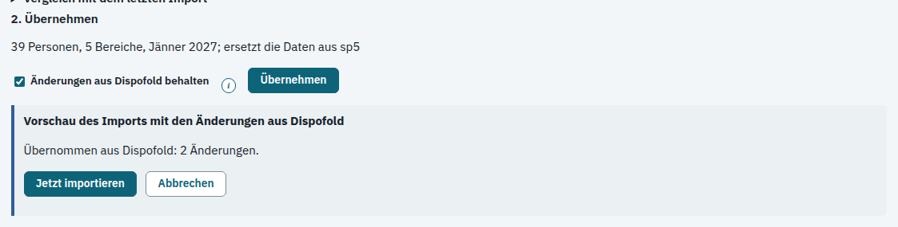

# Schichtplaner 5: Einlesen und Übernehmen

Unter **Daten → Übernehmen** mit der Quelle **Schichtplaner 5** wird aus Schichtplaner 5 eingelesen und
übernommen. Das ist die einzige Stelle dafür. Die Seite hat drei Teile: **Quelle** (Ordner, Zuordnung, Optionen),
**1. Einlesen** (rechnet die Daten und zeigt sie, ändert aber nichts) und **2. Übernehmen** (übernimmt genau das
Eingelesene). Den ganzen Weg beschreibt [Ablauf](plugin-sp5-ablauf.md), den kurzen Weg für den Anfang
[Echte Daten aus Schichtplaner 5](plugin-sp5-echte-daten.md).

Dispofold merkt sich die Quelle: Das nächste Mal öffnet **Daten** gleich hier. Die Seiten **Lauf und Import**,
**Bericht** und **Vergleich** früherer Versionen führen ebenfalls hierher; Bericht und Vergleich stehen jetzt im
Ergebnis des Einlesens.

## Quelle

Ein aufklappbarer Abschnitt. Er ist offen, bis Ordner und Zuordnung eingerichtet sind; danach ist er zu einer Zeile
zugeklappt, etwa „Quelle: Ordner /srv/dispofold/quellen/ordner: 40 Personen gefunden“.

- **Ordner von Schichtplaner 5:** der Datenordner (mit `5EMPL.DBF` und den anderen Tabellen). Am Server sind nur
  die Ordner wählbar, die die IT freigegeben hat (siehe [Betrieb](../betrieb.md#erweiterungen)); am eigenen
  Rechner öffnet **Ordner wählen …** den Ordnerdialog. **Ordner speichern** speichert ihn.
- **Zuordnung:** Die Zeile darunter sagt, ob es eine gibt: „Zuordnung: gespeichert.“ mit dem Link **Zuordnung
  bearbeiten**, oder „Zuordnung: noch keine. Ohne sie kann nichts eingelesen werden.“ mit dem Link **Zuordnung
  einrichten**. Beide führen zu [Daten → Zuordnung](plugin-sp5-zuordnung.md).
- **Optionen:** wie der Import rechnet. Sie gelten für jedes Einlesen, bis man sie ändert; eine Änderung wird
  gleich gespeichert, daneben steht kurz „gespeichert“. Was jede Option tut, sagt ihr „i“ mit einem Beispiel und
  die Tabelle unter [Import aus Schichtplaner 5](plugin-sp5-sp5.md#einschalten-und-einstellen). Was man selten
  braucht, steht unter **Erweitert**.

## 1. Einlesen

- **Erster Monat** und **Letzter Monat:** der Zeitraum, als Monate mit Namen (Jänner 2027). **Letzter Monat** ist
  „nur der erste Monat“ oder bis zu 12 Monate danach. Vorbelegt sind die Monate des letzten Einlesens; gab es noch
  keines, der Monat nach dem letzten abgeschlossenen Monat, ohne abgeschlossenen Monat der gewählte.
- **Einlesen:** liest den Ordner, wendet die Korrekturdatei von Dispofold an und rechnet den Datensatz, mit den
  gespeicherten Optionen. Das ändert noch nichts in Dispofold.

Darunter steht das Ergebnis:

1. Oben ein Satz in einfachen Worten, was man zuerst ansieht: Bereiche ohne Mindestbedarf, Schichten ohne Bereich,
   Zeilen mit rotem Hinweis, danach die Warnungen. Gibt es für Bereiche keinen Mindestbedarf, ist der Satz gelb,
   etwa „für 2 Bereiche gibt es keinen Mindestbedarf: dort würde niemand eingeteilt; die Option Bedarf prüfen“;
   dort würde der Plan niemanden einteilen, also zuerst die Option **Bedarf** prüfen. Nur wenn nichts davon
   zutrifft, heißt es „Der Lauf sieht in Ordnung aus“. Siehe [Bericht](plugin-sp5-bericht.md).
2. „Eingelesen am …“ mit den Monaten und darunter „Mit den Optionen: …“ mit allen Optionen, mit denen gerechnet
   wurde.
3. Die Zahlen: Personen, Bereiche, Schichten, Dienste, Bedarfsregeln, Warnungen, Berichtszeilen und Zeilen der
   Korrekturdatei. Hat die Korrekturdatei Einträge, steht dort „Die Korrekturdatei wurde angewendet“ mit ihrer
   Zahl.
4. Zum Aufklappen: **Bericht** (siehe [Bericht](plugin-sp5-bericht.md)), **Vergleich mit dem letzten Import**
   (siehe [Vergleich](plugin-sp5-lauf-vergleich.md)) und, wenn Kürzel des Ordners keine Regel haben, **Zuordnung:
   … Kürzel ohne Regel** mit der Liste (etwa „Schicht T1“, „Gruppe Projekt“) und dem Link zur Zuordnung.

Das Eingelesene bleibt, bis jemand neu einliest oder der Server neu startet. Danach ist das Ergebnis leer, und bei
**2. Übernehmen** steht „Erst nach dem Einlesen: dann steht hier, was sich ändert.“; dann einfach noch einmal
**Einlesen**.

## 2. Übernehmen

**Übernehmen** geht erst nach dem Einlesen. Darüber steht, was es ändert, etwa „40 Personen, 5 Bereiche, Jänner
2027; ersetzt die Daten aus …“. Übernommen wird genau das Eingelesene, mit seinen Monaten und Optionen, also der
Datensatz, den Bericht und Vergleich zeigen. Eine eigene Rückfrage gibt es nicht.

- **Ordner oder Optionen seit dem Einlesen geändert:** **Übernehmen** ist dann aus, und darüber steht „Seit dem
  Einlesen wurden Ordner oder Optionen geändert: bitte zuerst neu einlesen.“
- **Sonst etwas geändert** (jemand hat neu eingelesen, die Zuordnung oder eine Korrektur in Dispofold): Dispofold
  lehnt das Übernehmen ab; dann neu einlesen, damit Bericht und Vergleich zeigen, was übernommen wird.
- **Änderungen aus Dispofold behalten** anhaken, wenn seit dem letzten Import in Dispofold etwas geändert wurde.
  Die Vorschau zeigt, was übernommen wird, Konflikte und was sich nicht übertragen lässt (siehe
  [Daten und Korrekturdatei](daten.md#neuer-datensatz-änderungen-aus-dispofold-behalten)).

Nach dem Übernehmen steht die Zusammenfassung da, der erste Monat der Daten ist gewählt („Gewählt ist jetzt
Jänner 2027.“ mit **Zum Dienstplan**), und **Bereiche prüfen** führt zur Tabelle aller Personen und Bereiche (siehe
[Bereiche aller Personen](personen.md#bereiche-aller-personen)): Dort sieht man auf einen Blick, wer wo planbar,
nur von Hand oder nie ist, und ändert es für viele auf einmal.

### Ein Monat ist abgeschlossen

Ist ein Monat des Eingelesenen schon abgeschlossen, steht über **Übernehmen** ein Hinweis mit dem nächsten
Schritt: Ändert der Import einen abgeschlossenen Monat, lehnt Dispofold ihn ab. Dann einen späteren ersten Monat
wählen und neu einlesen, oder den Monat unter **Daten → Monate** wieder öffnen (mehrere: den neuesten zuerst) und
dann übernehmen. Der Link **Unter Daten → Monate wieder öffnen** führt dorthin (siehe
[Monate](daten.md#monate)).

### Noch keine Korrekturen

Gibt es noch gar keine Korrekturen (keine geladene Korrekturdatei, keine Änderung in Dispofold), steht über
**Übernehmen** ein Hinweis mit dem Weg zu **Daten → Sichern**,
[Korrekturdatei laden](daten.md#korrekturdatei-laden). Wer bisher mit `sp5_export.py --corrections` exportiert
hat, lädt seine `korrekturen.json` dort einmal vor dem ersten Übernehmen.

## Ergebnis als Dateien speichern

Unter **Daten → Sichern**, **Für Fachleute** speichert **Ergebnis als Dateien speichern** (mit eigenem ersten und
letztem Monat, Knopf **Ergebnis speichern**) Datensatz, Bericht und Warnungen eines Exports als ZIP-Datei, für den
Vergleich mit dem früheren Exportprogramm (siehe
[Technik und Vergleich mit sp5-export](plugin-sp5-technik.md#vergleich-mit-echten-daten)). Die Datei enthält
personenbezogene Daten.
