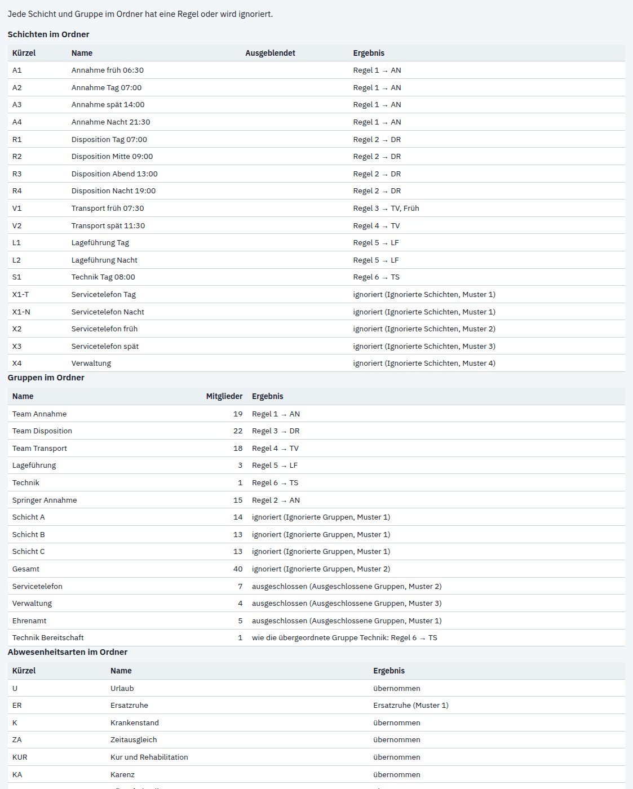

# Schichtplaner 5: Zuordnung

Die Seite **Schichtplaner 5 → Zuordnung** bearbeitet die Zuordnung: welche Schichten, Gruppen und Abwesenheiten
von Schichtplaner 5 zu welchen Bereichen von Dispofold gehören. Sie ist dieselbe Zuordnung wie in den
Einstellungen der Erweiterung und hat dasselbe Format wie eine `mapping.json`.

## Abschnitte

- **Bereiche:** die Bereiche, die der Import anlegt, mit Id (kurz, etwa `AN`), Name und Farbe.
- **Schichtregeln:** ordnen Schichten nach ihrem Kürzel einem Bereich zu; die erste passende Regel gilt.
  **Kategorie** leer heißt: aus den Zeiten der Schicht; **Unbeliebt** leer: Nachtschichten sind unbeliebt. Die
  Spalte **Trifft** zeigt die Kürzel aus dem Ordner, die die Regel trifft, oder „trifft nichts“.
- **Ignorierte Schichten:** Schichten, die der Import nicht übernimmt, auch wenn eine Regel passt.
- **Gruppen:** Personen in einer Gruppe, deren Name passt, bekommen die angekreuzten Bereiche.
- **Ignorierte Gruppen** geben keine Bereiche; **Ausgeschlossene Gruppen**: ihre Personen übernimmt der Import
  nicht.
- **Ersatzruhe** und **Ignorierte Abwesenheiten:** Kürzel von Abwesenheitsarten.
- **Dienste auf ignorierten Schichten:** ob ein solcher Dienst den Tag als Abwesenheit sperrt (Vorgabe: ja).
- **Unbekannte Schlüssel** bleiben beim Speichern erhalten; der Export weist eine Zuordnung mit ihnen aber ab.

Muster: `*` und `?` als Platzhalter (Groß- und Kleinschreibung zählt), oder `re:` und ein regulärer Ausdruck, der
am Anfang des Kürzels passen muss.

## Bearbeiten

- Jeder Abschnitt hat **… hinzufügen**; jede Zeile hat Knöpfe zum Verschieben nach oben und unten und zum
  Entfernen, auch mit der Tastatur erreichbar.
- **Prüfung:** Nach jeder Änderung prüft der Server die Zuordnung wie der Export und nennt jedes Problem mit
  Liste und Eintragsnummer, etwa „shifts, Eintrag 2: Muster 're:(' ist kein gültiger regulärer Ausdruck“.
- **Zuordnung speichern** speichert sie in den Einstellungen; der Server prüft sie dabei noch einmal und weist
  eine fehlerhafte ab. Ungespeicherte Änderungen sind markiert, und beim Verlassen der Seite fragt Dispofold nach.
- **mapping.json laden** ersetzt die Zuordnung im Editor durch eine Datei, **Als mapping.json speichern**
  speichert sie als Datei. **JSON anzeigen und bearbeiten** zeigt sie als Text; **Übernehmen** ersetzt den Editor
  damit.

## Im Ordner

Die Tabellen **Schichten im Ordner**, **Gruppen im Ordner** und **Abwesenheitsarten im Ordner** zeigen alles aus
dem Ordner von Schichtplaner 5 und was die Zuordnung im Editor damit macht: welche Regel gilt („Regel 3 → AN,
Früh“), dass es ignoriert oder ausgeschlossen wird, dass eine Gruppe ohne eigene Regel die der übergeordneten
Gruppe übernimmt, oder „keine Regel“. Darunter stehen die Kürzel ohne Regel, die nicht ignoriert werden: Sie
werden nicht importiert, und der Lauf warnt.

