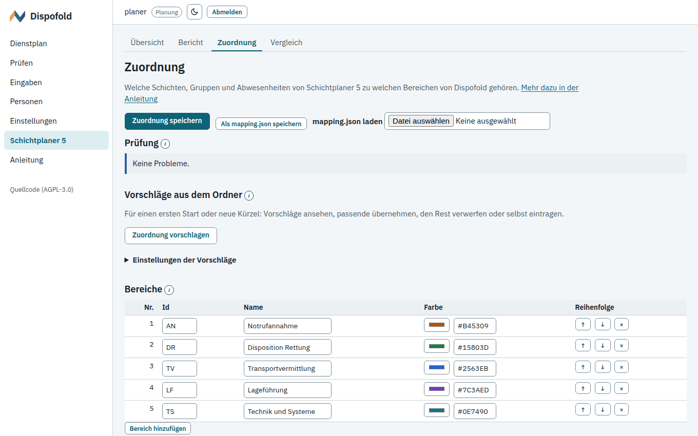
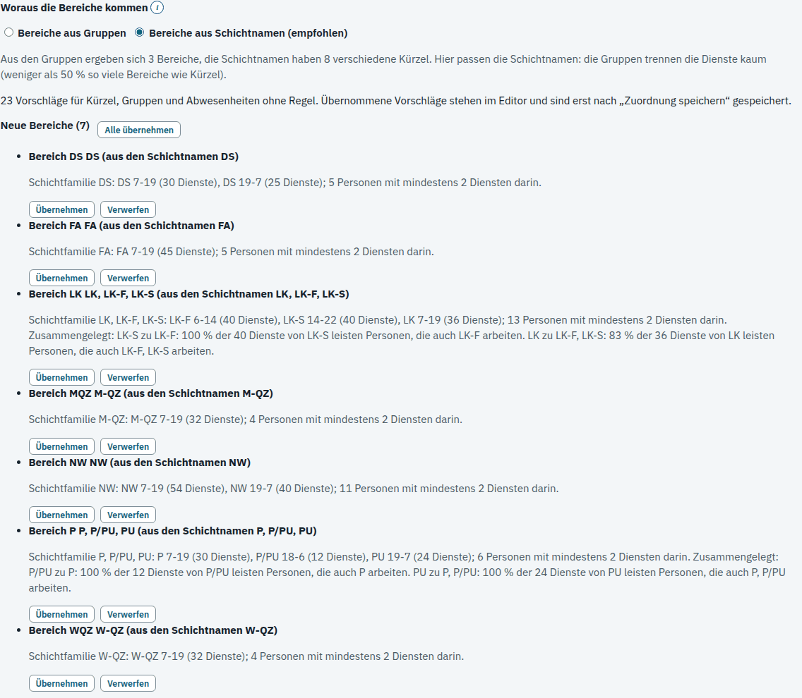

# Schichtplaner 5: Zuordnung

Die Seite **Schichtplaner 5 → Zuordnung** bearbeitet die Zuordnung: welche Schichten, Gruppen und Abwesenheiten
von Schichtplaner 5 zu welchen Bereichen von Dispofold gehören. Sie ist dieselbe Zuordnung wie in den
Einstellungen der Erweiterung und hat dasselbe Format wie eine `mapping.json`. Für den Anfang reicht
**Zuordnung vorschlagen** (siehe [Vorschläge aus dem Ordner](#vorschläge-aus-dem-ordner)); fehlt die Zuordnung
noch, führt der Hinweis „Die Zuordnung fehlt“ auf der Seite Lauf und Import mit **Zur Zuordnung** hierher.

Die Seite ist lang; oben führen Links zu jedem Abschnitt, von den Vorschlägen bis **Im Ordner**.

## Abschnitte

Die Zuordnung übersetzt Schichtplaner 5 in Dispofold: welche Arbeitsplätze getrennt geplant werden (Bereiche),
welcher Dienstcode zu welchem Bereich gehört (Schichtregeln), welche Gruppe wo arbeiten darf (Gruppen) und welche
Abwesenheit die Ersatzruhe ist. Dieselben Sätze stehen auf der Seite über jedem Abschnitt.

- **Bereiche:** Arbeitsplätze, die getrennt besetzt werden. Der Import legt sie als Bereiche an, mit Id (kurz,
  etwa `AN`), Name und Farbe.
- **Schichtregeln:** ordnen Schichten nach ihrem Kürzel einem Bereich zu; die erste passende Regel gilt.
  **Kategorie** leer heißt: aus den Zeiten der Schicht; **Fair verteilen**: Dienste dieser Schicht werden über die Fairness gleichmäßig auf alle verteilt, die
  sie machen können; ohne Angabe nein, Nachtschichten nur mit der Option „Nachtschichten automatisch fair verteilen“
  (Lauf und Import, Optionen). Die
  Spalte **Trifft** zeigt die Kürzel aus dem Ordner, die die Regel trifft, oder „trifft nichts“.
- **Ignorierte Schichten:** Schichten, die der Import nicht übernimmt, auch wenn eine Regel passt.
- **Gruppen:** Wer darf in welchem Bereich arbeiten? Personen in einer Gruppe, deren Name passt, bekommen die
  angekreuzten Bereiche. Sammelgruppen, in denen fast alle sind, werden ignoriert.
- **Ignorierte Gruppen** geben keine Bereiche; **Ausgeschlossene Gruppen**: ihre Personen übernimmt der Import
  nicht.
- **Ersatzruhe** und **Ignorierte Abwesenheiten:** Kürzel von Abwesenheitsarten.
- **Dienste auf ignorierten Schichten:** ob ein solcher Dienst den Tag als Abwesenheit sperrt (Vorgabe: ja).
- **Unbekannte Schlüssel** bleiben beim Speichern erhalten; der Export weist eine Zuordnung mit ihnen aber ab.

Muster: `*` und `?` als Platzhalter (Groß- und Kleinschreibung zählt), oder `re:` und ein regulärer Ausdruck, der
am Anfang des Kürzels passen muss.

## Bearbeiten

- Jeder Abschnitt hat **… hinzufügen**; jede Zeile hat Knöpfe zum Verschieben nach oben und unten und zum
  Entfernen, auch mit der Tastatur erreichbar.
- **Prüfung:** Nach jeder Änderung prüft der Server die Zuordnung wie der Export und nennt jedes Problem mit dem
  Eintrag, wie ihn die Seite nennt, etwa „Es ist noch kein Bereich eingetragen.“ oder „Schichtregel 2: Das Muster
  „re:(“ ist kein gültiger regulärer Ausdruck (…).“
- **Zuordnung speichern** speichert sie in den Einstellungen; der Server prüft sie dabei noch einmal und weist
  eine fehlerhafte ab. Ungespeicherte Änderungen sind markiert, und beim Verlassen der Seite fragt Dispofold nach.
- **mapping.json laden** ersetzt die Zuordnung im Editor durch eine Datei, **Als mapping.json speichern**
  speichert sie als Datei. **JSON anzeigen und bearbeiten** zeigt sie als Text; **Übernehmen** ersetzt den Editor
  damit.

## Vorschläge aus dem Ordner

Fast alles, was die Zuordnung braucht, steht schon im Ordner von Schichtplaner 5: die Gruppen, ihre Mitglieder,
der Bedarf je Gruppe und die Dienste. **Zuordnung vorschlagen** liest das und schlägt Einträge vor, für alles, was
die Zuordnung im Editor noch nicht trifft (in **Im Ordner** „keine Regel“). Bei einer leeren Zuordnung ist das eine
ganze erste Zuordnung. Bestehende Einträge ändert ein Vorschlag nie.

Jeder Vorschlag nennt seinen Grund mit den Zahlen dahinter. So liest man ihn: „14 von 15 Mitgliedern mit Diensten
(93 %) haben Dienste im Bereich NW“ heißt, fast alle aus dieser Gruppe, die im Zeitraum gearbeitet haben, hatten
Dienste in NW; die Gruppe gehört also dorthin. Je näher an 100 %, desto sicherer. Im Zweifel übernimmt man einen
Vorschlag nicht, sieht unter [Im Ordner](#im-ordner) nach, welche Kürzel und Gruppen es gibt, und trägt die Regel
selbst ein.

**Übernehmen** trägt ihn in den Editor ein,
**Verwerfen** nimmt ihn aus der Liste, **Alle übernehmen** nimmt alle eines Abschnitts. Gespeichert wird erst mit
**Zuordnung speichern**, mit derselben Prüfung wie sonst. Ein verworfener Vorschlag kommt nicht wieder, bis man
**Verworfene zurücksetzen** wählt. Nach jedem Lauf nennt die Seite Lauf und Import die Zahl der neuen Vorschläge mit einem
Link hierher.

### Woraus die Bereiche kommen

Über den Vorschlägen steht die Wahl **Bereiche aus Gruppen** oder **Bereiche aus Schichtnamen**, die passende als
„(empfohlen)“ markiert und darunter der Grund:

- **Aus Gruppen** passt, wenn die Gruppen in Schichtplaner 5 die Arbeitsplätze trennen (Team Annahme, Team
  Disposition …): Eine Gruppe mit eigenen Schichten wird ein Bereich. So entstehen die Vorschläge im nächsten
  Abschnitt.
- **Aus Schichtnamen** passt, wenn wenige Sammelgruppen fast alle enthalten und die Arbeitsplätze nur an den Namen
  der Schichten zu erkennen sind: `NW 7-19` und `NW 19-7` gehören zu NW. Siehe
  [Bereiche aus Schichtnamen](#bereiche-aus-schichtnamen).

Empfohlen sind die Schichtnamen, wenn die Gruppen weniger Bereiche ergeben als die Hälfte der verschiedenen
Anfänge der Schichtnamen (Einstellung **Schichtnamen empfehlen unter**). Der Anfang ist das Kürzel vorn ohne
Variante nach `-` oder `/` und ohne Ziffern am Ende: `LK`, `LK-F` und `LK-S` sind ein Anfang, `A1` und `A2` auch.
Beispiel: „Aus den Gruppen ergeben sich 3 Bereiche, die Schichtnamen haben 8 verschiedene Anfänge. Hier passen die
Schichtnamen: die Gruppen trennen die Dienste kaum (weniger als 50 % so viele Bereiche wie Anfänge).“ Die Wahl gilt, bis man die Seite verlässt; jedes
erneute **Zuordnung vorschlagen** nimmt dieselbe Grundlage.

### Bereiche aus Gruppen

So entstehen die Vorschläge aus den Gruppen (die Beispiele stammen aus einem erfundenen Ordner):

- **Dienste:** Gezählt werden die Dienste im Ordner, auch die aus Dienstzyklen, im gewählten Zeitraum; „alle“
  reicht bis zum neuesten Dienst oder bis heute, was später ist. Zu einer Gruppe gehören auch die Mitglieder ihrer
  Untergruppen. Eine Schicht ohne Kürzel und eine Schicht, die nur Personen ohne Gruppe gemacht haben, bekommen
  keinen Vorschlag.
- **Bedarf zuerst:** Der Bedarf in Schichtplaner 5 verbindet eine Schicht direkt mit Gruppen. Hat nur eine Gruppe
  Bedarf für die Schicht, gehört die Schicht zu ihr. Beispiel: „R1: Bedarf in Schichtplaner 5 nur bei der Gruppe
  Team Disposition. Mitglieder der Gruppe Team Disposition (Bereich TD) haben 100 % der 42 Dienste.“ Haben mehrere
  Gruppen Bedarf oder keine, entscheidet, wessen Mitglieder den größten Teil der Dienste gemacht haben.
  Sammelgruppen zählen dabei nicht.
- **Bereiche:** Eine Gruppe, der so eine Schicht gehört, wird ein neuer Bereich, mit einer Id aus ihrem Namen
  (Team Annahme → `TA`, änderbar) und einer Farbe. Beispiel: „Gruppe Team Annahme mit 68 von 71 Mitgliedern mit
  Diensten; eigene Schichten A1, A2, A3, A4.“
- **Schichtregeln:** Eine Schicht kommt in den Bereich, wenn die Mitglieder seiner Gruppen mindestens den
  **Anteil** ihrer Dienste gemacht haben, Standard 80 %. Darunter stehen die zwei stärksten Bereiche zur Wahl, und
  man wählt selbst. Beispiel: „Kein Bereich erreicht 80 % der 4 Dienste: TA 50 %, TD 50 %. Bitte wählen.“ Die
  Regeln nennen genau das Kürzel; ein Muster wie `A*` kann man danach selbst daraus machen.
- **Gruppen:** Die Gruppe eines neuen Bereichs bekommt diesen Bereich. Eine Gruppe ohne eigene Schicht kommt in
  den Bereich, in dem mindestens der Anteil ihrer Mitglieder mit Diensten gearbeitet hat. Beispiel: „40 von 45
  Mitgliedern mit Diensten (89 %) haben Dienste im Bereich TA.“ Eine Untergruppe unter einer Gruppe mit Bereich
  übernimmt deren Regel und bekommt keinen Vorschlag.
- **Sammelgruppen ignorieren:** Verteilen sich die Mitglieder auf zwei oder mehr Bereiche, und keiner erreicht
  den Anteil, ist die Gruppe eine Sammelgruppe (etwa „alle“ oder eine Schichtgruppe quer durch die Bereiche).
  Beispiel: „Sammelgruppe: die 147 Mitglieder mit Diensten verteilen sich auf die Bereiche TA (64 %), TD (46 %),
  TT (25 %).“ Eine Obergruppe über Gruppen mit verschiedenen Bereichen wird ebenso ignoriert, auch eine Gruppe
  ohne Mitglieder oder ohne Dienste.
- **Schichten ignorieren:** in Schichtplaner 5 ausgeblendete Schichten, Schichten ohne Dienste und Schichten mit
  weniger Diensten als die Grenze (Standard 3). Das gilt nur für Schichten ohne Bedarf: Eine Schicht mit Bedarf
  ist in Gebrauch, auch wenn sie im Zeitraum selten oder gar nicht vorkam. Beispiel: „Nur 2 Dienste im Zeitraum
  (weniger als 3) und kein Bedarf.“
- **Ersatzruhe:** die Abwesenheitsart, deren Name oder Kürzel eines der Wörter enthält (Standard „Ersatzruhe“).
  Passen keine oder mehrere, gibt es keinen Vorschlag.

### Bereiche aus Schichtnamen

- **Kürzel:** der Teil eines Schichtnamens vor dem ersten Leerzeichen oder vor einer Uhrzeit am Ende: `NW 7-19` und
  `NW7-19` → `NW`, `LK-F 6-14` → `LK-F`, `P/PU 18-6` → `P/PU`. Ein Name ohne beides ist selbst das Kürzel (`A1`).
  Je Kürzel eine Schichtfamilie; ausgeblendete und seltene Schichten werden wie sonst zum Ignorieren vorgeschlagen.
- **Zusammenlegen:** Eine Person arbeitet eine Familie, wenn sie dort mindestens 2 Dienste hat (Einstellung
  **Arbeitet eine Familie ab … Diensten**). Zwei Familien mit verwandtem Namen (derselbe Anfang vor `-` oder `/`,
  etwa `LK`, `LK-F` und `LK-S`, oder eines Teil des anderen, etwa `P/PU` und `PU`) werden eins, wenn Personen,
  die auch die größere arbeiten, mindestens 70 % der Dienste der kleineren gemacht haben (Einstellung
  **Schichtfamilien zusammenlegen ab**). Bei Namen ohne gemeinsamen Anfang muss das in beide Richtungen gelten.
  Beispiel: „LK zu LK-F, LK-S: 83 % der 36 Dienste von LK leisten Personen, die auch LK-F, LK-S arbeiten.“ Familien
  mit verschiedenem Personal bleiben getrennt, auch bei ähnlichem Namen (`M-QZ` und `W-QZ`), und ein paar
  Springer, die zwei Familien gelegentlich arbeiten, legen sie nicht zusammen.
- **Bereiche:** Jede Familie wird ein Bereich mit dem Kürzel als Id (`NW`; bei Varianten der gemeinsame Anfang,
  `LK`; ein Kürzel mit mehr als 6 Zeichen wird abgekürzt) und den Kürzeln als Name. Der Grund nennt die Schichten
  mit ihren Diensten: „Schichtfamilie NW: NW 7-19 (54 Dienste), NW 19-7 (40 Dienste); 11 Personen mit mindestens 2
  Diensten darin.“ Gehören Schichten der Familie schon zu einem Bereich der Zuordnung, kommt die Familie dorthin
  (bei mehreren in den mit den meisten Diensten); so bleibt sie beisammen, wenn man ihre Regeln einzeln übernimmt,
  und eine neue Variante wie `LK-N` kommt zu `LK`, wenn dieselben Leute sie arbeiten.
- **Schichtregeln:** je Kürzel ein Muster, `NW *` für alle Namen, die mit NW und einem Leerzeichen beginnen. Der
  Grund nennt, was es heute trifft: „Deckt heute NW 7-19 (54 Dienste), NW 19-7 (40 Dienste).“ Fängt das Muster
  auch eine ausgeblendete oder seltene Schicht, sagt der Grund das; deren eigener Vorschlag ignoriert sie. Würde
  ein Muster eine Schicht einer anderen Familie treffen, stehen stattdessen die genauen Kürzel da.
- **Gruppen:** Eine Gruppe bekommt jeden Bereich, in dem mindestens der Anteil ihrer Mitglieder mit Diensten
  gearbeitet hat (Standard 80 %). Verteilen sich die Mitglieder auf zwei oder mehr Bereiche und erreicht keiner den
  Anteil, ist sie eine Sammelgruppe und wird ignoriert, wie oben.

### Schichten ohne Platz im Dienstplan

In beiden Grundlagen wird eine Schicht zum Ignorieren vorgeschlagen, wenn ihr Kürzel keinen Zeitraum wie `7-19` oder
`5:20-15:20` hat und sie in Schichtplaner 5 keinen Bedarf hat. Das sind meist Dinge, die nicht im Dienstplan
besetzt werden: Ausbildung, Home-Office, die Leitung eines anderen Dienstes. Beispiel: „Kein Zeitraum im Kürzel,
kein Bedarf in Schichtplaner 5, 40 Dienste: vermutlich kein Platz im Dienstplan, etwa Ausbildung.“ Ein Kürzel ohne
Zeitraum, aber mit Bedarf (etwa ein Tag- und ein Nachtdienst der Einsatzleitung) bleibt ein Dienst, ebenso ein
Kürzel mit Zeitraum ohne Bedarf. Solche Schichten bilden keine Familie und zählen nicht für die Empfehlung. Hat der Ordner gar keinen Bedarf
eingetragen (der Bedarf kommt dann aus der Historie), sagt das Fehlen nichts, und die Regel greift nicht. Trifft
die Regel einen echten Arbeitsplatz, dessen Kürzel keinen Zeitraum und keinen Bedarf hat, verwirft man den
Vorschlag oder trägt eine Regel ein; ganz abschalten lässt sie sich mit **Schichten ohne Zeitraum und ohne Bedarf
ignorieren**.

Was der Ordner nicht wissen kann, entscheidet man selbst: ob eine Gruppe wie ein Servicetelefon oder die
Verwaltung überhaupt in den Plan gehört (dann ausschließen statt übernehmen), und die Kategorie einer Schicht
(leer heißt: aus ihren Zeiten).

**Einstellungen der Vorschläge** (unter der Schaltfläche, gespeichert mit **Einstellungen speichern**):

| Einstellung | Standard | Wirkung |
|---|---|---|
| Anteil für eine Schicht | 80 % | ab diesem Anteil der Dienste ein Bereich, darunter die Wahl; derselbe Anteil für Gruppen ohne eigene Schicht |
| Seltene Schicht: weniger Dienste als | 3 | eine Schicht ohne Bedarf mit weniger Diensten wird ignoriert |
| Zeitraum in Monaten | 0 (alle) | nur die Dienste der letzten Monate bis zum neuesten Dienst |
| Wörter für die Ersatzruhe | Ersatzruhe | durch Komma getrennt, ohne Groß- und Kleinschreibung |
| Schichtfamilien zusammenlegen ab | 70 % | nur aus Schichtnamen: ab diesem Anteil werden zwei Familien ein Bereich |
| Arbeitet eine Familie ab … Diensten | 2 | nur aus Schichtnamen: ab so vielen Diensten zählt eine Person zu einer Familie |
| Schichtnamen empfehlen unter | 50 % | Schichtnamen empfohlen, wenn die Gruppen weniger Bereiche ergeben als dieser Anteil der Anfänge |
| Schichten ohne Zeitraum und ohne Bedarf ignorieren | an | ohne Zeitraum im Kürzel und ohne Bedarf: als „ignorieren“ vorgeschlagen; aus wie in 0.24.0 |

## Im Ordner

Die Tabellen **Schichten im Ordner**, **Gruppen im Ordner** und **Abwesenheitsarten im Ordner** zeigen alles aus
dem Ordner von Schichtplaner 5 und was die Zuordnung im Editor damit macht: welche Regel gilt („Regel 3 → AN,
Früh“), dass es ignoriert oder ausgeschlossen wird, dass eine Gruppe ohne eigene Regel die der übergeordneten
Gruppe übernimmt, oder „keine Regel“. Darunter stehen die Kürzel ohne Regel, die nicht ignoriert werden: Sie
werden nicht importiert, und der Lauf warnt.

